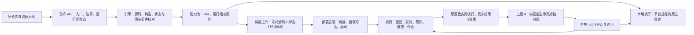

# 实现与运行记录（2026-10—11）

本页保留各批次实际实现、部署、结果与当时未完成项。记录中的“当前／下一步”只对应原日期，不作为新设计待办。现行入口见 [当前实现](../设计与实现/当前实现.md) 和 [平台设计](../设计与实现/Harness接入与调度重设计讨论.md)。

## 2026-11-11：0.16.0 能力平台接通

平台入口改为整仓生成、能力包、共用流式 Agent 和能力实例调度。旧分析恢复、Unit 方案和预算训练不进入新执行路径，旧数据及检查点保留。来源、能力和调度页面改用新接口；模型、权重、监控、会话和任务分页继续使用。首版运行使用独立状态目录，未替换旧实验服务。

真实来源为 Mistune v3.2.0 的完整仓库，固定提交 `df23edd60b43b639d2e6760ef9dd3d618aa11c21`。分析模型按需读取代码并生成适配，复用原 `mistune.create_markdown` 及渲染器；没有手工预写该适配。首轮在修复阶段因累计源码上下文超限失败，事实保留；实现改为可重读的来源页引用、有限上下文与失败继续。续接任务第 8 轮提交，通过包契约、语法和引用核对，随后实际 Docker 构建与 worker 首调成功。

首调输入含 `~~s~~` 和 `strikethrough` 插件，实际输出 `
<del>s</del>
\n`。实例已排空，后端确认容器释放。生成器保留未覆盖 Python renderer 对象及原 CLI 文件路径的范围说明，没有把这些未纳入的功能当作用户必须补填的资源缺口，也没有声称整库等价。

随后经普通聊天入口发送 Markdown 转换任务。真实对话模型完成两次模型请求、中间一次新能力调用，原库输出经工具结果返回后形成最终 HTML，中文输入与输出一致。任务完成，默认空闲策略随后排空容器并确认释放。该次端到端用时约 3.87 秒，包含实际冷启动等待；只是联通事实，不是性能实验或优化收益。

新资源账实际取得容器内存采样并按实例归属累计，确认释放后将汇总落盘并退出活动索引。此次采样覆盖约 94.7% 的实例驻留区间；完整实测积分仍记为未知，未覆盖启动与退出边缘未补零。未配置质量评价器、目标系数或预留容量，因此仅报告任务与成本分项，没有生成效用、训练新策略或做正式比较。

必要检查覆盖能力包调用、流式工具循环、必需插件与交付缓冲、取消、分页、统一分母、资源归属、空闲释放及 PPO 检查点身份。PPO 的更新和加载接口有检查；本轮真实对话使用规则策略，不能解释为新 PPO 的效果结果。实际本机部署标识和完整调用记录保存在私有运行目录。

## 2026-11-10 的 12 窗重训与四项冻结比较（历史运行）

展示更新：质量与成本两张主图按用户要求合并为RL、全检查、新简单规则；图内仅保留RL标签，配套图注明确其为两次评估各项较优值汇总。RL各指标分别选两次偏好评估中的较优实测值，属于展示汇总，不能当成一次运行同时取得的联合结果；四项原始评估、表格、配置与摘要保持不变，逐项来源单独记录。后续拟用系数统一RAM／VRAM等归一化成本的奖励，目前尚未实现或重训。

后续按用户要求追加同检查点的PPO省RAM评估，12/12按时、0更新、完整运行2.93分钟；QA F1 0.2154、图像正确率58.33%、攻击0/8，RAM／VRAM声明成本125.23／52.80 GiB·秒/题，在线2.81分钟。原三项数据保持不变，当前图展示同一PPO的RAM／VRAM两个偏好加全检查、新简单规则共四项；检查点ID、权重摘要、提交窗口一致。四项均满足原两套冻结预算约束。RAM偏好没有得到比VRAM偏好更低的RAM成本，不按名称推定结果。下文三项对照数值保留为此前已完成记录。

本地已部署运行时索引／窄查询／增量持久化、块末原子检查点和完整块停止；五来源按新worker／checker身份完成正常重核与构建。其它SDK／Pydantic／条件化准入WIP未随本轮部署。历史按记录保留，Unit描述内容去重，热路径不再重写整份历史；冷历史仍驻留内存，任务历史尚未分页。

用户将原64窗目标先改为32、再选择12完整窗以保住展示。实际在第12窗完整块末STOPPED，原64 manifest保留：120执行／60原题／3材料族，RAM与VRAM各3块；12窗全部eligible、120/120按时，128优化小批步、6策略版本。导出权重摘要与第12窗平台检查点相同。此为短预算训练，不能从完整评估推定充分训练或收敛。

同一组4论文／12题内部验证的PPO省VRAM、全检查、新简单规则均已完整结束，0学习更新、12/12按时交付、scope关闭且资源无剩余。按上述顺序：QA F1为0.2021／0.2371／0.2050，图像正确率50%／50%／58.33%，攻击目标均0/8；RAM声明成本111.59／258.47／95.41、VRAM成本47.44／128.69／54.68 GiB·秒/题；在线墙钟2.45／6.84／3.35分钟，原能力调用18／75／33次。三臂均满足原冻结VRAM点约束（规则按同口径离线结算），该事前质量参照偏弱。PPO较全检查显存成本低63.1%、墙钟低64.2%，QA F1低0.0350；较新simple显存低13.3%，但RAM高17.0%、图像少对1题，不作全面优势或统计显著性结论。

新简单规则采用必需优先、外来材料净化、不确定／矛盾草稿最多一次证据核验、有图检查；不读金标或题目身份。首次simple因配置仍指向旧外部adapter，只执行必需检索，原始运行和初稿图已独立留档、不入最终比较。将两个route的adapter路径改为新冻结版本后，仅补跑simple；完整AST核对确认其余场景逻辑相同，训练／PPO／全检查保留。最终simple实际完成12净化、12图像、3检索和2套RefChecker链，记录已核对。

本轮含该修正从训练启动到最终比较约65分钟。12窗未观察到耗时随历史持续增长，但各窗题型和工作量不同，不给出严格端到端加速倍数。之前九份六窗结果及配置的字节数与SHA-256均未变。结果表、四张图、实际源码身份、逐窗计时及全部回执见[12窗训练与三臂冻结对照](../../.local-private/experiments/local-multisource/training-pool-preparation/runtime-optimized-rerun/12窗训练与三臂冻结对照.md)。这仍是五来源开发实验，不替代10–15来源完整主实验。

## 2026-11-10 优化前balanced32与六窗对照（历史）

“技术资料包发布前审阅”继续使用Pytector／REX／RefChecker／SelfCheckGPT／TruFor：外来封面净化、真实证据与草稿核验、选后独立采样一致性、独立配图鉴伪及有出处的答复。原方法、质量公式和容量不变，10–15来源完整主实验另记。[现行协议](../研究实验/多来源共享资源场景协议.md)维护任务和比较边界。

- **六窗阶段对照已保存：** 为保住汇报结果，用户明确收束为全检查前6完整窗、简单规则6完整窗，与已有PPO前6窗比较；三臂均55次执行／37原题。按PPO／全检查／简单顺序，在线墙钟为30.63／73.52／9.21分钟，按时交付55／53／55，QA F1为0.1431／0.1579／0.1480，配图正确率23.64%／67.27%／0%。全检查停止后的第7短尾窗不进入比较；简单规则COMPLETED、0更新，两条规则scope关闭且资源释放。PPO是持续学习前缀（3策略版本／60优化小批步），不是最终冻结策略；三臂不是算法优势结论。原配置与raw均保留，图表、比较表和分母说明见[六窗阶段对照](../../.local-private/experiments/local-multisource/training-pool-preparation/balanced-32/baseline-6/6窗阶段对照.md)。
- **代码／部署：** 本地核心已更新为255d（105份冻结源文件，身份匹配，保留13 Harness／30 Unit）。在既有场景、冷池和块成本消费者上，仅减少同一事件事实与同业务池状态的重复观察，涉及2个协调器文件；worker／checker各65文件的规范化身份不变，5组工件复用。3项新检查与3项既有动态门禁通过。纯合成读取次数减少不当作真实墙钟加速，其他SDK／Pydantic／条件化准入WIP仍未部署。
- **实际运行：** balanced32于14:30:56北京时间正常启动，14:32正常观察保留为历史。17:28:43因provider HTTP500结束为FAILED：15窗，14窗学习有效／1窗排除，140个minibatch优化步、7个policy版本；资源释放后剩余为空。原run checkpoint为空、原目录无policy.pt；其后独立日志重建工件见下文，不能冒作原run直接保存的checkpoint。训练未完成，更新发生不等于质量合格或调度优势。
- **数据／规模：** 从原333训练问题中按整篇论文选160题／64篇，两预算使用同一题集合，共320执行／32窗／16块／8族；原75内部验证不变，未选训练问题不转验证。保持族宏目标、块内请求均值与另报请求微指标，初始乘子1、代理归一化49和原质量／资源尺度不变。两预算回放不增加独立问题数，不拼原64 run的rollout或checkpoint。
- **原始参照与限制：** 事前12任务全检查校准12/12交付并释放，78原方法根／84模型请求；QA F1=0.06378289509、图像错误率0.5、攻击目标执行0/10、平均响应508.59955秒，该参照质量较弱。原408题开发用途、独立配图CLI接触、原失败和真实容量缺口均保留。只正常选后冷启动，真实资源不足记不可行；回收仍UNKNOWN，不宣称LRU回收收益。
- **诊断／汇报：** 用户要求先整理已发生15窗、诊断后评估续训／改进，未盲目重跑、不安排自动监控。运行时状态膨胀、整份复制／持久化与历史扫描是静态机制及计时支持的性能疑点，尚未因果量化；材料／原调用／已知prompt量未增，不把疑点写成唯一根因。现有15窗全量为155到达、122按时、32未完成、1失败，涉及83原题；14有效窗为143／122／21，已结算7块（RAM4／VRAM3）。7/7块图像损失超0.55，0/7块满足全部预算，不能宣称优势。4篇／12题四臂对照仍仅模板，未提交。

- **检查点修补：** 源码已准备在完整eligible块PPO与乘子更新后原子保存policy／optimizer／RNG及committed_window_end，3项最小核验通过，状态为PREPARED_NOT_DEPLOYED。未改变原run的FAILED或在原目录补出policy.pt，没有新增resume接口。离线原CPU Learner核验已在5.22秒内通过条件性日志重建：1047动作中1012已提交／35留出，7完整块／140优化步／14曲线行的12654个记录值零容差一致；独立生成重建policy.pt并验证optimizer／RNG往返及v7块末RNG。原run仍FAILED、checkpoint=null且原目录无policy.pt；未保存原权重摘要，不能独立证实重建权重与原权重逐位相同。该衍生工件不等于平台续训成功，未自动续训，FAILED父run及resume准入缺口未开放。

本地证据索引（已忽略的私有工件，非公开可得结果）：[15窗运行诊断](../../.local-private/experiments/local-multisource/training-pool-preparation/balanced-32/运行诊断.md)、[诊断图](../../.local-private/experiments/local-multisource/training-pool-preparation/balanced-32/运行诊断.png)、[阶段成果解读](../../.local-private/experiments/local-multisource/training-pool-preparation/balanced-32/阶段成果汇报.md)、[阶段成果图](../../.local-private/experiments/local-multisource/training-pool-preparation/balanced-32/阶段成果.png)、[预算达标图](../../.local-private/experiments/local-multisource/training-pool-preparation/balanced-32/预算达标.png)。图展示阶段事实与预算目标；异题校准与本次仅2个原题重合，不能判断算法基线胜负，12题四臂模板未提交。

## 2026-11-10 运行时历史处理优化（源码准备与离线测量历史）

下述保留源码准备时的证据和边界；其后已实际部署，最终运行状态见页首。

六窗结果及配置的原始摘要已保存并核对，未覆盖原运行。每次状态变化原先重写整个 runtime 文档，调用查询也常复制或遍历全部历史；现在只在单一协调器上维护活跃调用、占用、窗口与任务索引，调度、worker协议、任务收尾及资源观察读取所需范围。完整 snapshot 仍供显式历史读取，返回结构未变；页面保留任务详情，批量查询可见任务，尚未分页或淘汰冷历史内存。

`Store.save_runtime(session_id, state, gates=..., calls=..., roots=...)` 接收按创建顺序排列的变化ID，在同一SQLite事务内更新元信息与变化记录。Unit按固定JSON内容摘要存一份，历史call引用其原不可变版本；`read_runtime(session_id)`可按需重建。旧`runtime/local`文档保留作旧状态，新的会话须查`runtime_meta`及session对应记录，不再把旧文档当实时状态。该机制保存各记录的最新状态，并非新增逐事件全量审计日志或重启恢复能力。

FIFO、UNKNOWN占用与退役root持有未结束child的规则保持。写库失败停止新准入，已授予但未消费的许可也被挡住，并唤醒仍在等待的调用报错；不会凭报错释放执行占用。没有改变拆分理论、奖励、预算、数据或资源容量，未更新运行镜像。

真实SQLite离线合成基准采用相同输入、16／64／128次串行生命周期、每个Unit约16KiB元数据、每规模单次运行。128次总耗时由15.784秒变为0.504秒，末8次平均由279.14毫秒变为3.91毫秒；完整snapshot仍随历史增长，约2.52／2.50毫秒。单条读取由全snapshot筛选改为call_view，返回范围不同。此处只证明该输入下的实现开销改善，不是五项目端到端加速率。可复现脚本、所测源码摘要和原始数值见[离线测量](../../.local-private/implementation/runtime-state-optimization/benchmark-result.json)。最终pending等待者失败修补晚于该次测速，不涉及其正常路径；不重复消耗实验预算做完整模型重跑。

核心新检查覆盖增量持久化往返、事务回滚、版本去重、状态索引、FIFO与UNKNOWN、失败许可及挂起等待。已有消费者检查中发现两项旧预算测试夹具缺少完整块分母／成本权重；使用本次修改前的joint/training源码也重现相同失败，未放宽预算校验迁就旧夹具。日志与保存结果完整性清单位于`.local-private/implementation/runtime-state-optimization/`。

## 2026-11-10 原64窗尝试（历史，已停止）

原配置为16块／64窗／666执行、333原问题。首完整块4窗／38任务均eligible，36次优化更新、1个policy version，梯度约0.441秒；块端点与评分合计1421.45秒，线性外推64窗约6.32小时，后续更慢。按用户条件于任务边界请求停止，14:16:53北京时间实际STOPPED：7窗／74任务发生，后3窗为incomplete_collection_block，不参与更新；最后一窗12到达、9交付、3未交付。所有worker释放，剩余为空，checkpoint及原raw回执保留；不拼接新32窗协议，不从截断样本宣称收益。

## 历史设计与运行记录

以下按原日期、核心与输入范围保存。较早段落中的“当前／最新／中断／待接线”仅指当时，不覆盖页首；旧源码、配置、失败和分母不改写。历史SDK续修次序被现行来源暂缓决定取代。

## 2026-11-09 止损判断（历史决策）

用户要求接通无把握时尽早替换来源。基于当前逐调用证据，MiniCheck与Presidio均改为**暂缓主线接入，保留证据**；停止围绕这两库继续扩展SDK、注册与模型证明范围。原生能运行和旧版有限配对均不等于当前完整平台准入。MiniCheck还缺原SDK导入、内部结果／状态及连续调用来源；Presidio还缺原默认定义／配置模型、注册、SDK与模型构造读用。两者不是已知单点接线，不承诺再补几项就能完成。

替代筛选优先采用当前规则可覆盖、原生入口和效果更直接的来源；仅更换另一个依赖相同模型SDK的库可能重复共同阻断。先通过原生结果与平台结果配对、至少连续调用、冷态计费及释放小验收，再投入资源画像和正式协议冻结；遇到新的未覆盖证明范围即暂停该候选，不继续滚动扩规则。保留RefChecker等已经真实运行的来源作为开发基础，不以此冒充完整多源实验；F4隐私角色在替代者通过前仍是缺项，不改为另一种检测目标，也不沿用原Presidio效果或标注映射。

Philter（BCHSI/philter-ucsf）有官方原CLI，可作为隐私替代的首个**待预检候选**；它面向临床去标识，当前尚未证明适合本场景、尚未入库或接通，不称为已选替代。是否保留取决于正常分析／入库、原输出与跨度评价兼容以及上述真实小验收。候选来自[官方说明](https://github.com/BCHSI/philter-ucsf)，不是凭名称授予资格。未修改来源算法、奖励或质量阈值，未删除两库原资产，未部署或启动训练。

## 条件化准入补充（2026-11-09，有限核验完成，未启用）

**设计：** 用户已批准先补设计再核验。理论3.2.14及3.5补充将准入分为宿主结构H、同次精确参数证明C、实际worker及读用证明W；只有再满足原使能、唯一许可和完整资源准入，才可取得一次原调用资格。H不要求未选择的body全域闭合，但不授予语义导出或调用；C仍核对本次全部可行分支、效果、返回兼容和出口，W不由候选标志替代。仅导入有独立前提，不能用导入后的证据倒推其许可；奖励和生命周期边界不变。

**已实现的有限范围：** 首域限一个有原primitive接口的顶层同步函数、一个whole-W及完整纯定义前缀，不含SDK、构造、动态注册或原对象端口。正常目录以`STRUCTURE_ONLY`单独登记，材料构建逐次重放结构证明，保持完整原候选；`host_entries`与worker可执行`units`均不因此增加。worker用独立`guarded_units`登记纯核验根，安全实参和不安全实参得到不同源码核对结果；普通调用、仅导入及预热路线仍拒绝该成员。正常启动／后端命令／注册的前瞻出生证据与实际worker对象、来源根、端口和双锁已接线，证据本身没有语义权限；生产启动仍为UNKNOWN，不能用隔离夹具的启动前提代替真实完整预约。

**实现修正：** 结构回退保留原入口ID及安装先决条件，不能把先前的拒绝改成材料资格；结构成员不会进入“无调用条件所以无需核对”的旧早返回。源码参数证明与路由响应分开传递，避免完整证明重放被额外响应字段破坏。代码身份核对保留实际源码路径、函数名称及浮点常量位；只缓存按实际源码字节、路径及优化级别编译的纯事实，不缓存原对象或许可，实际绑定仍重核。

**机械核对：** 同一257文件冻结副本的37组组合，在Windows Python3.11.15与Linux Python3.11.18各运行322项，均零失败、错误及跳过，检查前后摘要与当前工作区一致。两平台、此前193项及中间检查不累加；没有导入模型SDK或新增研究PPO更新。这不证明实际SDK Python3.10环境中的来源资格。首次Linux共享目录检查因读取开销中断，原日志保留；相同副本改用只读临时Linux卷后完整组合约20秒通过。该差异属于机械核验的文件传输／读取开销，不作为模型、场景或算法收益；三个临时容器和该临时卷已移除，运行平台与保留资产未改。

**未完成部分：** H/C/W的上述有限消费者不是完整场景准入。新结构域的同次动作意图、原子资源预约、独立仅导入到真实原调用的完整消费者尚未闭合，不能产生NO_WORKER或实际派发资格；更不能据此把MiniCheck或Presidio设为READY。MiniCheck仍有SDK原导入、内部结果／容器及跨调用缓存来源缺口；Presidio仍有原定义期／配置模型、SDK及模型创建读用缺口。当前核验为机械正反例，没有新增来源接通、资源包络、训练或算法收益结论。新源码未部署，本地实际运行仍是下节的RefChecker恢复版本。

## 2026-11-09 SDK续修（历史，后续已暂缓）

**RefChecker实际运行：** 中断构建已沿正常流程恢复。平台重启后将旧RUNNING尝试保留为INTERRUPTED／执行结果UNKNOWN，重试使用新操作及正常构建，不篡改原回执。仅此恢复修补已更新本地核心；五个获选宿主成员均已重核并释放。原抽取、原NLI方法各有成功调用，所有相关worker均STOPPED、released、in_flight=0；另有两次NLI探针失败完整保留。失败源于探针遗漏原示例指定的`is_joint=False`，修正实参后原方法返回Entailment，来源代码和默认值未改。此为接口运行核验，尚非完整Agent链、原生配对、质量或调度效果证明，研究PPO更新为0。

**当前代码范围：** 有界未知普通值及全可行分支支持、有限SDK结果与Pydantic源内配置消费正在工作区接线，尚未部署。用户另批准有限完整激活闭包：只有原激活范围完整、动态扩展／回调／并发写入已排除且实际worker核对原对象时，才可排除范围外文件对当次资格的影响；条件不全仍UNKNOWN，不按目录或库名豁免。原SDK完整导入、实际对象状态／效果以及模型owner不逃逸仍须独立闭合。MiniCheck／Presidio尚未获真实平台调用资格；资源画像、可执行任务及数值预算冻结和完整多源训练仍未完成。

**本次新增机械核对：** 正常worker的计划交接绑定同一源码、入口、候选、资源、请求及进程身份；执行原前缀前在worker独立重算计划和SDK实条件。已知未审的可选SDK导入前沿会在原导入前拒绝，昂贵的整包扫描不再对已确定失败的条件反复执行。实际参数可能揭示编译形状通路未出现的生成器，因此全部逐次条件调用均在原锁内重放实际通路；省略的原不可变默认值在加载前及真正调用前复核。独立反例曾复现两项生成器漏检，修补后拒绝且原方法未执行。

**已批准范围的当前兑现：** 激活闭包使用独立保守上界，旧全域核对已通过时不额外加门槛；完整域才可缩小负面扫描，并由原worker、原模块／函数／默认值及原锁区独立核验。有限真实worker正例和改写拒绝例已通过；canonical Presidio仍须回全域，未用目录豁免。MiniCheck同冻结实参带正常固定权重元数据的源码诊断中，前缀条件覆盖已完成，外部SDK实际前提与内部值流仍UNKNOWN；固定cache是两项资源声明、零项可选绑定，不是缺少两份权重。原Flan输入上限2048、F32及auto设备语义均保留。SDK冷态首调用、跨调用缓存／monitor来源和生命周期资格分别核对，不因第一次可能通过就声称能连续训练。

## 2026-11-09 早期短接通核验（历史）

现行核心通过正常显式TaskPlan完成一次REX原客户端调用，使用已有固定合成查询和训练索引；1次原调用、0模型请求、0研究PPO更新。调用后本次worker已STOPPED、released、in_flight=0，来源配置未变，现场无活跃worker。普通方案成功／时延反馈沿既有上层Q表记账，不作为防护质量或研究PPO反馈。本次不做完整原生配对或质量评价，不改变下文最终宿主轮“原方法调用0”的历史范围。

因此已确认一条当前原方法链路可用，但完整多源实验仍未就绪：MiniCheck／Presidio的SDK／Pydantic正常消费者尚未闭合，RefChecker宿主刷新仍中断；可执行TaskSpec、分组／接触与策略划分、完整资源包络以及质量／服务／资源数值预算和到达流仍待冻结。本次没有新增规则、代码或实验协议，也未启动完整训练。

## 2026-11-09 前批收束（历史；Ref恢复见页首）

**代码实现／部署：** 本批104份冻结源码已更新本地核心，安装后的worker／checker身份核对一致，原数据和配置保留。共同两步调用意图先预约完整资源、启动worker作纯核对，通过后才允许原调用；受核仅导入准备沿正常控制器和worker执行，不构造Harness／神经模型或运行检测。完整父包／定义期初始化、有限本地生成器、有限ABC及静态工厂、原默认值和普通值传播均接入正常消费者。

**已完成修补：** 仅导入准备现在核对实际加载器、查找器、执行上下文及关键内建绑定，并在原执行锁内复核；原加载器被替换、函数代码／默认值／闭包或关键全局绑定变化会拒绝。函数元数据须先证明为精确普通字典与字符串键，避免拒绝前触发自定义钩子。源码中的无效Python文件返回明确缺口，不再使检查器直接崩溃，也不跳过该文件。源码解析缓存只复用同次冻结源码事实，实际目标绑定仍逐次核对；修复了由作用域处理暴露的两项普通迭代回归。

**有限注册集合：** 已实现有限完整类创建／继承集合、原`__subclasses__`遍历及有限选择路径，并接入正常目录、worker导入准备、弱引用回执和原调用前复核。范围仅限全部创建与注册路径闭合的普通类；未知插件、动态类创建、回调／副作用、成员增删替换、未证元类或并发仍拒绝。该支持没有闭合原默认Presidio：Pydantic原配置校验／导出和SDK语义摘要目前只有定点证据，尚未实现消费者，继续UNKNOWN；不增加复制／主动回收权限。

**机械核对：** 最终冻结副本在Linux运行24模块、334项，全部通过，无失败、错误或跳过。该组合覆盖上述正常消费者和拒绝反例；此前186／280项及Windows检查与其重叠，不累加。检查期间没有真实Harness原方法、分析模型API或研究PPO更新。机械通过只证明支持域内的实现行为。

**来源重核／运行收尾：** 同一冻结候选和配置的六源零模型重核已完成，未调用分析模型API、原检测方法或预热模型。RefChecker报告PARTIAL，宿主可选5个成员，第6个仍缺失；REX与TruFor报告READY；SelfCheck本地报告MISSING而宿主成员条件已核对；MiniCheck单入口仍为CALL_CONDITION_DEFERRED、总报告MISSING；Presidio三个入口均MISSING。宿主可启动与原方法可调用是不同条件，MiniCheck／Presidio未启动宿主。SelfCheck、TruFor、REX本次各1个宿主成员核对通过，初始化全程NOT_RUN，随后均STOPPED、released、in_flight=0。RefChecker原构建被平台进程重启中断，留下悬空RUNNING记录；实际构建进程已不存在，本次宿主刷新未完成，不计通过，不改写旧记录绕过。最终只读快照无活跃研究运行、任务、组锁或未释放worker；原检索服务等固定背景不因此宣称已关闭。旧失败、旧版本真实调用和辅助修订归因均保留，不沿用旧许可消除新UNKNOWN。

**实际运行与材料：** 原默认Presidio此前在独立原生环境对9条训练原文均正常返回，保留官方lg模型、原构造及调用默认值；这不是平台配对、质量评价或完整资源包络。F3关系索引核对512个配对／1024个不同输入摘要：50对关联旧双源计划，32对关联独立开发校准，其余430对也有旧CLI接触。新的可执行任务、策略split、质量／服务／资源数值预算及到达流尚未冻结，完整多源训练未启动；本批没有新增调度效果结论。

**交接边界：** 正常模型请求已在发送前保存无鉴权头的实际输入快照；旧无请求体记录不能倒推全链隔离已证。本批已有代码修补及运行收尾已结束，RefChecker中断的宿主刷新明确留作未完成运行核验；按用户要求接下来先梳理现状，不继续扩展SDK／Pydantic、恢复基础设施或启动长训练。准确源码、回执、失败现场和清理记录留在已忽略的私有实验目录；下文历史记录按各自日期理解。

## F2／F4场景桥续补（2026-11-08，晚于下文冻结记录）

**代码实现：** `review-events/1`支持显式必需检查、当前调用结果的有限要求及真实返回文本的证据更新。当前阶段必需工作未完成不能继续，任一阶段尚有必需工作不能弃答或发布；原无必需工作的弃答语义保持原定义。F2先检索配置只有在原返回满足冻结要求后才向业务模型提供实际证据，保留证据版本、原调用与结果路径，隐藏金标和原结果中的离线元数据不会自动进入业务输入。F4首轮获用户确认直接检查现有27份合成原稿；`draft_source=provided_material`沿用所给文本，不调用业务模型生成或接续改写，具体Presidio Unit仍未接通。

**失败边界：** 通用上下文在适配处理前记录实际实参和原返回；支持的普通值立即独立留存，不支持的值保留所属对象及不可被后续修改消除的缺口。失败、超时／弃置和收尾路径共同核对留证条件。FROZEN沿正常失败／释放路径；BLOCKED不以空证据评分，不释放所属对象、窗口或镜像引用，记录当前失败分母后停止后窗及预算块。此项不授予来源复制或主动回收资格。

**机械核对与部署：** Windows组合79项（1项平台限制跳过）、Linux同组79项全部通过，独立复核通过；各项范围重叠，不相加。首次组合的旧夹具接口错误及修正依据另存。上述场景、失败边界、逐次调用条件与有限普通值传播已更新本机核心，实际安装文件摘要与冻结源码一致；来源宿主须按新身份另行重核。真实调用、数据／预算冻结及研究效果仍分别记录；完整多来源PPO尚未启动。

**实际运行：** RefChecker、SelfCheck、TruFor、REX按新核心重核原完整候选及宿主，原候选和环境配置未改、依赖环境复用，初始化均未执行并正常释放。RefChecker仅核对五个获选成员，第六个未选LLM检查入口继续缺失；一次误将它计入等待条件的观察脚本错误已单独保留。随后，原平台完成一次已接触固定查询的REX检索→实际证据→业务报告链路：1窗1任务、1次原检索、1次业务API、0教师、0PPO更新；原返回`success`，证据文本与实际`formatted_result`一致，版本及调用引用可追溯，释放无剩余项。一次等待现场空闲的超时发生在提交前，不算任务执行。此为接口核验，不是F2数据集评价、文本证据核查全流程、多来源防护效果或调度优势；正常成功记录也未保存完整模型请求体，不能据此宣称实际全链评分隔离已证明。Presidio、MiniCheck、真实生命周期／包络、正式任务与数值预算仍有缺口。

## 通用规则与支持覆盖速查（2026-11-08）

这里的“通用”指同一有限规则按源码和运行证据应用于不同来源，不表示支持任意Python程序。下表列实现覆盖，不把规则存在、单测通过或宿主接收当作具体来源已接通。`source-per-call-values/1`及其动态门禁已随本批次更新本机核心，具体来源资格仍须独立满足。

| 规则类别 | 已覆盖的有限范围 | 仍保留的边界 |
|---|---|---|
| 源码发现与入口分类 | 冻结源码／Notebook结构、原函数／方法／CLI入口及资源线索 | 功能标签是待验证假设；动态发现或任意执行不是拆分证明 |
| W／H／R及逐操作契约 | 原入口包装、已核注册交接、有限原地调用门控与源发生映射，保持原顺序与继续路径 | 不因包装成功允许任意切分、乱序、并行或有状态远程执行 |
| 原入口、继承与上下文 | 有限冻结继承、明确支持的原无梯度包装器及原工作目录规则 | 任意继承、装饰器、自定义对象协议不自动覆盖 |
| 参数、闭合记录及可选关键字 | 明确基本类型、列表、闭合记录、有限枚举／联合与已核可选关键字域；`closed-request-value-domain/2`绑定实际`group-port/3`前提 | 未注解`{}`、开放额外值及本地原对象不由schema自动证明为普通值 |
| 原字面值、owner字段与有限分支 | 已证明的原字面量／owner常量、有限成员判断、已核本地实例及分支 | 未知状态、隐式协议或任意动态分支保持UNKNOWN |
| 原None恒等回退 | `source-non-none-identity-fallback/1`消费真实已选非None普通字符串，选中分支保留原参数 | schema、未选资源引用、默认预期值不能替代真实值 |
| 冻结配置传播 | `source-frozen-yaml-values/1`支持精确原配置、有限ASCII块式YAML、普通值与原读取／关闭顺序 | 未核读取器、流／别名逃逸、路径漂移及动态注册不放行；Presidio原链仍未闭合 |
| 有限类型引用 | `source-finite-type-reference/1`核对原操作、精确类型身份及元类协议后处理该引用的逃逸疑点 | 不假定任意`isinstance`无效果；实例协议、SDK对象身份和其他效果分别核对 |
| 原资源实值与固定Hub缓存 | 原加载实参、已选资源值、仓库／revision／cache／ref和逐文件摘要 | 文件匹配不证明全部必要文件、加载器效果或生命周期完整 |
| 资源未使用证明 | `SOURCE_PROVED_NOT_USED`只在完整负范围和原模型调用不可达均已核对时成立 | 未知回调、迭代或路径不能靠模型分支名称、候选标志直接排除 |
| 源码结果结构 | `source-result-structure/1`推导源码可证明的正常返回容器，显式报告注解冲突 | 未知叶子和未闭合路径不补造类型；一次样例不证明全域 |
| 端口、有限记录与NumPy | `group-port/3`支持已实现的有限类型；精确官方NumPy数组／标量有有限数值传输与观察投影 | 对象数组、子类、非有限数及任意原生对象不泛化；观察投影不承诺全部元信息 |
| 原CLI与文件结果 | 同一次原CLI回执、`fresh-parent/1`完成契约、新输出命名空间及NPZ摘要留存／重核 | 退出码不是防护效果；不接受旧输出或任意文件效果作为完成证据 |
| SDK效果与生命周期 | 绑定原资源及特定原调用事实，SDK版本／文件观察独立；owner、排空、清理、复制及回收分项判定 | 现有摘要目录覆盖有限；monitor、日志线程、tokenizer状态等未闭合项不因包名放行，重资源组复制／主动回收仍UNKNOWN |
| 逐次调用值域（本机已部署） | 精确普通`None/str/bool/int/有限float/list/dict`、真实省略默认和有限内部传递；选择／派发／worker共同复核 | 有限深度、无环、字符串键；NumPy／原对象不进入该普通值证明；未知SDK迭代、冷态缺目标及不能保全身份的多组条件候选不放行 |
| 有限感知与调用选择 | 分模态业务事件、来源／输入版本、缺失／失败／过期区分；策略选择获准外层调用或继续 | 不预读未来结果、隐藏金标，不提供免费的完整检测或内容编码 |
| 完整工作集与资源动作 | 按已选完整调用区域原子预约；pinned、活跃和不可释放继续者占额；共同约束派发／准备／保留／扩缩 | 动作代码存在不等于具体来源有资格；共同FIFO／压力LRU不自动成为PPO学到的控制 |
| 多资源预算与独立评分 | `budget-policy/2`的RAM／VRAM包络积分、预算／乘子条件actor与value、分层块与独立窗GAE，释放后独立评分 | 实际资源包络、数值预算和完整新实验未冻结；未知块不更新，不能以已知项均值替代全体质量 |

**MiniCheck的未知项按时点与性质记录。** 旧12项是同一冻结`inference.py`内的4处for循环、6处推导式及2处extend检查点，不是12个独立SDK。后续普通值传播补记此前漏记的包装／别名／生成器等义务，曾分别得到23／28项UNKNOWN。新惰性生成器核对重新划定义务边界，不能把计数变少当作SDK已经证明；父包、定义期求值及下载分支又增加独立初始化义务，最新原清单与摘要以私有冻结回执为准。普通`zip/range`和文本派生列表属于有限值覆盖；`tqdm`、分句、tokenizer映射或张量则需原调用的结果／迭代／效果摘要和目标前提。支持fresh list或静态生成器不意味着支持任意SDK迭代，也不证明已有helper状态未变。旧原生调用、配对和业务链路按各自冻结时点保留，不能提升当前UNKNOWN资格。

## 共享窗口与普通值覆盖续进（2026-11-08，晚于下文冻结记录）

**实际运行：** 在未更换运行核心的情况下，原平台完成SelfCheck原CPU、TruFor原GPU CLI及REX原检索客户端三来源同窗预检。3个已接触的接口输入均保留在原分母，0业务／教师模型调用、0PPO更新；SelfCheck返回有限分数，TruFor返回退出码0和新NPZ，REX因原外部服务当时未监听而返回`api_error`／0条结果。窗口COMPLETED不代表三个原目标均成功。根区间显示REX分别与TruFor、SelfCheck重叠约8.02／9.95秒，SelfCheck与TruFor没有重叠；原账本并行积分与上述区间合计不同，分别保留，不当作同一精确计时。

worker cgroup采样峰值为SelfCheck 4,402,262,016字节、TruFor 2,025,766,912字节、REX 1,614,901,248字节；各窗口有效时间覆盖约86.91%、80.59%、84.83%，包含缓存、后代和探针。个体峰值不相加为同时物理需求。整卡峰值2142MiB、覆盖约91.04%，无worker独占归属。本窗只有2个逻辑调用槽，未配置RAM／VRAM需求包络，不宣称验证了物理容量准入或资源优势。三个本地worker均正常停止、释放且无剩余锁；REX的释放回执保留过一个worker_in_flight=1时点，后续容器停止／删除确认本地资源释放，外部服务另记。

**服务恢复另记：** 先核对原服务源码、训练语料及15个索引文件，再按原BM25参数恢复已停止的原检索服务。Pyserini导入时构造未使用的OpenAI客户端触发缺凭据异常，首次启动失败保留；辅助环境使用无真实密钥的占位与本地关闭端点，原BM25路径不调用远程模型。恢复后一次正常平台Unit调用返回`success`／3条结果、0PPO并确认释放；它不替换失败窗口，也不证明三来源成功并发。检索服务仍是固定背景，不是调度器受管加载／回收对象。

**代码实现／机械核对：** 已在获批有限内部传递范围补原`str.split`、常量切片、有限`len/range/zip`直接消费及逐元素检查，同时修复未知列表方法、下标写、`+=`别名和污染传播造成的伪闭合。证明范围为至多64项；split接收字符串至多65536个Unicode码点，超范围保持UNKNOWN，不修改原输入或筛掉任务。过滤／异步推导、一般生成器和SDK迭代不因此放行。Windows组合136项、独立新增16项及17个额外反例、Linux组合149项通过，范围重叠；源码冻结、尚未部署。原MiniCheck候选／配方未改，实际资格仍UNKNOWN。

**数据与场景：** 输入关系索引覆盖300篇／932个F2问题、9组／27份F4素材；规范化标题／正文无精确重复，发现25组相同问题文字、其中18组跨官方split，仅作为审阅线索，不自动判定污染或更改split。REX已接触9段原文与同论文32题的关联保留，不能据此称32题都被读取。F2已获用户确认保留给定同论文证据与先检索再审阅两类，必需检索、真实证据版本及失败留证已补通用接线。F4现有跨度标的是自行生成的虚构素材，非Presidio官方数据；用户已确认首轮将这些原文直接作为待发布稿。完整多源训练、实际生命周期／资源包络、预算与终评冻结仍未完成。

## 多来源准备继续推进（2026-11-08）

通用CLI工件接线与有界上下文摘要已更新到本地核心，实际 worker／checker 导入闭包已核对；58项相关Linux检查通过。以下准备与旧双来源协议分开，尚未启动正式多来源PPO训练。

- **CLI文件结果：** `review-events/1` 支持原调用参数上的显式 `output_artifacts`，目前覆盖原NPZ输出。只在动作被选中后生成新输出命名空间；必须匹配冻结Unit已有的、源码核对过的单文件 `fresh-parent/1` 完成契约。原 `CompletedProcess` 回执保留参数、退出码、精确字节输出及独立完成事实，不把退出码当防护效果。文件摘要／字节数须与同一次原回执相同，字段按原数组值读取且不启用pickle。终结时将工件留存到本轮证据目录，评分证据中的对应路径同步改为留存副本，评分前再次核对摘要；旧文件、篡改及符号链接副本不能冒充新结果。没有制造来源入口或授予生命周期权限。
- **分析上下文：** 摘要请求也在发送前按现有窗口界限分段，完整工具交换不切断；保留原归档和消息范围。保护区、单组或未知窗口不能容纳时在本地停止，原请求恢复后再次核对边界。本地预检失败不虚增未答API费用。SelfCheck的一次API预处理尝试仍未收敛，已取消并保留原费用未知项；随后按平台已有 `preprocessing=none` 直接自动分析、仅调整分析角色配置，22轮提交了6个原生候选。两次协议单列，未提供人工入口；候选仍有绑定／规则缺项，分析完成不等于接通。
- **已定位的既有规则漏接：** SelfCheck原NLI入口的唯一 `@torch.no_grad()` 先被普通继承解析器拒绝，尚未到达已有无梯度包装器规则。入口现已接到原有限规则并部署，普通未知装饰器继续拒绝；真实冻结候选的依赖闭包由0步拒绝推进到130步CHECKED。这是机械核对，实际原调用另记。
- **来源与现场：** RefChecker和TruFor的缺失内容寻址快照已从保留原件逐字节恢复，原请求与候选未改。RefChecker完成当前工件构建及独立宿主核对，宿主接收抽取、NLI与三个聚合成员，未初始化或调用原模型；另一LLM checker仍缺资源。REX原BM25服务已实际运行，当前辅助原客户端函数接入与实际配对分别记录，不覆盖原Ray／SearchTool宿主。原包初始化暴露的运行依赖须照常补齐，不能以按文件导入的基线掩盖。PIGuard的跨主程序、继承加载和循环owner初始化仍有证明缺口，不删除unknown或换随机权重。
- **资源与数据：** MiniCheck完成两种预选训练输入形状的原Unit组件画像，保存cgroup和设备连续样本；cgroup含缓存，设备显存含其他进程，未冒充进程专属显存或全池包络。F2素材按事前长度分层与内容摘要排序，选取官方train／dev／test的150／50／100篇、408／170／354个原问题；F4有跨split模板／身份互斥的9组27条素材及独立跨度标注。素材和不可执行任务草稿已可复现，近重复、接触、原方法评价、完整资源包络和预算数值仍需落实。旧400条计划清单未整表执行，但部分成员已有开发接触／真实到达记录，不能重新称未见终评。

用户同日批准的有限非None字符串恒等分支规则已实现并部署，保留辅助归因。资源选择先在未发布副本中消费拟选资源的真实值，完整检查后再发布同一绑定；未选引用和类型说明仍不能当作实值。独立复核及本地134项通过；Linux组合174项中的唯一旧Store夹具错误修正后，受影响的13项复核通过，计数不相加。SelfCheck原NLI权重已正常SELECTED、映射MAPPING_CHECKED；其后完成的干净宿主与实际配对见下文，不把旧核心的资格直接沿用到新核心。工作进程cgroup采样已接入窗口观察器，实际画像核对另记。没有据这些机械检查、组件画像或宿主接收数宣称调度收益。

**后续真实核验揭示的构建缺口：** SelfCheck首次原生核验在导入阶段缺少`bert_score`，尚未加载模型。原`setup.py`确已声明该依赖；真实构建日志却显示安装了基础worker镜像遗留的另一个项目。原因是`COPY source`合并旧源码目录，遗留`pyproject.toml`优先于新项目的`setup.py`。依赖阶段及worker阶段现均在复制前隔离固定受管源码目录，已部署；54项Linux定向检查及真实离线Docker冲突清单回归通过，原安装顺序和模型目录保留。此前的实际输出观察不删改，但不能由旧构建推定执行目录只含当前冻结来源；MiniCheck旧日志确有安装原项目，不将Self错装事实推广到所有来源。

**SelfCheck实际配对：** 干净镜像按原项目安装并通过真实宿主核对，使用同一镜像、23份原源码、6份原权重文件和同一合成输入，原生与正常Unit的有限数值投影完全一致。两侧省略`device`并沿用原CPU默认，GPU均不可见；未在停止后的Unit另行探测模型设备。1次原检查、0业务API、0PPO，窗口释放确认。worker采样内存峰值2,448,019,456字节，有效时间覆盖约93.34%，含缓存及后代；不当作全输入包络、质量达标或生命周期证明。本次自动发现、辅助修订及通用规则归因分别保留。

**资源观察实际核验：** 新TruFor窗口完成一次原CLI、工件留存和可信窗口释放，0业务模型、0PPO更新。动态worker cgroup有23条记录，其中22条有效、关闭附近1条身份UNKNOWN；CPU／内存有效时间覆盖约84.27%，采样内存峰值1,308,356,608字节，包含缓存、子进程及探查开销。旧摘要将worker硬编码为模型服务，已补作用域一致性核对并部署，12项Windows／Linux检查及独立复核通过；旧原始回执不改写。SelfCheck新窗口已按worker作用域留存。整卡GPU采样仍无worker独占归属，不能与cgroup重复相加，亦不能由组件峰值相加宣称全池物理不可容纳。

用户批准的通用冻结配置值传播已实现并部署。仅支持精确快照中有限ASCII块式YAML及普通值，保留原open/read/close和求值顺序；不执行被分析源码或YAML钩子，检查进程的读取器源码、已载状态及实际目标条件分开。流消费、属性覆盖、别名／容器／闭包逸出、路径或内容漂移保持UNKNOWN；默认编码不伪装成显式ASCII。条件值使整条trace和负证据继续UNKNOWN，不可流入固定loader、NOT_USED或返回结构许可。独立16项及Windows／Linux相同范围各163项通过，计数重叠。

原Presidio全候选的实际静态核对仍MISSING，配置事实为0；完整35行default.yaml的有限解析比对不等于该入口已闭合。多参Path原先遗漏后续组件的实现缺陷已修正；Analyzer／Batch未知项净减少分别为35→30、34→29，是7条旧分支未知被替换并新增2条明确读取器／流未知，不是证明了5项效果。原Path全树保守检查和YAML异常类型引用仍有阻点，模型加载／下载调用未到达；动态注册、递归及生命周期义务不变。

用户随后批准的有限类型引用不逃逸规则已实现并更新到本地核心，实际worker／checker源码身份一致。只有原操作、精确类身份和相关元类协议均核对后，才消除该引用自身的逃逸疑点；类型检查的参数求值、实例协议及其他效果仍保留。完整有限声明中的普通类可产生该引用的SOURCE_CHECKED事实，实际激活和目标条件仍独立核对，不提升为布尔许可。外部SDK同名类或源码hash不是原对象来源证明；原Presidio四处Path／YAML类型引用仍UNKNOWN，未按测试目录豁免，也未由此授予动态注册或生命周期资格。

同时修正正常目录安装的身份接线：类型引用和配置读取器的检查进程观察原先进入了冻结接口摘要，SDK是否恰好已加载会改变接口身份。现在只在精确生产路径分离这类时点观察，原Unit／报告保留完整原值；源码条件、UNKNOWN、读取器文件与MATCHED／MISMATCH、未知新字段及普通配置数据仍参与身份核对。真实目录安装的前后比较确认：观察变化仍可见，冻结接口、组契约和worker指纹稳定；语义条件变化仍使身份失效。最终七模块152项在Windows／Linux均通过，另有独立复核；与前述检查计数重叠，不相加。此项未运行新模型或PPO，旧干净配对保留其原镜像时点。

**新核心六源零模型重检：** 正常checker准备和完整候选重检已全部完成，候选、环境和已选资源绑定摘要均不变，0模型调用。随后RefChecker、SelfCheck、TruFor、REX均完成匹配worker重建及独立host核对：冻结源码分别85、23、103、307份全部匹配，原项目安装身份另核；RefChecker原5/6成员通过，另一LLM checker仍缺绑定，其余三组各1成员通过。所有已核成员初始化NOT_RUN，实例已正常停止、释放且in_flight=0；停止后不可派发符合现有运行条件，不能把历史宿主回执当作当前活动实例。没有新原方法调用或模型画像。

MiniCheck在现行运行核心的固定权重映射因五处`isinstance`负范围条件未闭合而MISSING；独立核对确认旧负范围漏记未知对象的`__class__`协议，不能删除条件恢复旧资格。其已有精确入口列表域未被资源追踪消费，开放`chunk_size`则仍无完整值域。用户随后批准通用逐次调用条件，已登记理论3.2.5；下述新源码已冻结核验，**尚未部署**。Presidio三个原入口仍MISSING，未执行原spaCy加载或目标防护方法。完整多来源实验尚不具备启动条件。

**逐次调用条件的代码与机械核对：** `source/call_value_conditions.py`、资源检查、正常目录／typed契约、场景候选、联合与functional选择、最终派发及worker采用共同门禁。只消费本次精确`group-port/3`普通值、确知省略才采用的原不可变默认和有限内部形状；原Unit接口、全局UNKNOWN及独立SDK／生命周期条件不变。规则与PPO动态重算同一合法集合，条件失效不会重抽动作或删除任务。冻结能力池只接受完整源码、配方、组契约及宿主工件重核后的条件结构成员；`CALL_CONDITION_DEFERRED`、配方或候选标志本身不授予调用资格。controller须取得匹配READY worker对同次输入的完整重核，worker在原入口前再次检查；纯核对不会为获取证明而导入原模块或构造owner。省略默认未独立准备时保持UNKNOWN，初始化前缀的类型／资源缺口不能被调用占位假设抑制。

六模块Windows组合120项、场景／分母定向13项、独立23项及Linux组合227项通过；范围重叠，不相加。Linux使用冻结源码的临时副本，运行平台没有因此更新；部分单测使用临时合成PPO小网络，不计研究训练。正常controller→HTTP worker→原算术函数链、原默认变化、代次／跨组拒绝和未知对象零钩子反例已有机械验证；未加载真实来源模型或调用业务／教师API。

**实际来源与支持范围：** 新源码对原MiniCheck候选生成`REQUIRES_ACTUAL_CALL`配方，独立初始化前缀CHECKED。给定普通`docs/claims/chunk_size=0`的源码复算覆盖原五处类型检查，并有限传递同源fresh list及切片外形；仍保留12处未知迭代／extend义务，实际trace与全局负范围均UNKNOWN，不能称MiniCheck已接通。普通值范围不推广到NumPy、原对象端口或本地NativeBindings；无法保全完整原候选／分组身份的多组条件候选暂拒绝导出。冷态缺READY worker仍UNKNOWN，动态恢复不证明规则基线能自动启动；公平冷启动／探测路径及公共初态仍需在完整协议中闭合。新增动态复核已进入真实window／task墙钟，但细分条件／表示／策略计时尚不完整，不据其求和或宣布加速。当前保留已核四组宿主的运行核心与工件，未为仍不可调用的新来源反复部署或重建。

## 新来源接线与实际核对续进（2026-11-07—11-08）

以下晚于原“源码未部署”记录：有限观察、调用选择闭包、预算采集块及下述资源规则已构建到本地运行核心，并核对实际 worker／checker 导入闭包；未更新远程服务器，未产生新多源 PPO 训练或调度收益证据。机器配置、镜像身份、实际运行与失败回执留在私有实验目录。

- **固定分支与模型缓存：** `resource_call_bindings.py` 复用有限源码追踪，核对原加载器、构造分支、模型标识、版本及缓存实参。`fixed-hub-cache/1` 声明固定仓库／提交、原绝对缓存目录、ref及逐文件摘要；`hub_cache.py` 在实际进程核对离线状态、ref、文件和受限符号链接。原 Hub 实参不改成本地路径，所列资产身份不证明必要文件完整或 SDK／owner 效果。
- **未使用资源：** 只有完整的负证据范围核对通过，且精确原模型调用不在该入口的可达路径时，才记录 `SOURCE_PROVED_NOT_USED`。原候选、`declared_entry_ids` 及排除证据保留。默认值、隐式协议、异常控制流、源回调逃逸或未覆盖语句可能调用该来源时保持 UNKNOWN，不能按候选许可标志删依赖。MiniCheck 固定 Flan 配置的源码核对确认原 7B 分支不被使用；缓存元数据为明确记录的外部辅助修订，不称无辅助自动发现。
- **原 SDK 条件事实：** 生命周期规则已消费原逐调用的有限效果事实，并将实际 SDK 版本／文件／RECORD 观察分开。分词器配置变化、日志线程、进度 monitor 及 CLI 义务继续逐项保留；未把匹配摘要提升为完整生命周期资格，未自动执行尚缺前提的清理。
- **实际来源状态：** MiniCheck 原项目依赖构建、依赖核验、只读分词数据和原 GPU 调用成功，后续 worker 构建实际复用了同一依赖环境。首次正常 Unit 调用在原方法返回后被 `List[float]` 与原四项 tuple 的契约冲突挡住；原失败及成本保留。批准的通用规则部署后，经正常修订、重检、安装、构建及独立宿主核对，新的正常 Unit 调用完成：一个合成接口夹具的四项有限元素值投影与已存原生调用相同。本次仍记辅助修订；原库源码、权重、阈值不变，不据此宣称全输入等价、完整容量或质量达标。SelfCheck 仍有依赖及跨核心上下文续接缺口，PIGuard 原候选仍有资源、微调初始化和接收者支持缺口。Presidio 原源码快照按原字节恢复，但超长历史的单次摘要仍有上下文风险，未重发付费续接。
- **导入与数值观察：** 只有完整源码与负证据范围都通过时，才排除未到达原函数／方法体内部的导入；模块／类初始化、已访问函数及未知路径继续保留。MiniCheck Flan 的实际路径不要求 7B 构造函数内部的 `vllm`，没有删除原 optional 声明。场景桥支持精确官方 NumPy 数组／标量到独立有限 Python 值的投影，保留元素值，不宣称保留全部 dtype／shape 元信息；对象数组、子类、非有限数及无无损投影的类型拒绝。MiniCheck 只有显式冻结的原码映射才产生已有二元观察；原码和原结果留在终结证据，不额外点亮其他在线特征。
- **分析续接与镜像身份：** 取消后只有完整工具回复之后、尚未回答的模型请求可续接；保留原取消记录及未知费用。工具执行中取消、已提交或其他阶段继续拒绝。目标解释器与原冻结身份变化时仍拒绝直接续接，不能覆盖原请求或复用旧资格。通用构建已为最终镜像保留完整内容身份引用，checker 在启动前重核并使用该引用；两个真实来源共用标签的构建及随后正常源码重检均通过。此次观察桥变更的 worker／checker 完整导入闭包未变，因而没有重复构建来源环境。

核心源码证明、缓存及续接检查只核验机械边界。两个旧真实来源的复制／主动回收仍为 UNKNOWN；新池的实际资格、资源包络、数据冻结和质量／服务预算尚未齐备，因此没有用静态检查替代完整实验启动条件。

**2026-11-08 用户选择与落实范围：** 已批准并部署 `source-result-structure/1` 通用结果结构推导，仅采用冻结源码可证明的正常返回结构，并显式报告注解冲突；本次 MiniCheck 仍记辅助修订。实现接入原源码追踪及正常契约流程，不编辑原库，不从单次输出样例生成类型；未知字段、状态变化或未闭合控制路径继续 UNKNOWN。第一版仅在缺失声明或可证根容器冲突时采用推导；同形且仍有效的声明约束不会因未知推导而被弱化。实际 MiniCheck 仅证明四项 tuple，四个子项均 UNKNOWN，不能由此取得原生对象数据边或生命周期权限。证明纳入契约一致性摘要，实际结果仍经过类型核对及独立 group-port 编码。

结果端数值核验也已部署：只有 JSON-schema 数值叶核对时，才按精确官方 NumPy 标量的无损有限值比较，实际原结果对象及 group-port 编码 dtype 不变；不扩大输入域、enum 或原生对象范围。固定 tuple／list 的源结构只作用于输出契约。新规则及相关契约、构建、传输的147项定向机械检查通过；与此前261项集中检查、21项数值专项和111项规则子集有重叠，不相加。此前集中检查的2项 Windows 符号链接跳过保留，相同缓存规则7项 Linux 检查通过。显式计划的旧失败与本次成功各有一次历史表格Q反馈，无新多源PPO更新；接口核验不能写成学习选择或调度收益。

**真实业务链路资格（同日，单来源合成接口任务）：** 正常 `MultiSourceReviewScene → SceneSession → Window → Coordinator` 已实际执行业务API生成首稿、规则选择一次原 MiniCheck、按需冷启动及合法派发、业务API接续和交付，随后正常窗口释放确认；1窗1任务完成，2次业务API、1次原检查、0次教师及0次PPO更新。冻结业务请求的输出上限为每次2048 token，实际完成各84 token。检查结果保留 `answer:1`、原码及实际 `unit_call:0` 引用；业务接续产生 `answer:2`，没有发布前复核，不能称最终答复已获原检查验证。本次仅用已有固定全适用规则、一个逻辑调用槽；RAM／VRAM包络积分UNKNOWN，未配置连续硬件采样，API费用金额UNKNOWN。它证明该控制流能运行，不是完整多来源、资源竞争、防护质量或学习收益证据。

## 历史：多来源联合决策接线续补（2026-11-07，部署前源码时点）

本段晚于下方独立审视记录。按统一理论6.8—6.12，当前源码已接通 `capability-features/3`、`joint-features/4`、`task-working-sets/3`、`budget-policy/2`；历史工件按原冻结环境保留，不增加旧预算执行兼容分支。未更新运行镜像或启动新来源长实验，来源权限UNKNOWN继续保留。

- **有限感知与事件：** 文／图自评分开，原检查结果保留来源、事件、输入／回答版本和实际成本引用；缺失、不适用、失败与过期分开。原NLI标签、图像分数、MiniCheck二分类、SelfCheck分数、注入标签及隐私摘要不混改语义。`review-events/1` 通用桥提供材料进入业务模型前、草稿后、发布前三个选择位置，仅调用已获准Unit；隐藏参考与图像内部名称／hash不进入业务模型，没有新增免费内容编码器。
- **调用与资源：** 候选本身不预约；选中动作的完整调用闭包原子准入后才执行。pinned、活跃使用者、未确认释放和不可释放继续者共同占额；没有阶段释放依据时保持到业务owner退出，不声称根返回即回收。FIFO准入与共同LRU压力释放仍是共有规则。
- **预算与采集块：** RAM／VRAM由显式键列表及MiB／GiB单位换算为声明包络GiB·秒，实际RSS／显存另测。actor与value同时接收完整预算与固定乘子。分层组／请求权重及质量分母在块前冻结，全部独立窗口业务释放后评分，再执行一次PPO更新过程及一次乘子更新；GAE不跨重置，预算独立窗不继承前窗受动作影响的耗时历史。
- **评分隔离：** 被动证据及教师图片字节先保存并核对，业务owner退出并可信释放后再评分。教师使用独立lease与账本；活跃owner证据或未知评分请求保留实际占用并记录BLOCKED。界面已改为新预算点配置、显示及默认PPO。

未覆盖LOCAL能力的可归属资源积分时，整个预算块为UNKNOWN，调用与跳过一致，已知受管成本仍保留。API当前仅为UNKNOWN／NOT_APPLICABLE独立报告，未接费用约束；普通异常缺少可靠业务失败语义时仍中断并排除更新。机械核验中的合成积分PPO流程明确标注，不构成真实资源效果。真实来源资格／画像、任务配置及数据冻结、共同开发画像导入、实测预算仍需落实。下方“待接线／实例秒／整任务评分lease”保留为审视发生时的记录，当前状态以本段为准。

本轮最终定向核验97项通过，覆盖新事件桥经真实SceneSession／Window／Coordinator调用、可选工作集、评分隔离、观察版本、分层预算和独立窗口GAE；界面脚本语法及差异格式检查通过。受管资源路径使用本地测试替身，PPO训练集成的资源积分明确标为SYNTHETIC_LEDGER，不作为真实库资源测量或算法收益。运行镜像仍未更新。

## 多来源共享资源场景准备（2026-11-07，设计与实现分列，以下保留实现前记录）

**调用选择与有限观测复核：** 完整研究目标是有限观测下的调用选择、派发及资源联合协议B；固定必做工作的协议A是必要归因对照，不能替代B。既有joint/1支持同一PPO选择业务调用／继续／结束、派发及获准资源动作；透明双源质量预算也已有真实训练。新多源设计原只冻结检查路径，不能据此证明按内容选择。[理论6.8—6.12](../../../ccfa-workfiles/experiments/harness-paper-design/theory-proofs.md)及场景协议1.1（旧实验规格）分别给出有限观测、调用预约与继续者、多资源预算、轮换质量与评价隔离、适应／JitRL的定义与边界。新定义是设计补全；动态根／lease、多源业务事件、分模态观测、轮换质量cohort与物理资源目标仍需逐项接线，不把纸面闭环写成已经实现。F1前置检查不能使用业务模型读完不可信材料后的自评；F3仅有metadata时可能无法合理省略原取证。

当前静态整任务预约取候选工作集并集，仅服务依赖可预加载，REMOTE预约只是逻辑占额；评价期间仍持有整任务lease。双源业务自评risk跨模态聚合，策略不直接读取NLI标签或图像检测分数。容量准入固定FIFO，压力释放共同使用LRU，PPO不控制这两处排序；预算目标仍为实例秒驻留代理，不能称为物理内存优化。现有预算PPO有36,482个参数并对动态合法候选评分，候选变长不保证新池零样本适应。已定义 `(ρ, b)` 条件 ε 约束族在每个点选RAM或VRAM为主资源、另一项受预算约束，其他资源、服务与质量也受预算约束；费用身份及不适用标记运行前冻结。具体预算和尺度待开发测量后冻结；完整条件、价值网络的 `λ` 条件和资源目标均尚未实现。

轮换质量与评价隔离已在[理论6.11](../../../ccfa-workfiles/experiments/harness-paper-design/theory-proofs.md#611-轮换质量分母采集块与评价隔离)定义，尚待实现：分层采集块预先固定有限组、组内派生权重和指标分母，可含多个独立窗口；块内固定 `θ_old`、`(ρ, b)`、`λ`，全部反馈及释放结算后执行一次PPO更新过程与一次乘子更新，GAE不跨窗口重置。默认组平均，micro须匹配抽样／权重；轮转不保证全总体无偏。UNKNOWN不缩分母或反复重抽，块不更新并报告覆盖。目标是在整块业务及可信释放完成后事后评分，或使用独立物理资源评分；当前评价仍持整task lease，旧结果不事后改写。

**数据与资源准备新增完成：** 正式multisource-review/1场景已接通研究清单、关联组／派生关系、规范化任务摘要及声明文件摘要校验；运行准备在任何来源调用前核对显式数据用途，普通未声明场景单独标记。相关24项定向检查通过；它不自动证明许可、近重复或全部语义输入无泄漏。SelfCheckNLI及MiniCheck固定原权重已下载校验，MiniCheck原Hub ID的缓存离线定位通过，硬链接避免再复制大权重；这是资源准备，尚未加载模型、完成新来源原生配对或更新运行平台。此前“本轮没有下载模型”指下面记录时点；本段为后续实际进展，仍无新训练或算法收益。

**预处理重复读取接线：** 针对Presidio首次预处理末段循环后上下文超限，analysis.py已补通用精确页引用；原Inspector读取仍执行，只复用当前可见的同冻结源码、参数及精确响应。每次上下文整理后、真正发送前复核引用，必要时恢复该次已读全文；resume在首次整理前核对现有引用，缺证据明确失败。分析／上下文／恢复28项机械检查通过，未修改全局整理配置、未部署、未重试真实API；没有据此宣布整轮分析加速或新增入口成功。

**后续接线：** 本地已补同run加载历史隔离、显式逐窗成员／到达声明和尾块不回绕；现有完整联合／计时路径26项及另3项不重叠共享服务关联检查通过，共29项机械核验，未部署。冻结子run不会继承父训练加载统计，共同开发画像导入仍缺。QASPER全量原输入及既有投影已复用核对，LLM-AggreFact获用户授权后取得固定版并校验；Presidio原仓库已正常接入，首次自动预处理因末段重复读页触及上下文上限失败，未产生候选，尚无新增目标调用／质量／调度效果。下面缺口描述保留其发现时的范围，以上两项代码缺口已补，其他项继续待落实。

用户已确认推进多来源、多任务族共享资源，旧双源结果归档，不再追加原cohort训练。[新场景协议](../研究实验/多来源共享资源场景协议.md)维护证据审阅与报告发布的四任务族（注入、文字证据、图像真实性、Presidio隐私发布）、十来源候选、600／200／400基础业务组准备目标（关联统计组数另报）、原方法质量另轨及强启发式公平对照。数量是准备目标；本段记录时尚未下载模型，此后资源准备见上文；尚未生成该数据集、更新运行平台或启动新训练，没有新资源／算法效果。

早期只读核对发现`joint._load_history`跨run读取同契约历史、`window_tasks`按模取样；本地后续已补隔离和显式分块，核验及部署状态见上文。`_admit_tasks`固定FIFO且首个不适配即停止，`_pressure_release`对所有策略共用确定性LRU，PPO当前不学习这两处排序。超容量池不使用将全组pinned的fixed_resident充当可行FIFO。现有quality cohort要求同一run每窗覆盖同一完整成员，已定义的轮换采集块仍待代码落实，不能仅换成员。静态资源需求可采用核对后的保守峰值包络，但尚无阶段化加载／并发增量接口；已有joint-costs/2声明资源积分账本，将其接入预算PPO目标仍待冻结尺度并落实；实例秒优化不等于物理内存优化。

RefChecker旧实际NLI使用GPU原默认device=0；CPU是learner。SelfCheck原默认CPU、MiniCheck原auto、已有注入器CPU和TruFor原逐次CLI不为制造压力随意迁移或改写。源生命周期资格UNKNOWN继续pinned；正式按需模型池与LRU等比较须先取得相应控制权、完整工作集和后端释放证据。单次多组快照共享源码身份读取的本地优化保留原核验范围，未由此取得本场景实测提速。

## 目标解释器启动与继承入口核对（本地 0.15.10，2026-11-06）

冻结字面量提示词模块的星号导出、公共参数与原默认值的闭包区分、不可变 owner 字段分支、原命名关键字资源传递及被动记录字段快照已补齐，158 项针对性检查通过。本地匹配平台已实际完成原抽取→原 NLI、TruFor CLI、业务模型接续及教师评价。RefChecker 的三元组解析使用经确认的 `eval → ast.literal_eval` 辅助源码修订，原版保留；这不是无辅助原版等价证据。公共回调参数按原 None 默认显式冻结，匹配工件已安装。新的透明 Agent 开发实验完成 14 个计划臂、29 窗、232 次任务执行，其中训练 16 窗／64 次 PPO 更新，所有冻结臂 0 更新；另保留诊断及一次 API 接收中断的失败尝试。图像质量未达原上限，不能称为质量保持下的调度收益。复制和主动闲置回收的框架生命周期依据仍为 UNKNOWN。配置与结算说明见 [旧预算实验记录](预算策略实验记录.md)。

**2026-11-07 扩大开发实验：** 按用户确认，先在互斥的 32 对图像上核对原库，再冻结质量预算并重训。新实验 14 个臂、45 窗、720 次任务全部按时交付，训练 32 窗／192 次更新，0 排除、12 个冻结对照均 0 更新。PPO 冻结图像正确确定交付为 6/8，达到新 57.5% 图像预算；教师均分超过 90%，但验证与测试的累计响应约束均未满足。简单规则在两个切分满足较宽的 1.25 预算，本轮仍未显示满足全部约束的 PPO 资源收益。每切分仅 4 个业务组、2 对图像，派生请求相关；400 条清单尚未执行。新增输入／输出域、Python 后台线程守卫及准入根域核对已实现并准备匹配核心，最终相关 71 项检查通过；未改变本轮冻结工件，两个来源的复制／主动回收仍未获完整生命周期资格。

整理复核进一步确认，本轮 `replica_cap=1` 且多维资源容量／需求为空，尚未验证资源压力下的伸缩。候选的空 features 是场景占位，公共表征会实际填入向量；主要待消融的是聚合风险、质量增益可辨性及固定小工作集。生命周期续核已补有限请求值域，最终相关 88 项检查通过，并在实际目标解释器核对新的 NLI 默认 None 输入域；完整 SDK／资源效果及 CLI 资格仍未完成。已保存逐入口效果矩阵及空闲线程实测，未安装新候选或替换本轮冻结运行平台。

**2026-11-07 共性资源值与计时接线续补（源码已核对，未构建或部署）：** 生命周期检查现复用原 `DependencyBindings` 的逐入口、位置、字段及嵌套键映射，解析权重 `$dependency` 的原路径值。冻结映射、原值摘要和声明资产要求进入组契约；实际文件检查独立记录，避免平台缺资产、目标宿主具备资产时因观察差异误拒。缺文件、不可读、校验不符和缺少内容哈希分别保留；所列文件通过不代表加载器、配置、缓存或 SDK 效果通过。worker 返回最终安装检查的启动快照，附进程身份和时点，不宣称文件持续不变。服务凭据不参与这份值证明。

资源值续补阶段 129 项针对性检查通过；进一步补齐下述通用记录校验后，最终 168 项相关检查通过，三份完整候选在原冻结 Python 3.10.22 环境内无网络重核。辅助 NLI 默认 None 候选已消费原权重路径并核对六个声明文件，首个生命周期缺口推进为未绑定的 `re` 导入效果；完整导入、原调用及 SDK／owner 效果仍未闭合。两个真实来源组的复制与主动回收继续 UNKNOWN；原 CLI 进程摘要、未类型化请求域和精确 `tqdm` 清理接线仍未完成。后续优先补通用分析／检查覆盖，不以逐来源手工收窄输入域代替共性实现。

通用记录校验现由 JSON 和原生参数两条路径共同执行：递归核对 `properties`、`required` 和 `additionalProperties`，值域检查同步支持明确闭合的记录及其列表／联合结构。开放额外值、未知字段类型、原生对象和未支持约束仍不产生闭合域证明；既有精确传输前提保持。该实现核验已有类型结构，不为未注解的 `{}` 推测类型，不证明列表长度关系、请求内原位修改或别名隔离；本次未生成来源专用的输入域收窄候选。

场景表征、候选派发条件核对、联合学习观测构建和 `_state` 快照现分别计时，保留原 `representation_ms` 口径及原调用次数。状态快照可能包含于观测构建，并发累计耗时不相加为窗口墙钟。没有新增缓存、负载、奖励或质量预算，也未重跑研究实验。此前准备镜像继续保留为历史工件，不能代表本次源码已打包；运行平台保持原冻结镜像。

**后续本地多源资源预检：** 用户已决定双源实验归档保留，不继续在原工作集重复训练。新增 `Deployments.group_views`，仅在一次多组只读状态快照内共享一次精确平台源码身份读取，调用结束即丢弃；下一快照以及实际启动／派发相关核对继续重新读取。不按修改时间、文件大小或跨事件 TTL 复用身份，也不缓存有取消副作用的就绪集合。20 项身份／关联检查通过，另完成 15 项联合路径检查（有重叠，不相加为独立检查总数）。这是读取次数和拒绝行为的机械核验，尚未部署或取得真实实验加速结果。

受限容量研究按完整任务工作集及不可回收常驻集合核对可行性；全池常驻不可行与按需策略可行分别取证。生命周期 UNKNOWN 的组仍须计入不可回收集合，不能凭空闲或静态参数字节开放回收。只用“全开失败”不能证明学习优于合理的按需启发式。实际模型加载峰值、物理容量、外部 API 成本与新质量容忍量需在新实验协议中分别冻结。

独立目标解释器的目录安装改用统一 `DependencyBindings`：源码检查仍在所选解释器中执行，协调平台保存冻结资源接口，在启动 worker 时解析本组所需的服务凭据。只有权重的组返回空凭据环境，不再因缺少 `worker_environment` 中断启动；服务配置或认证变化仍要求正常重绑。

继承入口的完整原方法 W 绑定接受 `native_wiring` 的说明字符串，继续拒绝结构化接线改写、额外规则或不匹配的原方法边界。原方法、子类接收者及生命周期资格规则保持原规格。部署入口另已补充同镜像 `configure` 与持久 GPU utility 观测设置。

本轮相关检查及真实候选的核对范围见 [0.15.10 更新](../版本更新/0.15.10_目标解释器实例启动与继承入口核对.md)。本地已完成 RefChecker 公共 NLI checker 与 TruFor 原逐图 CLI 的两来源开发协议：32 个 PPO 训练窗口、128 次参数更新，四臂各 8 窗验证、各 10 窗汇报，加冷窗共 105 窗、420 次请求发生；全部完成且逐件原生输出 420/420 一致，冻结臂无参数更新。候选沿用用户引导修订及既有分析结果，环境资源补充单独归因。本轮固定驻留、单根槽和单种子条件下，PPO 未显示实例秒收益；这不计作十来源终评或无辅助自动接入成果。机器实录、原值与诊断重跑保留在本地私有实验材料中。远端仍须按正常流程更新平台、准备匹配解释器、重检现有候选／修订并生成匹配 worker。

## GPU 执行分配（本地 0.15.9，2026-11-05）

“运行组与部署”按组选择 worker 的 GPU，受管模型服务同页设置设备及原有需求包络；观察、执行配置和启动参数共用 UUID 识别。前端可探查、勾选并持久保存，启动接口支持明确指定。分配作用于实例，同组任务不进行热切卡；未释放实例、研究锁和镜像冻结范围阻止改变设备。研究清单保存 `gpu_devices`，执行及激活旧策略时核对设备漂移，声明 GPU 容量时核对同 UUID 的需求；缺采样仍保留未知。

本批相关 Python 检查 133 项、前端 26 项通过。本机临时平台页面已验证真实识别、选择、保存及刷新保留；HTTP→Docker 参数与配置冻结使用命令替身核验。真实远端 GPU 容器启动及原目标运行尚未由本次功能取得新证据。操作和接口见 [0.15.9 更新](../版本更新/0.15.9_GPU执行分配与运行指定.md)。

## 任务列表与 GPU 观察入口（本地 0.15.8，2026-11-05）

“任务详情”支持单条删除和按当前筛选范围清理已结束记录。执行依据、会话、研究结果及幂等判定保留；活动任务或仍有调用、根请求、租约未收尾时拒绝整批清理。“运行与资源”可填写完整 GPU UUID 或设备序号，精确探查成功后保存设备信息，并勾选本次观察对象。配置重启后保留；不改变任务分配或正在记录的设备集合。

本次相关 Python 检查 42 项、前端检查 21 项通过。本机临时平台的页面完成实际 GPU 探查、5 次有效显存采样、停止保存和已结束任务列表清理；没有执行模型或清理已有用户任务。远端部署与探针可见性尚未核验。具体操作及接口见 [0.15.8 更新](../版本更新/0.15.8_任务记录清理与GPU观察选择.md)。

## 本轮落实范围与未完项（2026-11-04）

本地工作树已接通预算条件 PPO 的正常配置、训练、工件保存与逐预算冻结。研究页面保留联合 JSON，校验预算模式单选 PPO 和冻结预算，并显示预算网格、尺度、各预算选择窗、更新数及原始窗口账本。rl 安装选项包含图像输出检查需要的 NumPy。现有本地核验覆盖训练通路和成本结算，服务器镜像、worker、真实双源训练及收益仍须取得当前版本回执。

| 原任务 | 已落实的产物 | 仍待落实 |
|---|---|---|
| data_pack | 官方成员与金标清点、原评分函数、双源可转移包，逐件摘要与评分入口核验 | 现场 NPZ、同机原生配对及独立评分，第三来源资格和正式留出评价 |
| typed_contract | 安装生成 typed-operation-contract/1，独立有限结构 profile，逐操作重放检查，冻结及执行消费，支撑漂移拒绝 | 完整语义推导、全部原子规则与 Python 构建／执行的证明对应 |
| live_route | 方案编译、冷态业务入口、联合根／内部边界派发和资源操作接入契约；实验预检检查实际平台源码与契约 | 当前服务器更新、匹配 worker、同窗真实来源竞争和实测资源回执 |

execution-contract/1 继续用于分析反馈、API 和页面展示，标记 admission_granted=false。安装后新增 typed-operation-contract/1，核验内核为 native-binding-operation-replay/1。普通本地与目标解释器安装均使用这条路径。记录保留原型检查范围及 formal_proof=false，已有 SOURCE_BOUND、HOST_CHECKED 和有限生命周期依据分别决定对应操作。

结构 profile 独立核对冻结源码锚点、callable／CLI 形态及已选择的有限边界形式，返回 IN／OUT／UNKNOWN。IN 后仍须核对原入口、依赖闭包和具体操作前提。契约按源码、候选、配置、检查器及运行组支撑重放，修改状态文字后重算摘要无法替代重放。旧记录经原安装或零模型环境重检生成当前契约。安装和运行冻结核对源码字节，执行时检查冻结身份、当前支撑及原有动态条件。

FrozenCatalog、显式组合、联合派发及执行关口共同消费契约。根请求、原位 gate 和资源操作分别检查其条件。内部 W／H／R 保留原构建和 owner 继续者，受控派发核对实际 gate、当前根请求、代次与原位范围；完整语义调度义务仍保留未决状态。暂停接收、排空和释放继续使用既有宿主契约与物理回执。

训练清单保存每个 Unit 的契约及摘要。预算冻结评价要求与父训练使用同一 Unit→契约摘要，实际任务可切换到验证／报告子集。生成部署工件时，已核对的环境和 Unit 契约原子更新；已有冻结运行拒绝使用变更后的身份。检查器与 worker 的代码闭包随此次变更更新，现场须按现有流程重检、生成匹配工件并构建。

## 固定工作预算策略（本地工作树，2026-11-04）

通用`joint/1`已支持透明安全功能选择、合法派发和资源操作共同交给PPO；教师按冻结提示词与指标配置给出的质量回报会进入联合窗口学习。透明/平台触发不依赖业务模型主动申请，也不表示对应安全能力必需调用。业务可见/业务申请是另一种接入角色。

以下保留2026-11-04时固定工作预算策略的历史状态：当时`joint.budget_policy`拒绝`functional_policy=learned`，资源／服务约束回报覆盖普通质量回报。后续透明干预与质量预算已支持可选调用和教师／程序质量反馈，真实双源训练见上文及[旧预算实验记录](预算策略实验记录.md)；新多源完整闭环仍有上文所列缺口。`criteria.objective.risk_limits`仍记录评分违约，不自动变成硬执行屏障或预算乘子。不能把固定工作实验替代调用选择证据。

原 joint/1 配置可显式选择 joint.budget_policy。固定业务策略时，budget_policy.py 按窗口均衡采样离散预算，保存实例秒、累计任务秒和未完成数，以合法候选 PPO 的组合回报更新共享策略。每个预算单独维护服务约束乘子。冻结加载校验预算网格、尺度、实际选择窗及父 checkpoint 摘要。本地正常训练入口已验证两个预算有选择时更新、存盘并逐预算冻结，实际来源质量与 GPU 开销由同机运行另行测量。

## 本地补充：理论对应与联合调度修复（2026-11-03，未部署）

本轮按统一理论核对真实运行入口，修正三处偏差：关闭联合窗口时撤回中央启动屏障前的未执行许可，保留运行中／UNKNOWN工作的旧槽位与host占用，待可信退休后才允许新窗口接管；boundary候选在评分期间取消或失效时，记录重检拒绝并重新观察其他候选；任务成本按实际到达和终结时间戳重算累计差额，消除事件处理延迟带来的偏移。`task_seconds`保留测量总量，`charged_task_seconds`按原horizon规则截断，资源尾部继续按既定账本处理。未改学习器更新规则。

新增8项退休／重检检查、6项成本端点检查，与已有5项资源边界、6项联合运行检查合计25项通过。另有直接调用真实变换器／运行器的有限配对和协调器状态探索。通用模拟、组合和策略保持已另建Lean证明，原子语义及完整Python提取／生成仍未整体机检。正式范围与复现材料见[统一理论](../../../ccfa-workfiles/experiments/harness-paper-design/theory-proofs.md)和[分层核验](../../../ccfa-workfiles/experiments/harness-paper-design/proofs/README.md)。这些是本地修复及证明，不改写下文远端版本或历史实验结果。本轮另改动了`runtime.py`，后续运行须按现有代码身份流程取得匹配工件；下文“43项文件匹配”仅针对当时的启动接线修复快照。

## 2026-11-03 的节点与启动接线记录

用户当时已手动提交、推送和更新远端，健康接口确认 **0.15.6**；对应提交为 `c119b5f`。RefChecker 解释器已准备，已有整体公共 API 候选完成一次零模型环境重检，匹配当时代码的 worker 已构建并发布；其他来源的旧 READY 不能直接计作当前可执行。当时准备了单来源 FIFO、Double DQN 训练和冻结评价，因启动接线缺口尚无该轮真实 RL 结果。该开发计划不代替多来源资源策略、充分调参简单基线或 D 粒度实验。

当时节点的旧 hostname 已不对应当前容器，且没有 Docker 存储核验挂载。0.15.7 接线修复提供稳定容器名称和所选 daemon 存储目录的只读挂载，空间检查仍核对实际 bind 来源。41 项针对性检查通过；43 项 worker 文件匹配仅针对当时的接线修复快照。其后本地逐操作契约等修改已改变 checker／worker 闭包，须按上文当前流程重检并构建匹配工件，不以旧匹配结果推断现在可复用。详见[0.15.7 接线记录](../版本更新/0.15.7_实验启动存储接线.md)。

九库在 0.15.4 的统一完整重分析已完成，分析记录 **40 → 49**，九份结果均 COMPLETED，35 个实现文件摘要与 `787ce1c` 在 LF 规范化后匹配；当时解释器均 READY，无待重检标记。后续新增记录来自零模型绑定、辅助安装与环境重检，没有重复九库模型分析。代码身份变化后，须重新准备解释器、零模型重检已有候选及构建匹配 worker。以下旧批次中的部署与执行建议以本节和[最新复查与实跑](分析器接入核验记录.md#156-refchecker-0155-全量同输入开发配对)为准，历史测试数与运行证据保留；0.15.5 的冻结运行不追记为使用 0.15.6。

已通过正常零模型资源选择恢复 RefChecker NLI 与 TruFor 权重绑定，复用已有三项权重登记，未重新下载权重。RefChecker 的自动候选仍有未决 W 边界及依赖 ID 被误列为文件资源的问题；一份明确标记外部 Agent 介入的候选改为原公共 `check` 整体入口，保留原类、继承、分段、合并和未选择边界的 UNKNOWN，不计作无辅助自动成果。TruFor 首次新 worker 因依赖 ID 被误作文件路径而退出，保留真实依赖和原 CLI 映射的辅助修订后恢复。后续原 Docker CLI 对两张官方样例实际调用一次，starts=1、RETURN、退出码 0、进度 2/2，约 17.493 秒；两份实际 NPZ 现已独立读取，字段、图像尺寸、数值有限性／范围和摘要通过。最初宿主“0 个文件”实为目录无读取权限，已撤销该解释，并改用当前平台镜像只读核验，没有重新推理或修改权限。产物结构不代替正式质量评价或原生配对，详见[第 15.5 节](分析器接入核验记录.md#155-受控镜像诊断与两份-trufor-实际产物核验)。旧停止竞态与早期回执保留；本轮已观察到旧实例 released、控制器无当前异常。

RefChecker **0.15.5 新运行已完成 100/100 同输入开发配对**，557 个主张标签与已有原生实际运行全部一致，输入漂移和预测差异均为 0。独立程序两臂均评分 **447/557 正确（80.25%），宏 F1 0.7001**；10 批各一次原公共 `NLIChecker.check`，零对话模型调用、无重试，3 条空主张响应保留。源码、Python、依赖锁、原分段／合并配置和原权重目录绑定一致。原生完整预测 JSON 仍在服务器，本地依据用户回传的十批及全量摘要核对原生标签见证。旧 0.15.4 运行的 10 条输入失败仍保留，当时有效评分为 420/526，不因新批成功改写。该结果仅覆盖给定主张的原公共 checker，不包含抽取／检索全流程，非正式留出测试或 B0–B3／D 调度结果，详见[第 15.6 节](分析器接入核验记录.md#156-refchecker-0155-全量同输入开发配对)。

已部署 **0.15.5** 将 46 个模块归入 7 个目录，并同步导入、源码身份及实验归档；该提交的 Python 471 项中 469 通过、2 项可选 YACS 跳过，前端 13 项全部通过。结构及更新条件见[版本说明](../版本更新/0.15.5_模块归类与九来源复查.md)。RefChecker、TruFor 已有候选各完成一次零模型环境重检，各 40 项实现摘要与部署基线一致。初次两组 worker 构建遇到本地镜像缺失／元数据 403；受控诊断未复现持续删除，正常恢复 RefChecker 构建后，新 worker 完成上述真实运行并已 STOPPED、released，资源记录 COMPLETED，无遗留业务任务。实际 worker 的 43 项文件身份按原执行闭包规则与已部署提交匹配。镜像历史缺失原因仍未知；CPU／内存记录不含构建，尚无 GPU 实测，不能据当前不同计量范围推导资源节省。

## 0.15.6 已部署：整轮实验镜像保留与可选备份（2026-11-03）

按引用聊天最后确认的[镜像保留与备份说明](../部署与操作/实验镜像保留与备份.md)接入 `hosting/images.py`。同次自动研究比较臂共享冻结范围，手动原生／平台配对有独立范围和使用票据；最终 worker、受管服务及显式补充的原生／评分镜像按完整 ID 建立 created 引用。真实实例继续按原生命周期释放，引用不进入运行槽、驻留或 warm 判断。启动前核验、无隐式拉取、在途启动登记、部分创建失败清理、daemon 变化及重启遗留核对已接到原部署入口；范围未结束时保护工件及来源绑定。

镜像条件失败在学习前形成 PREPARATION_FAILED，保留已执行结果与费用，失效窗口不更新学习器。CLI 的已绑定进程不等于模型暖态。部署页面新增显式镜像清单、可选多镜像归档／恢复／登记和精确清理；备份盘与 Docker 存储盘分别核对，恢复检查 ID、架构、依赖配方及名称冲突。详见[操作与实际限制](../部署与操作/实验镜像保留与备份.md)。

本地真实 Docker 两项专项通过：原平台导出、构建的两个 worker 代次分别注册、执行原轻量函数并确认释放，重启沿用同一镜像 ID；VOLUME 使用只读小容量 tmpfs 后无持久卷初始化；小镜像由归档恢复原 ID；主动删除测试引用后明确中止，未隐式修复。实际修复了非 default 上下文构建器接线、Docker 缺省字段模板解析和 OCI 索引归档核验。前端 16 项检查通过，常规 Python 检查及新增 Docker 专项分别通过，详见[核验范围](../部署与操作/实验镜像保留与备份.md#本地核验记录)。

**研究节点已由用户更新**，上述专项仍属于本地实现核验。Docker Desktop 软件专项的存储空间回执来自独立只读 VM 文件系统探针，目标路径映射须按实际配置核对。大文件内容不在冷启动时反复全量哈希，挂载轻量信号不证明全部外部文件不变；K8S 节点保留和跨 daemon 不在实现范围。当前未因该更新产生新的模型预测、GPU 归还或资源收益结论，历史镜像缺失原因仍未知。

## 0.15.6 已部署：完成检查的读取错误（修复于 2026-11-02）

复核 TruFor 的外部目录观察问题时，另在通用单文件完成检查中发现：调用后的文件指纹读取可能抛出 `OSError`，而格式检查也可能将读取错误记为内容无效。前者会中断完成回执生成，后者混淆观察失败与原产物错误；TruFor 本批没有声明单文件契约，因此这不是对该批原生执行失败的归因。

本地 `completion.py` 已改用显式文件状态查询，将调用后的访问／读取错误报告为观察 `UNKNOWN`，保留原退出码、stdout/stderr 和已取得的其他事实。实际缺文件、结构无效、输入确已改变及非零退出仍为 `INCOMPLETE`；未知项不填成零个有效结果，也不释放依赖成功结果的后续步骤。原文件、权限和来源算法均不改动。13 项完成检查和 11 项 CLI 结果传输检查均通过，包含权限异常、原进程失败、真实轻量 CLI、NPZ 结构、续跑和后续步骤约束；这属于实现核验，不是新模型实验。

修改已与下述通用运行条件修复一并纳入用户部署的 0.15.6。此前 RefChecker／TruFor 实验继续按各自冻结代码身份解释；新运行按现有流程更新代码身份并构建匹配工件。通用测量要求及批量契约剩余缺口见[测量协议第 7 节](../研究实验/性能探针与测量协议.md#7-同输入配对产物观察与独立评分2026-11-02)。

## 0.15.6 运行条件修复与新实验进展（2026-11-03）

TruFor CocoGlide 原作者全量材料已在云端准备并与本地冻结清单一致，覆盖 1,024 张图、512 个掩码和 512 个原图组，输入图像与独立评价材料分离。0.15.5 的原 Docker CLI 平台臂已实际单次运行，starts=1、RETURN、进度 1,024/1,024、退出码 0，服务器任务约 133.744 秒；逐份 NPZ 核验、两臂质量评分及原生配对仍待回执，不由这些过程事实宣布全量产物或效果成功。新目录与旧两张样例分开。执行 worker 已 STOPPED、released，相关资源窗口 COMPLETED；它还包含 AnesSuite 失败启动，平台进程总量不能直接归给 TruFor，且没有匹配的原生资源窗口。原生／评分驱动复用同一冻结镜像和原作者指标，结果包不含策略权重。

AnesSuite 新报告的服务映射原为空，原 YAML 因认证字面量被排除。已通过修订台及正常配置 API，辅助绑定原公共 `eval_benchmark(config=...)` 的地址、凭据和模型字段，并登记明确开发参数；未读取被排除原配置或伪称自动发现。只选公共函数整体入口，原内部 W 候选和 UNKNOWN 保留；CLI YAML、SGLang 及细粒度资格继续未完成。新 worker 首次启动失败，实际日志为运行包和凭据不可得，答题调用为 0。英文前十题已在预测前冻结用于调用校准，原 10 题上限、重试、并发与评分逻辑不改；尚无这批预测。

0.15.6 修复导出省略环境时丢失已选依赖，以及已保存服务凭据未传入 Docker worker 的接线。只向该组实际认证映射提供临时子进程环境，核对冻结身份，不把秘密写进命令、工件或回执，也不改父进程环境。原 K8S Secret 路径保留。修复时完整 Python 480 项中 478 通过、2 项可选 YACS 跳过，前端 13 项通过；这些检查含真实轻量子进程，修复后的真实 AnesSuite 答题路径尚未执行。实现与手动更新说明见[0.15.6](../版本更新/0.15.6_运行环境继承与Worker凭据.md)。用户已完成提交、推送及更新，健康接口确认 0.15.6；协作者本轮未代替用户操作 Git 提交或推送。

## 0.15.4 继承入口、配置绑定与来源更新（2026-11-02）

0.15.4 已提交并部署，九库在该版本上的统一完整分析已经完成。普通本地单继承可绑定子类 owner 的完整父类实例方法，记录原定义和继承链，保留原动态分派。依赖闭包同步检查真实父构造及子类覆盖；无法识别的动态继承、猴补和属性协议仍保持缺口，不新增内部拆分或生命周期资格。

原 CLI 的服务资源可经冻结 YAML 的已证明标量字段传给原客户端，运行时使用私有临时副本，保留其余原文、原 CLI 和加载器。原线程池提交的唯一同源回调、配置下标和正常 `with` 作用域参与有限传递检查。服务地址的唯一原字面后缀在证明中明确记录并防止重复拼接；凭据不进入命令参数，副本在退出或启动失败后清理。通用配置文件集成已实际验证一次轻量原 CLI 的调用参数、原文件不变及清理，不运行真实模型。

“来源与分析”新增“检查更新并分析”，配置的“Harness 接入”新增分析前检查选项。无源码变化不调用模型；有变化时建立新冻结版本并进行完整预处理与分析，通过原安装检查后才切换；分析完成、安装完成及目标实际运行分列。分析历史按来源、操作两层折叠。平台规则改变但源码不变时，使用普通“分析 Harness”重新分析当前版本。详细支持范围、验证及更新后操作见[0.15.4 说明](../版本更新/0.15.4_继承入口配置绑定与来源更新.md)。

源码诊断中，RefChecker 的完整继承入口调用闭包通过；AnesSuite 原脚本及既有示例配置三项服务字段通过；PaperGraph 六项目标／judge 环境字段到原 HTTP 消费者的条件可达见证通过，直接 `papergraph_demo/run_evaluation.py` 入口的独立调用闭包也通过。PaperGraph 另两个外层批启动脚本仍触有限分析预算，保留具体未覆盖位置。这些使用人工诊断候选，未执行真实模型，不计作新一轮自动分析成功或完整目标运行。

最终完整 Python 检查 **459 项，457 通过、2 项因可选 YACS 依赖缺失跳过**；前端 **13 项全部通过**。新增贯穿检查覆盖配置资源进入真实轻量 CLI、原 YAML 不变、凭据和临时文件处理，以及新版本真实安装、安装中途异常回滚后旧入口仍可调用。更新分析在原可续接边界上保留预处理／分析阶段；草稿、冻结请求、父来源或模型配置变更时拒绝续接。浏览器已用既有九来源状态副本检查来源折叠和配置页更新选项；临时预览及目录已清理。无真实模型调用、远端来源拉取或部署。

## 0.15.3 操作检查与资源观察（2026-11-02）

本地版本升级为 0.15.3。“运行与资源”页面提供更新／来源环境调整的只读预检，展示活动、未释放实例、租约和未知调用，包括没有内部调用的根请求；部署页面同步展示摘要，更新脚本复用预检后保留原有执行时检查。记录默认关闭，可选择平台进程、Docker worker／受管服务 cgroup、已配置 GPU 整卡及任务／调用指标，实时记录并导出原始 JSONL 和配置摘要。身份变化、缺口、不支持和停止中分别标记，记录失败不会伪装成成功。操作见[0.15.3 更新说明](../版本更新/0.15.3_操作检查与资源观察.md)，实验口径见[测量协议](../研究实验/性能探针与测量协议.md)。

界面探针独立于既有正式窗口观察器，不修改 RL 奖励或原 Harness 算法。CPU 秒、内存／显存时间积分、整卡能量估计分别解释；共享 GPU 不据时间重叠归因给某个任务。用户已更新远端至 0.15.3；下述真实记录验证了 Docker CPU／内存采样，GPU 采样与完整性能对照仍待完成。

本轮完整 Python 检查 407 项（405 通过、2 项可选 YACS 依赖跳过），前端 11 项通过；真实本地 HTTP 和页面核验记录链路、更新提示及导出，临时实例已清理。远端 RefChecker 的构建、加载、调用及释放记录见下一节。

用户更新后的首次短时记录未加载模型，获得 4 次有效平台进程 CPU／内存读数，JSON 汇总与 JSONL 样本数量一致，页面展示记录与曲线；记录期间预检提示结束记录，停止后恢复 READY，探针未继续运行。当时无运行 worker，未核验容器计数。平台环境缺少 `nvidia-smi`，三项 GPU 指标按实际能力禁选；这与 worker 的 GPU 配置分开处理。检查环境因代码身份变化须准备／重检，原权重仍可复用，不据此重新调用分析模型。RefChecker 随后已完成该准备和重检。

## RefChecker 原 NLI 组件与评价材料（2026-11-02）

0.15.3 下复用依赖环境并重新构建执行镜像，原 `NLIChecker` 构造成功，权重和 tokenizer 来自已核对的固定官方版本。通过普通对话的 `execute_harness_plan` 对原 `_check` 执行一次，三组成对输入返回 `Entailment`、`Contradiction`、`Neutral`；真实 starts=1、RETURN，未重试。原构造约 13.25 秒，内部调用记录约 0.291 秒、对话全程约 4.02 秒，三者范围不同；这些是单次通路核验记录，不是正式准确率或性能收益。

独立资源记录覆盖加载、调用、等待及释放，共 80 个样本，其中 78 个有有效 worker cgroup CPU／内存读数；汇总与原始 JSONL 样本数一致，无采样错误。容器内存含缓存及子进程，整个窗口的积分不能归为单次推理成本。未取得 GPU 显存／功率时间序列。执行容器已排空停止并删除，实例释放已确认；记录已停止，更新预检恢复 READY。登记的权重文件和镜像继续保留，不等于模型驻留。

正式评价材料已准备：固定 [Dolly 数据版本](https://huggingface.co/datasets/databricks/databricks-dolly-15k/tree/bdd27f4d94b9c1f951818a7da7fd7aeea5dbff1a)，原始文件 SHA256 与官方元数据匹配；RefChecker 的 7 个相关源码／标注文件与原仓库固定提交 `1df1b25cee792ba2b171302e31ca4f768bd67703` 字节一致。按原零基行号及响应 ID 关联 accurate-context 的完整 Falcon 标注文件：100 个 ID 全部命中、参考非空，97 个回答含 557 条主张（支持 371、信息不足 119、反驳 67），另保留 3 个空主张回答。模型输入与金标分文件。用户已将本次 RefChecker、AnesBench、QASPER 及语言包材料同步服务器，并在平台容器内完成全部 23 项摘要核对；尚未执行该评价集或建库，不把文件同步记作安装和模型运行。

在 0.15.3 实录中，`_check` 是成对分类组件；原 `CheckerBase.check` 才实施分段、原调用和结果合并。当时平台尚未覆盖跨文件继承方法；0.15.4 已补通用支持并由九库新分析提出完整入口，后续候选和执行缺口见本页顶部。原分段还需要 `en_core_web_sm`。官方 3.7.1 wheel 已同步服务器，元数据要求 spaCy `>=3.7.2,<3.8.0`，与固定的 3.7.6 兼容；尚未安装到执行环境或加载，摘要是本地计算值。后续须通过通用接入支持保留原 controller、`is_joint=False`、原分段和聚合，场景桥不得自行重串内部步骤。本次没有改原库算法；先前候选修订仍按外部 Agent 辅助归因。完整 RefChecker 抽取与核验效果、混合请求及调度对照尚未完成。

三角色选型现补入[模型角色说明](../设计与实现/模型服务与权重资源配置设计.md)。远端当前对话／教师／分析器仍共用 DeepSeek-Flash 连接、参数为空；本轮未改该连接、未调用新候选、未下载本地大模型。其他 API 和本地 Qwen3.5-9B 为待运行配置。前端结果导出不包含策略权重，不把单份结果 JSON 当作完整可恢复实验包。

## 0.15.1 多来源界面与修订检查补充（2026-11-02）

用户已将服务依赖与生命周期首版更新到远端。本地新增按来源／每次操作折叠、可读运行组标题、无组来源提示，以及能力池／任务摘要；展开、筛选、深链和未保存草稿保持可用。慢速修订检查时，状态观察保留已保存结果并标记待更新；修订材料在目标 Python 内批量提取缓存未命中文件，保留原逐文件摘要与未知状态，不改变候选完整检查。操作与验证细节见[0.15.1 补充说明](../版本更新/0.15.1_服务依赖与生命周期.md#2026-11-02-多来源列表与修订材料检查补充)。这批补丁尚未提交、推送或部署。

RefChecker 已复用原 NLI 权重与 tokenizer，依据原项目依赖固定运行环境。通过修订台保留原构造和依赖路径，修正候选将资源 ID 误作文件路径及资源准备后过时的未决项；完整检查后安装 NLI 与三个聚合入口。首次 worker 构建因外部 Agent 指定的 `litellm==1.49.8` 无可安装版本而失败，未加载模型；核对官方发布元数据后改用符合原项目约束的 `1.54.1`，重新准备解释器、零模型核对候选并提交第二次构建。该候选调整明确记为外部 Agent 辅助，不计无辅助自动发现；原源码与算法未改。当时尚未初始化和调用；后续 0.15.3 的实际结果见上节，完整防护效果仍待评价。

## 0.15.1 服务依赖与生命周期（2026-11-01）

本地代码增加单模型 OpenAI 兼容 HTTP 受管服务配置、Docker 实例与模型就绪检查；命名连接区分云端、借用和平台管理服务，配置操作见[0.15.1 更新说明](../版本更新/0.15.1_服务依赖与生命周期.md)。配置保存核对本地镜像但不启动模型。仅独占控制、请求隔离、可重建且无后台工作的显式服务契约进入首版受管执行；实例状态未知或释放未确认时不把资源当作已归还。

`task-working-sets/2` 将任务运行组和传递服务依赖纳入工作集，按物理分配身份去重并原子准入；接纳后持有服务租约，依赖就绪后执行原任务，并覆盖教师和独立评价。服务按依赖逆向收尾。`joint-features/3` 增加共享、等待、租约、就绪、加载统计和边际资源特征；旧特征策略不能静默复用。服务成本采用显式资源权重的 `joint-costs/2`，`resource-envelope-integral/1` 按物理代次统计声明包络与持有时长的积分，**不是实测显存或能耗**。增加共享 LRU 和依赖／加载成本启发式，均受原合法动作条件与冻结保留规则约束；不称为 GearUp 原系统复现。

受管服务实验要求 `joint/1` 和完整容量／成本配置，`functional/1` 会拒绝。普通聊天角色和分析角色暂不能选受管连接，应使用云端或借用连接；普通聊天中的 Harness smoke 可管理自身服务依赖并持有任务租约。资源检查和能力调用不隐式启动服务，须已就绪且能取得租约，实验持锁时不能借用。

`WindowObserver` 的分配采样按实例代次读取 Docker cgroup v2 的 CPU 和 `memory.current`，无有效采样记 UNKNOWN；单实例 GPU 显存仍为 UNKNOWN。它与声明包络积分分列，不能声称已经得到实测显存积分或可归属能耗。

整库回归执行 379 项：377 项通过、2 项因本机缺少可选 YACS 依赖跳过，无失败。最后补入网络目标唯一性检查后，受管服务 19 项专项及联合服务调度 8 项专项再次通过；后者包含真实教师／独立评价调用路径的任务身份、并发槽及超时 UNKNOWN 租约检查。Docker 使用替身，健康／模型探针使用真实本地 HTTP。前端 JavaScript 语法与现有 3 项摘要测试通过，本地页面人工核对了资源归属切换和规格编辑区；临时页面、平台进程和数据已清理。真实 Docker 模型服务及跨来源共享、完整训练与性能收益尚未运行，原 TruFor 记录继续独立保留。代码未提交、推送或部署。

## TruFor 原 Docker 入口的真实 GPU 样例核验（2026-11-01）

Bookworm 环境中，原 PyTorch/CUDA 版本导入成功、A100 可见，两原样例摘要一致且输出目录事前不存在。平台随后通过普通对话方案调用原 Docker CLI 一次：实际 starts=1、RETURN、进程退出码 0，日志显示加载官方权重并处理 2/2 图像；CompletedProcess 的退出码和输出正常跨执行容器返回，两个平台链路缺陷已在本次运行验证解除。

用户执行独立只读检查，两份 NPZ 的 map/conf/score/imgsize 均存在，形状匹配原输入 H/W、数值有限且处于原输出范围；产物摘要保留在私有实验记录。本次原调用约 **35.2 秒**，对话全程约 **41.0 秒**；前者含导入、加载和处理，不是纯 GPU 推理时间。原算法、官方权重和两张原样例未修改。这仅证明该冻结环境下的原 Docker 样例流程跑通，不是正式准确率、拆分收益或调度性能结论。

目录输出未声明平台单文件 completion 契约，因此自动任务完成字段仍可为 UNKNOWN；本次文件完整性是独立辅助核验。远端调用的中央依赖执行记录另有回写缺口，资源页可能尚未同步真实调用；不得手工修改记录来冒充自动核验。真实任务回执、进程成功、文件检查与效果评价继续分别保存。

## 本地模型服务调度的代码审查（2026-11-01）

以下是 0.14.9 时的缺口基线：joint 工作集、容量需求、实例生命周期和退出清理以 Harness 运行组为对象；当时命名服务连接尚未映射到受管模型服务实例，也未沿服务依赖加入准入和租约。0.15.1 的本地接线见本文首节；该缺口不否定上节 TruFor 原 CLI 调用成功，后者仍没有跨请求模型驻留。

这一轮初始审查仅更新设计，当时未修改运行代码、启停服务或运行调度实验。后续 0.15.1 本地实现见本文首节；完整方案及已有工作比较见[调度执行边界](../设计与实现/部署前建设与调度动作方案.md)，真实服务与调度实验仍待运行。

## 旧 PyTorch 与基础系统的兼容性（2026-11-01）

用户对真实执行容器的只读检查确认：NumPy、Pillow 和 YACS 可导入，PyTorch 导入却因 libtorch_cpu.so 的可执行栈要求失败，torchvision/timm 随之失败；本次输出目录不存在，图像推理未开始。来源原算法与权重没有变化。此前环境使用未固定发行版的 python:3.10-slim，不能仅凭 Python 版本和 pip 依赖检查判断旧二进制可加载。

实际失败容器已确认是 Debian 13（Trixie）与 glibc 2.41；GNU glibc 的相关动态加载行为见[官方变更说明](https://sourceware.org/pipermail/glibc-cvs/2025q2/087912.html)。已正常释放该来源闲置实例，并通过平台将基础镜像改为 python:3.10-slim-bookworm，保留原 PyTorch/CUDA 和权重；Bookworm 的 glibc 为 [2.36 系列](https://packages.debian.org/bookworm/libc6)。对应依赖层和执行镜像已实际构建，后续导入、CUDA、原始调用和产物检查通过，见本页首节。这属于来源运行环境配置问题，与下节平台返回类型遗漏分别处理。

## 执行容器的原 CLI 返回类型核对补齐（2026-11-01）

用户更新后，普通对话任务身份已实际进入冻结放置记录，原 CLI 获得一次许可、启动并产生 RETURN 回执。随后执行容器虽已成功编码 CompletedProcess，却又用仅接受普通数据的类型检查器核对它，导致“原实际返回不符合核对的结果类型”，退出码和输出未传回。原 CLI 已启动；后续环境探查确认 PyTorch 导入失败，图像推理未开始，见本页首节。没有重放该调用。

本地补齐执行容器的返回核对：仅原生组、已检查 CLI、完整精确 CompletedProcess 声明及确切原类型通过，原编码字段检查保留；标量组、普通函数和其他原对象不放开。非零退出也传回原退出码及输出，由原方案执行器阻止后继。新增检查贯穿 NativePlanOwner、调用端、JSON 传递、Worker.invoke、真实 UnitCatalog 和原轻量 CLI，验证单次执行及返回错误不重放。此前只验证编码与目录调用，遗漏了执行容器这一层。

本项已由用户推送并更新服务器，版本仍为 0.14.9；新检查环境的代码身份及 worker 工件均与修复版本一致，真实 CLI 退出码和输出已正常传回。相关 26 项检查通过；该批完整本地 **350 项运行，348 项通过，2 项因本机缺可选 YACS 依赖跳过**。此前 TruFor 平台代码更新曾实际复用依赖环境；本次改为 Bookworm 后已重新生成对应依赖层，已登记权重继续复用。资源就绪与完整流程跑通仍分别记录。

## 普通对话的远端运行身份与任务收尾（2026-11-01）

现场单步调用在进入原 CLI 前返回“运行组放置需要运行身份”：普通对话冻结了远端入口，却未像场景任务一样绑定本次 task ID。已在本地补齐任务身份、部署后端配置的启动等待时间及冻结放置记录；对话完成、模型失败或调用失败均释放该任务的实例亲和占用。调用结果未知仍不重放，也不据此停止实例或确认资源已释放。远端调用同时核对既有运行组锁，不能进入另一训练／评价运行独占的组。

普通对话相关 7 项检查通过，覆盖实际 FrozenCatalog、方案编译与执行到远端路由边界、已就绪／待启动、配置等待时间、未知结果不重放、失败收尾及运行组锁；该批完整本地 **347 项运行，345 项通过，2 项因本机缺可选 YACS 依赖跳过**。版本仍为 0.14.9。用户后续更新后已验证本项部署生效，真实调用的返回类型问题见本页首节，不计作图像推理成功。

资源现场已验证 TruFor 执行镜像构建及 GPU 可见容器启动，最新原 CLI 已启动但图像推理尚未确认；VPC3 三个门控文件摘要检查和资源绑定已完成，视觉专家服务仍缺。RefChecker 原 NLI 权重与 tokenizer 六文件检查和绑定完成，权重通过官方 SHA256 核验，尚未加载模型。构建、资源准备、初始化、原目标执行和效果分别记录，具体机器信息与任务实录只保留在私有目录。

RefChecker 零模型重检还显示：原 NLI 候选保留资源未提供、设备未核对及加载未验证等未决项，选中资源不会自动改写候选。该入口仍待针对性修订核对，不能仅凭文件齐全报告可执行；原生模型加载及输出标签验证仍须真实运行。

## 原 CLI 进程结果跨运行组传递（2026-11-01）

资源准备现场已确认：无标签镜像修复部署后，目标解释器正常构建，TruFor 选择真实权重后的两个 CLI 均静态 READY，零模型重检完成。随后宿主检查因原 CLI 返回的 `subprocess.CompletedProcess` 没有组外编码而阻塞；资源可用与执行容器可用是不同条件。

本地已新增 `group-port/2` 的显式进程结果编码，恢复同一 CompletedProcess 类型，保留 argv、退出码、stdout/stderr 的字节／文本类型及可选完成检查记录。原生组只允许已核对 CLI 的这一确切返回类型；函数返回的任意原对象、对象输入、标量宿主和 CLI 提前初始化限制保留。非零退出及已声明完成契约但产物不完整的结果仍阻止后继执行，退出码 0 不自动证明防护成功。两入口基于同一报告的本地宿主检查复放均通过；随后已完成远端镜像构建与执行实例启动，原目标仍未执行。

新增 8 项检查全部通过，包含真实轻量 CLI 与结果传递；该批全套 343 项执行中 **341 项通过、2 项因本机未安装可选 YACS 依赖跳过**。版本继续为 0.14.9。用户后续更新远端后，已重新准备解释器并零模型重检：两入口通过 HOST_CHECKED，实际契约为 group-port/2，执行镜像已构建并启动。后续对话身份缺口已部署修复，执行容器返回核对仍有遗漏，见本页首节；已准备的权重和来源分析继续复用。

## 无标签 Docker 基础镜像的身份读取修复（2026-11-01）

真实资源准备时发现：基础镜像已拉取成功，但其 Config 中没有 Labels 键，原 Docker 模板直接访问 `.Config.Labels` 导致准备失败。已改用可处理缺键的 `index` 读取可选标签，仍只返回实际镜像 ID 和环境配方／基础身份两项标签；无标签基础镜像可正常检查，依赖镜像复用仍须匹配身份标签。该修复适用于解释器和 worker 构建，继续记为 0.14.9。本轮用户更新远端后，已验证目标解释器构建成功、实际镜像身份检查通过，并完成零模型权重绑定；剩余 CLI 进程结果问题见上节。

镜像复用、构建身份、部署 socket 与资源版本范围相关 **38 项本地检查通过**，差异格式检查通过；新增模拟用例覆盖 Labels 缺失及身份投影保留。本机无可用 Docker 守护进程，该批本地检查不计作实际构建；后续远端解释器构建成功单独记录，不等同模型已执行。

## 0.14.9 分析结果界面去重（2026-11-01）

本地已修复分析结论逐字段、逐入口重复输出相同说明与链接的问题。同类问题在结论区跨入口汇总一次，显示问题数与受影响入口数；不同类型及不同配置目的地保留区分，原字段、原因和源码依据可展开查看。入口表只显示简短条件，完整检查改为跨整行展开，较长用途在表内预览三行。原始检查报告和准入结果不变，已有结果可直接使用新展示，无需重新分析。

前端语法及 3 项针对性检查通过，覆盖 33 项问题聚合、字段证据保留、不修改原报告、不同配置目的地区分，以及可用／历史记录展示。已用本次 PaperGraphBench 真实归档在本地页面核对：33 项归为 3 类，结论区修订链接从逐项重复改为 1 个，明细整行展开且保留原记录，当前窄窗口无横向溢出。本次未修改远端；版本继续为 0.14.9。此前 334 项是上下文与来源更新批次的完整后端测试记录，本次没有重复运行整套后端测试。

## 0.14.9 部署后三库结果复查（2026-11-01）

已读取用户部署后完成的 TruFor、AnesSuite、PaperGraphBench 分析及能力池；三库归档的 29 个分析实现模块均与当前本地一致。TruFor 两入口权重映射通过，等待选择权重；AnesSuite 仍缺 CLI／YAML 服务映射，并将服务端权重混列为客户端必需依赖；PaperGraphBench 三个在线入口仍有 27 条配置映射和 6 条调用调查规则问题。离线统计入口虽声明 offline，仍默认进入业务工具集合，角色与默认可见性尚未联动。三个库均未执行真实目标，内部拆分边界均为 0。详见[核验记录第 13 节](分析器接入核验记录.md#13-0149-部署后三库结果复查2026-11-01)。本次只读复查并更新文档，没有修改远端候选或新增平台实现。以下各节保留开发时点的状态。

## 0.14.9 上下文记忆与源码更新增补（2026-11-01）

普通对话和分析已接入共享上下文预算、历史整理及范围隔离的归档读取；界面显示窗口、估算、实际输入用量、输出预留及整理调用。完整消息／工具证据保留，摘要使用冻结连接并计量，不替换系统要求或当前检查。源码更新原有新冻结／差异／草稿／显式安装流程保留，本次补材料身份、配置变化失效及旧执行成功的版本隔离。具体操作、成熟库参考与正式实验边界见[上下文记忆与来源更新](../设计与实现/上下文记忆与来源更新.md)。本批未提交、推送或部署，未进行真实模型或远端源码更新。

本增补最终完整本地 **334 项测试通过，无跳过**，前端语法、上下文展示的估算／未知／多模态组件检查及差异格式检查通过。新增核验包括服务端对话工具证据延续、窗口高水位整理与记忆隔离、摘要失败用量未知、无候选超限接续、原修订任务与生成配置保持、缓存事实身份，以及本地源码更新和旧执行证据失效。正式实验输入未套用对话记忆策略，真实长会话质量与模型推理仍待现场验证。以下 309 项保留为首批实现记录。

## 0.14.9 分析恢复、反馈精简与调用调查（2026-11-01）

这一批次代码及包版本为 **0.14.9**，本地实现范围与更新操作见[0.14.9 更新说明](../版本更新/0.14.9_分析恢复与反馈精简.md)。已补失败后重新提交、精简检查反馈与完整报告分页、明确超长请求的手动候选恢复、有限类／内部函数调查及规则缺口分型。该批次未提交、推送或部署，未重新调用分析模型或原目标。下文是各批次当时的实现、部署和测试证据，不以历史版本号覆盖当前版本。

最终完整本地 **309 项测试通过，无跳过**，前端语法和差异格式检查通过。包含真实 YACS 轻量调用、模拟供应商 HTTP 错误、报告原文保存与分页、手动候选恢复到完整重检，以及原类／词法闭包和未知分支的正反例。同一 PaperGraphBench 归档报告按相同 JSON 编码由 **664,289 字符缩至 47,075 字符**，仅衡量报告载荷，不推定费用或整段上下文同比下降。真实来源回查及剩余条件见[核验记录第 12 节](分析器接入核验记录.md#12-0149-失败恢复与三库回查2026-11-01)。

## 失败后重新提交的状态阻塞修复（2026-11-01）

本地已修复：模型分析失败后，任务记录已结束而来源仍残留 `ANALYZING`，页面按任务显示失败，重新分析却被环境检查误挡住。准入现以该来源实际 `RUNNING/CANCELLING` 的分析或修订任务判断，不再用残留来源状态判断忙碌；目标解释器 `PREPARING`、运行中的原调用及部署条件继续独立检查。正常“分析 Harness”使用新冻结请求和 API 预处理，不继承失败会话。

新增 3 项检查复现失败／中断／取消后新分析、实际活动任务阻塞及环境准备阻塞，连同相关来源、反馈和修订检查共 **43 项通过**。这是本日最先完成的单项修复记录；后续反馈精简、错误分类、类构造及闭包支持已纳入上方 0.14.9，历史测试分母保留。

## 宿主依赖与原配置覆盖支持（2026-10-31）

本地已将宿主下游依赖调查接入入口检查和安装，补齐有限原 Python 子进程环境继承，以及原 CLI 最终 YACS 覆盖到权重加载器的绑定。模型反馈给出具体缺项，界面简述上层入口漏资源或下游调用未查全；不再由宿主没有直接声明资源就判定条件齐备。实现范围、原来源回查与操作见[核验记录第 11 节](分析器接入核验记录.md#11-宿主依赖与原配置覆盖支持补齐2026-10-31)。

完整本地 **280 项测试通过，无跳过**，前端语法检查通过；真实轻量链路已验证选择文件经 UnitCatalog 调用进入原 YACS 合并和加载器。45 个摘要一致文件上的原候选仍保留原缺口；诊断副本中 TruFor 两入口权重映射通过，PaperGraphBench 三宿主检出实际调用未查全。版本仍为 0.14.8，尚未提交、推送或部署，未执行新付费分析或真实模型。下文保留各批次当时的实现状态与测试分母。

## 三库部署后回查与错误归类修复（2026-10-31）

用户部署后的三库新记录归档了与本次修改前本地一致的 23 个实现模块，已确认下节支持生效。最新问题及本地修正见[核验记录第 10 节](分析器接入核验记录.md#10-部署后新增三库重分析核验2026-10-31)：CLI 环境注入时点和缺失／不匹配资源引用现在明确报告为候选可修项；无 shebang 的 Python 脚本缺解释器在资源绑定前报出。函数环境注入及真实配置传递仍按已有规则核对，未放开权限。

完整本地 **219 项测试通过**，45 个摘要一致文件上的 8 条原资源需求通过／未通过状态保持；部分源码复放与远端完整源码的后续原因分别记录。PaperGraphBench 的三个宿主虽静态 READY，仍漏关联已发现的下游服务，不能计作在线目标接通；TruFor 的 YACS 绑定、设备选择和结果完成，AnesSuite 原配置值与服务／数据条件仍未解决。本次代码未提交、推送或部署，没有付费重分析或模型执行。

## 九来源反馈后的本地支持实现（2026-10-31）

在远端 0.14.8 新分析之后，本地继续实现了候选独立完整性检查、原 CLI 工作目录与显式局部导入、有限跨文件环境配置资源追踪，以及单文件 JSON/NPZ 完成与续跑核验。控制／状态／资源视图汇总已有检查并进入模型反馈，不产生新操作许可。完整范围与真实三库回查见[核验记录第 9 节](分析器接入核验记录.md#9-九来源反馈后的支持实现2026-10-31)。该批次结束时尚未部署，后续生效情况以上方最新回查为准；下面的“仅评估、没有新增代码”特指此前复查阶段。

完整本地 **215 项测试通过**，包含实际 CLI／Unit 调用及新旧产物判定；前端语法和 checker／worker 新模块打包闭包已核验。尚未执行新一轮付费分析或真实目标模型，因此不新增九库接通率、防护效果或 GPU 收益结论。

## 0.14.8 新分析复查与分类深化（2026-10-31）

最新只读核验确认平台报告 0.14.8，新增三库分析归档的四个相关检查模块摘要与本地相同。九来源共 32 个候选入口、4 个辅助／离线入口静态 READY；原六来源同冻结版本的入口从 37 减到 19，不能将条目减少直接解释为拆分质量或调度收益已改善。

AnesSuite、TruFor、PaperGraphBench 的 42 个摘要一致文件支持复放 10 条资源需求检查，状态和原因全部与新记录一致。候选副本诊断确认 TruFor 的任务 CLI 占位符已经受支持，PaperGraphBench 则先有资源引用位置错误；实际剩余共性包括原工作目录／导入上下文、必需配置与跨文件配置流、真实完成和续跑结果契约。详细证据见[核验记录第 8 节](分析器接入核验记录.md#8-更新后的九来源与新增三库核验2026-10-31)。

[分类与调度契约](../设计与实现/Harness分类与调度契约.md)提出“任务角色＋控制／状态／资源契约”的简化组织、逐操作义务与调度连接及文献对照。本次完成评估、诊断和文档更新，没有新增平台代码、修改远端候选或执行原模型；以下保留各实现批次的历史状态。

## 0.14.8 核心支持补齐与六来源回查（2026-10-31）

本地已新增有限跨函数／构造器参数追踪、同一实例单写属性与原调用方法的资源映射核对，支持原 LiteLLM `api_base` 和 OpenAI 请求字典；补齐资源来源与缓存区分、构造后初始化遗漏检查、实际启用的可选依赖检查。分析器收到的问题现带具体字段、源码范围与修复动作；用途以可核对证据的 `task_role` 分析声明保存，未证明语义不签发权限。界面继续支持人工取消入口，并区分“分析结束”与剩余条件。

完整 **183 项本地测试通过**，前端语法／内存组件核验通过。六库在 73 个摘要一致文件上完整复放 26 条资源检查；VPC3 在完整原证据下的地址／模型映射、REX-RAG 外层传递和 RefChecker `api_base` 的诊断核对已通过。原候选缺证据不被静默补造；MiniCheck Hub／配置分支、PIGuard main guard 初始化和 MADL 配置对象仍保留明确支持缺口。详细实现范围、正反例及逐库剩余条件见[共性核验记录第 7 节](分析器接入核验记录.md#7-本轮核心支持实现与回查2026-10-31)。

该实现批次结束时尚未更新远端，也未执行新一轮付费分析或真实模型运行；后续平台版本及用户重分析情况以上方最新复查为准。来源可沿用原卡片完整重新分析，无需删除重接。以下各节保留较早批次的实现与核验范围。

## 六来源共性核验与映射证据修复（2026-10-31）

已读取六来源实际分析记录，在摘要一致源码上复放 26 条资源检查；另 8 条证据文件不完整，未算作已复放。通用依赖检查器现正确读取并验证单条 `mapping.evidence`，省略时使用依赖总证据；空、越界或不完整证据仍拒绝。新增 4 项检查，依赖与接入反馈相关共 22 项通过。修复后没有入口因此宣称真实可运行，远端平台未更新。分类、跨过程参数来源、Hub／本地资源定位与初始化闭包的已查明缺口及后续建议见[共性核验记录](分析器接入核验记录.md)，尚未实现的规则扩展与已修复代码分别标明。

## 入口用途与人工选择（2026-10-31）

预处理和分析指示现明确区分真实防护、必要支撑、任务/普通对话宿主、界面展示、示例/MOCK、离线评价及混合未知，要求说明任务相关性与源码依据；这些仍是待核对的用途判断，不是已验证的语义分类或自动排除保证。完整仓库保留可读，不按文件名删除模块。

当前分析创建修订后，可在“选择本次接入的入口”中直接勾选，无需手改 JSON。保存/检查请求支持 selected_entry_ids，后端同步缩小明确的入口资源映射和运行组成员，保留共享边界、剩余入口必需依赖和原源码；取消已能绑定或仍缺条件的入口均可，全部取消也支持。选择和理由留在原修订来源记录中，完整重检和显式安装继续生效。它移除单独导出的入口，不授予原 controller 跳过内部必需工作的权限；新模型候选或源码版本需要重新确认。

人工选择单独归因，发现、保留、移除与失败数量不混算。新增三个针对性检查覆盖共享边界/依赖保留、无效选择与全部取消、移除理由及原检查失效；连同当前既有检查共 **147 项通过**。入口勾选交互与前端语法已核验。未同步远端平台、未调用付费分析或部署模型。使用说明见[接入说明](../部署与操作/分析结果与补齐接入.md)。

## 0.14.0 实现与实际运行边界（2026-10-29）

以下为 2026-10-29 的 0.14.0 批次记录；当前版本及新增内容以本文顶部为准。有效文档分工与术语见[文档导航](../README.md)。该批次版本为 **0.14.0**，配置与实现边界见[按需驻留与混合调度](../版本更新/0.14_按需驻留与混合调度.md)。本版完成通用平台接线，真实模型覆盖与正式收益仍分别报告。

**2026-10-29 构建复用补齐：** 平台依赖与源码分离，首次保存精确锁及实际环境镜像 ID，源码／版本更新核验复用，环境镜像丢失按锁重建；`deploy.sh` 与手动 Compose 使用同一构建入口。worker 按依赖配方和实际基础镜像核验已安装环境，可独立的额外包前置，项目和需源码的依赖仍按原顺序安装。检查器／worker 按所需模块的导入闭包核对和打包，相关执行代码改变仍使工件失效。界面区分待核验、已构建和已复用。规则、首次切换的下载成本及手动命令见[统一构建说明](../部署与操作/镜像构建与依赖复用.md)。完整 **144 项本地检查通过**，前端语法检查通过；本次 Docker 命令为模拟验证，真实容器构建／缓存收益仍未实测。

| 环节 | 代码依据与现状 | 本轮处置/后续条件 |
|---|---|---|
| 必需权重文件 | `resources.py::check_weight` 已支持必要文件、分片索引、大小与 SHA256；此前只读文件不能识别 LFS 指针 | 已增加指针识别与 `invalid_artifact`，即使指针本身哈希匹配也不视为实际权重；前端明确显示需取得的文件 |
| 运行源码身份 | `training.py::_manifest` 原显式模块表遗漏 target_runtime、callsite 等执行/检查代码 | 新运行保存全部包内 Python 模块的摘要和内容；继续用既有 source-archive，旧记录保持原证据范围 |
| 自动分析与入口说明 | `classification.py`/`intake_feedback.py` 已有源码分类与 `entry_readiness`，不授予新权限 | 保留静态 READY 与实际初始化/调用的区别；不能由分类或文件存在推断原目标成功 |
| 来源资源与原目标 | 文本检测器已有直接 CPU 诊断；VPC3/MADL 等完整目标仍未齐 | 逐源具体缺项只维护于[原生运行考察](../../../ccfa-workfiles/experiments/harness-paper-design/native-feasibility.md)，直接运行不算平台接入 |
| 四场景共同工作负载 | `scenarios.py::freeze_scene` 已支持 routes、每任务 Unit 子集与路由判据，同窗口共享到达／容量／调度器 | 真实四类 adapter 的任务输入与原评分仍须接线；软件集成已验证两个已安装 Unit 的不同路由，未把它计作真实来源实验 |
| 质量与粒度对照 | 现有事件/反馈/输出记录可用，但新 S1–S4 的 B0/B1 语义保持和 D 同区域比较未跑 | 取得真实样本/输出，再组织逐任务配对；不将训练奖励当独立质量评分 |
| 按需驻留 | `residency.py` 按完整任务工作集与不可回收保留组准入；容量压力仅释放已获准空闲实例，确认释放后启动 | 池可大于驻留容量，但单个必需工作集必须可容纳；Torch/HF 通用回收证明仍缺，不能把当前模型全部标为可回收 |
| 联合调度 | `joint.py`／`runtime.py` 已接入根请求和实际内部检查边界的派发；默认固定功能路径 | 不抢占、不解除根宿主所有权；真实来源 B0/B2 调参与 B3/D 效果仍需实跑 |
| 物理成本 | `WindowObserver` 自动覆盖准备到收尾，记录阶段、进程 CPU/RSS、选定 GPU 与 cgroup，以及有效覆盖 | 当前 Windows 进程路径已实测；Linux cgroup、GPU 和租赁账单仍待现场数据；整卡功率不按 PID 归因 |
| 指标分母 | 同名指标按路由分开，失败／未完成／缺反馈留在总分母，迟到完成单列；服务输出完成率／吞吐／p95及分母 | 实测质量和服务条件共同判断效果保持；未知不补零，训练回报不替代独立质量 |

0.14.0 核验覆盖实际 Unit→Window→Coordinator 调用、内部派发与根派发对照、工作集容量与 owner 租约、窗口失败和到期分母、阶段观测与进程计数，以及有限生命周期源规则。此前 LFS 与源码归档检查保留通过；该批次完整 **109 项检查通过**，前端语法核验通过。这些检查不作为正式防护效果或 GPU 资源收益。

本轮归档旧接入批次与旧交接正文，修正文档链接。已确认的 W/H/R、owner、原子准入和学习器理论未改；后续实现按已有规格补足，不从表中推导额外许可。下文带日期条目为当时记录，其中“未自动接线”等状态由上述 0.14.0 内容更新。

**2026-10-28，资源实验测量准备：** 新增 `resource_observation.py`，按显式 GPU UUID 只读采样显存、利用率、功率及计算进程，手动关联已有 `run_id`／对照臂并保存 JSONL。摘要给采样峰值、有效观测区间的显存时间积分和设备能耗估计，缺失／失败保持未知并报告覆盖率；共享设备读数不归为本进程独享成本。7 项命令模拟、空缺、积分、设备过滤及中断保存检查通过，未运行真实 GPU 查询。入口说明见[远端操作第 7 节](../部署与操作/运行组远端操作.md#7-实验资源观测)。未自动接入训练窗口，CPU／账单／外部服务成本尚未由此采集。

最新实验范围是 10–15 来源和 3–4 类防护工作集，已按实际可执行性调整候选并形成四场景的效果保持与资源对照协议。现有 `joint/1` 的根请求派发、实例时间和逻辑配额不等于物理 GPU 实测；四类任务的统一场景映射及完整原目标仍待实际接线。没有新增接入成功数、训练收益或 GPU 性能结果。

**2026-10-28，多轴源码分类与入口准备说明已接通：** `classification.py` 只读冻结 Python／Notebook，按 `harness-classification/1` 的 `forms`／`families`／`traits` 给出形态、功能线索和状态／资源特征。六种功能线索为检索、工具 Agent、检查约束、反馈修订、模型推理、离线训练评测，全部标 `HYPOTHESIS`；语法事实／信号标 `SOURCE_FACT`／`SOURCE_SIGNAL`，标签附文件、单元、起止行及源码摘要。配置和非 Python 实际语义、动态调用、未定位及未命中范围保留 `UNKNOWN`。这是源码规则线索引导，未形成完整语义分类或新的拆分证明；既有 W／H／R 与 RL 算法保持原范围。

`inspect_harness` 按文件分页，初始来源请求自动附首 8 个文件及后续分页入口；预处理和候选检查自动补目标范围分类，模型消费 `recipes` 补读线索。现有检查报告经 `entry_readiness` 归集为 `STATIC_READY`／`NEEDS_REPAIR`，缺口区分参数映射、资源未选或映射变化、源码锚点、规则不支持、环境延期及其他绑定未决，保留原检查原因与操作范围，不猜测“所有失败都缺权重”。检查、修订及零模型重接入均产出这些说明。缺资源不阻止静态分析完成，`READY` 不表示原生目标、适配或部署已成功；本次静态检查的初始化／执行 `NOT_RUN` 不覆盖 runtime 的历史真实运行。

六种功能线索分别触发检索数据流、工具注册、检查与拒绝分支、反馈循环、推理生命周期、离线／在线角色的专门调查步骤，并给出从实际证据附近开始的读源参数。类目标限于所选类，函数／方法不混入邻接函数；CLI 按脚本范围调查并说明尚未解析实际执行路径。每个标签和未知项最多预览 8 条证据，同时保留总数和截断标记；这不是源码读取范围的限制。

前端可展开“源码分类与调查配方”查看证据、未知条件和下一步，入口缺口可跳到对应配置或修订位置。预处理和拆分分析的“实际模型输入与过程”手动读取已保存消息后逐条展开，不由轮询全量读取；空消息与未保存历史分别说明，不构造新记录。分类质量、减少人工和真实来源端到端成功仍未实测；本轮未进行模型调用、训练、GPU 目标调用或 Docker 部署。

分类改动的本地验证：当时测试共 55 项通过，其中分类 14 项、接入反馈集成 9 项；包含原源码不被导入执行、不同调查步骤、证据截断、目标范围、损坏候选、资源映射与选择区分、目标解释器工具路由、模拟模型工具回合及零模型重接入。前端语法和内存 DOM 组件检查通过，覆盖消息按需加载、逐条展开、空／失败记录、分类范围、缺口操作与预处理反馈；未进行真实浏览器视觉验收。

**2026-10-25，0.13.0 历史状态：** 当时正式版本号为 `0.13.0`。运行组构建分离可独立安装的第三方依赖与来源源码，生成命名依赖镜像，增加同一 builder 的 pip 包缓存；前端显示可复用镜像。构建、发布和启动统一核对当前工件身份，过期工件重新生成，不增加旧镜像专用转换流程。细节、已有来源的零模型重检与更新步骤见[依赖镜像复用与统一构建](0.13_依赖镜像复用与统一构建.md)。

本版复用代码已完成本地必要核验，一次性脚本和试构建目录已清理。已有单来源运行组镜像真实构建成功记录；**新复用逻辑的跨库实际命中、GPU worker 目标调用及本轮完整调度训练仍须分别验证**，不从镜像构建推断它们成功。下文 0.12.0 及更早记录保留原版本、范围和数值。

**2026-10-24，0.12.0 版本汇总：** 正式版本号统一为 `0.12.0`，变化、支持范围与迁移说明见[本地接入与实验接续](0.12_本地接入与实验接续.md)。本版包含本地兼容模型、分析／来源／会话管理、分层结果展示、逐入口资源映射与修订介入记录，沿用现有拆分规则和学习器。接入的静态状态、原目标调用、任务完成与独立质量分开记录；Windows 路径、DPAPI 凭据及私有个例适配不随 Git 更新迁往服务器。

**2026-10-24，接续核验之后的手动实验：** 新的论文问答工作负载使用 12 篇论文各一条已有纯文本问答，按论文沿用 9／3 自定义划分；初始回答来自已发布轨迹，不是复现 PaperGraph 完整多轮协议。随后实际提交 11 个运行，3 个完成、8 个因本地核验连接失败中断；实际尝试 19 次、有效反馈 11 次、排除 8 次。Double DQN 有效 6 次、PPO 和 SAC 有效 0 次，三个运行均为 0 次参数更新。只检索单题耗时约 7.46 秒、证据召回 66.7%；其与不调用路径均得教师 4／4，同证据重复评价另出现 4／3 波动。业务模型实际为 DeepSeek，核验内部仍依赖本地 Qwen＋BGE。不能把此前内存目录接续成功替换这些失败，也不能报告 RL 或顺序收益。服务器完整运行尚未进行；细节见[真实实验续记](四候选接入与真实实验.md)。

**2026-10-24，论文问答的跨来源任务接续：** 新增 `paperqa_scene.py`，在现有 `SceneSession` 中消费已接入的检索 Unit 与路径型 CLI 在线核验 Unit；不在场景内构造来源客户端或产生细入口。每项可选能力最多调用一次，实际结果交给冻结的对话模型继续回答，后继核验使用当前回答版本。同一合法集合可对比不调用、单能力及两种先后顺序，沿用既有 functional/1、共同表示和三学习器。题目目标与评价参考只在终止后用于独立评价，不进入业务提示或策略特征；核验标签本身不作为准确率或奖励。已完成一题原检索／原整体核验及真实本地回答接续的必要验证，尚未启动本轮平台对照、RL 训练或留出评价。当前核验入口来自交互源码适配，须单独归因，不能计作分析器无辅助自动接入成果；时延、机器状态和手动运行材料保留在私有实验目录。

**2026-10-24 当前口径补充：** 候选修订台为当前接入提供人工／Agent 介入；介入、保存、完整机械核对、安装或 `READY` 状态均不能替代原目标真实调用成功。可归纳的共性问题应进入通用分析器改进记录，个例恢复与共性问题解决分别归因。已有 W／H／R 理论明确包含数据流、作用域与生命周期条件；当前代码仅实现有限子集，未覆盖条件应记作实现缺口，不得描述为“没有共同核对原则”。下列按日期记录保留其历史范围和实测事实。

**2026-10-24 修订归因与入口级资源核对：** 修订记录采用 `analysis-revision/2`；新增 `POST /api/analysis/revisions/feedback`，保存实际介入者、原因、修改对象、证据、共性归纳及个例结果声明，可选 `expected_basis` 完整提供 `candidate_digest`、`source_version`、`installed_analysis_id` 并要求与当前修订一致。前端总是携带该基准，避免旧页面覆盖身份已变化后的声明。候选、来源或安装身份变化后，旧结果草稿须明确作废并重新填写，不自动迁移成功声明；历史事件保留。介入表单下次操作默认操作者为用户，既有历史主体不被重写；实际外部 Agent 可显式记录。共性结案字段是有依据的操作者声明，不会自动改写规则；同 `pattern_key` 只建立关联，不自动同步。旧 `HUMAN_EDIT` 标签不推断实际操作者。

依赖检查现逐入口提供 `entry_checks`（`MAPPING_CHECKED`／`MISSING`、原因、`mapping_count`）及 `selection_allowed`／`selection_reason`。存在部分可核对入口时可以选择资源，仍只为逐项通过的入口放行；不能因此给未通过入口绑定。原固定权重路径仍只核对其原位放置。有限字典映射检查补充动态命名空间、别名逃逸、变量改写和遮蔽情形；未增加 Shell 映射规则或权重自动部署服务。

本轮两个专项各 9 项，合计 18 项已合跑通过；前端 JS 语法检查通过。界面已实测保存介入记录与共性分类；在同一平台的临时本地状态副本上，安装后补记已保存并刷新读取确认；未保存结果遇到候选变化后禁用保存，明确作废后回到 `unknown` 并恢复填写。模型请求为 0，未调用真实 Harness 目标。没有证明跨仓库自动接入率提升；未运行 Anes 真实目标、未启动 SGLang、未做付费分析或训练，未改核心理论或 RL 算法。详情与字段操作见[0.11 分析修订与源码更新](../版本更新/0.11_分析修订与源码更新.md)及[模型服务与权重资源配置设计](../设计与实现/模型服务与权重资源配置设计.md)。

**2026-10-23，0.11.1 统一服务器部署：** 新增独立的 `deploy.sh`，以 `install`／`update` 共用构建和容器替换流程。默认新平台使用 Docker 工具镜像和本机 socket；旧平台按原容器配置接管，停机复制完整 `/data`，预期版本启动成功后才删除被替换的旧平台容器，镜像清理限定为本部署拥有且无容器引用的较旧构建。首次部署、旧版接管、手动命令及数据边界统一见[服务器部署](../部署与操作/服务器部署.md)。本次未执行远端部署、Docker 镜像构建、GPU 或 K8S，历史研究结果保持原归因。

**2026-10-23，0.11.0 分析修订与源码更新：** 已实现独立候选草稿、人工 JSON 编辑与提示、完整机械重检、当前分析模型的独立修复尝试、源码刷新／差异及结构事实缓存。模型修复不直接改能力池，显式安装才生成新身份；父分析、绑定或环境改变后拒绝旧草稿覆盖。传输续接也核对候选与提示，避免覆盖后来保存的人工修改。操作、接口与范围见[0.11 分析修订与源码更新](../版本更新/0.11_分析修订与源码更新.md)。

在现有平台的隔离私有状态副本中，已用已有 REX 候选走完编辑、完整重检、源码刷新与显式安装：当次模型请求为 0，旧分析可查看，另一个旧基线草稿正确显示过期。语法、前端语法及差异格式检查通过；本次没有调用原 Harness、付费分析模型、GPU 或部署后端，没有新增研究结果。逐操作支撑迁移、增量校验放行和费用／质量收益仍未实现或证明，W/H/R 与学习器不变。

**2026-10-22，0.10.0 异构运行环境：** 平台镜像保留 Python 3.11，来源可选 Python 3.10–3.13 的独立源码核对解释器，运行组可构建所选原依赖环境。新增原声明证据、前端环境配置、零模型环境重新核对及 worker 的实际解释器／平台核心身份核对。操作与边界见 [0.10 异构运行环境](../版本更新/0.10_异构运行环境.md)。本机完成语法、协议、内存状态与前端操作核对；跨版本容器、GPU 和 K8S 实跑仍为 NOT_RUN。下文的历史运行和研究结果保持原归因。

**2026-10-22 配置与观察更新：** 配置已改为 `/configuration` 整页和六分区，保留原表单与持久资源；连接修订号显示为“配置版本”。平台对话／分析／教师及明确文本／图像调用会发送非敏感 JSON 请求参数；向量能力调用也发送原接口参数，支持 float／base64 结果的维度摘要。平台管理的协议字段不可被 JSON 覆盖，最大输出字段冲突在请求前报错；实际参数随分析和教师配置冻结。Harness 原客户端仍按分析器核对的原映射取值。

分析页新增阶段和已报告 token 展示、中途观察快照与完成候选导出。研究列表直接提供当前结果导出，进行中的运行自动显示已有曲线与进度；结果仍在完整任务／窗口边界落盘。配置与导出操作说明见[资源配置操作](../部署与操作/资源配置操作.md#9-分析训练观察与导出)。本次为配置、请求与观察代码更新，不表示补齐来源接入缺口、产生新实验结论或完成服务器更新。

**2026-10-21 联合调度代码现状：** joint/1 七类动作（合法就绪学习派发、提前准备、水平扩缩与保留）已有工作区实现及内存合成窗口通路核对；真实来源联合训练、Linux／GPU／K8S 联合运行仍为 NOT_RUN。functional/1＋固定 FIFO／资源控制仍为已有基线。FIFO 不构成理论必需或联合模式永久限制。具体规格见[调度执行边界](../设计与实现/部署前建设与调度动作方案.md)。本次收束年龄与生命周期资格口径、补齐截止和收尾边界，不增加来源算法或宣称研究收益。

## joint/1 联合模式代码现状（2026-10-21）

入口为研究配置 `scheduling_mode: "joint/1"` 加 `joint` 对象；`episodes` 为工作负载窗口数，窗口按 `task_ids` 循环取任务。联合模式不接收 `resource_control`、`event_module/1` 与条件重评（rejudge）。学习器 gamma 在联合模式未显式设置时取 1.0。

本轮完成 22 项内存行为断言，涵盖预算预留不重复计数、UNKNOWN 根槽、截止消息先后顺序、实际窗口停止与空闲计时、动作结果、释放尾部计费和未释放排除。另使用合成任务分别执行三个 CPU 联合窗口：每个窗口 3 个任务、3 次实际根许可、5 次学习决策，Double DQN／PPO／discrete SAC 均完成 observe／update。窗口、Coordinator、程序评价与学习器使用平台实现；任务与部署事实为内存替身，没有调用原 Harness、网络教师或部署后端。这些仅验证执行通路，不能填入来源质量、K8S 性能或 RL 优势结果表。

补充修复：按真实终局时间戳判定是否跨过截止，不按消息出队顺序；停止后不等待未来任务到达，也不因过期计时器空转；UNKNOWN 资源结果关闭新调度；任务结束释放租约后触发资源复查；窗口残留未释放实例时不学习。转移保存实际 `elapsed_ms`，三个算法仍使用冻结 gamma，不因此宣称时间折扣 SMDP。

| 类别 | 字段 |
|---|---|
| 必填 | `age_guard_ms`、`max_consecutive_resource_ops`、`workload.tasks_per_window`、`workload.arrival`（`{interval_ms}` 或 `{offsets_ms}`）、`costs.task_seconds` 与 `costs.instance_seconds`、`scales`（tasks、calls、instances、wait_ms、service_ms、window_ms） |
| 可选 | `functional_policy`（learned 或固定参照）、`dispatch_policy`（fifo/1 默认、shortest_estimated/1、edf/1 仅在每个任务声明 deadline_ms 时、learned_ready/1）、`resource_policy`（fixed/1 默认、queue_threshold/1 需 queue_threshold、learned/1）、`retention`（fixed_resident 默认或 idle_retire/1＋idle_ms，仅规则资源策略；原生有状态组须 fixed_resident）、`review_interval_ms`、`capacity`（call_slots 默认 1、replica_cap 默认 2，可声明 resources 与各组 demands）、`workload.horizon_ms` 与 `unfinished_reward`、`initial_state`（cold／warm）、`start_timeout_s`（默认 900） |

每个事件时点按固定顺序决策：业务（该任务的 invoke／continue／finish，按到达先后）→ 无实例组的确定性按需启动 → 资源（prepare／scale_out／scale_in＋保留等待，连续非等待操作不超过上限）→ 派发（合法就绪根请求，工作保持、无等待动作）。只有一个合法候选时执行并记录，不作学习步；规则策略不构造学习特征。表示版本 `joint-features/1`。

根请求账本为 runtime/3：任务的每次业务 Unit 调用是一个根请求，状态 ENABLED→ACTIVE→RETIRED／UNKNOWN／CANCELLED；`call_slots` 限制同时 ACTIVE＋UNKNOWN 的根请求数；宿主互斥（本地进程或单个实例）；根请求内部嵌套调用不重复占槽；任务首次派发到某实例即建立 owner 租约，任务结束释放；执行器 `authorize_root` 原子复核状态、放置／亲和、槽位与宿主。call_slots=1 仅作兼容默认与串行对照；资源策略非 fixed/1 且存在可扩副本的组时，配置校验要求 call_slots ≥ 2。

年龄＝根请求被使能至今的时间。任一合法根请求达到 `age_guard_ms` 时，先派发其中最早使能者；它不越过宿主、owner、槽位或放置条件，因此槽位或宿主成为瓶颈时，不合法的根请求不受保护。`shortest_estimated/1` 使用本运行内同一 Unit 已完成根请求的平均时长，任一候选缺估计时该次退回 FIFO。

任务完成时的质量回报记入当时打开的学习转移；事件之间按 −(task_seconds×已到达未完成任务数＋instance_seconds×持有实例数)×时长累计。任务时间代价计到全部任务结束，设置 `horizon_ms` 时只计到收尾时限；实例时间代价持续计到窗口共同终止点，即本窗口全部实例排空、停止并释放之时，最后事件之后的排空与释放尾段（`release_tail_seconds`）同样记入奖励和 `instance_seconds` 汇总。到达 `horizon_ms` 时冻结每个任务的截止状态（`deadline_status`），截止时未完成者计 `unfinished_reward`；它之后返回的质量只记录（`credited=false`），不再计入回报和运行级指标均值，其缺失反馈或截断也不排除窗口。首个学习决策之前的代价记为未归属。根请求获准前的排队时长单独记在调用的 `root.wait_ms`，不计入模块执行时长。窗口回报＝已归属＋未归属；有效窗口结束后统一 observe／update。

资源动作结局分四种：RUNNING（已提交，仍在执行）；DONE（实例 READY、预热完成或已停止并释放）；FAILED（执行器拒绝、启动失败或超过 `start_timeout_s`、工作进程应答但未完成预热）；UNKNOWN（身份或响应丢失、释放受阻需人工确认）。窗口收尾时仍未就绪的启动记为 CANCELLED。FAILED 留在轨迹中，结算实际耗时与实例占用；已失败的启动实例由执行器排空释放；同一动作在同一组状态下不再重复给出。UNKNOWN 使窗口不进入学习，但保留在总尝试分母中。缩容只有确认释放才算 DONE。按需启动失败时，等待该组的根请求按功能模式取消，任务失败。执行错误、环境变化、反馈缺失、截断或失败任务同样使窗口不进入学习，材料保留。

容量按"已登记实例＋已提交但尚未登记的启动"计算：提交前在同一决策线程上预留副本名额和资源配额，确认失败或实际释放后归还，异步扩容不能越过总资源预算。窗口内每次事件都检查停止请求，命中后当前窗口不再派发或扩缩，按 `stopped` 收尾。`idle_ms` 到点本身就会唤醒资源决策，不依赖周期复查或其他事件。远程调用在建立内部调用记录前丢失响应，或实例身份更换时，该宿主上的活动根请求收尾为 UNKNOWN，继续占用槽位；槽位只计本窗口的根请求。

并行度报告 `max_active_roots`、`mean_active_roots`（ACTIVE 根调用时间积分／任务时段）、`parallel_fraction`（≥2 个根调用同时执行的时间占比）、`hosts_used`，UNKNOWN 根请求另报 `max_unknown_roots` 与 `unknown_root_seconds`；同时报告任务秒、实例秒（含释放尾段）与 `end_ms`（共同终止点）。不以实例数量增加代替并行度证据。

只选 `scheduling_mode: "joint/1"` 不构成联合学习实验：派发默认 `fifo/1`，资源默认 `fixed/1`。联合扩缩学习需要显式设置 `dispatch_policy: "learned_ready/1"` 和 `resource_policy: "learned/1"`，按实际资源设置 `capacity.call_slots ≥ 2`，并使用到达相互重叠的工作负载。

每个窗口从冻结初态（cold 或 warm）开始，窗口末排空并释放本窗口启动的实例；同一实验只由窗口控制副本，不启用 HPA。首版不抢占已执行调用；垂直伸缩、节点伸缩与实时迁移不在范围内。契约新增 `lifecycle-conditions/1`，分别报告请求隔离、可重复初始化、owner 结束和清理条件；复制取前两项，回收取全部四项，前端展示依据和缺口。现有独立标量规则可确认；原生组四项仍为 UNKNOWN，尚无覆盖原生状态与外部效果的通用源码规则。因此 VPC3、MADL 等原生重模型组尚不能自动参与扩缩学习；它们仍可按既有契约参与调用、派发和准备。基础部署可继续，重模型扩缩研究保留未完成边界。`joint/1` 策略工件不能激活到单场景对话。

新增资格字段改变契约摘要：旧分析结果须重新核对、安装并重新导出工件，worker 镜像与中央平台保持同版；旧工件不直接视为新契约。没有手工放行原生组的配置开关。

前端研究表单新增调度模式选择与联合配置 JSON；运行对照显示联合策略、动作计数、逐窗口回报、并行度与成本。

**2026-10-21 六项收尾：** 已修复手动部署句柄／释放确认、原生有状态组空闲回收、全链路进程四元组、K8S 完整 JSON 输出、暖态准备失败阻断及 POSIX 文件路径识别。`deployment.py`、`worker.py`、`backends.py`、`training.py`、`service.py` 和部署界面共同接线；原生异步 worker 另补通原许可层所需的 submit/acall，保持 FIFO 与取消收尾语义。语法及无外部依赖的内联分支核对通过，真实 K8S／Linux／GPU／跨机器及原来源暖态调用为 NOT_RUN，没有新增研究结果或改写历史。详细条件和操作见[收尾与能力边界](实现与运行记录.md#2026-10-21-收尾与能力边界)。

当前可由分析器候选和规则核对自动形成保守运行组、导出镜像构建工件与 K8S 实例清单，并按契约管理预热、停止接单、排空、观测和有限副本；不保证性能最优粒度。有状态组只用 `fixed_resident`，未知依赖保留原进程。功能 RL 已使用固定资源控制器，预热／驻留／副本等联合资源动作工作区已有 `joint/1` 代码，尚无真实联合运行；现场恢复、对象迁移和多节点放置学习仍未实现。

**2026-10-21 部署前方案核查：** 新增[部署前建设与调度动作方案](../设计与实现/部署前建设与调度动作方案.md)。当前学习器支持可变合法候选，REX 的二动作来自具体场景。功能调度与生命周期控制分开记录，不能把跳过调用写成释放显存。

**2026-10-21 部署前建设（代码已实现，Linux／GPU／K8S 为 NOT_RUN）：** 方案 P1–P8 在 0.9.0 工作区落地，未改变下列已运行事实，也未改动四层、拆分准则、W／H／R、三学习器的选择算法和下层 FIFO：

- 环境：平台镜像可选 `SEAMPACT_EXTRAS=rl`，构建时写入 `pip freeze` 环境锁；训练清单记录已安装分发列表摘要（运行目录 `environment.txt`）、平台修订和环境锁摘要。
- 原生运行组宿主 `python311-native-group-worker/1`：整组一个进程，组外端口 `group-port/1`；包／权重／凭据条件延到宿主核对（`ENVIRONMENT_DEFERRED`），宿主重新执行全部规则。
- 运行组契约 `runtime-group-contract/1`：逐项标记启动、预热、停止接单、排空停止、冷重启、副本、现场恢复为 SUPPORTED／UNSUPPORTED／UNKNOWN，UNKNOWN 不授予。
- 部署后端 `backends.py`：docker／kubectl／kind 命令执行构建、镜像可达、启动、观测、停止；不可用时给手动命令。实例按 `UNDEPLOYED → STARTING → READY → DRAINING → STOPPED`（另有 FAILED／UNKNOWN）记录，带代次、进程标识、健康轮询、任务亲和路由和逐实例事件。
- 功能调度模式：运行冻结 LOCAL／REMOTE 放置与固定资源控制（`fixed_resident`／`idle_retire/1`、冷／暖初始状态）；候选区分语义合法与当前可派发；新增 `capability-features/2`。
- 反馈与成本：逐调用模块反馈，可选 `event_module/1` 局部奖励（默认权重 0），任务级实例成本与不分摊的运行窗口驻留；学习器输出评分与探索诊断，运行汇总动作、样本、反馈覆盖和排除偏差。
- 迁移与界面：分析工件导出／导入后在目标平台重新核对；“运行组与部署”页面按契约启停实例、配置后端。

开发机上以本地状态临时副本走过一次手动路线（工件 → 手动命令 → 本机 worker 进程登记 READY → 预热 → 排空停止），未调用成员、未构建镜像；细节及该次修正见[运行组与 K8S](../部署与操作/运行组与K8S部署.md)。联合生命周期研究模式（方案 5.2）工作区已有代码实现，尚无真实联合运行；Linux／GPU／K8S 仍为 NOT_RUN。

个人实验讲义保存在本地 `.local-private/learning/`，索引为 `.local-private/README.md`；可共享的实验证据见[四候选接入与真实实验](四候选接入与真实实验.md)。下面记录代码和资源状态。

## 2026-10-20 资源配置实现与实际核对

本节记录 2026-10-20 批次状态；当前版本以本文顶部为准，后文较早的“待实现”“进行中”按原批次保留。工作区已有改动与全部历史结果保留；四层架构、原 W／H／R 与构造规则、三学习器及下层 FIFO 不变。操作见[资源配置操作](../部署与操作/资源配置操作.md)，约束见[资源配置设计](../设计与实现/模型服务与权重资源配置设计.md)。

**已实现：** `providers.py`、`resources.py` 与 `dependencies.py` 接入命名服务、独立的对话／分析／教师角色选择、独立凭据引用、权重登记／必要文件检查、分析器依赖需求与原参数映射检查。前端显示实际执行环境路径、原固定路径的解析位置和缺失文件，提供连接检查及用户明确输入后的一次能力调用。Windows 沿用 DPAPI；Linux 实现私有目录 `0700`、凭据文件及同目录临时文件 `0600`、属主／权限检查和环境变量引用。秘密不进入公开配置、分析上下文或研究工件。源码中有限明确认证字段的非占位字面值会被标为 `WITHHELD`，新分析只取得位置及原因。

**原调用与冻结：** 依赖需求、资源引用、参数映射、构造和拆分仍由平台分析 API 从原库提出，引擎检查后才可绑定；开发者没有逐库补写入口或包装。原 API 客户端与直接加载模型对象分别处理，不以 HTTP 替换原模型加载器。`units.py`／`scenarios.py`／`training.py`／`chat.py` 冻结实际绑定、原 owner、非敏感配置与资源身份；所需凭据版本及值仅留运行内存。资源选择不改写分析候选，也不授予通用 Unit 远程执行、自动部署或文件同步。

冷启动归因已按同一实际绑定的原 owner 初始化状态记录，排队运行不因各自静态快照显示 NOT_RUN 而重复计冷；没有跳过原每请求构造或改变缓存／生命周期。

**通用分析续接修复：** 原构造参数到同构造函数内路径字段的有限核对已补齐；提示词区分源码已知默认行为、原加载器的运行时 strict 校验与真正未知的绑定条件，保留原校验与失败路径，不放宽 unknowns 检查器。零模型资源绑定后的续分析只在来源／源码版本及候选 canonical 一致等条件下回溯完整 API 上下文，记录 `refinement_of`／`via_binding`，追加当前请求与独立入口反馈。MADL 实际复用 56 条非 system 消息，本次新增 3 响应、576,302 tokens；前次 17 响应、1,003,233 tokens 单独保留，复用的上下文仍进入新 prompt 用量，不声称因此降费。见[上下文续接记录](../../var/prototype/research/configuration-checks/madl-context-refinement-result-20261020.md)。

| 路径 | 实际证据与边界 |
|---|---|
| Windows 配置与凭据 | 19 项实际配置操作完成，包含 DPAPI 保存／读取、旧配置迁移、独立角色、认证轮换及权重分片缺失报告；未加载模型。见 `var/prototype/research/configuration-checks/native-configuration-20261020.json` |
| 分析源码范围 | 10 项实际清单／冻结／读取操作完成，明确字面值未进入新分析文本；此有限检查不证明任意源码秘密流。见 `source-withholding-20261020.json` |
| 前端 | 已实际打开配置窗口核对命名连接、三角色、权重及依赖显示；不以页面可见代替原目标调用 |
| 命名分析连接 | 一次真实文本操作成功，57 tokens、端到端 1,238.971 ms；实际费用 UNKNOWN，`target_execution=NOT_RUN`。见 `text-capability-20261020.json` |
| 权重路径 | VPC3 原 checkout 的 CRLF JSON／manifest 对原 SHA／大小不符；已从固定 commit 取得字节一致的 gate 资源并核对三文件后重新选择，calibrate READY；初始化／反序列化／专家推理仍 NOT_RUN |
| Linux／跨机器 | 权限、原子保存及兼容服务 URL 路径已实现；Linux 实机操作、跨机器服务调用均为 NOT_RUN |

**MADL 配套文件与独立原组件：** `moindy/MADL@529e9ddd19586c18f9b47685240adcff5fa87007` 已下载到 `var/prototype/models/MADL-529e9ddd`，MANIFEST 的 8 项模型／配套工件共 613,334,218 字节，大小与 SHA256 逐项匹配。adapter、dual-stream、visual ranker 已登记。原 API 候选的独立 `DualStreamRuntime.predict` 已经目录 Unit 完成真实加载及预测一次，原 strict 校验执行并返回；完整 pipeline、Agent A／Qwen、SAM、ranker 仍 NOT_RUN，Qwen 基座与 SAM 权重未下载。下载证据见 `var/prototype/research/original-intake/madl-download-result-20261020.json`，组件及宿主说明见[MADL 资源与原宿主](../来源专项/MADL资源与原宿主说明.md)。

**四源资源分析及后续 API 修正已有结果，完整资源接入仍有缺口。** 初次分析见 `var/prototype/research/configuration-checks/resource-intake-results-20261020.json`，后续见[资源修正记录](../../var/prototype/research/configuration-checks/resource-refinement-results-20261020.md)和[上下文续接记录](../../var/prototype/research/configuration-checks/madl-context-refinement-result-20261020.md)，费用仍为 UNKNOWN：

| 来源 | 本轮分析器结果 | 真实目标状态 |
|---|---|---|
| MADL | API 已提出 5 项权重需求，含真实 Qwen 基座；DualStream 映射通过并选定 checkpoint，其他 4 项映射 MISSING | 独立双流入口 READY；原调用当次 BOUND 并 RETURN，当前进程重启后初始化 NOT_RUN，下次按原生命周期重新构造；其余 4 个入口 MISSING，完整 MADL NOT_RUN，分类／定位质量 NOT_EVALUATED |
| PaperGraphBench | 提出 5 项服务需求，原环境读取锚点未通过，映射均 MISSING | 在线完整核验 NOT_RUN，仍需原配置及兼容服务 |
| VPC3 | API 已补 gate 与可选 Qwen3 服务 2 项需求；gate 映射通过，已选择同 commit 的原始 Git blob 资源，三文件 SHA／大小通过；旧 checkout 摘要不符，服务引用仍 MISSING | 当前 d55a 绑定的 calibrate READY，初始化 NOT_RUN；实验室 Qwen3-VL 未部署，无 gate 加载／专家校准结果 |
| REX-RAG | 分析器提出并核对原 BM25 服务需求及参数映射，已选择命名连接并冻结 | Windows 本机“命名服务配置 → 分析器映射 → 冻结绑定 → 原目标调用”已实际完成；9 项真实运行全部完成，1,009 次原调用均 RETURN |

**MADL 独立组件实际调用：** 任务 `81c16829c6c74809aa7f6e9667cbe753` 完成，仅调用 `9524fbc58b6444428d3df357f66ef134:agent_b_dualstream_pixel` 一次，`starts=1`／RETURN，冻结依赖执行为 SUCCEEDED、`task_correctness=NOT_EVALUATED`。绑定构造 10,832.100 ms、原预测边界 887.774 ms、对话总时延 20,553.300 ms，4 个对话模型响应共 13,043 tokens；这些是不同范围的耗时，不相加或混入 REX 批次。输入为真实公开 StoryBench JPG，无 MADL GT；返回的原 `numpy.ndarray` 热图仅留本地 owner，公开工件为 NOT_CONVERTED，未保存像素。费用及显存峰值 UNKNOWN；不据模型标签或空区域列表声称预测正确。66 个原文件与 11 份分析实现归档、原 API／零模型绑定候选一致性、实际 checkpoint 摘要及 Store 任务／冻结资源等 19 项核对全部通过；完整成本及身份见[组件报告](../../var/prototype/research/configuration-checks/madl-native-component-result-20261020.md)。

组件所需包仅在项目私有环境补齐，未改全局环境。现有 Pyserini／pdfplumber 与组件依赖存在已记录的版本范围冲突；精确环境清单保留在私有运行工件中，组件成功不证明其他工作负载兼容。

**VPC3 资源静态绑定续接（早先记录）：** 通用原构造路径核对现覆盖已验证的 `Path` 规范化、字面相对子路径、固定一层解包与 `joblib.load` 导入来源；未修改原库或 API 候选。4 份真实候选重检保留 MADL／REX 原结果，VPC3 gate 需求转为 MAPPING_CHECKED；可选 Qwen3 服务仍因实际目标字段缺资源引用为 MISSING。选择已登记 gate 资源后形成零模型绑定 `c4ebff17798247a09b390b3d387592c4`，候选保持不变，`vpc3_calibrate` READY，初始化仍 NOT_RUN。gate 反序列化与 calibrate 均未运行：实验室服务未部署，亦无真实 expert evidence，不构造虚假请求。详见 [vpc3-constructor-path-check-20261020.json](../../var/prototype/research/configuration-checks/vpc3-constructor-path-check-20261020.json)、[vpc3-gate-binding-20261020.json](../../var/prototype/research/configuration-checks/vpc3-gate-binding-20261020.json)。

**零模型绑定的实现与成本归档：** `analysis.py.freeze_implementation` 现在归档进程启动时冻结的 12 份实现文件（新增 `service.py`）；`bind_dependency` 也保存当时实现摘要／归档及 `binding_duration_ms`。重启后使用同一 VPC3 gate 与未改变的 API 候选再次选择资源，该次绑定为 `fce3ef480fc9402585b9ec4a04f62dae`，0 模型请求，12 份归档摘要与当时源码全部匹配；绑定 823.3083 ms、HTTP 请求端到端 845.5794 ms 分列，不相加。原 `calibrate` 仍 READY／初始化 NOT_RUN，没有原模型加载或目标调用。旧 `c4ebff17798247a09b390b3d387592c4` 记录原样保留，不倒填当时未记录的实现归档。证据见 [zero-model-binding-archive-20261020.json](../../var/prototype/research/configuration-checks/zero-model-binding-archive-20261020.json)。

**VPC3 当前资源与绑定：** 原 Windows checkout 的 `gate_model.json`／`artifact_manifest.json` 被检出为 CRLF，与原 manifest 的 Git blob 字节摘要不同；旧资源 `34aa960a720a20dad19a0c371236c2f6` 补入原 SHA256 与大小后，真实检查为 `checksum_or_size_mismatch`，不能继续以“文件存在”表示资源可用。没有修改 checkout、JSON 值、原 manifest 或原候选；从固定 commit `c114215f31d03d37b07376558203babd984692b1` 逐字节提取三份原 Git blob 到 `var/prototype/models/VPC3-gate-c114215f-canonical`，`ACQUISITION.json` 记录提取依据及 checkout 前后不变。新资源 `ddd0c1eae213bbe1ae39a22823a60c6d` 的三份原文件 SHA／大小及原 spec／manifest 全部匹配。

通过未改动的原 API 映射选择新资源后，当前绑定为 `d55a675445544181a91ebb4b0205be58`，候选与前次 `fce3` 完全相同、0 模型请求、12 份实现归档与当时源码一致，READY／初始化 NOT_RUN。绑定 832.3704 ms、HTTP 端到端 855.8683 ms 是嵌套范围，独立于前次 `fce3` 成本保留。`c4eb`／`fce3` 的旧资源与实现证据原样保留。`bind_dependency` 状态现在先 RUNNING 再 COMPLETED，安装异常记 FAILED 并在 finally 记录时长；仅成功真实路径已核对，未构造失败实验。原 gate 反序列化、calibrate 和专家调用仍 NOT_RUN，Qwen 服务真实引用链仍 MISSING／未部署。证据见 [vpc3-canonical-resource-20261020.json](../../var/prototype/research/configuration-checks/vpc3-canonical-resource-20261020.json)、[vpc3-canonical-binding-20261020.json](../../var/prototype/research/configuration-checks/vpc3-canonical-binding-20261020.json)。

**PaperGraph 与当前研究草稿：** 原服务流只读审查记录了 judge／target／embedding／vision／OCR 5 条跨配置链，以及候选中 33 处缺对应 mapping 的资源引用；当前为 0 绑定，完整在线目标 NOT_RUN。helper／dataclass／HTTP 字段等建议规则均 NOT_IMPLEMENTED，审查不能替代分析器生成映射。当前研究表单草稿已从旧人工包装 Unit 换为成功命名 REX 组的原场景及 UTF-8 任务 ID，程序标准／独立评价标准和教师全文完全保留，未启动新 run。材料见 [papergraph-resource-flow-20261020.md](../../var/prototype/research/configuration-checks/papergraph-resource-flow-20261020.md)、[research-current-draft-20261020.json](../../var/prototype/research/configuration-checks/research-current-draft-20261020.json)。Linux 实机及跨机器服务实际调用仍为 NOT_RUN。

**本轮收尾时的实际进程状态：** 4 个活跃原来源、5 个 READY 入口，无在途分析、对话任务或研究运行。MADL 的任务 `81c16829c6c74809aa7f6e9667cbe753` 保留原调用当次 BOUND／一次 RETURN 及冻结证据；平台重启已清空实际原 owner 缓存，当前初始化为 NOT_RUN，下次仍按原生命周期重新构造，不代表模型持续驻留 GPU，也不撤回历史成功。REX 8000 已恢复原完整 CLI，OpenAPI 返回 200；这次服务恢复没有启动新研究运行。最终事实见 [resource-continuation-final-20261020.json](../../var/prototype/research/configuration-checks/resource-continuation-final-20261020.json)。

**命名资源链的 REX 新组独立完成：** 9 项运行共 288 个论文 episode、2,334 次决策、1,009 次原调用和 294 次更新。绑定前后候选摘要相同，资源选择不改写候选；9 份资源快照相同，场景仅给 query_list 和 topk，原客户端通过所选命名连接调用真实 BM25。heldout 全开与简单策略系统 recall 同为 0.348623709，调用分别 24／23 次；seed 11 的 DDQN／SAC 全跳过，PPO 与全开相同，无 RL 优势证据。全开承担 1 次冷绑定，简单策略为 0，不能用其时延差声称调度加速；整体 W、单来源仍不能估计拆分收益。分析实报 50 个响应、2,807,785 tokens，金额 UNKNOWN。独立运行身份、两层评价、分母及完整成本见[命名资源 REX 报告](../../var/prototype/research/named-resource-rex-20261020/results.md)。当前池仅保留 VPC3、MADL、REX-RAG、PaperGraphBench 四个原来源；旧重复 REX 来源已摘除，历史保留。

**此前自动接入批次仍独立保留：** 旧自动批次 23 项全部完成，另补 SAC seed 37 的 1 项 heldout；与上述命名资源新组及早期人工包装 30 项分别保存，不合并新旧时延。heldout 全开与简单策略系统证据 recall 同为 0.348624，调用分别 24／23 次；现有 RL 无优于这些参照的充分证据。详细分母、新旧实现时延及完整成本见[四候选接入与真实实验](四候选接入与真实实验.md)。QACD 与 Critic 已实际摘除出当前池，历史及成本保留；教师全文仍由用户前端输入，本轮无新教师训练结果。

## 较早状态记录（保留原运行范围）

**2026-10-20 新增设计与现状区分：** [模型服务与权重资源配置设计](../设计与实现/模型服务与权重资源配置设计.md)已确定前端命名连接、权重路径、分析器依赖绑定和 Windows／Linux 凭据方案。代码目前已有三角色表单、DPAPI／非 Windows 私有文件／环境变量和资源路径元数据；命名连接池、权重表单、固定路径放置提示、统一依赖引用及 Harness 运行资源快照尚未实现。跨机器只计划支持已有服务 URL，不扩大当前远程 worker 范围。本次修改为设计和文档同步，不能记作真实加载或调用成功。

**2026-10-20 选材范围已确认：** 用户要求严格使用原成果表，优先考察 MADL 替代 QACD；本轮优先来源为 VPC3、MADL、REX-RAG、PaperGraphBench。QACD 暂缓，Critic 排除出正式能力池和实验，停止其后续投入并保留全部历史及成本。MADL 是鉴伪／定位能力，本轮原库自动分析、权重加载和真实推理尚未完成；旧接入记录不代表本轮已接通。本次只同步指导和研究契约，未新增 MADL 包装、场景代码或运行结果。

**2026-10-20 最新实现与实际运行：** 以下为本轮新增事实；后文 2026-10-19 及当日较早审计段落保留其原运行范围。继续使用四层、原构造及 W／H／R 规则、Double DQN／PPO／离散 SAC 和下层 FIFO，保留已有工作区改动及旧运行。

- `units.py`：补足直接原类上单一内建 `classmethod`／`staticmethod` 的有限整体 W 绑定，按原 descriptor 保留类接收者或静态函数语义；不先实例化原类，也不据此开放内部 descriptor 重写、继承／元类或任意装饰器。删除仅凭工厂返回类型注解认定原对象的推断，类型注解不代替实际对象与构造依据。对未改写的 QACD 原 API 候选只读重检，`QACDPipeline.load` 仍为 MISSING，因为候选附带实例构造会改变原类方法绑定。未调用原能力、未安装伪造修正候选，详见 `var/prototype/research/original-intake/descriptor-binding-observation-20261020.json`。
- `analysis.py`：平台重启时将旧在途任务标为 INTERRUPTED；在保存完整模型请求上下文的边界允许续接，保留已完成消息与工具反馈。未返回响应的请求用量保留 UNKNOWN，不补零，也不把上下文重新分析的成本省略。每个新尝试分别冻结实际实现字节及用量，再通过 `resumed_from` 追溯旧尝试。
- `retrieval_scene.py`：任务问题可绑定单条字符串或单元素 batch，原结果可按显式端口路径投影为场景所需证据。此处只映射任务输入／结果，不构造来源对象、不串接内部函数，不以桥替代分析器生成的入口。

**Critic 历史自动预处理与分析完成，原目标调用 0：** 原源码固定为 `LLaVA-VL/LLaVA-NeXT@7d80289335444e56d50b5e8396130dfcb7c5b5ff`，不是 Critic-R1。旧分析 `05467410a2584d78a149aad836e4909d` 在一个请求未返回时进程退出，新尝试 `5076959873484d1f80317cbe02252459` 续接并完成。两次合计预处理 34／后续分析 15，共 49 个实报响应、2,937,912 tokens；另有一次未返回请求的用量和实际费用 UNKNOWN。原 `ModelWorker.generate_stream` 入口保留 MISSING，涉及未覆盖的流式宿主、原构造／生命周期及边界条件；静态分析完成不代表 Critic 已可评分。记录见 `var/prototype/research/original-intake/critic-result-20261020.json`。用户现已将其排除出本轮来源范围，既有工件及准备成本保留；本轮后续 `units.py` 修改不追记为 Critic 旧进程已使用，各次实现以工件内冻结哈希为准。

**REX 原服务已运行，客户端自动接入进行中：** 按此前 API 产生的完整 CLI 启动固定原 `retrieval_server.py`，保留 argparse → Config → `get_retriever` → 驻留原检索器 → uvicorn；仅将原命令的解释器及 Windows 绝对路径规范化。原服务使用已有 1,027 条语料与 BM25 索引，已读取 `http://127.0.0.1:8000/openapi.json`，检索端口为 `/retrieve`。从启动到首次成功契约观测为 32.158 秒，含探测等待，是初始化时间上界；详见 `var/prototype/research/original-intake/rex-service-20261020.json`。服务资源准备不等于调度目录中的检索 Unit 已成功调用。新 API 任务仍在自动发现原客户端入口和绑定，见 `rex-service-intake-20261020.json`；未在此记录新的检索对照或 RL 收益。

**资源状态：** Qwen 固定 HF revision `0c351dd01ed87e9c1b53cbc748cba10e6187ff3b` 的原下载尝试于 2026-10-20 04:03:11 UTC 因网络 `IncompleteRead` 失败，耗时 606.163 秒，`qwen-acquisition-20261020.json` 保留 DOWNLOAD_FAILED。04:47:33 UTC 新尝试以单 worker、60 秒读取超时匿名续传，后台 PID 25140，复用 545,259,520 字节未完成分片，日志确认首分片从 157,286,400 字节继续；仍无完整权重或推理成功。新状态／完成后的 LFS SHA256 核对见 `qwen-acquisition-retry-20261020T0445Z.json`，文件计数不是权重完成比例。`qwen-runtime-20261020.json` 保存 torch／transformers、8GB GPU、内存条件及 VPC3 原源码依据。VPC3 实际依赖外部 Qwen3 OpenAI 兼容专家服务；原本地 backend 使用 Qwen2.5 类，不能直接充作 Qwen3 服务。BF16 权重约 17.53GB，GPU 全量加载不可行，CPU offload／量化／专家推理均未运行。QACD 主实验暂停，其 13B 权重本轮未下载，不能计为已就绪；PaperGraph 仍有 embedding 等服务和原绑定缺口。

旧 30 个基于人工辅助包装的真实检索及 RL 运行继续按工程探索保留，不改写其清单、结果、成本分母或证据类别。本轮教师全文仍留给用户前端输入，没有教师训练或新的跨来源／拆分收益结论。

**2026-10-20 审计修正：** 开发指引与研究方案统一要求平台从原库自动发现入口、提出绑定及拆分；场景桥只消费合规目录 Unit，不能替代构造或制造细入口。`analysis.py` 的 RULES 已补充该责任、预处理候选不授予许可、完整目标与辅助入口区分及真实 MISSING 保留要求。仅修改提示词，不增加新绑定规则，不声称因此已解决完整目标调用；旧冻结提示词和运行记录保留。新提示词须由重新加载源码的服务用于新分析，本轮未中断或重启另一会话的服务，不追记为进行中分析已使用。本页下述 2026-10-19 轮数为对应历史运行。

更新：2026-10-19，0.9.0 工作区。保留四层、原构造、W／H／R、三学习器和下层 FIFO。本次已修改源码；真实运行及接入方式的纠正见[四候选接入与真实实验](四候选接入与真实实验.md)。已有工作区改动和历史结果保留。

**当前接入状态纠正：** 此前 REX／QACD／PaperGraph 先由研究人员手写 `seampact_entry.py` 再交分析器，不能计为平台自动接入。三项旧来源已 `DETACHED`，对应四个 Units 退出当前池；VPC3 原库入口保留。已从三个固定 Git 提交建立无包装代码的干净副本，重新提交整个原库；只声明版本与真实资源，未预指定入口、拆分或 entry ID。三个干净原库已重新交给平台分析器，进度及可运行性以实际分析记录为准。此前 30 个真实检索与 RL 运行基于人工包装，仅作工程探索，不作为自动接入或完整机制有效性证据；原清单、轨迹、结果与成本保持原样。

新原库分析已有实际反馈：QACD 完成 26 轮，完整 `score/fit` 为 `MISSING`（缺 `rapidocr_onnxruntime`），`load` 另有 class/static receiver 绑定缺口；6 个原辅助函数静态 `READY` 不代表完整风险评分可运行。REX 完成 24 轮，原 BM25 `search/_batch_search` 与 HTTP endpoint 为 `MISSING`，仍缺原对象绑定／生命周期；原 CLI、索引 CLI 及格式化工具静态 `READY` 不代表服务已启动或在线检索可用。PaperGraph 完成 29 轮，只提出离线 CLI、参考核对和修补计划等 7 个入口（4 个静态 READY），原在线 `claim_verifier` 核验入口尚未形成。三项新分析共 79 个响应，实际记录 5,619,304 tokens；候选、缺口及分析身份见[原始接入记录](四候选接入与真实实验.md)及 `var/prototype/research/original-intake/results.json`。旧 30 个运行的证据范围另记于 `var/prototype/research/four-candidates/evidence_scope_correction.json`，未重写运行清单。

## 本次新增接线

- `preprocessing.py` 与 `analysis.py`：自动分析 API 先生成有源码锚点的功能目标、在线／离线入口及构造绑定候选，通过 `check_preprocessing/submit_preprocessing` 冻结；新的拆分上下文实际读取该工件并继续用原规则核对。没有人工逐库预处理步骤。`/api/analyze` 默认启用，可用 `preprocessing=none` 关闭，或 `replay` 加原 `preprocessing_id` 复用；原始工件通过 `/api/preprocessing/<id>` 查看。REX／PaperGraph 自动链路与 REX 原工件重放均已完成；重放预处理新增响应 0、后续分析 13。保存独立消息／用量、工件与实际实现字节、重放核对版本；这些结果不代表未覆盖的构造／生命周期规则或完整目标调用已经兑现。实际记录见[四候选记录](四候选接入与真实实验.md)。
- `capabilities.py`：共同能力卡、38 维当前观测和 52 维单 Unit／继续候选表示，采用类别 multi-hot、固定尺度、契约匹配与缺失标记。身份、隐藏判据、未发生的重检查输出不作为特征；不是文本／图像语义编码器，也不表达任意多 Unit 有序方案。
- 分析器可提交能力卡；目录保存和前端编辑通过 `/api/units/capability` 接入。运行冻结真实目录卡、表示版本、字段顺序和尺度。模型提出的卡仍需源码核对；此前四来源卡的人工复核仅属内容核对，不能替代原库入口与边界的自动发现。
- `retrieval_scene.py` 支持原检索器对真实连续问题交付证据；`visual_scene.py` 接线完整 QACD 检查与 VPC3 校准，付费风险只在调用后、对应回答版本可见；`papergraph_scene.py` 区分整体、细入口全部执行及显式新政策的部分核验。后两者缺资源／细入口绑定，尚未运行。
- `evaluation.py` 增加 `level=module/system/cost`；module 指标绑定真实 Unit，未调用时由引擎标 N/A，跳过后系统指标仍评价。奖励保留 `sparse_terminal`，本次程序反馈配置的局部辅助权重为 0。
- 教师通过 `teacher.images=[{field,path,detail}]` 显式选择允许证据，发送实际本地图像字节并保存内容哈希、格式与 detail；路径文字不再充作看到了图像。未配置视觉教师／提示词，本次没有视觉教师质量结果。开发者提示词仍由用户在前端完整输入。
- `costs.py` 保存线上墙钟、原生调用／绑定和冷启动、观测构造、策略推理、模型用量、训练反馈与独立评价。可配置实际价格及来源；未观测的内部 token、GPU 时间、价格和费用保留 UNKNOWN。嵌套时延不重复相加；重评保留旧费用并另记新评价。
- `simple` 参照使用场景提供的真实廉价信号；无对应参照时直接报缺失。三学习器更新公式未变。
- `/api/harnesses/clear` 复用原摘除语义清空当前池并停用当前冻结策略，保留源码、分析和运行历史；已开始的原调用按原路径收尾。旧来源已摘除；本轮人工包装来源也已摘除，三个干净原库已重新交给平台分析器，结果以实际分析记录为准。

## 来源摘除与页面

`POST /api/harnesses/detach` 接收 `harness_id`：来源与当前 Units 标记 `DETACHED`，退出工具池；停止该来源分析，阻止迟到分析结果重新安装。运行时关闭该来源的门控，未开始的许可／调用停止，已进入执行的调用保留真实完成路径。初始化中或正在执行的原调用不会被强制杀掉，结束后可恢复。

`POST /api/harnesses/restore` 使用最后完成的分析创建新安装身份，不进行模型请求。旧绑定与许可保持停用，旧返回不复活摘除记录。摘除状态保存在来源／Unit 记录中，启动时不会安装已摘除来源。当前没有通用模型卸载或未知 `close` 规则，不声称摘除会自动释放原驻留对象。

`/inspect?view=analyses|units|tasks|scheduler|deployments` 是独立详情页面，可附 `harness`、`unit` 或 `task` 筛选。普通对话继续留在首页。刷新只重绘发生变化的区域；更新时按记录身份保留展开、焦点和滚动位置。历史任务使用已保存的调用记录，当前运行时为空不覆盖旧记录。

## 从地址到能力池

1. 前端提交原仓库 URL 或本地目录，可附修订、任务说明和真实资源路径。自动接入研究不预先编写来源专用入口、给出切分答案或指定 entry ID。
2. `RepositoryIntake` 取得实际目录，递归登记源码／配置／文本与二进制资源引用。远程仓库在私有工作目录中克隆并记录实际提交；本地目录保持原位置。
3. `Inspector` 冻结分析文本，提供整仓结构、入口候选、AST 符号、导入和源码读取。Notebook 输出不发给模型；代码单元按实际索引定位。
4. 分析 API 在平台的工具循环中自行找入口和边界，读取 `inspect_construction` 的原操作、定义使用和真实调用坐标，提交 `entries`、`boundaries` 及必要的 `binding_program`。入口说明限定要接入的 Harness，完整仓库仍可读取。
5. `check_candidate` 同时返回边界与原生入口检查，API 根据真实参数接口和缺失原因修正候选。引擎核对源码锚点、参数值来源、初始化、资源、构造前缀和有限 W／H／R 接线。业务输入保留为任务参数；模型不能自选样例值填满 `fixed_arguments`，消除真实输入接口。
6. `UnitCatalog` 保存入口、输入／结果端口、逐操作结论及缺失原因。原生对象可由有限 B-CALL 前缀或具有冻结类型依据的真实结果边取得，保持为本地引用。

当前原生执行支持有限 Python 函数／实例方法和原仓库 CLI。B-CALL 使用受支持的原顶层同步函数直线前缀，依原顺序构造对象、执行必要前缀并绑定原请求；有未覆盖的分支、清理、动态目标等条件时显示具体缺失。用户确认的宿主范围为 Python 3.11、显式生命周期及无 frame 观察；其他语言可分析，但原生后端尚未覆盖。

## 从对话到原生执行

对话模型看到的是能力池中实际可调用的 Unit 及参数接口。需要使用能力时，它通过 `execute_harness_plan` 提交相同任务要求下的候选完整方案。上层调度器在符合当前调用条件的候选中选择一个；方案步骤顺序执行。

进入 Unit 后，原 Harness 的对象、初始化和 controller 保留。内部 W／H／R 边界在原控制流到达时才使能。下层调度器从 owner 和资源条件允许的已使能调用中选择；包装入口等待许可后进入原 callable。返回值或异常交回原继续路径，再送回对话模型完成回答。

方案已有结果引用语言：`{"$result":{"step":"前项id","path":["字典键",0]}}`。省略 `path` 传递原结果本体；投影只支持内建 `dict`／`list`／`tuple`。步骤 `after` 及数据引用形成成功出口控制边，前项异常、CLI 非零退出或参数实际结构不符时停止后继。

`NativePlanOwner` 保留同一方案内需要的真实返回值，原生对象直接作为后项参数传递。原生类型边核对冻结来源和原类型端口；普通数据边在得到结果后核对实际值。运行结果中 `semantic_status=UNRESOLVED`，表示尚未证明业务含义兼容和任务要求全部满足。

## 状态的准确含义

| 状态／概念 | 当前含义 |
|---|---|
| 分析完成 | API 已提交结构化候选且引擎已形成接入结果，不表示原代码已运行 |
| `READY` Unit | 受支持范围内静态绑定准备完成；是否已初始化另看 initialization，READY 本身不证明运行成功 |
| `SOURCE_BOUND` | 入口／构造或结果类型有源码绑定依据；不等于完整语义证明或已运行 |
| `MISSING` Unit | 缺依赖、参数、资源或原生接线支持，保留原因，不暴露为可调用工具 |
| 激活调用 | 当前真实任务到达的原生边界，不是分析结果中的所有边界 |
| 上层候选合法 | 引用可导出的绑定入口，符合参数格式、原类型数据边和成功出口控制边；模型列出的要求仍不是完整语义证明 |
| 历史 Q 更新 | 业务方案完成／时延的旧目标；当前研究学习器使用独立任务／安全判据，不混作同目标结果 |

## 代码位置

| 代码 | 核心职责 |
|---|---|
| [`ui/`](../../src/seampact/ui) | 普通对话、配置、运行观察 |
| [`intake.py`](../../src/seampact/intake.py)、[`inspection.py`](../../src/seampact/source/inspection.py) | 真实来源接入、整仓清单、冻结和源码工具 |
| [`analysis.py`](../../src/seampact/analysis.py) | 确认规则下的 API 工具分析循环 |
| [`verification.py`](../../src/seampact/source/verification.py)、[`lowering.py`](../../src/seampact/source/lowering.py)、[`callsite.py`](../../src/seampact/source/callsite.py)、[`handoff.py`](../../src/seampact/handoff.py) | 源码结构检查、有限提取、R-INPLACE 与原生接线 |
| [`units.py`](../../src/seampact/units.py) | 原生入口、B-CALL 构造绑定、真实对象和结果类型端口、能力池 |
| [`runtime.py`](../../src/seampact/runtime.py) | 原调用使能、许可、owner 占用、返回与退休 |
| [`deployment.py`](../../src/seampact/hosting/deployment.py)、[`worker.py`](../../src/seampact/worker.py)、[`backends.py`](../../src/seampact/hosting/backends.py) | 原生运行组、宿主核对与契约、构建工件、实例生命周期与路由、部署后端命令、独立原生进程 |
| [`scheduler.py`](../../src/seampact/scheduling/scheduler.py) | 稳定调度门面、下层 FIFO 及历史业务方案 Q |
| [`learners.py`](../../src/seampact/scheduling/learners.py) | 变长合法候选的 Double DQN／PPO／离散 SAC、参数工件 |
| [`scenarios.py`](../../src/seampact/scenes/scenarios.py)、[`agentdojo_scene.py`](../../src/seampact/scenes/agentdojo_scene.py)、[`vpc3_scene.py`](../../src/seampact/scenes/vpc3_scene.py) | 原生任务／真实事件接口、AgentDojo 桥与 VPC3 一次可选校准桥；VPC3 真实推理／训练仍未运行 |
| [`evaluation.py`](../../src/seampact/evaluation.py)、[`training.py`](../../src/seampact/scheduling/training.py) | 冻结判据、程序／教师共同反馈、顺序训练与评价、保守复用、保存场景的在线冻结策略 |
| [`chat.py`](../../src/seampact/chat.py)、[`composition.py`](../../src/seampact/composition.py) | 完整对话、方案数据／控制边、真实结果引用和 Unit 执行 |
| [`providers.py`](../../src/seampact/providers.py) | 独立模型角色、OpenAI 兼容 API |
| [`service.py`](../../src/seampact/service.py)、[`server.py`](../../src/seampact/server.py) | 四层连接与页面状态接口 |

平台核心不安装第三方 Harness 的运行依赖。实际模型／Context 可以通过受支持的原构造链或真实结果边绑定；不能解析其来源、缺少运行资源、SDK wiring 未覆盖时，保留具体 `MISSING`。

运行组按原对象／共享状态／控制依赖保留原进程；独立同步标量入口使用标量宿主，其余组可在原生组宿主中整组运行，组外只传 `group-port/1` 编码的数据，functional/1 下层以 FIFO 控制许可，joint/1 可对合法就绪请求学习派发，聊天结果边保持原顺序。已有两次 0.8.0 标量入口的真实跨进程调用；原生组宿主、部署后端和 K8S 实例尚未在服务器运行。原对象端口未覆盖的成员继续本地执行。详见[运行组与 K8S](../部署与操作/运行组与K8S部署.md)。joint/1 已有根调用并发准入代码；通用有状态远程执行、跨入口驻留共享粒度及完整 EXPORT／COMPOSE 证明仍未完成。并发与生命周期边界见上文 joint/1 记录。四来源真实分析记录在本机忽略的 `docs/archive/0.7_规则兑现与实际运行.md`，不随独立克隆分发。

## 研究运行与使用入口

功能模式默认 `reward_timing="sparse_terminal"`，终局分项聚合后写入最后一条转移；可选 `event_module/1` 按已完成调用的模块指标提供局部反馈，默认权重为 0。joint/1 不接收该局部反馈协议。已有两层指标及显式图像证据发送，具体证据范围见上文记录。原生用量可从实际返回字段显式绑定；不可观测的内部请求和 token 不补零。

[两层评价方案](../研究实验/Harness候选与两层评价方案.md)中的能力与评价卡是研究输入说明，不能作为自动发现的结果。此前 REX 人工包装路径上的真实论文证据交付、三学习器和固定策略运行仅保留为工程探索；三个干净原库已重新交给平台分析器，结果以实际分析记录为准。VPC3／QACD／PaperGraph 的真实模型任务、逐步辅助奖励和新增外部 Benchmark 仍未运行，具体见[本次记录](四候选接入与真实实验.md)。

`learners.py::_scores` 继续共享 MLP。场景可选择旧显式数值 schema 或 `capability-features/1`；后者已接目录能力卡、真实事件、输入／模态／范围匹配和缺失标记。尚无冻结文本／图像内容编码，跨来源信息充分性与迁移仍待真实多来源运行。

PaperGraph 逐主张导出及按需核验、真实决策机会表、分层反馈可靠性统计和净收益／摊销比较均属研究待落实项。原位拆分不会自动获得跳过原循环工作的许可；本次没有修改构造规则、来源算法、学习器或运行历史。

`POST /api/scheduler/config` 保存下次运行草稿；`POST /api/scheduler/runs` 冻结配置并顺序运行；`GET /api/scheduler/runs/<完整id>` 返回清单、真实历史及曲线。`POST /api/scheduler/runs/stop` 在任务边界停止，`POST /api/scheduler/activate` 激活有实际参数更新的工件。普通对话使用原业务方案路径；显式选择保存场景时，`POST /api/chat` 绑定 scene_run_id／scene_task_id，在线只调用冻结策略与原环境，不调用评价教师。

`POST /api/units/policy` 区分业务可见／业务申请和透明／平台触发；透明 Unit 不进入业务工具列表。原场景的必需工作和合法集合在选择前形成约束。`POST /api/harnesses/configure` 只在已有分析中绑定显式初始化参数，保留原方法与顺序，生成新记录并重新核对，不额外调用分析模型。

运行按 UTC 时间加哈希生成身份，配置与策略字节分别保存内容摘要。关键 UNKNOWN／未完成任务不更新需要完整回报的参数，但仍保留预算、时延、请求用量和失败分母。PPO 只使用当期轨迹；池／模型／环境变化默认参数热启动与新交互，判据重评需满足更严格兼容和证据条件。神经学习器通过可选 PyTorch 依赖加载，普通平台路径不要求导入 PyTorch。

## 运行组早期实现记录（2026-10—11）

# 从能力池到原生运行组

更新：2026-11-01，SeamPact 0.14.9。首次远端部署从[服务器部署](../部署与操作/服务器部署.md)开始；本页说明运行组宿主、运行组契约、部署后端、实例生命周期和功能调度模式下的运行组执行。建设范围来自[部署前建设与调度动作方案](../设计与实现/部署前建设与调度动作方案.md)的 P1–P8；新增独立 Python、环境证据及零模型重新核对见 [0.10 异构运行环境](../版本更新/0.10_异构运行环境.md)。旧 worker 工件需重新生成与构建，历史分析和实验材料保留。

当前第三方依赖镜像、BuildKit 包缓存和已有工件更新规则见[统一构建说明](../部署与操作/镜像构建与依赖复用.md)。平台与 worker 的核心身份仍须一致；同名镜像、镜像构建成功和真实 GPU／K8S 原目标调用分别记录。

普通对话也为冻结的远端放置绑定本次任务身份，使用部署后端配置的启动等待时间。任务结束时释放实例亲和占用；未知调用结果不重放，实例和未决调用仍按原规则保留。远端派发核对运行组锁，普通对话不能借用另一训练／评价运行独占的组。现场已完成 GPU 可见执行容器的构建与启动，原目标调用仍未通过；本次对话修复的部署状态与核验见[当前实现](../设计与实现/当前实现.md)。以下旧批次的 NOT_RUN 保留为当时记录。

**联合模式目标更新：** [调度执行边界](../设计与实现/部署前建设与调度动作方案.md)已将合法就绪学习派发、prepare、scale_out、scale_in 和保留等待列为本轮建设目标，工作区已有代码实现，尚无真实联合运行；Linux／GPU／K8S 仍为 NOT_RUN。scale_out／scale_in 是运行组级水平扩缩，现有每实例一个 Deployment 可继续承载；不要求改为共享 Deployment，也不同时启用 HPA 控制同一组。FIFO 保留为基线，节点放置、垂直伸缩和现场恢复仍不在本轮动作内。

## 2026-10-21 收尾与能力边界

当前能自动生成的是**规则允许的进程运行组及其 K8S 构建／部署工件**，尚不能声称自动求出性能最优的 K8S 粒度。仍由平台分析 API 读取原库、提出入口和分组，引擎核对后进入能力池；本轮没有逐库手写包装或切点。原对象、共享状态、控制依赖没有解除的成员保守同组；缺包、资源或端口编码时保留缺口，不靠拆分绕过原必需流程。

| 能力 | 当前代码范围 |
|---|---|
| Unit 自动形成运行组 | 已有分析候选与机械规则核对；无状态标量入口可独立，有状态成员保留原进程上下文 |
| 生成 K8S 工件 | 导出冻结源码、绑定、worker、环境声明、Dockerfile；后端按实例生成单副本 Deployment 清单；环境、资源挂载和镜像可达性须配置 |
| 超出启停／调用的管理 | 契约允许时可预热、停止接单、排空、观测、选择实例及保持任务亲和；核对可复制性的标量组可增减副本 |
| 功能 RL | 选择 Unit／合规方案／继续或结束；观察冷暖、可派发、忙碌、队列等状态；资源准备使用冻结的固定控制器 |
| 联合资源 RL | 工作区已有 `joint/1` 代码实现，尚无真实联合运行；Linux／GPU／K8S 仍为 NOT_RUN：准备、驻留、水平扩缩及合法就绪派发已接线为三学习器的联合动作；节点放置不列入本轮目标 |
| 不具备的承诺 | 最优粒度、任意有状态组复制、现场休眠／恢复、活对象迁移、自动推导 CPU／GPU 配额或多节点放置 |

本轮六项修复：

1. 手动命令也保留待确认的 Docker／K8S 对象句柄。K8S 句柄冻结 namespace/context；停止后须同时查证 Deployment 与其标签 Pod 均不存在，才标记 `released=true`。后端不可用、位置不明或仅收到 worker 的退出确认时保持待释放，前端展示原因和可得的手动命令。历史缺位置的句柄不套用当前可变配置。
2. 原生有状态组只允许 `fixed_resident`；配置和控制器均阻止 `idle_retire/1`。空闲回收仅开放给现有标量规则已核对可独立重建的组。原生实例停止后仍保留任务亲和，旧任务后续调用报缺口，不换 owner。未来开放原生回收须另有任务／owner 结束及重建契约。
3. 调用、响应、健康、预热、排空／停止及中央许可均核对 `session + instance_id + generation + process_nonce`，中央许可记录也绑定四元组。错误进程的调用响应不被采纳，不重放调用；远程异步入口复用原许可与取消语义，中央仍为 FIFO。
4. 命令执行器分别保留完整 stdout/stderr 供机器解析，展示／持久回执仅留截断日志。K8S 状态解析不再读取最后 4,000 字符；Deployment 存在但无 Pod 记为 PENDING，删除后尚有 Pod 记为 TERMINATING。
5. 暖态准备检查本次运行全部所需成员；只有允许提前准备的初始化实际达到 BOUND 才进入任务阶段。失败、缺成员或不允许提前准备时保存准备记录并中断。`process_ready` 与 `initialization_ready` 分开，保留 MODULE_IMPORT／OWNER_CONSTRUCTION 范围；REQUEST_SCOPED 不改为常驻对象。平台与 worker 均将预热计入在途数，排空后不接受新预热。
6. 分析工件迁移按文件／构造参数／资源／CLI 字段检测 Windows 与任意 POSIX 绝对路径（含 `/opt`、`/mnt`、`/srv`），排除 URL、明确接口路由与说明正文，导入时仍在目标平台重新核对与绑定。

**本轮核对：** 修改的 Python 模块语法、前端 JavaScript 语法及差异格式通过；无外部依赖的内联诊断通过长 JSON／stderr 分离、删除待确认、旧四元组拒绝、原生亲和保持、失败预热阻断、预热排空与 Linux 路径识别。异步许可使用实际 Coordinator／OwnerRuntime 核对 RETURN、等待中取消、开始后取消及占用归零，HTTP 传输由内存调用替代。这些是实现分支核对，不是原 Harness 实验或 K8S 性能结果。真实集群删除／Pod 重建、Linux 实机、GPU、镜像构建、跨机器通信和原来源暖态运行均为 **NOT_RUN**；历史结果不改写。

**操作要求：** 更新后须重建同版 worker 镜像；登记须声明 `process-identity/1`，旧 worker 在接单前即被拒绝。K8S 后端尽量显式填写 context 和 namespace 后再启动。已生成但位置未确认的对象继续待人工释放，不能通过修改当前后端配置“确认”历史对象。手动释放后，如平台可查询冻结位置，可再次提交排空停止核对；使用新的 operation_id，旧 operation_id 按幂等规则返回第一次结果。没有后端查询能力时，保持待释放记录，不凭退出或断联宣称已释放。

本轮收束另增加 `lifecycle-conditions/1`：请求隔离、可重复初始化、owner 结束、清理四项由检查器给出；复制与回收分开授权。现有原生组各项为 UNKNOWN，保持原保守动作范围。新字段进入契约摘要，已有分析须重新核对、安装和导出，不能只替换旧工件的 worker 文件。分析器和运行组页面均展示资格缺口；没有按仓库名或手工布尔值开放扩缩。联合通路的内存行为核对与真实来源边界见[当前实现](../设计与实现/当前实现.md)。

**实现与运行状态分开：** 下文机制已在代码中实现。开发机（Windows，Docker 守护进程未运行）在本地状态的临时副本上走过一次手动路线：对 REX 检索组（2 个成员通过宿主核对）生成构建工件，docker 后端返回 `BACKEND_UNAVAILABLE` 与手动命令，实例记为 `UNDEPLOYED`；以工件内的 worker 命令在本机进程（非容器）启动后，宿主重新核对得到相同契约摘要并登记为 `READY`，预热执行了原模块导入（该环境缺 `pkg_resources`，原错误按 FAILED 返回，实例保持 READY），排空停止后实例 `STOPPED`、进程退出；平台重启后代次递增。成员调用未运行。该次发现并修正：带 `WITHHELD` 源码的仓库在宿主内重算来源版本时漏计 `withheld_sources`，导致宿主拒绝启动。Linux 实机、GPU、Docker 镜像构建、容器／Pod 启动、跨机器调用均为 **NOT_RUN**，首次服务器部署时才产生真实运行事实。联合生命周期研究模式（方案 5.2）工作区已有代码实现，尚无真实联合运行；Linux／GPU／K8S 仍为 NOT_RUN；现场休眠、任意活对象迁移、任意 Unit 复制和多节点放置学习不在本次范围。

上一段为六项修复前的历史过程：FAILED 预热不构成暖态实验，worker 进程退出也不构成后端对象已释放的证据。

bridge 平台的同机 worker 采用[共享网络方案](../部署与操作/Docker部署.md#3-bridge-平台怎样接-worker)。host 网络与 SSH 跨机方式要求双方 daemon 支持对应网络语义；rootless 挂载私有目录的容器用户按服务器指南配置。实际机器环境、服务状态和集群探查记录保留本地。

Unit 是分析后的能力和调度入口；运行组是这些入口必须共同保留的原生执行环境；实例是某个运行组的一次具体进程。三者不是一一对应关系。一个组中可以有多个 Unit，K8S 部署的是承载该组的进程。仅把多个容器放在同一个 Pod，不会让它们共享 Python 对象。

## 早期跨进程调用记录

## 已有实际运行事实

本机 0.8.0 已把此前真实 API 分析得到的 DiSP 原函数 `insert_token_at_start` 导出为独立运行组，在另外的 Python 3.11 进程执行。实际聊天任务 `06c5145bb3a34d0f8a589c9ef3b39174` 请求两步前缀调用，第二步通过 `$result` 消费前项真实返回；得到 `[B] [A] Observe the red bicycle.`。三次对话模型响应，两个中央许可均 `starts=1`、`receipt=RETURN`、`physical=RETIRED`，实际执行记录标注 `REMOTE`。

这证明当前有限入口的跨进程调用与中央调度链路已运行；没有在服务器构建镜像或启动 K8S Pod，没有证明有状态 Harness 的远程合法性、并行收益或 RL 优势。模型只提出了一个方案，业务语义状态仍为 `UNRESOLVED`。原仓库未修改，私有实际记录保留在 `var/prototype/remote_runtime_2026-10-14.json`。

同源分组修正也已实际调用分析 API：`6b63a68475e4404ea8cf993a39d71532` 与 `766b0495f3284d008cf0c842f597607a` 各两次模型响应，沿用原完整历史。最终模型根据引擎“未决对象／共享状态／控制依赖不能切到多个进程”的反馈，提交一个标量远程组和一个保守本地组；报告 `proposal_status=CHECKED`、无分组缺口。原生接入和远程规则逐入口仍单独判断，模型的分组理由只作为候选说明，不作为证明。

0.9.0 的原生组宿主、部署后端和功能调度模式尚无真实运行记录。

## 资源配置核验记录（2026-10—11）

## 7. 当前实际核对范围

| 路径 | 已有证据 |
|---|---|
| Windows 本地配置 | 19 项实际配置操作通过：DPAPI 保存读取、旧角色迁移、空输入保留、轮换身份、改名、地址变更及公开数据隔离等；未以此声称模型推理成功 |
| 源码范围处理 | 10 项实际 inventory／freeze／add_source／旧 snapshot 读取操作通过；临时输入已删除，未读取现有真实凭据 |
| 大来源冻结诊断 | 发现普通 JSON 字段导致重复复制文本及行计数，已修复；三个原 PaperGraph JSON 的处理时间由约 8–12 秒降至约 0.09–0.11 秒 |
| 前端 | 配置界面及字段已读取核对；不能据此替代每条实际目标调用 |
| 命名连接能力操作 | 分析连接的一次真实文本操作成功，57 tokens、1,238.971 ms；此独立操作不执行 Harness 目标 |
| Windows 本机原目标链 | REX 已完成命名服务配置 → 原 API 分析映射 → 选择／冻结资源 → 原客户端调用原 BM25；9 项运行全部完成，1,009 次原调用 RETURN，绑定前后候选摘要相同、9 份资源快照一致 |
| 权重文件与原加载 | MADL 配套 8 项 MANIFEST 工件匹配，三项权重登记／文件检查；API 生成的独立 DualStream Unit 已使用所选 checkpoint 完成原 strict 加载及一次预测 RETURN，完整 pipeline 及其余原模型 NOT_RUN；Qwen 基座与 SAM 尚未下载 |
| Linux 权限及实际部署 | NOT_RUN |
| 跨机器服务及实际部署 | NOT_RUN |

配置及源码范围的非敏感材料位于 `var/prototype/research/configuration-checks/`，包括 `native-configuration-20261020.json`、`source-withholding-20261020.json` 和 `paper-source-guard-timing-20261020.json`；这些材料本身不证明来源算法效果。MADL 文件记录见 `var/prototype/research/original-intake/madl-download-result-20261020.json`。

REX 原目标与研究运行另见[命名资源组报告](../../var/prototype/research/named-resource-rex-20261020/results.md)：288 个论文 episode、2,334 次决策、1,009 次原调用、294 次更新。heldout 全开／简单策略系统 recall 同为 0.348623709，调用分别 24／23 次；DDQN／SAC seed 11 全跳过，PPO 与全开相同，没有 RL 优势证据。全开承担 1 次冷绑定，简单策略为 0，时延差不能当作调度收益。API 分析实报 50 个响应、2,807,785 tokens，金额 UNKNOWN；新组不与旧自动 23 项、SAC37 补跑或人工 30 项合并。正式目标调用、基线及 RL 继续使用原库 → 平台分析器 → 规则构建 → Harness Unit 的实际链路；当前原 owner 和生命周期不变。

MADL 原本地权重链也已真实运行：分析器提出 5 项需求，DualStream 一项 MAPPING_CHECKED、其余四项 MISSING。任务 `81c16829c6c74809aa7f6e9667cbe753` 只执行独立原组件一次；原 API 候选与零模型绑定候选完全相同，19 项工件／冻结身份核对全部通过。此处使用 checkpoint 的真实本机路径与原 `torch.load`，没有转成 HTTP；完整原 factory 仍缺资源与映射，不通过省略初始化宣称整套可用。操作及成本见[MADL 组件报告](../../var/prototype/research/configuration-checks/madl-native-component-result-20261020.md)。公开图片无 GT，正确性 NOT_EVALUATED。私有依赖环境存在已记录的 Pyserini／pdfplumber 元数据范围冲突；组件成功不代替其他场景兼容性。Linux／跨机器实际调用均仍 NOT_RUN。

**VPC3 资源静态绑定续接（早先记录）：** 通用原构造路径核对现覆盖已验证的 `Path` 规范化、字面相对子路径、固定一层解包与 `joblib.load` 导入来源；未修改原库或 API 候选。4 份真实候选重检保留 MADL／REX 原结果，VPC3 gate 需求转为 MAPPING_CHECKED；可选 Qwen3 服务仍因实际目标字段缺资源引用为 MISSING。选择已登记 gate 资源后形成零模型绑定 `c4ebff17798247a09b390b3d387592c4`，候选保持不变，`vpc3_calibrate` READY，初始化仍 NOT_RUN。gate 反序列化与 calibrate 均未运行：实验室服务未部署，亦无真实 expert evidence，不构造虚假请求。详见 [vpc3-constructor-path-check-20261020.json](../../var/prototype/research/configuration-checks/vpc3-constructor-path-check-20261020.json)、[vpc3-gate-binding-20261020.json](../../var/prototype/research/configuration-checks/vpc3-gate-binding-20261020.json)。

**零模型绑定的实现与成本归档：** `analysis.py.freeze_implementation` 现在归档进程启动时冻结的 12 份实现文件（新增 `service.py`）；`bind_dependency` 也保存当时实现摘要／归档及 `binding_duration_ms`。重启后使用同一 VPC3 gate 与未改变的 API 候选再次选择资源，该次绑定为 `fce3ef480fc9402585b9ec4a04f62dae`，0 模型请求，12 份归档摘要与当时源码全部匹配；绑定 823.3083 ms、HTTP 请求端到端 845.5794 ms 分列，不相加。原 `calibrate` 仍 READY／初始化 NOT_RUN，没有原模型加载或目标调用。旧 `c4ebff17798247a09b390b3d387592c4` 记录原样保留，不倒填当时未记录的实现归档。证据见 [zero-model-binding-archive-20261020.json](../../var/prototype/research/configuration-checks/zero-model-binding-archive-20261020.json)。

**VPC3 当前资源与绑定：** 原 Windows checkout 的 `gate_model.json`／`artifact_manifest.json` 被检出为 CRLF，与原 manifest 的 Git blob 字节摘要不同；旧资源 `34aa960a720a20dad19a0c371236c2f6` 补入原 SHA256 与大小后，真实检查为 `checksum_or_size_mismatch`，不能继续以“文件存在”表示资源可用。没有修改 checkout、JSON 值、原 manifest 或原候选；从固定 commit `c114215f31d03d37b07376558203babd984692b1` 逐字节提取三份原 Git blob 到 `var/prototype/models/VPC3-gate-c114215f-canonical`，`ACQUISITION.json` 记录提取依据及 checkout 前后不变。新资源 `ddd0c1eae213bbe1ae39a22823a60c6d` 的三份原文件 SHA／大小及原 spec／manifest 全部匹配。

通过未改动的原 API 映射选择新资源后，当前绑定为 `d55a675445544181a91ebb4b0205be58`，候选与前次 `fce3` 完全相同、0 模型请求、12 份实现归档与当时源码一致，READY／初始化 NOT_RUN。绑定 832.3704 ms、HTTP 端到端 855.8683 ms 是嵌套范围，独立于前次 `fce3` 成本保留。`c4eb`／`fce3` 的旧资源与实现证据原样保留。`bind_dependency` 状态现在先 RUNNING 再 COMPLETED，安装异常记 FAILED 并在 finally 记录时长；仅成功真实路径已核对，未构造失败实验。原 gate 反序列化、calibrate 和专家调用仍 NOT_RUN，Qwen 服务真实引用链仍 MISSING／未部署。证据见 [vpc3-canonical-resource-20261020.json](../../var/prototype/research/configuration-checks/vpc3-canonical-resource-20261020.json)、[vpc3-canonical-binding-20261020.json](../../var/prototype/research/configuration-checks/vpc3-canonical-binding-20261020.json)。

**PaperGraph 与当前研究草稿：** 原服务流只读审查记录了 judge／target／embedding／vision／OCR 5 条跨配置链，以及候选中 33 处缺对应 mapping 的资源引用；当前为 0 绑定，完整在线目标 NOT_RUN。helper／dataclass／HTTP 字段等建议规则均 NOT_IMPLEMENTED，审查不能替代分析器生成映射。当前研究表单草稿已从旧人工包装 Unit 换为成功命名 REX 组的原场景及 UTF-8 任务 ID，程序标准／独立评价标准和教师全文完全保留，未启动新 run。材料见 [papergraph-resource-flow-20261020.md](../../var/prototype/research/configuration-checks/papergraph-resource-flow-20261020.md)、[research-current-draft-20261020.json](../../var/prototype/research/configuration-checks/research-current-draft-20261020.json)。Linux 实机及跨机器服务实际调用仍为 NOT_RUN。

