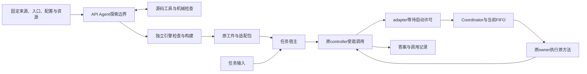

# SeamPact组会报告：从异构Harness到可执行能力

更新：2026-10-13。工程版本0.5.0。建议按下面8页组织约12至15分钟报告，再用3分钟演示。本文是当前设计与工程进展的讲稿，可据此制作幻灯片。

## 第1页：要解决什么问题

不同安全方法已经有各自的完整Harness：有人用Agent工具调用，有人用文档工作流，有人用政策配置和规则解释器，有人用模型训练／净化脚本。平台需要把这些能力接入、选择并组合执行，但不能假设它们都有统一的函数接口、无状态输入输出或可随意并行。

我们的研究问题是：**面对没有预先标注边界的异构原生实现，能否自动找出可交接的执行边界，生成可运行适配，并明确每个边界允许哪些调度和组合操作？**

口头展开：一个函数依赖会话、模型对象或规则上下文时，“函数能调用”还不够。我们需要知道由谁持有状态、谁决定调用发生、结果回到哪里，以及能否拆细、并行或放到别的宿主。

## 第2页：整体方案怎样工作

系统分为接入期与执行期。接入期读取来源并生成适配；执行期处理具体任务，不为每个问题重新分析整仓。

引擎输入包括固定来源、可见工件、入口与配置、任务目标、资源引用和通用支持准则。API Agent通过读源、补充依赖、检查和修复工具提出候选；工程引擎负责机械核对和代码生成。候选不自签行为保证，未知依赖和不支持的结构会影响可交付范围。

当前API Agent是我们实现的工具循环，可以接DeepSeek／GLM；未来可以替换为成熟Agent后端。开发者预先提供通用变换规则和固定SDK摘要，正式分析输入不预填某个来源的具体切点。开发探针的人工候选另行记录。

## 第3页：究竟改了原Harness什么

采用**包装／原生接入＋有限局部重构**。原算法和原SDK对象保留，生成的是接线与适配代码。

| 方式 | 实际改动 | 要解决的问题 |
|---|---|---|
| W：包装 | 保存原callable，外层等待许可后调用它 | 整个调用的实际开始可以被安排 |
| H：原生接线 | 在框架注册／交接处装入适配入口 | 原框架实际经过门禁，避免只在目录里“有模块” |
| R：有限局部重构 | 在支持结构上提取原代码，例如逐项评价循环体 | 整个批次可以露出更细的调用发生，顺序与异常路径先保持 |

CRAG中，原循环按节点逐项评价。有限R保留原循环体与逐项Context读取；当前按原序执行。把全部项提前发送出去会改变失败时的外发与费用，因此并行需要独立条件，不能由“已拆细”自动获得。

非代码资源仍由原loader或解释器消费：图像／数据保留真实字节或固定引用，配置／Colang由匹配版本的SDK解释，模型权重和索引由宿主绑定。API分析不会创造缺失的数据和模型，也不能把专有模型接口换成普通Chat然后声称保真。

## 第4页：一个完整Harness如何形成多种能力

能力定义、调用发生和部署实例是三个不同对象。一个Harness可以暴露多个能力，同一能力可在一次任务中被调用多次；共享会话或GPU对象的能力可以共置在同一个owner中，不按能力数量创建Pod。

例如CRAG可以暴露准备、检索、逐项评价、文本归约、查询改写和回答等边界。本次激活哪些，由原工作流的分支和实际输入决定。ABC可能包含多个具体rail／门控方法，但内部flow能被观察到，不代表它已成为独立调用接口。

需要区分两类交付：

| 交付 | 谁使能调用 | 还需核对什么 |
|---|---|---|
| 原流程内排期 `controller_bound` | 原controller | 门禁实际生效、原状态和继续路径 |
| 导出供新组合 `composition_export` | 经验证的新任务计划 | 初始化、输入与状态前提、组合作用域、全部出口和唯一继续者 |

两层RL设计建立在这个区分上：上层选择已经具备对应操作许可的方法／粒度／组合；下层安排已经使能的调用、并发和实例。当前代码实现FIFO，不具备两层RL、独立导出目录或跨源组合执行。

## 第5页：理论要说明什么

固定接入范围记为Γ，包含来源与SDK版本、入口配置、资源、观察契约和环境假设。对边界b、宿主h和操作p分别判断是否满足前提。原位排期、独立导出、并行和远程化各有不同义务；一个统一“合法”布尔值不够。

三类论证分工如下：

| 论证 | 要证明的内容 | 工程中的对应物 |
|---|---|---|
| T1：顺序保真 | 在Γ的观察下，适配有限轨迹有原生对应；正常覆盖和进展另证 | 固定来源、输入／状态／异常与顺序配对 |
| T2：条件并行 | 在实际可达事件前缀上，交换后使能、状态、输出与保护条件保持 | 并发条件、全部异常路径、外发与归约 |
| T3：策略无关协议 | 至多启动、唯一继续者、版本及托管资源不变量在合法动作下保持 | 一次性许可、owner代次、取消、物理退休和账本 |

最简单的运行约束是`starts(o) ≤ 1`，其中o是一项实际调用发生。资源退出必须以物理确认计账：逻辑取消不意味着后台计算已退出。

目前数学文档给出了条件性定义、证明骨架和反例；真实W／H／R规则的完整参数化可靠性证明仍需完成。理论保真、模型任务质量和系统性能是三组证据：轨迹一致不证明模型回答正确，任务完成也不证明任意并行正确。

## 第6页：目前实际做到哪里

| 内容 | 实际进展 | 解释范围 |
|---|---|---|
| 四源分析 | 之前真实DeepSeek工具分析完成74轮：MMCT19、CRAG12、ABC18、DiSP25 | 正式输入使用通用准则，未预填探针切点；不是本次重新运行 |
| 自动候选与构建 | CRAG提交7边界、DiSP提交9边界并生成草案；MMCT19候选与ABC2候选的完整提交未通过 | 失败保留；BUILT_DRAFT与业务运行分别判断 |
| 有限原生接线 | W／H、注册前接线、有限R顺序循环提取；已有MMCT与CRAG受控SDK记录 | 开发探针含人工边界，不能计自动发现 |
| 可交互任务 | CRAG原Workflow＋本地输入资料＋真实DeepSeek完成一次中文问答 | 使用已有真实API包，实际模型调用4次，9项原生发生退休，执行槽归零 |
| 新包进入任务 | 当前平台build生成包后，按package_id交给同一宿主，联调完成 | 该次联调为明确标记的分析fixture与受控预览，未另做一轮真实API分析 |
| 工作台与Git | 四源卡片、分析／包／任务／接口页面；0.5.0源码与文档已在GitHub | 密钥、完整API消息、数据库、下载快照和模型数据不进Git |
| 部署 | 默认一个带CRAG SDK的Docker服务；本机原生0.5.0可用，此前0.4.0有实际容器记录 | 服务器0.5.0部署待人工执行；旧KIND工作负载已清理 |
| 后续能力 | MMCT／ABC／DiSP完整业务任务、并行、跨源组合、K8S执行后端与两层RL | 设计中，尚未实现 |

4次模型调用与9项发生是该次固定输入下的实测值，不是所有任务的固定次数。StartEvent无效果分支在运行记录中单列。当前检索／搜索范围是用户输入文本，尚未接在线搜索或完整向量模型。

可用的阶段性表述：**我们已经贯通有限规则下的来源分析、适配构建和CRAG任务宿主，展示了原生调用通过门禁执行并返回真实模型答案；接下来扩大原生任务覆盖，再开放实际可用的选择和并行自由度。**

## 第7页：借鉴与候选创新

既有工作提供了生命周期／processor、跨框架规格、依赖图并行、程序提取、动态接口及多粒度选择等基础。HarnessX启发了生命周期与门禁表达；规格／编译类系统启发了结构化候选、机械反馈和lowering；并发与程序分析工作约束了闭合、继续路径和合法交换。这些组件本身已有研究。

汇报时可以用三项一手工作说明借鉴范围：

| 工作与已核对章节 | 借鉴点 | 我们需要进一步处理的对象 |
|---|---|---|
| [HarnessX v3 §3.1—3.2](https://arxiv.org/html/2606.14249v3) | processor及hook契约帮助表达生命周期与介入点 | 从原生异构实现找到真实启动交接，保留原controller |
| [SIGIL v3 §3.3—3.4、附录A](https://arxiv.org/html/2607.27309v3) | 结构化候选、机械核验、binding及固定lowering | 原生代码、配置、状态与外部效果的依赖范围 |
| [LLMCompiler v3 §3、§5.2](https://arxiv.org/html/2312.04511v3) | 工具依赖计划及并行执行 | 不透明owner、条件使能、失败外发和并行前提 |

此表说明本项目对这些机制的采用与研究定位，不是对先例能力的穷尽判断；完整近邻表与否定条件仍由研究工作区主设计第14节维护。本次复核上述固定版本，没有增加“已经证明新颖”的结论。

本项目要检验的候选机制是：**按请求开放的操作生成义务，联合选择边界与宿主，把未知定位到具体操作，再调整边界、宿主或局部代码，保留其他有依据的能力。**

举例：对象不能序列化时，远程派发可能不可用，但原owner内的原位排期仍可用；会话前提尚未闭合时，独立导出可能不可用，但原controller内的H接线仍可用。研究重点是能否自动得到这种受限而有用的选择，而不是最终只剩整体黑盒。

比较要包含同样具备依赖分析、调用协议核对、标准包装和精确反馈的强方案。检验自动获得的有用边界／操作、完整任务成功率、人工成本、延迟与费用。创新目前是待验证假设，参数字段、普通DAG、K8S或RL的存在不单独作为贡献。

## 第8页：下一步与组会讨论

近期工程先扩大可交互竖向切片：MMCT图片任务与真实注册H接线 → ABC政策配置任务 → DiSP模型／数据／CLI制品链。缺服务器资源或私有制品时集中交接，不以重复环境探测和完整探针矩阵阻塞DEMO。

随后实现能力选择、状态／效果条件、可独立并行分支和跨源组合；建立同环境的资源感知规则基线，再分阶段实现下层RL、上层RL。K8S按owner与生命周期部署，增加多宿主时再引入，不要求每个能力一个节点或每次调用一个Pod。

组会上建议讨论三个问题：首篇研究是否以自动适配机制为主线；哪些真实任务能产生非平凡选择和并行自由度；怎样用强基线区分联合选择的作用与模型／预算变化。已有用户决定保持四源纳入和两层RL设计，讨论的是近期证据与论文叙事的优先级。

## 常见追问的直白回答

**是不是先用Codex手工拆好再交给引擎？** 正式API分析从固定来源和通用规则探索；开发者提供支持规则与宿主摘要。手选边界用于开发探针并另记。当前真实问答复用之前的API包，不把复用任务冒充本次从零自动拆分。

**引擎是不是重写整套代码？** 原算法与原SDK保留。它生成wrapper／注册接线，在支持的局部结构生成有限patch；非代码资源仍用原加载／解释路径。

**拆出来多个模块是不是就可以并行？** 多边界首先让调用可控制。并行还要满足使能、状态、效果、异常和资源条件；当前FIFO不宣称并发能力。

**是不是每个能力部署成一个K8S节点？** Node是承载机器，Pod／进程是部署实例，能力是逻辑边界。多个共享状态能力通常共置在同一owner里。

**RL会不会跳过必要门控？** 上层计划必须满足独立TaskSpec，AND义务不能删掉；下层只能从当前合法动作选。其完整准入与训练接口还未实现。

**现在能直接演示什么？** 四源入口、API分析记录、CRAG能力包和本地资料真实问答；运行中的具体激活和轨迹可见。不是四源已经全部可执行的展示。

进一步阅读：[手动启动与演示](手动启动与演示.md) → [设计与实现路线](设计与实现路线.md) → [原生接线与有限重构](原生接线与有限重构.md) → [任务DEMO](任务DEMO.md)。完整理论与形式化规格由研究工作区现行18／20文档维护，原始实测保留在研究工作区，本文摘录其已记录范围。
