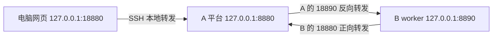

# 远端部署：Git、Docker 与跨机器运行组

**2026-10-21 部署前状态：** 命名服务、权重登记及依赖配置前端已有实现，操作见[资源配置操作](资源配置操作.md)。部署前建设（[方案](部署前建设与调度动作方案.md) P1–P8）已在 0.9.0 工作区实现：平台镜像以 `SEAMPACT_EXTRAS` 选择是否安装学习器依赖并记录环境锁；原生运行组宿主、构建／发布／启动／登记／预热／停止接单／排空停止、实例级路由与成本事件、功能调度模式见[运行组与 K8S](运行组与K8S部署.md)。**Linux 实机、GPU、K8S 与跨机器调用均为 NOT_RUN**：开发机完成编译、平台启动和一次本机进程形式的手动路线实例启停（见运行组页），没有执行镜像构建或容器启动。Linux 网页保存的凭据采用私有目录 0700／文件 0600，属于文件权限保护而非磁盘加密；也可引用启动进程环境变量。权重填写执行进程／容器内路径，源库固定路径由界面提示实际放置位置。跨机器服务 URL 从实际调用方解析，不等于跨机器运行组。实际服务器资源、权重和 API 配置留到服务器完成。

更新：2026-10-21。本文是可复用的远端部署入口。实际账号、地址、机器环境和执行记录保存在 `.local-private/`，由部署者按目标机器配置。

在已授权的 Linux 机器运行中央平台，通过 SSH 转发打开网页，再把已核对的运行组放到另一台 Linux 机器。平台核心流程无需 GPU。K8S 操作见[运行组与 K8S](运行组与K8S部署.md)。


**下一实验的代码前置：** [joint/1 联合规格](部署前建设与调度动作方案.md#52-功能派发与生命周期联合模式本轮建设目标)工作区已有代码实现，包括学习派发、水平扩缩和连续工作负载训练，尚无真实联合运行；Linux／GPU／K8S 仍为 NOT_RUN。上述 P1—P8 完成状态指基础设施与功能模式，不表示联合 RL 已真实运行；本文部署步骤仍可用于基础平台安装。实际资源、权重与 API 继续在服务器配置。

**收束后部署口径：** 年龄按根请求使能后的总等待时间计算；原生组生命周期四项未确认时不开放扩缩，不阻塞基础部署。已完成内存合成窗口及三个 CPU 学习器更新通路，具体边界见[当前实现](当前实现.md#joint1-联合模式代码现状2026-10-21)。部署须包含 `joint.py`、`backends.py` 及同步文档等全部工作区实现，不能只拉取旧 HEAD；本轮没有自动提交或推送。到服务器后重新核对分析结果、生成同版 worker 工件，再配置权重／API／镜像及执行资源。联合学习显式设置 learned_ready/1、learned/1、call_slots≥2 和重叠到达任务，记录实际合法动作覆盖；没有合格复制组时不报告重模型扩缩收益。

## 1. 实际支持范围与交付方式

| 内容 | 0.9.0 工作区的实现情况 |
|---|---|
| 中央平台 | 对话、模型配置、整仓分析、能力池、两层 RL 与运行观察 |
| 本地原生能力 | 有限 Python／Notebook／CLI，保留原构造与控制，缺条件报缺口 |
| 标量运行组 | 已核对的独立同步不可变标量入口，`python311-scalar-worker/1` |
| 原生模型运行组 | `python311-native-group-worker/1`：整组在一个进程保留原构造与 owner；组外端口按 `group-port/1` 编码，需要原对象输入或返回原对象的成员保留本地 |
| 部署控制 | 平台按配置执行 docker／kubectl／kind；客户端或守护进程不可用时给出手动命令，进程登记后绑定同一实例 |
| K8S | 每个实例一个副本数 1 的 Deployment，Pod IP 登记；单机 KIND 不等于跨物理机 |
| 副本 | 默认 1；只有标量规则核对过的组可增加副本，原生组为 UNKNOWN 不授予 |
| 重启 | 不恢复原会话；平台重启后旧实例标为 UNKNOWN，需排空停止释放后启动新实例 |

中央平台从部署者配置的 Git 远端拉取；运行组实例使用该中央平台生成的构建工件。仓库 URL 不包含账号口令或访问令牌。

| 内容 | 交付方式 |
|---|---|
| SeamPact 源码、模板、文档 | GitHub，记录实际 commit |
| 公开 Harness 原代码 | 平台 URL 接入，或在项目目录按原修订拉取 |
| 私有源码、数据、模型、配置 | SFTP 到自己的项目目录 |
| 分析后的运行组构建工件 zip | 从调度它的中央平台生成；跨机器且不经镜像仓库时 SFTP 给运行机器 |
| 分析结果（可选） | `/api/analysis/export` 导出候选与源码身份；目标平台接入同一源码后 `/api/analysis/import` 重新核对，不调用模型 |
| API 密钥 | 在目标平台网页填写，不进 Git、不发聊天 |
| 状态库、快照、分析记录、Q 表 | 私有数据目录，Git pull 不会同步 |

不要把 Windows 整个 `var/prototype` 直接复制成 Linux 平台：DPAPI 密钥无法跨系统解密，来源路径和安装身份也不会自动变成服务器路径。本文默认服务器创建自己的状态，重新接入／分析；已有研究记录留在原机器。确需迁移状态时另行处理路径与身份映射。

## 2. 主平台 A：目录、Docker 与代码

下面在 **Linux 服务器 A 的 Terminus 终端**执行。一个段落报错先停止，不执行依赖它的下一段。新开终端先重新执行变量块。

```bash
umask 077
SEAMPACT_ROOT="$HOME/seampact-workspace"
SEAMPACT_CODE_DIR="$SEAMPACT_ROOT/Seampact"
SEAMPACT_DATA_DIR="$SEAMPACT_ROOT/seampact-data"
SEAMPACT_HARNESS_DIR="$SEAMPACT_ROOT/harnesses"
SEAMPACT_PLATFORM_NAME="seampact-platform-$(id -u)"
SEAMPACT_PLATFORM_PORT=8880
mkdir -p "$SEAMPACT_ROOT" "$SEAMPACT_DATA_DIR" "$SEAMPACT_HARNESS_DIR" "$SEAMPACT_ROOT/uploads" "$SEAMPACT_ROOT/logs"
```

先读取目标环境中所需工具、Docker 服务与目标端口的实际情况；具体机器的完整环境快照只保留本地：

```bash
command -v git docker python3 ssh
docker version --format '{{.Server.Version}}'
ss -ltn "( sport = :${SEAMPACT_PLATFORM_PORT} )"
```

使用 rootless Docker 时，若报默认 `/var/run/docker.sock` 不存在，先确认连接的是当前用户自己的服务：

```bash
systemctl --user status docker --no-pager
docker context use rootless
docker version --format '{{.Server.Version}}'
```

服务已安装但未运行时可使用 `systemctl --user start docker`。未配置个人服务的账号应先核对安装前提。权限不足或工具不存在时记录实际报错；端口已有 LISTEN 时确认所属实例，必要时更换本项目端口并同步 SSH 目标。


首次 clone 前先执行：

```bash
test ! -e "$SEAMPACT_CODE_DIR"
```

仅在上一条成功、目录不存在时拉取。HTTPS 不要求新增 GitHub SSH 密钥：

```bash
read -r -p "仓库 URL（不含凭据）: " SEAMPACT_REPO_URL
git clone "$SEAMPACT_REPO_URL" "$SEAMPACT_CODE_DIR"
```

仓库 URL 可以使用已授权的 HTTPS 或 SSH 形式。私有仓库使用目标机器已有授权；私钥与 token 通过私有凭据渠道提供。

如果目录已有本项目 Git 克隆，跳过 clone，先看来源和修改：

```bash
git -C "$SEAMPACT_CODE_DIR" remote -v
git -C "$SEAMPACT_CODE_DIR" status --short
```

确认仓库正确、本地修改已妥善处理后：

```bash
git -C "$SEAMPACT_CODE_DIR" pull --ff-only
git -C "$SEAMPACT_CODE_DIR" rev-parse HEAD
```


## 3. 主平台 A：构建与启动

### rootless Docker：回环端口发布

先构建实际 commit 对应的镜像：

```bash
SEAMPACT_REV="$(git -C "$SEAMPACT_CODE_DIR" rev-parse --short=12 HEAD)"
SEAMPACT_PLATFORM_IMAGE="seampact-core:$SEAMPACT_REV"
docker build -f "$SEAMPACT_CODE_DIR/deploy/Dockerfile" -t "$SEAMPACT_PLATFORM_IMAGE" "$SEAMPACT_CODE_DIR"
```

构建成功后启动。镜像中的 Python 为 3.11。rootless 的容器 UID 0 映射为启动 daemon 的宿主用户，以下使用 `--user 0:0` 写入该用户所有的私有绑定目录。系统 Docker 的 UID/GID 取宿主实际值，不能直接照搬 rootless 配置。

```bash
docker run -d --name "$SEAMPACT_PLATFORM_NAME" --init \
  --user 0:0 \
  -p "127.0.0.1:${SEAMPACT_PLATFORM_PORT}:8880" \
  --mount "type=bind,src=$SEAMPACT_DATA_DIR,dst=/data" \
  --mount "type=bind,src=$SEAMPACT_HARNESS_DIR,dst=/harnesses" \
  "$SEAMPACT_PLATFORM_IMAGE" \
  serve --home /data --host 0.0.0.0 --port 8880 --public-port "$SEAMPACT_PLATFORM_PORT"
```

容器内监听8880，宿主只发布到127.0.0.1。第4节SSH本地转发仍可使用。这条bridge路线的容器回环不是宿主回环：同机 worker 可使用[Docker部署第3节](Docker部署.md#3-bridge-平台怎样接-worker)的同网络容器方案（选择Compose启动平台）；下文第5、6节的host网络及SSH回环命令不适用于本段bridge启动方式。跨机连接需另选host路线或明确双方容器可达的地址，不能把两套地址混用。

### 可选：host 网络路线（系统 Docker／29.5及以上rootless）

以下原命令用于已确认的 Linux 系统 daemon。`--network host` 共享宿主网络，程序只绑定回环，能访问同机 worker 及 SSH 转发。**已选上方bridge启动方式时跳过本段。**

host 网络能力按目标 Docker 版本核对，见[Docker 官方说明](https://docs.docker.com/engine/security/rootless/troubleshoot/#--net-host-doesnt-listen-ports-on-the-host-network-namespace)。采用支持宿主网络的 rootless daemon 时，下面的 `--user "$(id -u):$(id -g)"` 改为 `--user 0:0`。若双方都满足 host 网络条件，第5、6节的回环与 SSH 地址设计适用；否则使用 bridge 路线。

```bash
docker run -d --name "$SEAMPACT_PLATFORM_NAME" \
  --network host --init \
  --user "$(id -u):$(id -g)" \
  --mount "type=bind,src=$SEAMPACT_DATA_DIR,dst=/data" \
  --mount "type=bind,src=$SEAMPACT_HARNESS_DIR,dst=/harnesses" \
  "$SEAMPACT_PLATFORM_IMAGE" \
  serve --home /data --host 127.0.0.1 --port "$SEAMPACT_PLATFORM_PORT"
```

```bash
docker ps --filter "name=$SEAMPACT_PLATFORM_NAME"
docker logs --tail 80 "$SEAMPACT_PLATFORM_NAME"
```

同名容器已存在时先看它的版本和目录，不自动删除。当前 API 没有公网登录与鉴权，使用回环＋SSH；bridge路线使用上面的 `-p 127.0.0.1:…`，host模式不要另加 `-p`，见[Docker 官方网络语义](https://docs.docker.com/engine/network/drivers/host/)。

| A 宿主目录 | 平台里填写的路径 |
|---|---|
| `$HOME/seampact-workspace/seampact-data` | `/data`，配置、分析、状态、快照、Q 表和导出包 |
| `$HOME/seampact-workspace/harnesses/example` | `/harnesses/example`，该来源自己的源码、数据、配置 |

不要同时运行两个主平台写同一状态目录。启动平台不自动执行训练或 Harness；实际任务执行原代码时仍需要原依赖、数据和资源。

## 4. 电脑打开远端网页，配置模型与来源

Terminus 对 A 建立 **SSH 本地转发**：本地绑定 `127.0.0.1`、本地端口 `18880`、远端目标 `127.0.0.1:8880`。保持连接，电脑打开 **http://127.0.0.1:18880**。用 18880 避开电脑现有平台8880；这是两套独立状态。

也可在电脑 PowerShell 执行：

```powershell
$SeampactServer = Read-Host '服务器A地址'
$SeampactUser = Read-Host '服务器A用户名'
$SeampactSshPort = Read-Host 'SSH端口（通常22）'
if ([string]::IsNullOrWhiteSpace($SeampactSshPort)) { $SeampactSshPort = '22' }
ssh -N -T -o ExitOnForwardFailure=yes -p $SeampactSshPort -L 127.0.0.1:18880:127.0.0.1:8880 "${SeampactUser}@${SeampactServer}"
```

这个终端持续运行，Ctrl+C 只关闭转发。A 的平台端口改过时，改 `-L` 最后一个端口。

网页“配置”分别保存对话模型和分析模型：

| 字段 | 填写 |
|---|---|
| DeepSeek 基础地址 | `https://api.deepseek.com`；程序追加 `/chat/completions` |
| GLM 基础地址 | 国内平台通常为 `https://open.bigmodel.cn/api/paas/v4`，以账号实际兼容接口为准 |
| 模型 ID | 当前账号实际可用型号；分析模型需要工具调用能力 |
| API Key | 在目标网页填写，保存在该平台私有配置中 |
| 最大输出 token | 可留空，使用可获得的模型能力或提供方默认值 |

平台保留完整上下文，不设置应用费用／轮次上限；提供方自己的限制仍存在。Kimi 暂不作为本项目接口。

公开来源可填 Git URL／修订。私有来源经 SFTP 上传到 A 的 `harnesses/<项目>`，页面用 `/harnesses/<项目>`。容器不自动继承宿主 Git SSH 凭据；私有仓库也可以先在宿主取得，再按挂载路径接入。

提供真实入口、资源及非敏感初始化配置，先“接入 Harness”再“分析”；不手工预填内部切点。READY 是静态绑定准备，BOUND／实际调用记录才表示原入口运行；MISSING 与 LOCAL_ONLY 分别阅读绑定和远程缺口。脚本静态 READY 不代表模型、数据、GPU 和完整作业已经准备好。

## 5. A 同机启动已核对的运行组

本节用于第3节的host路线（系统daemon，或29.5及以上rootless并已按说明调整容器UID）。bridge启动的平台改用[Compose同网络方案](Docker部署.md#3-bridge-平台怎样接-worker)，不执行本节的回环地址命令。

在 **A 这个平台**“运行组与部署”找到宿主条件已核对的组，填写环境（基础镜像、冻结源码内的依赖清单、额外包）后点“生成构建工件”。平台镜像内没有 docker 客户端，部署后端保持 `none`，或配置为 docker 后点“构建镜像”／“启动实例”取得手动命令（`BACKEND_UNAVAILABLE`）。以下为手动路线；页面 `/data/deployments/<本次目录>` 映射到宿主 `$SEAMPACT_DATA_DIR/deployments/<本次目录>`。

复制最后一段目录名，在 A 终端运行：

```bash
read -r -p '本次导出目录名（仅最后一段）：' SEAMPACT_BUNDLE_NAME
SEAMPACT_BUNDLE_DIR="$SEAMPACT_DATA_DIR/deployments/$SEAMPACT_BUNDLE_NAME"
test -f "$SEAMPACT_BUNDLE_DIR/worker.json"
```

成功后读取真实组身份，使用本次导出后缀区分新旧镜像：

```bash
SEAMPACT_GROUP_ID="$(python3 -I -B -c 'import json,sys; print(json.load(open(sys.argv[1],encoding="utf-8"))["group"]["id"])' "$SEAMPACT_BUNDLE_DIR/worker.json")"
SEAMPACT_WORKER_IMAGE="seampact-worker:${SEAMPACT_GROUP_ID#rg-}-${SEAMPACT_BUNDLE_NAME##*-}"
SEAMPACT_WORKER_NAME="seampact-owner-${SEAMPACT_GROUP_ID#rg-}-$(id -u)"
docker build -t "$SEAMPACT_WORKER_IMAGE" "$SEAMPACT_BUNDLE_DIR"
```

系统 Python 可读取 JSON；原代码运行仍使用镜像内3.11。先看自己的目标端口：

```bash
ss -ltn '( sport = :8890 )'
```

端口空闲、构建成功后：

```bash
docker run -d --name "$SEAMPACT_WORKER_NAME" --network host --init \
  "$SEAMPACT_WORKER_IMAGE" \
  --coordinator "http://127.0.0.1:$SEAMPACT_PLATFORM_PORT" \
  --host 127.0.0.1 --port 8890 \
  --advertise-url http://127.0.0.1:8890
docker logs --tail 80 "$SEAMPACT_WORKER_NAME"
```

正常输出 worker_ready，A 页面在该组下出现“操作者启动后登记”的就绪实例。advertise 填写后自动登记；不填则在网页手动登记 A 可访问的 URL。改端口须同时改 `--port` 和转发／advertise。若使用页面“启动实例”给出的手动命令，命令已带 `--instance-id`／`--generation`，登记后绑定到平台预先创建的同一实例。

包必须来自调度它的同一平台、来源版本、安装身份和运行组契约。本机 Windows 包不能登记到空的服务器平台；重新分析／恢复来源后也须新包。运行进程在自身环境重新核对源码、绑定、包／文件／凭据条件和契约摘要；环境未满足的成员列在实例的 `missing`，调用不会改派到其他实例。

模型组需要权重和凭据时：权重按平台登记的同一路径只读挂载（`-v <宿主路径>:<平台登记路径>:ro`），凭据只以环境变量传入（`-e 变量名`，值来自启动进程环境）。环境变量名为连接配置的 `env`，或 `SEAMPACT_CREDENTIAL_<连接ID大写，非字母数字改为下划线>`。GPU 由 `--gpus` 等运行参数决定，平台不推断显卡配置。

## 6. 跨机器放置运行组

使用 **A 中央平台＋B worker**。本节要求 A 使用第3节的 host 网络路线，Docker 形式的 B 也须具备对应 host 网络能力。rootless 的容器用户配置按第3节设置。两台先用 Linux。下面通过 B→A 的 SSH 连接建立双向通道，业务端口保留在回环地址。



### B：上传、解压与构建

先在 B 第一个终端创建自己的接收目录：

```bash
umask 077
SEAMPACT_ROOT="$HOME/seampact-workspace"
mkdir -p "$SEAMPACT_ROOT/uploads" "$SEAMPACT_ROOT/workers"
```

然后在 A 平台生成该组的构建工件，用 SFTP 将 A 的工件 zip 下载到电脑，再上传到 B 的 `~/seampact-workspace/uploads/`。B 不需要重新分析该组，也不能以自己的新分析冒充 A 的安装身份。上传完成后回到 B 第一个终端：

```bash
read -r -p '已上传的本次zip文件名：' SEAMPACT_ZIP_NAME
SEAMPACT_ZIP="$SEAMPACT_ROOT/uploads/$SEAMPACT_ZIP_NAME"
```

解压到与 zip 同名的新目录；已有目录时停止，不覆盖：

```bash
python3 -I -B - "$SEAMPACT_ZIP" "$SEAMPACT_ROOT/workers" <<'PY'
import pathlib, stat, sys, zipfile
archive = pathlib.Path(sys.argv[1]).resolve()
destination = pathlib.Path(sys.argv[2]).resolve() / archive.stem
if destination.exists():
    raise SystemExit("目标目录已存在，未覆盖：" + str(destination))
with zipfile.ZipFile(archive) as package:
    for member in package.infolist():
        target = (destination / member.filename).resolve()
        if not target.is_relative_to(destination) or stat.S_ISLNK(member.external_attr >> 16):
            raise SystemExit("运行包路径不合法，未解压")
    destination.mkdir()
    package.extractall(destination)
print(destination)
PY
```

```bash
SEAMPACT_BUNDLE_DIR="$SEAMPACT_ROOT/workers/${SEAMPACT_ZIP_NAME%.zip}"
SEAMPACT_GROUP_ID="$(python3 -I -B -c 'import json,sys; print(json.load(open(sys.argv[1],encoding="utf-8"))["group"]["id"])' "$SEAMPACT_BUNDLE_DIR/worker.json")"
SEAMPACT_BUNDLE_NAME="${SEAMPACT_ZIP_NAME%.zip}"
SEAMPACT_WORKER_IMAGE="seampact-worker:${SEAMPACT_GROUP_ID#rg-}-${SEAMPACT_BUNDLE_NAME##*-}"
SEAMPACT_WORKER_NAME="seampact-owner-${SEAMPACT_GROUP_ID#rg-}-$(id -u)"
docker build -t "$SEAMPACT_WORKER_IMAGE" "$SEAMPACT_BUNDLE_DIR"
```

镜像本地标签可以不同，真实身份来自 worker.json。B 同样需要自己已有 Docker 权限；不为它修改共享账户环境。

### B：保持双向 SSH 连接

在 **B 第二个终端**，输入 A 的实际 SSH 参数。A 的 SSH 服务须允许端口转发；若组织禁用，返回报错讨论，不修改全局 SSH 配置。

```bash
read -r -p '平台A的SSH地址：' SEAMPACT_A_HOST
read -r -p '平台A的SSH用户名：' SEAMPACT_A_USER
read -r -p '平台A的SSH端口（通常22）：' SEAMPACT_A_SSH_PORT
SEAMPACT_A_SSH_PORT="${SEAMPACT_A_SSH_PORT:-22}"
ssh -N -T -o ExitOnForwardFailure=yes \
  -o ServerAliveInterval=30 -o ServerAliveCountMax=3 \
  -p "$SEAMPACT_A_SSH_PORT" \
  -L 127.0.0.1:18880:127.0.0.1:8880 \
  -R 127.0.0.1:18890:127.0.0.1:8890 \
  "$SEAMPACT_A_USER@$SEAMPACT_A_HOST"
```

保持终端运行。B 的18880到达A平台；A的18890到达B的8890。先建转发、后启动B worker是允许的。A平台改端口则修改-L的目标；多个B须各用不同的A反向端口。

### B：启动并登记到 A

回 B 第一个终端，构建成功且 B 的8890可用时：

```bash
docker run -d --name "$SEAMPACT_WORKER_NAME" --network host --init \
  "$SEAMPACT_WORKER_IMAGE" \
  --coordinator http://127.0.0.1:18880 \
  --host 127.0.0.1 --port 8890 \
  --advertise-url http://127.0.0.1:18890
docker logs --tail 80 "$SEAMPACT_WORKER_NAME"
```

coordinator 是 **B 能访问 A** 的地址，advertise 是 **A 能访问 B** 的地址。二者不是同一主机的回环。A 页面显示远程执行后，原函数实际在B运行。

其他方式是双方可路由的专用网络，但当前无公网鉴权，不直接开放8880／8890。Compose桥接容器／K8S Pod与宿主回环不同，不能直接套用本节地址；K8S连接使用集群服务网络。

### B 没有 Docker daemon 时

租用产品可能只提供一个现成容器，不应默认在里面再跑 Docker。有 Python3.11时可用运行包自带core；先建立上面的SSH通道：

```bash
python3.11 --version
PYTHONPATH="$SEAMPACT_BUNDLE_DIR/core" python3.11 -B -m seampact worker \
  --spec "$SEAMPACT_BUNDLE_DIR/worker.json" \
  --coordinator http://127.0.0.1:18880 \
  --host 127.0.0.1 --port 8890 \
  --advertise-url http://127.0.0.1:18890
```

恰好3.11才受当前worker支持。只有3.10／3.13时选择独立3.11环境或可部署自定义镜像的实例，不替换系统解释器。原生模型组在无 Docker 时须在该 3.11 环境自行安装工件 `environment.json` 声明的依赖；宿主重新核对后未满足的成员留在实例 `missing` 中。

## 7. 停止、更新与数据保存

停止自己的 worker／平台分别执行；执行前在任务／调度页面确认原调用已经收尾。单独停止 worker、而主平台继续运行时，在“运行组与部署”点该组“排空后停止”：平台停止派发新根请求，等在途调用与内部许可收尾，再请运行进程自行退出，实例记为 STOPPED。只想停止派发而保留进程时点“停止接单”。平台启动的容器／Deployment 由平台执行停止；操作者启动的容器退出后可按需删除：

```bash
docker rm "$SEAMPACT_WORKER_NAME"
```

```bash
docker stop "$SEAMPACT_PLATFORM_NAME"
```

SSH中断不等于原调用被取消；响应缺失不会自动本地重放，也没有承诺断线必定立即返回。需要更新平台时，在A重新执行变量块、处理本地修改并git pull，按第3节构建新commit镜像。原调用收尾后，仅替换自己的容器：

```bash
docker stop "$SEAMPACT_PLATFORM_NAME"
docker rm "$SEAMPACT_PLATFORM_NAME"
```

再执行第3节docker run，挂载原数据目录。rm删除容器，不删宿主数据；要保存旧容器日志先用docker logs写入自己的logs目录。不做全局prune，不删除未知容器／集群。

**主平台重启会更换session，全部worker也须停止、重新启动取得新session再登记。** 平台启动时把上一会话仍存活的实例标为 UNKNOWN（stale）；在“运行组与部署”勾选“释放结果未决的实例”后点“排空后停止”，平台停止有后端句柄的容器／Deployment，未决调用保持 UNKNOWN。只在网页填旧worker地址不会更新它缓存的session。保留分析／任务历史不意味着恢复旧对象或未收尾会话。来源安装身份没有改变时可复用原包；重新分析／来源恢复后使用新包、新镜像。

worker 镜像、协议核心和安装身份未变时，操作者启动的容器（命令不含 `--instance-id`）可在原机器恢复，它会生成新实例身份并重新登记；平台启动的实例不要 `docker start` 复用，同一实例身份换了进程会被判为 FAILED，应从页面启动新实例：

```bash
docker start "$SEAMPACT_WORKER_NAME"
docker logs --tail 80 "$SEAMPACT_WORKER_NAME"
```

协议核心更新时由新平台重新导出运行包，不只启动含旧代码的容器。

换worker包时，同样等待原调用收尾，再停止并移除自己的旧worker容器，以本次标签构建／启动。不用新实例冒充旧未知执行。私有状态备份在平台停止后SFTP复制完整专属目录；运行中的SQLite不能只拷贝一个.sqlite3文件作为可靠备份。

## 8. 共享服务器、租用算力与研究方向

建议先用组内服务器做中央平台，用另一台真实机器跑有限worker。当前不需要GPU，不必为建立跨机连接租GPU。共享GPU等待实际阻碍完整任务时再短租，需明确持久磁盘、SSH／SFTP、端口转发、实际Python／Docker权限、模型组显存和费用。

现成容器与具备Docker daemon的VM／裸金属不同。原生驻留与生命周期研究更适合持续运行的实例，不默认改成每请求销毁的serverless作业。多台显卡不会自动合成显存池。当前复杂模型组未远程开放；若先使用GPU原Harness，应在该机保留完整原生流程及实际依赖，不能套标量worker宣称模型已远程化。

消费级设备承载部分Agent能力可发展。潜在贡献是**从已有异构Harness自动取得合法部署边界，以及何时分布放置值得**。已有[AutoGen分布式runtime](https://microsoft.github.io/autogen/stable/user-guide/core-user-guide/framework/distributed-agent-runtime.html)、[Ray actors](https://docs.ray.io/en/latest/ray-core/actors.html)与设备／云端协作的[EcoAgent](https://arxiv.org/abs/2505.05440)。本轮为针对性检索，不宣称创新已经完整核实。

网络成本包括协调往返、序列化、传输、排队、初始化和计算。当前同步入口除了平台→worker调用，还串行进行enable/wait/consume/finish四次中央请求；按请求链粗略估算有约**5×网络RTT**的通信分量，首用另有注册／加载，连接建立还会增加开销。这是源码路径估算，不是测得的收益。短函数容易被网络淹没；较重且输入输出紧凑的环节更有机会摊薄成本。可接受延迟须按任务要求定义。

接口以[DeepSeek官方文档](https://api-docs.deepseek.com/zh-cn/)和[GLM官方文档](https://docs.bigmodel.cn/)为准。租用要核实连接方式：例如[Runpod SSH说明](https://docs.runpod.io/pods/configuration/use-ssh)区分基本代理SSH与完整SSH，前者不支持SCP／SFTP；仅有网页终端不足以假定能执行本指南交付。这里未购买服务或给出未经确认的报价。
