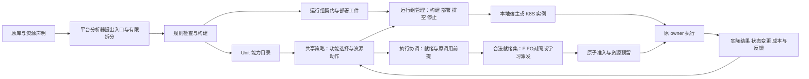

# 联合调度与运行组执行规格

2026-11-01 补充：[第 9 节](#9-本地模型服务的依赖与生命周期调度2026-11-01)核对 0.14.9 的模型服务缺口，维护本地可控服务的研究方案、文献比较和实现顺序。该节是待实现设计，不代表服务已经进入 joint/1，也不改变此前实验记录。

2026-10-29，0.14.0：第 5.2—5.3 节继续作为 joint/1 执行规格；新增任务工作集准入、内部检查边界派发、同窗口多路由及自动资源观测已接线，详见[本版说明](../版本更新/0.14_按需驻留与混合调度.md)。根请求仍持有原宿主，不抢占活动调用；未证明生命周期的组仍为 UNKNOWN。较早 REX 单来源诊断及建设任务按其日期理解。当前能力与准备缺口见[当前实现](当前实现.md)，主实验场景/对照以[协议第 15 节](../../../ccfa-workfiles/experiments/harness-paper-design/plan.md#15-多来源防护效果保持与资源调度主实验2026-10-28)为准。

更新：2026-10-21。本文维护部署前建设及联合调度的现行规格。P1—P8 的功能模式基础设施已有工作区实现，Linux／GPU／K8S 实机结果仍为 NOT_RUN；第 5.2—5.3 节的 `joint/1` 工作区已有代码实现，尚无真实联合运行。保留四层、原 W／H／R 与构造规则、三学习器；FIFO 保留为功能模式与排期对照，联合模式允许对合法就绪调用学习派发顺序。代码事实按当前工作区及[当前实现](当前实现.md)核对，文档更新不产生新实验结果。

本轮范围是服务器部署之前可完成的代码、接口、配置模板、实验接续和文档。服务器资源选择、权重／数据下载、模型服务部署、API 地址及密钥填写、GPU 实机配置与真实大模型实验由用户在服务器进行，不作为本地前置工作。代码仍须支持这些配置的引用、挂载和状态核对，但本轮不代填实际值。

## 1. 判断：当前任务窄，容器管理是另一项缺口

目前 REX 场景每个问题只生成 `continue` 和 `retrieve` 两个候选，见 `src/seampact/retrieval_scene.py`。这是一个来源、一个整体检索入口的场景限制。`learners.py` 按当前候选列表评分并使用合法性 mask，没有将动作数固定为二；增加多个合规 Unit、选择不同粒度、依据检查结果决定后续调用，不以 K8S 为前提。

两个动作也可以构成有价值的多步问题。现有 REX 会把检索证据累积到后续问题，不能简单当成互不相关的二分类。当前缺少的是足够多、真实且可观测的决策差异及其收益证据，不能用动作数或模型重量代替。

最新命名资源 REX 组的 294 次更新是 DDQN 87、PPO 120、SAC 87 的合计；各训练 90 个论文 episode。heldout 全跳过回报为 0，全开约 0.188624，简单策略约 0.195290。因此全跳过并非该组已知最优结果。DDQN／SAC 冻结后全跳过只能说明本配置没有学出有效的冻结策略；表示、探索、终局信用分配、优化和训练采样／冻结 argmax 差异都需要诊断，不能单凭输出归因为“学会少挨罚”。原始结果保持在原报告中，不为本方案改写。

更强服务器让完整模型及其真实代价能够进入实验；教师补充难以用程序评价的质量信号。这是重要实验条件，但不会自动产生好动作、可靠观测或贡献。没有教师也可以用客观判据训练；教师看训练参考答案本身不是泄漏，参考答案进入运行时策略／业务输入或测试反馈回流训练才违反相应协议。训练教师和独立评委采用同一模型可能造成相关偏差，不能据此断言必然失效；应分别记录并用独立判据复核。

结论：应建设运行组部署与基本生命周期管理，以承载异构执行环境及研究真实启动／驻留代价；同时补齐功能动作和真实事件接续。不能把“加上 K8S”作为解决当前学习失败或证明拆分价值的充分条件。

## 2. 当前代码事实

| 内容 | 已有实现 | 明确缺口 |
| --- | --- | --- |
| 功能选择 | 三学习器共享可变候选；`capability-features/2` 表达能力、方案和运行状态 | `ACTION_TYPES` 仍仅 invoke／continue／finish；训练清单固定 functional/1 |
| 原生调用与远程宿主 | 标量宿主与 `python311-native-group-worker/1`；原生组在同一进程保留原对象，组外使用 group-port/1 | 环境缺口须在目标宿主核对；不支持任意活对象跨组迁移；原生服务器调用待验证 |
| 部署 | 已有构建、发布、应用、登记、排空与停止后端；不可用时返回 BACKEND_UNAVAILABLE | 工件生成与实际部署成功分别记录；本地无真实 K8S 执行结果 |
| 实例与生命周期 | 多实例记录、代次与进程身份、健康、任务亲和；标量组有限增减副本 | 原生组目前 fixed_resident；尚缺任务／owner 结束及独立重建、复制的细分契约 |
| 派发与并发 | 已使能调用经中央 FIFO 和 owner／配额许可 | 默认全局 quota=1；训练逐任务运行，run_id 被用作任务上下文；副本尚不带来训练中的并行收益 |
| 奖励 | 程序／教师终局反馈；可选 event_module/1，局部权重默认 0 | 尚无跨任务工作负载轨迹与联合动作反馈；执行异常统一排除并中断运行 |
| 成本 | 实例事件与调用成本、运行窗口驻留汇总 | 窗口驻留仍记 UNALLOCATED_WINDOW_TOTAL，未进入联合动作回报；未知资源量不能填 0 |
| 实验镜像 | SEAMPACT_EXTRAS 选择学习器依赖，环境锁及依赖摘要进入清单 | 目标 Linux／GPU 环境及实际镜像须在服务器核验 |

这些事实分别可在 `retrieval_scene.py`、`capabilities.py`、`learners.py`、`deployment.py`、`worker.py`、`training.py`、`costs.py` 与 `deploy/Dockerfile` 核对。已有有限跨进程调用不等于已完成真实 K8S 部署。

## 3. 保留的结构与新控制对象

保持原四层。运行组执行、镜像构建和 K8S 后端放入现有适配／运行时实现，界面扩展现有“运行组与部署”；不另建 Agent 框架或独立实验平台。

Unit 是功能边界；运行组是必须保留共同执行上下文的成员集合；实例是该运行组的一次实际运行。共享模型／对象的多个 Unit 可以在一个进程内分别调度。不能预设一个 Unit 一个 Pod，不能把放在同一 Pod 的多个进程当作共享 Python 对象。

运行组契约至少记录：来源与分析版本、成员和允许的根入口、构造／owner／会话作用域、绑定工件、运行环境身份、组外端口与编码、允许的生命周期操作及依据。实例另记：group_id、instance_id、generation、平台 session、镜像摘要、配置版本、实际位置、初始化状态、在途 owner／调用和最近状态证据。

每个操作分别标记 `SUPPORTED`、`UNSUPPORTED` 或 `UNKNOWN`；未知不授予操作。建议区分进程启动、模型预热、停止接单、排空后停止、新实例启动、创建独立副本和现场恢复。运行组边界及条件仍由分析器提出、规则检查；开发者补通用宿主，不逐库预写包装和切点。

## 4. 必做的部署前代码包

P1—P8 保留基础设施建设要求，当前完成状态见第 2 节；本轮在其上补齐第 5.2—5.3 节，不能因为这些基础接口已有代码就将联合 RL 标记完成。

### P1. 可复现的实验启动环境

- 更新平台镜像、Compose、K8S 模板及文档，统一实际代码版本与镜像摘要；构建上下文允许读取 `pyproject.toml` 等所需项目元数据，安装步骤与 `.dockerignore` 同步维护。
- 提供包含三学习器依赖的明确实验安装入口，保留轻量平台入口。记录实际依赖解析结果，不把 `torch>=2.2` 这种宽范围当成完整复现锁定。
- 原服务独立环境与原生 owner 环境分别声明。已记录的依赖冲突需要有可用环境方案；不能把 Windows 虚拟环境直接拷贝给 Linux，也不能假定一个额外虚拟环境中的包会被平台进程自动导入。
- 本轮输出的是配置能力与构建入口，不提前指定未验证的目标 GPU／CUDA 版本组合，不下载权重。

### P2. 保留原 owner 的运行组宿主

- 保留现有标量宿主，并新增独立、版本化的有限原生运行组宿主规格。不能通过删除 `check_remote` 的资源／构造限制，宣称旧 worker 已支持模型。
- 新宿主装入冻结原源码和分析器生成、引擎核对的绑定，在同一个工作进程保留原构造次数、owner、原 controller、初始化与关闭。原每请求构造仍按请求执行，不因节省时延而改成常驻单例。
- 内部 W／H／R 边界继续在原上下文中向中央许可交接。把整个已核对运行组放进容器，不表示内部步骤获得任意独立启动、乱序或跳过权。
- 组外只开放已定义端口。不可变结构、图像和数组等可增加有版本的编解码／制品引用，须声明类型、形状／dtype、身份、可见范围及有效期；组内原对象边留在进程内。不能用任意 `str()`／JSON 转换替代原返回值，也不通过通用 pickle 传递活对象。
- 不能独立导出的原状态继续同组；没有合法组外编码或生命周期依据时给出具体 MISSING，保留原本地执行路径。
- 先覆盖原同步根入口及其受支持的组内绑定。生成器、流式回调和活跃栈迁移只有已有明确宿主规则时才开放，不承诺自动覆盖所有 Python 程序。

### P3. 从导出工件到实际部署控制

- 补齐显式操作：构建工件、生成镜像、使镜像对目标后端可用、应用运行组清单、读取状态、登记实例、排空与停止。首版使用用户配置的一个集群／namespace 和镜像可达方式，不建设通用集群调度平台。
- 镜像由冻结源码、系统生成的绑定与确定的运行环境组成。配置、凭据、权重通过已有引用机制在启动时注入／挂载，不能把秘密或模型副本自动打进镜像。源码依赖清单的执行与构建错误需有实际状态，不能把文件生成成功当镜像成功。
- K8S 后端采用显式客户端操作，记录 build／apply／instance 身份；K8S 自身负责 Pod 放置。平台 RL 不默认接管节点放置或替代 kube-scheduler。
- 构建、镜像可达、Deployment 已应用、Pod 运行、worker 已登记、原生初始化完成分别报告。原生命周期不允许提前构造时，worker 可接单不等于模型已预热。
- 已应用的 desired state 与实际 observed state 分开。重复提交部署操作可按操作身份核对，但原 Harness 调用不能因响应丢失自动重放。进程重启后重新确认平台会话、实例和未收尾调用，不伪造原任务恢复。
- 本地未具备 Docker／K8S 后端时，给出后端不可用及剩余操作，仍可保存构建工件；不返回虚假 DEPLOYED。

### P4. 生命周期与有限副本管理

生命周期建议采用 `UNDEPLOYED → STARTING → READY → DRAINING → STOPPED`，失败及执行不确定另记 `FAILED/UNKNOWN`；忙碌度、原模型初始化和请求状态独立表示。

| 操作 | 首版语义与允许条件 |
| --- | --- |
| 启动 | 创建新实例，核对身份，允许按原生命周期初始化；不能恢复旧活跃任务 |
| 预热 | 可以准备进程／允许提前准备的资源；只有原构造允许时才加载模型，不能提前执行有任务副作用的入口 |
| 暂停接单 | 阻止新根请求，已有 owner 可继续及完成内部接续；不会自动释放模型显存 |
| 排空后停止 | 等待所有根请求、原 controller、会话和许可收尾，再调用原关闭流程／结束进程；只看当前没有 GPU kernel 或一个 Unit 返回不够 |
| 冷停与再启动 | 可缩到 0 并创建新实例，计入重载成本；页面用“停止并释放实例”，不称保留现场休眠 |
| 增加副本 | 只对经规则核对具备请求隔离、状态／外部效果允许、原初始化可独立重复条件的运行组开放；新副本是新 owner，不能复制正在执行的现场 |
| 缩减副本 | 先选择可排空实例，停止向其分配新请求；已绑定会话留在原实例，存在 UNKNOWN 的实例不视为可安全结束 |
| 保留现场休眠／恢复 | 本轮不实现；包含 GPU 内存、调用栈和任意会话恢复，不是 K8S scale 或 rollout pause 的语义 |

实例登记及亲和路由已有实现；联合模式须进一步区分 workload、task、session／owner 和 instance 身份。根请求选择实例后，所有组内调用固定在该实例；不依赖普通 Service 随机转发来维持 owner。携带 group／instance／generation／session／call 身份校验。多副本不自动授予同一个原请求内部的并行权；FIFO 可被合法就绪集中的学习排序替换，原控制关系与原子准入继续有效。

初始默认副本数仍为 1。平台可具备副本管理接口，但具体组未通过可复制性检查时禁用。无并发请求或资源竞争的工作负载不以“扩副本”为研究动作；否则只是在增加没有用途的选项。

### P5. 功能动作、接续与共同表示

- 在 `scenarios.py` 与现有 scene 桥中明确决策事件、可见状态、可选 Unit／已核对方案、输入数据来源和实际结果接续。桥只能调用能力目录，不访问原库内部对象来制造新切点。
- 支持同一事件上的多个合规能力及合法粒度选择；调用结果更新后再出现下一决策，例如新证据到达后选择核验、修正或继续。是否存在这种接续必须来自真实任务／Unit 契约，不能强制四来源互相配对。
- 保留 `continue`／结束等具有业务含义的候选；原必需步骤仍由规则与任务义务保留。内部等待、网络轮询及监控 tick 不伪装成 RL 决策步。
- 版本化扩展共同表示：能力目标、输入输出、作用、粒度与前提；任务当前已知信息和已付费取得的结果；允许的动作类型；运行组冷／暖、队列、忙碌／可接单、观测时间及缺失标记。当前 `goal` 文本不直接进入数值网络，不能仅填写文字就声称已解决共同语义。
- 新的类型要能表达鉴伪／定位等已选能力；数据集真值、最终教师评分和未来状态不得成为在线特征。特征提取如增加模型调用，也必须计入在线成本。
- 区分语义合法性与立即可派发性。冷但可启动的能力不能永远被从候选池删除；功能动作可经执行协调器完成启动、等待就绪再派发。不可执行、资源未配置的候选则报告具体原因。
- 任何新增 schema 或动作语义都进入 checkpoint／manifest 兼容判断；不能直接把旧二动作经验或旧特征维度当作兼容的新联合策略。

### P6. 教师与模块反馈的实际接线

- 复用已有教师配置、证据白名单、图像发送与结构校验，增加按真实调用／状态变更保存的模块反馈记录：调用是否完成、功能是否完成、激活依据、可观测的状态变化，以及支持判断的证据引用。
- 模块反馈与系统终局评价分开。核验器正确给出“证据不足”可以完成模块职责，不能因此给出系统成功；没有调用也必须取得系统终局评价。
- 允许把训练参考答案送给明示允许的教师／程序评估器，隔离于策略及业务输入。训练教师、最终评委的角色和版本独立记录；共享底模不等于独立，也不自动构成泄漏。冻结评测不把评委结果回写策略或经验库。
- “必要性”可作为诊断／可选监督，不能冒充未执行路径的实际增益。真实增益依靠相同初始条件的配对调用／跳过或策略对照，涉及有副作用任务时仅在可重置环境重放。
- 教师缺结果保留 UNKNOWN、实际费用和所有尝试分母，并按动作／任务难度统计覆盖率；不能把缺反馈直接标为失败或零成本。保留当前不完整轨迹不进入完整回报更新的规则，另报告由此产生的样本选择偏差。
- `sparse_terminal` 仍可作为完整基线。新增逐事件反馈模式必须显式记录奖励时点；如果采用增量质量或局部 shaping，终局只结算尚未计入的部分，不能按每次调用重复奖励同一最终正确答案。初始局部权重可为 0，是否启用通过开发对照决定，不把设计模式记成当前已实现。

### P7. 成本、状态与训练诊断

- 补实例级事件：构建／启动、初始化、排队、实际调用、空闲驻留、排空和停止；记录实际持续时间、采样来源、实例身份及阶段。墙钟时间不能冒充 GPU kernel 时间，无法测量的项保留 UNKNOWN。
- 原调用内部重试／Token 用量只能据实际证据统计，不由外层成功返回猜测。不同机器时钟用于对齐时需要明确偏差；单次耗时使用本机单调时钟。
- 质量、时延、调用 Token／费用、驻留内存积分和失败分项保存。实验目标选择互不重复的成本项并冻结尺度／权重；端到端时间已经包含初始化或排队时，不再把这些子项重复相加罚一次。
- 部署启动和空闲成本可能跨多个任务，须指定整段工作负载的计费窗口和分摊方式，另报告不分摊的窗口总量。实例一直空闲也在资源实验分母内，不能因没有 Unit 调用而消失。
- 输出候选／mask、动作概率或 Q 值、探索状态、训练与冻结选择差异、每动作样本数、奖励分项和有效反馈覆盖率。先诊断现有全跳过结果，不能仅通过增加动作掩盖学习问题。
- 当前 `risk_limits` 只是违规报告，不是已实现的约束 RL。必须执行的防护由规则／任务义务保证；可选防护报告漏防、误干预与成本，不声称经验奖励保证零漏防。

### P8. 实验身份、迁移与前端

- manifest 增加运行组／实例契约版本、镜像与绑定摘要、动作与观测 schema、反馈协议、成本窗口、资源控制模式及策略版本。原历史工件不回填，不把新代码记到旧运行。
- 服务器使用新的执行状态与实际路径。可共享实验定义、任务划分和可复用分析工件有明确导入／重新检查路径；禁止把 Windows 状态库中的原绝对路径及凭据直接当作 Linux 当前运行状态。实际目录与凭据填写留到服务器。
- 界面分别显示 Unit、运行组和实例；按组提供构建／部署／停止接单／排空停止／启动／允许时增减副本，并展示禁用原因。任务仍按 Unit 显示实际选择和结果，避免把“不调用”显示为“模型已卸载”。
- 训练运行冻结配置；编辑页面只影响后续运行。正在运行的实验不能被另一次手动启停悄然改变环境；外部人为变更记录为环境变化／中断，不能混入同一冻结对照。
- 同步 README、当前实现、服务器与 K8S 文档、实验方案。标明代码实现、工件导出和服务器实际执行三种状态；Linux／GPU／K8S 未运行就保持 NOT_RUN。

## 5. 调度动作的接入方式

建议支持两个明确分开的实验模式，避免把基础设施动作混进旧任务而改写原结论。

### 5.1 功能调度模式：保留已有基线

RL 选择 Unit／合法方案／继续；运行时按固定、公开的规则准备实例并等待就绪，下层 FIFO 派发。启动与等待成本进入该次任务／工作负载记录。这样已经可以比较完整模型的质量—代价取舍，也能验证拆分后新增的选择是否有用。

该模式下生命周期控制器可使用固定驻留或开发集选定的空闲回收规则。它是所有被比较功能策略共享的执行条件，不把控制器收益计给 RL。副本固定，保留最简单的解释路径。

2026-10-21 实现收尾后的限制：空闲回收当前只开放给经标量规则核对可独立重建的组；原生有状态组使用 `fixed_resident`，不能凭两次调用之间无在途请求重建 owner。暖态须核对本次运行全部所需成员已完成契约允许提前的初始化，失败即停止在任务阶段之前；进程 READY 单独记录。具体实现与未运行项目见[收尾与能力边界](../部署与操作/运行组与K8S部署.md#2026-10-21-收尾与能力边界)。

### 5.2 功能、派发与生命周期联合模式：本轮建设目标

`joint/1` 复用现有三学习器的共享候选评分，在同一工作负载中处理功能、就绪派发及资源决策。上下层仍是职责划分，不要求新增两套网络或新的 RL 更新算法。动作候选由实际事件和运行状态产生，不枚举任务×Unit×实例×副本数的全部组合。以下七类、八个标签是首版范围，不是理论上的充分动作集或固定上限。

| 类别 | 标签与参数 | 状态变化与准入 |
|---|---|---|
| 功能选择 | `invoke(task, unit_or_checked_plan)` | 非阻塞提交获准业务请求；实际调用仍由原 controller／绑定生成并等候许可。提交不等于执行成功，必需依赖及粗细互斥继续检查 |
| 业务推进 | `continue(task)`／`finish(task)` | 跳过允许取舍的工作或完成任务；未履行义务、待返回的必需调用不得被关闭 |
| 学习派发 | `dispatch(enabled_call)` | 从已使能且依赖、owner、效果及资源条件允许的调用中选择下一次许可；不能提前创造内部调用、改变原分支或抢占已启动调用 |
| 提前准备 | `prepare(group)` | 无实例时 0→1，或补足现有实例契约允许提前的初始化；原每请求构造不改为常驻单例，进程就绪与模型就绪分开 |
| 水平扩容 | `scale_out(group)` | n→n+1，n≥1；独立创建实例，只接新任务。须有复制资格与资源预留，不复制运行现场 |
| 水平缩容 | `scale_in(instance)` | n→n−1，包含 1→0；首版选择已无任务／owner lease、在途／排队接续及未确认请求、且原生命周期允许结束和重建的实例；原子停止接新单，再排空确认释放 |
| 保留与等待 | `yield_until_next_event` | 保留当前部署，推进到下一真实事件或预先配置的正时长复查点；等待期间照常累计任务与驻留成本 |

旧讨论中的 `replicate` 对应 `scale_out`，`release`／`retire_idle` 对应 `scale_in`，不同时生成同义候选。初始副本配置与上限分别冻结；首版默认上限 2 足以研究一个并发增量，并非理论上限。STARTING／DRAINING 等占用尚未释放时仍计入容量，不能依靠异步提交绕过副本和资源预算。

功能请求的提交与已使能调用的派发是两个不同决策对象。同一调用只启动一次，不能把它们计成两次模块完成或奖励。实例选择先沿用确定性的亲和／可接单路由；`dispatch` 不同时学习节点放置或活跃会话迁移。单候选只作执行记录，不把无选择的内部交接数量当作研究贡献。

候选合法性按动作类型判断，不能继续对所有动作统一应用 `required_units <= candidate.units`：资源操作不完成也不消除任务义务，`dispatch` 核对已批准请求与真实发生，`continue/finish` 才检查是否允许接续／结束。原内部强制检查不能因派发另一个合法请求而被遗漏。

冷组的获准业务请求保留确定性的按需启动路径，等待实际就绪后才能派发，启动／等待费用归入该请求所在窗口；`prepare` 的额外选择是提前准备及与其他工作的时间重叠。按需启动与主动准备合并同一目标，不能重复创建实例。调用结果返回对应任务继续者后，才产生下一业务决策或质量反馈。

#### 5.2.1 FIFO、学习排序和硬约束

FIFO 的作用是无需耗时预测、保持确定的对照和方便归因；它不是 W／H／R 保真或 T3 许可不变量的必要前提。全局到达顺序不同于原依赖／owner 顺序。跨任务或已获准独立发生之间，可以改变先后；同一会话的原因果顺序、保护前缀、效果限制和非抢占继续保留。FIFO 在合法就绪集合中工作，不因队首不可派发而阻止其他合法工作。

运行配置冻结 `dispatch_policy`：`fifo/1` 为基线，`shortest_estimated/1` 为有可用历史耗时预测时的对照，`learned_ready/1` 为联合学习目标。短作业预测只能使用训练／历史已知材料，保留估计误差与缺失标记；缺失时的 FIFO 回退规则随配置保存。有真实 deadline 的场景才加入 EDF，不虚构截止时间。学习策略在不同等待、暖态、资源需求和任务上下文下给候选评分，是否优于规则由相同工作负载对照回答。

本轮固定采用总等待年龄：`age = now - enabled_at`，从根请求被使能时开始计时，因宿主、owner 或槽位阻塞时不清零；每次仅在当前合法可派发集合中，对达到 `age_guard_ms` 的请求优先选择最早使能者，同龄以 FIFO 打破并列。不采用“持续合法时间”计时，避免合法性反复变化重置保护。它不解除依赖或预留条件，不抢占运行任务，也不在容量不足时承诺 SLO。资源操作不能无限推迟就绪业务：同一时刻合并重复目标、禁止无状态变化操作，并限制连续资源决策；有可派发业务时，达到冻结的决策上限或年龄条件必须进入派发机会。相同保护用于全部排期对照。

当前 `Coordinator` 默认全局 quota=1，训练逐任务运行；远程 worker 也回中央取得许可。实施须按实际托管容量开放独立实例间并行，保留 owner 不可重入、同进程原生锁及外部效果限制。先按任务和真实实例区分 owner 身份，不能仅把配额调大或删除锁就声明合法并行；父子调用的预留释放和接续不得死锁。

#### 5.2.2 水平扩缩容与 K8S 的分工

水平扩缩容属于本轮 RL 动作。当前后端一个实例对应一个单副本 Deployment，平台按运行组管理这些实例；因此 group 的 1→2 可实现为创建第二个 Deployment，2→1 删除指定已排空实例。学习动作使用运行组／实例身份，不依赖某一种 Deployment 布局，也不直接用 `kubectl scale` 任意删除有状态 owner。

同一实验由一个控制器拥有组副本决策权，不能同时让 HPA 与 RL 独立修改同一容量；HPA 或队列阈值扩缩可另作对照。RL 提出意图，执行器检查契约、原子预留和后端结果，K8S 负责 Pod 放置。资源观测包括 desired、STARTING、READY、DRAINING 和实际释放状态；提交扩容不等于获得即时容量。

暂不纳入垂直伸缩（改变单实例 CPU／内存／GPU 规格）、集群节点扩缩、多节点放置学习、批处理接口改造和保存现场休眠。这些会改变实例服务能力、模型／运行配置、重建方式或底层硬件分配，需另有动作契约和成本依据。保留这些边界不影响当前水平扩缩实验。

#### 5.2.3 事件、工作负载与成本

一次 episode 覆盖一段有限的真实或可重放到达序列及其任务收尾。任务到达、阶段结果、调用许可释放、准备／缩容完成和规定的空闲复查点产生事件。异步准备、已提交调用与其他任务可交叠；无候选但仍有在途工作时等待，不能当作任务完成。工作负载初态、到达窗口、收尾时限和终止规则对所有策略一致，策略不读取未来到达信息。

`task_done` 结算该任务的质量，只有窗口真正结束才 `terminated`。截止仍未完成的任务按预先声明的超时／未完成规则保留在分母；清理和未释放占用记录到共同终止点。运行中按真实 task／session／owner lease 保持亲和，窗口 run_id 不能替代全部任务身份。单次 Unit 返回不等于原会话结束。

联合观测至少含当前任务与义务、候选能力及粒度、就绪调用年龄、历史服务时间估计与缺失标记、组冷暖／初始化、期望与实际副本、在途／队列、占用／预留与剩余预算；特征获取和策略推断计入成本。实际下一状态和时间跨度进入 transition，不能用预期部署成功替代。

有限窗口首版推荐 `gamma=1`，以窗口累计回报学习；三学习器显式核对终止／截断和相同折扣配置。任务质量仅在其完成时结算，时延与驻留成本按相邻事件区间累计，不给启动／扩容成功独立正奖励。若使用任务数×时间积分作为响应时间代价，不再重复相加每任务完整响应时间；启动／排队分解保留作诊断。资源预留时长可以作为明示代理，不能冒充实测显存积分。模块局部奖励默认仍为 0，开启时沿用不重复计分规则。

合法动作的可观测失败作为 action outcome 留在轨迹，并结算实际耗时／费用；发生语义未知、身份更换或结果无法确认时记 environment-invalid／UNKNOWN，按完整反馈要求排除并保留总尝试分母。不能把所有资源失败都转成 execution_error 筛出学习。教师评价业务质量与模块结果，不负责给每次扩缩动作编造增益。

按时间折扣的 SMDP 可另行研究，不以增加时间字段代替三个学习器 target 的定义。本轮不引入 JitRL。冻结 mode、dispatch_policy、动作／观测／工作负载／成本 schema、年龄与操作上限、运行组契约及配置；旧 functional checkpoint 和转移不默认兼容 joint。前端按上述动作名称展示选择、禁用理由、实际结果与成本，禁止将计划功能标为已实现。

### 5.3 自动形成受约束的部署粒度

先形成可执行划分，再研究其性能；首版运行期间固定分组，不要求最优。分析器从原入口及 W／H／R／导出候选中提出 owner、对象别名、数据／控制／效果和生命周期依赖，检查器核对源码依据。活对象边、原控制上下文或未获准外传状态构成必须同进程的关系，按这些关系的传递闭包合组；只看调用图强连通分量不足以发现无环的共享对象依赖。

跨组端口必须已有类型／编码、输入来源、继续者和生命周期条件。未决成员保守留在原上下文；如必须合组却有无法满足的环境冲突，报告 MISSING，不以性能收益强行切开。当前保守分组可作为起点，后续比较原整体组、规则形成的基本组及有限合法合并；同组不授权把原本不同的构造合成一个共享单例。

每组分别检查 call、prepare、reclaim 和 replicate 的许可及依据。只读模型驻留／请求临时状态隔离、可重复初始化、外部副作用及独立资源配置支持独立实例；会话状态须绑定原 owner，结束及清理条件成立后才回收；未判清的进程全局状态继续 UNKNOWN。重模型不因使用 Python 对象就永久禁止操作，也不因无在途调用就自动获得重建资格。所有许可由通用分析／检查产生，不为指定仓库手写例外。

**部署前收束口径（2026-10-21）：** 契约使用 `lifecycle-conditions/1` 分别报告下列条件；检查器产出状态，分析器与前端消费缺口，不接收手工“可复制”开关或教师口头保证。

| 条件 | 必需依据 |
|---|---|
| 请求隔离 | 请求临时状态不串扰，保留原 owner／会话亲和，无未核对的进程全局或外部共享写入 |
| 可重复初始化 | 冻结构造及资源配置可在新进程独立执行，不重复不可幂等的外部注册／写入 |
| owner 结束 | 原任务／会话确已结束，无后台续接、回调和待兑现义务，单个 Unit 返回不够 |
| 清理 | 原清理与外部工作已结束；进程退出及后端删除能确认资源释放，失联不算释放 |

`replicate` 取前两项；`reclaim` 取全部四项。执行时仍核对资源预留、任务 lease、在途调用、UNKNOWN 和实际释放，静态资格不替代这些动态条件。现有独立标量规则能确认这四项；原生模型尚无覆盖这些条件的通用源码规则，逐项保留 UNKNOWN。此时允许已有契约支持的调用、派发和准备，禁止窗口内扩缩；整窗退出后的后端清理不等于允许窗口内回收再建。

首轮服务器部署不以补齐任意 Python 模型的生命周期分析为前提。原生组可先用于功能／派发／准备实验；扩缩只在自动核对通过的组上运行。真实来源没有合格组时，重模型扩缩实验明确 NOT_RUN，不以标量或合成工作负载结论替代。新增原生规则仍必须在平台通用分析／检查链内实现，不能为赶实验按仓库名放行。

至少在有真实独立请求、竞争和可复制组的工作负载上研究扩缩容。若本轮来源均未满足资格，保留缺口和受支持动作，不能用简单标量副本结果替代重模型扩缩收益。部署粒度是否创造了有用选择与其是否合法分别建立证据。

## 6. 如何判断建设有效

部署前完成代码与工件接线，并用现有可运行入口／场景核对实际路径；不创建第二套测试平台，不在本机强行运行无法容纳的模型。服务器上的真实执行、GPU／依赖兼容和性能结论单独记录。

| 要回答的问题 | 最小对照 | 保持一致的条件 |
| --- | --- | --- |
| 多能力选择是否有用 | 跳过／全开／简单规则／当前 RL | 同任务、合法候选、输入信息、反馈与数据预算 |
| 拆分是否增加有效选择 | 原整体入口／分析器产生的合法拆分入口 | 同来源和任务、原必需步骤与生命周期；不手工创造切点 |
| 部署隔离本身影响多少 | 原本地宿主／等价运行组宿主 | 原算法、配置和任务一致，计 IPC、启动与序列化成本 |
| 生命周期管理是否有用 | 固定驻留／固定空闲回收／联合策略 | 相同功能候选和允许操作、到达序列与资源预算 |
| 学习派发是否有用 | FIFO／有依据的短作业优先＋年龄保护／learned_ready | 相同已批准业务、实例控制、合法就绪集与公平规则；不以未来真实耗时排序 |
| 水平扩缩是否有用 | 固定副本／队列阈值扩缩／学习扩缩 | 相同容量上限、准备和原复制契约；有真实到达重叠，计冷启动与空闲副本成本 |
| 收益来自哪部分 | 固定资源控制＋功能 RL／固定功能策略＋资源控制／联合模式 | 不同时改变模型质量、任务集和动作粒度 |
| 教师是否提供有效信号 | 客观反馈／客观＋教师／有依据的局部反馈 | 教师预算、可见材料、独立最终评测和 UNKNOWN 分母 |

按论文／原图／任务来源划分训练与保留材料，防止同源近重复泄漏。只在开发集选择奖励尺度、阈值和驻留规则。冷启动与暖态分别比较，或固定相同初始状态与到达序列；不能让第一个策略承担全部加载成本。

报告系统任务质量／安全、原模块功能、实际配对增益、端到端时延、队列和启动开销、Token／费用、驻留资源、无效／失败调用、有效反馈比例与调度开销。副本实验需要真实并发或到达序列；纯顺序任务不能据此宣称扩容价值。

K8S 接通证明部署路径有效，不能单独证明拆分创造价值或 RL 优于规则。简单策略最好时保留结果，基于开发集诊断是任务结构、信息不足、反馈或学习问题，再决定扩池；不以“必须让 RL 赢”为目标选择保留集。

## 7. 交接顺序与边界

推荐实现依赖顺序为：P1 环境入口 → P2 运行组契约与原生宿主 → P3 部署后端与 P4 基本生命周期 → P5 功能事件／表示 → P6/P7 反馈成本 → P8 界面与复现同步。每项都保留旧路径，不在迁移时重写历史记录。

部署前的必做范围包括已有 P1—P8 基础及 `joint/1` 的七类动作、合法就绪学习派发、水平扩缩、异步连续工作负载、分项生命周期契约、真实成本和前端配置。副本不具备语义条件时禁用，不能为完成界面把支持状态强设为真。资源实际配置及 Linux／GPU／K8S 验证在服务器完成，代码接线与实际可用分别标记。

联合学习现为下一次服务器实验的实现目标，不能继续以“功能模式已跑通”代替完成。功能模式与 FIFO 保留作对照，学习派发、生命周期及完整联合的收益分别报告；论文主方法定位由实际结果决定。垂直资源伸缩、集群节点扩缩、多节点放置学习、保留现场休眠、任意活对象跨组迁移、任意 Unit 自动复制和新 JitRL 算法不列为此次前置。

对下一实现会话的要求：先读本文及当前实现，按实际差距补通用引擎、宿主、部署和场景接口；不预包装四个源库，不改原算法，资源准备按当前用户授权执行；本节不代配私人 API，不将新动作混入旧实验身份。静态工件、已实现功能与服务器真实运行分别交付；具体新增语义若超出本文给定范围，再提出选择，不能自行放宽执行规则。

## 8. 依据

- 当前事实：[当前实现](当前实现.md)、[真实实验记录](../history/四候选接入与真实实验.md)、[运行组与 K8S](../部署与操作/运行组与K8S部署.md)、[资源配置操作](../部署与操作/资源配置操作.md)。
- 原研究边界：[研究实验方案](../研究实验/研究实验方案.md)、[候选与两层评价](../研究实验/Harness候选与两层评价方案.md)、[构造语义与规则实例](../../../想法/21_拆分接入的构造语义与规则实例.md)。
- Kubernetes [Deployment](https://kubernetes.io/docs/concepts/workloads/controllers/deployment/) 管理期望副本及发布；暂停 rollout 不代表暂停进程或释放显存。[Pod 生命周期](https://kubernetes.io/docs/concepts/workloads/pods/pod-lifecycle/)区分原 Pod 与替代实例，不能据重建推定旧会话／对象已恢复。这些部署机制不提供 Harness 语义合法性的证明。
- [Fusionize，IC2E 2022](https://arxiv.org/html/2204.11533v2)，第 III—IV 节区分逻辑任务和部署函数，以规则寻找较好但未必最优的分组；这里借鉴粒度分离，原 Python 状态与控制检查仍由本项目规则承担。
- [Decima，SIGCOMM 2019](https://web.mit.edu/decima/content/sigcomm-2019.pdf)，第 5.2—5.3 节提供合法候选、共享评分、事件驱动及按时间累计成本的依据；不据其 Spark 并行度动作推定任意 Harness 可复制。
- [FaasCache，ASPLOS 2021](https://homes.luddy.indiana.edu/prateeks/papers/faascache-asplos21.pdf)，第 4 节用调用频率、初始化成本和资源占用选择保温／回收，适合资源控制强基线；它不提供本项目的联合 RL 结果。
- Kubernetes [工作负载自动伸缩](https://kubernetes.io/docs/concepts/workloads/autoscaling/)区分水平副本、垂直资源调整等机制；[HPA](https://kubernetes.io/docs/concepts/workloads/autoscaling/horizontal-pod-autoscale/)是可独立比较的自动副本控制器，不与本轮 RL 同时争用同一控制目标。

## 9. 本地模型服务的依赖与生命周期调度（2026-11-01）

状态：以下缺口分析以 0.14.9 为基线，0.15.1 已开始本地接线，具体实现和验证以[当前实现](当前实现.md)为准；本节的完整研究设计及真实工作负载对照仍待验证。本节集中维护设计；资源配置、分类和主理论文档只链接此处。这里的“本地可控”指实验拥有后端实例控制权，可以是受管机器上的服务，不由 URL 是否为 localhost 决定。共享机器上借用的服务不自动获得启停许可。

### 9.1 0.14.9 仓库事实与缺口基线

| 链路 | 已有实现及代码位置 | 本地独立模型服务缺项 |
|---|---|---|
| 资源绑定 | `providers.py::Profiles.connection_profile`、`dependencies.py::DependencyBindings` 冻结连接及原参数映射；`resources.py` 检查／调用连接 | 连接没有可控部署身份；地址可访问不证明平台拥有模型实例 |
| 容量与工作集 | `joint.py` 限制 demands 为远程运行组；`residency.py::freeze_working_sets` 从任务 Unit 找 group，`WorkingSets` 对任务声明取并集 | 未沿服务依赖扩展；工作集可能只有轻量调用者，漏掉实际持有模型的服务 |
| 生命周期 | `deployment.py::Deployments` 已有组锁、实例代次、owner 亲和、准备、排空、后端停止确认 | worker 协议不能直接用于模型 HTTP 服务；服务没有进入同一控制与租约链 |
| 结束与释放 | `joint.py::Window._teardown` 释放本窗口的运行组，记录未确认释放；`release_run` 只处理本 run 创建的实例 | 没有服务依赖反向收尾；后续教师／评价可能继续使用同一服务，不能随 worker 一起过早释放 |
| 成本 | joint 成本为任务秒和未释放实例秒；资源观测已有 GPU UUID、进程／cgroup 数据 | 服务未登记实例时没有对应生命周期归属；配置设备采样可能看到总占用，却无法归因到服务。实例秒也不区分轻量 worker 与大模型 |

现有能力可以复用，但接上一个 URL 不会自动贯通以上链路。TruFor 的最新原 Docker 样例已经在 GPU 跑通，见[当前实现](当前实现.md)；它仍是每次 CLI 调用加载后退出，保留外层 worker 不等于保留该模型。此次设计不将其重写为驻留服务。

### 9.2 分类增加资源关系，不强迫所有 Harness 微服务化

沿用 [C／S／R 分类与操作契约](Harness分类与调度契约.md)：用途说明它做什么，C／S 说明原调用及状态边界，R 进一步表达**资源位置、持有者、控制权、共享关系**。模型服务是执行依赖，不新增业务 Unit 或第五个平台层。

| 实际形态 | 资源持有者 | 可提出的调度动作 | 计量边界 |
|---|---|---|---|
| 原进程常驻模型 | Harness 实例中的原 owner | 原契约获准的初始化、保留、结束后回收 | 计入该进程，不能再把同一模型作为独立服务重复计费 |
| 原生每请求 CLI | 每次子进程／调用 | 派发及原流程允许的准备；退出后确认回收 | 每次加载与调用都计入；外层容器热态不代表模型热态 |
| 平台管理的独立服务 | 有后端句柄的服务实例 | 按服务契约准备、保留、排空停止；复制资格另核对 | 实例加载、空闲、请求与释放尾部均记录 |
| 借用的本地服务 | 平台无启停权的外部持有者 | 调用、限额内排队，不能回收 | 已知共机占用进入可用预算，无法归属的部分标未知 |
| 云端服务 | 云端提供者 | 连接及调用 | 请求费用、等待和失败；远端 GPU 占用不推算为零 |

同一来源可能同时包含多种形态，应按真实依赖逐项登记。相同模型名、镜像或权重只说明潜在兼容性，不证明是同一物理实例，也不证明能共享会话、并发执行或安全重建。别名连接只有明确引用同一服务实例时才去重；独立副本逐份占用。

分析器仍负责从冻结源码发现资源使用及传递关系，给出原调用、初始化／读取时点和证据。部署者补充镜像、设备、权重及实例控制方式，是运行资源配置；若人工补入漏检的依赖边，则记录辅助来源，不能算自动发现。不能从“调用 OpenAI SDK”推断服务已部署、无状态或允许关闭。

### 9.3 最小记录与接线

保留三种身份：`connection_id` 表示原客户端使用的连接，`managed_service_id` 表示可重建服务规格，`instance_id + generation` 表示一次真实启动。配置摘要与运行代次分开：重启不伪造新模型版本，换模型／镜像／关键推理配置则改变实验身份。

认证仍用既有私有凭据引用；公开规格、启动记录和分析上下文不包含密钥。服务规格及依赖闭包进入新的运行快照，旧实验不回填；新增特征／成本字段须显式版本化，旧策略不能静默套用新向量。

| 记录 | 必要字段／约束 |
|---|---|
| 服务规格 | 镜像摘要、冻结启动参数、模型／权重身份、设备集合、挂载、网络与稳定端点、服务协议／版本、准备及停止方法 |
| 运行条件 | 控制权和实验所有者、请求／会话隔离、可重建性、并发上限、是否有后台工作、真实模型就绪探针；不以 LLM 判断代替服务能力契约 |
| 资源包络 | 各设备显存、主机内存、加载峰值、允许输入／并发下的 KV cache 等上界或测量依据；缺失不填零。仅静态权重大小不足以保证不超量 |
| 依赖边 | 原入口／owner、connection 引用、服务规格、必需条件、读取时点、最晚安全释放边界、证据及辅助归因 |
| 实例事实 | 后端容器／进程身份、代次、状态、端点、设备与 PID／cgroup、任务／评价租约、启动／就绪／释放时间 |

接线为：原入口及依赖证据 → 冻结连接和服务规格 → 任务资源闭包 → 原子准入 → 准备所需实例 → 核对就绪 → 原 SDK／CLI 调用 → 租约结束 → 合法保留或回收。原业务接口保持原义，不为模型服务伪造 `/invoke` Unit。

实现上在现有部署层引入 worker／model-service 两类执行目标，共用控制权、实例登记和事件记录，后端适配器分别落实 start／probe／drain／stop／observe。首版复用已有 Docker 后端管理一种明确协议的模型服务；不要求同时实现任意服务引擎、节点放置、模型迁移、服务内部 token 排期或新 UI。

**端点也是缺口。** 当前依赖快照会冻结 base_url 等字段；实例重建若换地址，原客户端仍可能持有旧值。优先使用与冻结配置一致的稳定网络别名／端口，并核对后端代次及模型身份。必须换地址时，只能在原对象允许重建的边界重新绑定客户端；不能在线改全局环境变量，也不能把新进程当作旧会话继续。

### 9.4 完整工作集、就绪与回收

1. **任务声明包含传递依赖。** 将当前 group 集合扩展为原宿主和它依赖的服务分配单元；必需的后台／子调用也不能漏掉。对已接纳任务、固定保留项和未确认释放实例统一计算容量。一个服务被多个任务引用时，只预留一份基础驻留，新增并发需要的额外资源仍按包络处理。
2. **原子准入后按需准备。** 不先占住 worker 再无预算地等待服务。准备占用从 STARTING 起计算，DRAINING／UNKNOWN 未确认释放前仍占预算；同一服务的并发准备合并为一个启动。模型池总量可以大于服务器容量，按当前接纳任务的并集管理，不要求所有来源同时驻留。
3. **保留当前任务租约边界。** 首版沿用整任务资源声明，直到任务／owner 真正结束。若单任务必需闭包也放不下，明确拒绝该配置；不能假称系统已经支持任务中途卸载和恢复。按阶段缩短资源租约需要原状态不再使用及可接续证据，是后续独立扩展，不能用“下一步大概不用”放行。
4. **分别记录容器就绪和模型就绪。** 服务状态可为 STOPPED → STARTING → MODEL_READY → DRAINING → STOPPED；失败／失联走 UNKNOWN 占用。进程运行、端口开放和一般 HTTP 200 都不足以证明指定模型可请求。就绪以冻结服务版本的模型健康语义为准；必要探测请求单列成本，不混入任务质量分母。多模型引擎需要逐模型状态，首版限定单一冻结模型配置。
5. **原客户端直连也必须有租约。** 首版在最外层真实调用／任务范围持有服务租约，覆盖其内部重试、流式返回和后续使用，不要求拦截每个 token。根请求返回但存在后台工作时继续持有；网络超时不证明服务已结束。只有租约为零、在途／未知请求已解决且允许重建时，才停止接单并回收。
6. **收尾覆盖所有使用者。** 先结束任务、续接及需要该服务的教师／评价，再按依赖反向清理本窗口拥有的实例。共享实例要看全部使用者，不能只看某个 Harness 是否结束。首版可限定一个实验窗口拥有服务控制权、窗口内跨来源共享；跨窗口无控制权的借用不擅自停止。普通聊天、分析等后台角色若也借用它，必须登记为使用者或保持固定，不暗中进入回收范围。

“无任务租约”只表示可能允许回收，不表示自动立刻回收；保留多久仍交由固定规则或策略选择。后端确认实例退出／删除才归还额度；GPU 总显存不归零在共享机器上是正常的，释放核对应看本实例归属进程及后端对象。缺少有效句柄或释放证据则保留未确认状态。

以上容量安全只在资源包络可信、依赖覆盖完整、控制权独占且状态及时协调的条件下成立。多人共享机器的外部抢占会改变有效容量；不能把它解释成策略动作，也不能仅靠一次启动前采样保证整窗可用。

### 9.5 可研究机制及与 RL 的连接

建议问题表述：**在保留原防护工作量和状态语义的条件下，从异构 Harness 提取可执行操作及资源依赖，联合决定真实调用的派发、共享资源准备和驻留。** 其中接通服务启停是必要实现，研究机制需落在“哪些操作有依据”和“这些合法自由度如何改善端到端成本”。

将原操作依赖与资源使用关系分开：前者约束调用顺序／owner，后者允许多个调用共享同一资源。原 Python 程序不必预先成为完整静态 DAG；只能使用当前已核对关系和已使能事件，未知动态分支不能作为确定未来工作。操作的候选集合仍由逐项契约及实时 guard 产生，RL 不决定是否绕过契约。

令 W(q) 为任务 q 的必需资源分配集合，P 为固定保留集合，A 为已接纳任务集。在分配映射及包络固定的情况下，预留集合是 U(A)=P∪⋃[q∈A]W(q)。新任务的基础驻留增量为：

`ΔD(q | A) = Σ[r ∈ W(q) \ U(A)] d_r`

`d_r` 是各设备／主机资源向量；已启动的投机准备、回收中实例和额外副本另加入实际占用，并与预留取并集，不能漏计或相加两次。该式描述基础驻留的去重，不证明并发增量、时延或能耗线性，也不是新的最优性定理。

示例：两个 Harness 引用同一模型服务，第二个任务可增加轻量宿主与请求容量，而不再次增加该服务的基础权重驻留。回收收益则取决于整个依赖集合是否已无租约；只按单个 Harness 最近使用时间会误判。这种跨来源的边际占用和冷启动收益，应成为共享评分器的显式输入，而不是把所有实例都压成同一个“冷热”位。

沿用事件驱动 joint 框架，观测补充：候选新增资源向量、共享使用者／等待者、实际就绪状态、历史加载耗时及不确定性、租约与可释放容量、已知依赖进度。动作复用 prepare／dispatch／合法 scale_in／保留；服务复制另经资格核对。CPU 原宿主、GPU 模型和外部 API 不需要相同动作集。

现有 `task_seconds + instance_seconds` 奖励不能区分实例规格。建议增加**按冻结资源包络加权的占用时间分项**，保留任务时延和质量约束，各量先按预先约定尺度处理；这属于待明确实现的成本 schema 扩展，不静默改旧策略。实际测量用于验证预测成本，所有基线计同一完整窗口。学习价值是跨事件的保留／释放及等待取舍，是否优于调参规则必须实证，不由分类或“长期收益”措辞推出。

候选贡献是**操作契约约束下的异构依赖调度**。共享缓存、预加载、DAG 调度或 RL 的组合均不能单独作为新颖性依据。尤其要证明：原生状态／初始化限制确实导致不同合法动作，提取的资源关系确实改变决策，新增选择在真实工作负载中产生收益；若最终只有统一无状态服务，应收缩异构接入与契约的论文主张。

### 9.6 相关工作与取舍

检索截至 2026-11-01，以下为机制问题的定向核对，不是穷尽查新。采用论文原文／会议官网；预印本身份与正式论文分列。表中“本项目取舍”是设计判断，不是论文作者对本项目的结论。

| 工作与定位 | 已有机制／核对范围 | 本项目取舍 |
|---|---|---|
| [Clockwork，OSDI 2020](https://www.usenix.org/system/files/osdi20-gujarati.pdf)，系统；§4–5 | 控制器明确发出 LOAD／UNLOAD／INFER，统一维护显存状态及请求安排 | 借鉴显式状态和可执行动作；原库未提供独立加载边界时不能强套其控制接口 |
| [InferLine，SoCC 2020](https://par.nsf.gov/servlets/purl/10245792)，预测流水线系统；摘要及规划／调节机制 | 按阶段画像，结合较慢配置规划与快速伸缩满足端到端时延目标 | 依赖流水线及资源控制已有先例；不将“多个模型串联调度”作为创新 |
| [ServerlessLLM，OSDI 2024](https://www.usenix.org/conference/osdi24/presentation/fu)，模型服务系统；官方摘要 | 多层检查点加载、推理迁移及考虑检查点位置的启动调度 | 采用加载成本与驻留状态区分；不把检查点格式、迁移或放置优化加入本轮 |
| [Parrot，OSDI 2024](https://www.usenix.org/conference/osdi24/presentation/lin-chaofan)，应用级 LLM 服务；官方摘要 | 用 Semantic Variable 暴露跨请求数据关系以优化应用端到端表现 | 支持保留应用依赖的方向；不能把原库资源／状态恢复当作它已提供的功能 |
| [GearUp，2026-10-28 预印本](https://arxiv.org/html/2610.38196v1)，最接近的预加载／驻留工作；§3–6 | DAG 引导预加载、跨请求实例复用及动态保活；§3.2／4.1 要求容器暴露分阶段、幂等初始化 | 必须正面比较。我们的区分候选是原库可提供的操作不统一、部分阶段不可提前／共享；这一差别是否构成贡献仍待真实样例与对照 |
| [Festina，arXiv v2，2026-10-13](https://arxiv.org/html/2606.30391v2)，共享 GPU 能耗调度；摘要与§3概览 | 协调放置、SM 分配、设备工作频率及工作负载整合 | 说明能耗受共驻和设备级控制影响；本轮不获得共享 A100 的整卡频率控制，也不把释放显存等同于节能 |

对 GearUp 的比较尤其要避免弱化前人：它已经考虑跨 DAG 共享及保活，不能说它只调单个模型或不管复用。可以将其 slack／保活思想落实为**受同一原操作契约约束的启发式**；这属于借鉴的基线，未运行原系统就不能称为 GearUp 复现。若某来源没有分阶段初始化接口，各策略都只使用其合法的整体准备动作。

### 9.7 实现顺序、计量及真实验证

这是一条实现依赖顺序，不新增独立实验平台：服务规格／连接引用及适配器 → 依赖闭包与原子准入 → 就绪、租约、释放确认 → 动态实例观测与完整窗口账本 → 候选特征和成本 schema。没有前四项时，先做 RL 只会优化缺项账本。前端复用现有配置及观察入口，不新建启停产品流程。

| 改动位置 | 完成条件 |
|---|---|
| `providers.py`、`resources.py`、`dependencies.py` | 服务绑定有可核对实例规格，冻结连接与重建代次相容；服务变化不偷换原模型 |
| `residency.py`、joint 配置与准入 | worker＋服务传递闭包；别名去重、副本不合并；并发准备不超配，未知需求不作零 |
| `deployment.py` 与现有后端 | 服务有独立就绪条件、单次启动、完整使用者租约和后端释放证据；不把模型引擎当 worker 协议 |
| `joint.py` 事件、候选及收尾 | prepare 等动作识别服务；模型未就绪不派发；任务／评价结束后才释放共享依赖 |
| `capabilities.py` 与 joint 冻结配置 | 共享依赖、边际占用及就绪特征进入共同候选表示，schema／尺度／成本版本可核对；三学习器使用同一合法候选 |
| `resource_observation.py`、`resource_process.py` 与 run 工件 | 后端实例关联实际 PID／cgroup／GPU UUID，并随代次增删；保存配置摘要、计量口径、成本分项和未确认释放 |

至少分开记录：启动提交→模型就绪时间；请求排队／运行时间；服务各状态持续时间与加载次数；峰值及积分显存／主机内存；CPU 时间；失败与释放尾部；端到端时延／SLO、原防护质量。服务资源按物理实例全局计一次；若展示单任务分摊，权重须总和为一且标明人为归因，不改变全局总量。

声明容量、资源包络积分和实际观测不是同一指标。现有整卡功率积分可作为设备能耗，但共享服务器上不能称为本实验独占能耗；进程显存也不能换算为进程电量。主机 RSS 与包含其内存的 cgroup 值不能重复相加。释放模型降低资源占用并不自动降低按时租机账单，预算收益须有实际缩短租用／减少机器的依据。

仍采用既有 10–15 来源、四类工作集及 B0–B3／D：同模型、同输入与必需防护工作，所有策略承担自己使用的完整依赖成本。B0 保留原生可用的复用与批处理，不故意每请求重启；B1／B2／B3 共享同一合法动作和服务控制接口。B2 至少纳入调参的共享实例 LRU／TTL 与加载成本／依赖进度启发式；只比较 FIFO 不足以支持学习贡献。所有服务固定开启可作控制组，完整算其驻留；池总量放不下时报告不可行，不用 OOM 制造胜利。

在同一批真实库中覆盖三种关系：两个来源共享兼容服务；不同模型竞争容量且不能全部驻留；原生每请求加载／常驻 owner／独立服务混合。按源码与运行事实归类，缺哪种关系再补对应真实来源；不先指定未经核对的库扮演角色。对照可分别固定准备／保留／派发，定位收益来自哪里，不需重建一套模拟场景。

正确性检查要覆盖双使用者释放、并发启动去重、就绪失败、未知请求、重启后的客户端和教师收尾等边界。这些检查只证明实现条件；最终性能仍由真实模型、实际加载和同一工作负载测得。正式计量优先选择可固定实验条件的时段；共享 A100 的外部负载变化保留记录并作配对／重复比较，必要时使用预算内短租，不预设拥有整机。

### 9.8 操作契约、边际资源与观测细化（研究设计）

每个候选操作以 `(目标实例／代次, 操作, 输入依赖, 前置条件, 状态影响, 资源包络, 完成证据, 失效条件)` 记录。准备需要已冻结规格、控制权及完整资源预约；派发需要原依赖／owner 合法、指定代次模型就绪和请求容量；保留需要实例仍受控；回收需要停止新租约、全部使用者与后台工作结束，且原状态允许重建。调用超时、探针失败或控制通道失联不等于后端释放：状态与占用保持未知直至后端确认。证据分别标注源码发现、配置声明、实际探测或人工补充；无证据项为 UNKNOWN，不能从模型名或 SDK 自动推导权限。各动作的证据与 guard 属于所有策略共享的可行域，不能通过删除 guard 制造对照。

在固定映射下，对目标 q 将资源分成按实例代次去重的**基础驻留**、按实际并发包络计算的**增量**和启动峰值：`need(q|A) = base(W(q) ∖ U(A)) + concurrent_delta(q|A) + startup_extra(q|A)`，按设备／主机逐维检查；其中后两项按同时发生的峰值而非任意相加的历史峰值计入。已登记的启动、释放中和释放未确认实例与预约统一按实例代次取并集；共享服务仅去重基础驻留，不消去新增请求的 KV cache 等开销。若峰值、并发包络或实例同一性缺证据，不能给出零增量；按已验证上界准入，否则保留未知并拒绝依赖该容量判断。资源向量不应直接跨单位相加，资源加权成本和物理容量检查分别定义。

候选共同特征至少记录：动作及目标类别、各设备边际基础量与并发增量、当前可用预算、就绪／未知状态、活跃租约和等待者、允许释放量、已知依赖进度、测得加载时间分布及样本数、等待年龄。每个估计同时带有效位与来源；训练集统计尺度冻结并仅用于相同 schema，未知值不伪装为真实零值。未来未确认分支不输入为确定依赖；记录统计预测时说明窗口、冷／热条件与更新时点。控制器重启、外部负载与模型配置变化要使旧统计失效或分组，避免信息泄漏及跨模型混算。该特征表是候选设计，具体向量与奖励变更需遵循既有理论和版本契约。

### 9.9 可复现的强启发式与消融（待运行）

所有策略使用相同到达轨迹、冻结资源与原防护配置、合法操作集、观测时点及完整计费窗口，保留各自实际冷启动、排队、失败和释放尾部。以来源／请求轨迹分开调参与测试，规则参数、学习器选择及停止条件在验证集确定；固定时间或试验次数的调参预算，并记录各方法实际训练／调参开销。多次配对运行报告逐轨迹差值及不确定性，重复单位和随机种子事先固定；负载或设备外部干扰记录在案。计入超时和失败，不能只分析成功请求。

B2 具体至少包含：（1）共享实例按最后使用时间淘汰的 LRU；（2）按验证集选择保留时间的 TTL；（3）利用当前已知依赖进度、实测加载时长和剩余预算，优先及时准备且在容量压力下按潜在冷启动代价与占用量选择保留的规则。规则的打分公式、无历史样本回退、并列顺序、调参范围与成本权重在运行前冻结；候选仅限 guard 允许的操作。第（3）项是借鉴 GearUp 的思想，并非原系统复现；动态分支、缺失分阶段接口和共享实例均按同一真实契约处理。另设全部合法服务保持开启控制，超容量时标记不可行。

在完整方法与最强规则外，分别去掉共享关系及边际资源特征、加载时间／不确定性特征、依赖进度特征，并将保留选择固定为已调参 TTL；动作合法性、容量账本、模型配置和保护质量始终保持。必要时固定准备或派发以辨别收益来源；消融不以简化版本替代完整方法。结果至少按真实工作集报告任务成功率与防护质量、端到端时延分布和 SLO、加载次数／时间、按设备资源占用积分、实际峰值、未确认释放与失败数，并报告策略开销。能源、账单或质量变化只有对应可归属测量才作相应结论；预计方向均须实验验证。
