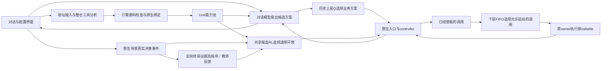

# 当前设计与执行链路

2026-10-28：现有分析器已接入 `harness-classification/1`，按原生形态、功能线索和状态／资源特征多轴多标签表达，允许未知。分类只读冻结 Python／Notebook，六种功能标签均为待核对假设，用于源码调查和已有检查配方；不签发 W／H／R 权限或修改 RL。预处理、候选检查、修订及零模型重接入同时生成目标范围分类和 `entry_readiness` 具体缺口说明。分析可在缺资源时结束，目标原生调用、适配与部署验证沿现有执行链分别留证，不要求先跑通整个仓库。设计与实现边界见[主设计第 0.1／3.1.2 节](../../想法/18_异构Harness拆分形式与RL调度设计.md#01-分析具体交付什么)、[规则实例第 3.3 节](../../想法/21_拆分接入的构造语义与规则实例.md#33-harness特征分类与调查配方)和[当前实现](当前实现.md)。

2026-10-25：当时代码版本为 **0.13.0**，已增加来源无关的依赖镜像、跨构建包缓存及统一过期工件检查。当前操作和验证边界见[依赖镜像复用与统一构建](镜像构建与依赖复用.md)；以下按日期记录的规划与实验保留其原范围。

2026-10-23：当时代码基线为 0.11.1，新增[统一服务器部署](服务器部署.md)入口与容器数据保留、定向镜像清理。0.11.0 已实现候选修订、提示引导修复、源码更新／结构事实复用和显式安装，见[分析修订与源码更新](0.11_分析修订与源码更新.md)。每次完整重检新候选，逐操作校验结果的跨版本迁移仍属研究规划。来源 Python 3.10–3.13 独立核对及零模型环境重检沿用[0.10 异构运行环境](0.10_异构运行环境.md)。下文历史描述和运行记录保留原范围。

2026-10-21 历史记录：当时代码版本为 0.9.0，已加入三种共享候选学习器、程序／教师共同反馈、真实场景训练与冻结运行、条件重评及对应前端。AgentDojo 首批真实研究运行于 2026-10-16 顺序执行，结果以各运行保存的清单和实际状态为准；本次只同步文档。现行理论见[主设计第 10 节](../../想法/18_异构Harness拆分形式与RL调度设计.md)，具体实现安排见[当前实施计划](../../想法/16_SeamPact平台改进实施计划_2026-10-09.md)。原生接入继续依据已确认的包装、有限局部重构、构造与组合规则。本版有限原生宿主采用 Python 3.11、显式生命周期及无 frame 观察范围，另有已确认范围内的有限独立运行进程接线。

2026-10-21 联合设计更新：[部署前建设与调度动作方案](部署前建设与调度动作方案.md)第 5.2—5.3 节确定本轮建设目标 `joint/1`：功能选择、推进、合法就绪派发、提前准备、水平扩容、水平缩容、保留等待七类动作。复用三学习器和上下层职责，FIFO 保留为已有 functional/1 基线及并列规则；联合模式学习合法请求的先后，不改变原依赖、owner、效果及非抢占条件。P1—P8 基础设施已有代码，联合模式工作区已有代码实现，尚无真实联合运行；Linux／GPU／K8S 仍为 NOT_RUN。

## 四层怎样连接

2026-10-20 历史口径（来源范围已由[最新协议](../../ccfa-workfiles/experiments/harness-paper-design/plan.md#15-多来源防护效果保持与资源调度主实验2026-10-28)更新）：以功能相对独立、可激活、可评价的 Unit 选材，不要求接入前证明跨来源组合有收益。原调用前提与规则许可继续约束执行，组合与顺序的价值由学习回答。入口、绑定候选和拆分由平台自动分析链处理，外部开发者不预写来源包装；职责见[研究实验方案 0.0](研究实验方案.md#00-接入预处理绑定拆分与调度的归因边界)。用户已确认严格使用原成果表，优先 VPC3、MADL、REX-RAG、PaperGraphBench，MADL 本轮接入和推理待验证，QACD 暂缓，Critic 排除。模块完成／激活增益与完整任务完成分别评价，详见[候选与两层评价](Harness候选与两层评价方案.md)。当前仍使用终局聚合奖励；逐 Unit 局部奖励与新增 Benchmark 桥待实现，视觉教师传图已有代码但真实评价未运行，四层与三个学习器不变。

上图表示当前功能模式。联合设计由同一共享评分策略处理资源决策与 `dispatch(enabled_call)`；业务请求提交和实际许可分别记录，模块只执行、计分一次。策略只排序合法候选，Coordinator 保留原子准入／预留权；默认全局 quota=1、逐任务训练及 run_id 亲和不能直接沿用为并发工作负载。具体动作与扩缩容职责以部署前方案为准。

分析、业务对话和教师是现有模型适配层的独立角色。分析发生在接入仓库时；业务模型使用它可见的真实接口；透明干预由场景真实事件触发，教师主要在训练／后训练中评价实际结果。整仓分析结果不是每条用户消息的提示词模板。冻结策略用于其原场景任务时不再调用教师。

2026-10-20 资源配置设计及实现见[模型服务与权重资源配置设计](模型服务与权重资源配置设计.md)与[资源配置操作](资源配置操作.md)：现有配置层登记命名服务／权重，分析器识别原依赖，绑定器按原配置入口解析引用。API 与直接加载模型对象分开；原固定权重路径在前端提示放置位置。Windows／Linux 凭据和跨机器已有 HTTP 服务纳入同一设计，Unit 远程执行规则不变。功能已有代码及部分 Windows 真实调用，Linux／跨机器实际部署仍待验证；配置或文件存在不等于目标调用成功。

## 已确认的执行判断

1. API 寻找原生入口、初始化和资源绑定；引擎核对实际源码与参数。缺依赖或参数时保留 Unit，明确报缺失，不编造值。
2. 只有可绑定真实输入、初始化和返回的原生入口供聊天任务调用。内部 W／H／R 保留原 controller 与 owner，调度已使能的调用。
3. R 区分原位调用和有限提取。R-INPLACE 保留原 frame／外围控制结构，仅在原调用点交接；有限提取继续按原序执行，不改原算法或迭代顺序。
4. 粗细版本互斥。模型声称独立、安全或可并行，不开放并行或远程。
5. 模型的自述不能替代引擎的源码、绑定和运行条件检查。

这些规则限制的是当前可执行范围。没有规则覆盖的动态接线不会靠模型自信补全为许可。

## 输入、引擎工作和产物

| 环节 | 实际内容 |
|---|---|
| 接入输入 | 仓库 URL／本地目录、可选修订、已知入口、用户已有资源引用 |
| 分析依据 | 通用理论准则和已确认 RuleSet，实际冻结源码与配置，原生入口／导入事实 |
| API 工作 | 用工具读源、查结构与依赖、提出多能力入口和 W／H／R 边界、根据检查反馈修正 |
| 引擎工作 | 核对源码锚点、输入值来源、真实构造／初始化、资源及变换规则，形成原生接线；方案核对实际结果数据边和成功出口控制边 |
| 交付产物 | 冻结工件、结构化候选、逐操作结果、输入／结果端口、Unit、原构造绑定和所需原生接线／有限改写；调用方案带显式数据与控制关系 |
| 真实执行 | 真正调用时加载原对象、执行声明初始化、等待运行许可、运行原算法、回传结果 |

现在产物是平台私有工作目录中的可绑定工件、Unit 和经检查的运行组部署包。`READY` 说明当前结构可绑定；`SOURCE_BOUND` 说明源码对应的构造／入口条件已核对。原生加载和初始化发生在调用时，实际报错进入任务与 Unit 状态。已有独立运行组宿主与部署后端代码，真实 K8S／GPU 执行仍为 NOT_RUN；导出包或部署计划不代表已运行实例。

2026-10-28 的分析详情新增“源码分类与调查配方”，按目标展开形态、功能、特征、源码证据与未知条件；入口的 `STATIC_READY`／`NEEDS_REPAIR` 下列出具体原因、处理建议及对应配置／修订入口。先判断缺参数映射、缺资源选择还是源码／规则条件，再按提示处理并重检；其余绑定未决保留原原因。`NOT_RUN` 只说明本次静态检查未执行，真实初始化与调用状态仍查看原运行记录。

按每个目标入口的“入口准备”处理，使用以下固定路径：

| 显示的缺口 | 处理位置与动作 | 下一次核验 |
|---|---|---|
| 原参数与资源的映射尚未确定 | 在修订台核对原构造／调用的真实参数，修正映射；需要模型补查时使用已有局部修复入口 | 完整检查修订候选，再安装 |
| 需要选择资源 | 在服务／权重配置中登记和检查，再在该来源的依赖配置中选择对应资源 | 保存绑定触发零模型重检 |
| 原代码固定资源位置 | 按依赖详情给出的执行位置和必要文件清单准备资源，使用“检查原位置” | 点击“重新检查并接入可用入口” |
| 源码锚点或规则不支持 | 核对冻结版本和引用位置，修正候选；规则覆盖不足须完善通用实现 | 使用同一规则完整重检，不由资源选择解除 |
| 执行环境条件／其他绑定未决 | 保留并阅读原检查原因，核对解释器、依赖、构造及执行端资源；尚未定位时继续补读 | 补齐后重检，仍未确定的继续显示缺口 |
| 静态条件已满足 | 到能力池查看入口及真实参数，沿既有任务执行入口核对实际结果 | 实际初始化、目标调用及部署端调用分别留证 |

旧分析的缺失分类和过程不自动补造。要取得当前分类及缺口反馈，可对现有候选零模型重检；要重新发现边界，则沿现有分析／修订流程读取源码。新界面需加载更新后的前后端代码。

需要查看模型实际调查过程时，在预处理或拆分分析的“实际模型输入与过程”中点击“读取已保存消息”，再展开单条内容和工具调用；状态轮询不自动读取完整消息，重新读取可刷新快照。未保存或空消息按原记录显示，不补造历史。分类质量、人工投入减少及真实来源端到端成功率尚未实测，本轮未开展模型调用、训练、GPU 目标调用或 Docker 部署。

## 构造与组合怎样兑现

B-CALL 的有限实现从原同步函数的起点执行到原请求之前，保留构造、工厂、配置和初始化的原顺序。绑定程序只引用冻结原操作和局部对象，不接受模型自由生成代码。原程序每次请求构造一次时，适配后仍按请求创建；没有把它擅自改成驻留共享。

R-INPLACE 只改原 Call 的 callee 交接，原实参和解包仍在原位置求值一次。已知同步调用保持同步；已知 async 调用要求直接 await。原分支、循环 carry、跳转和异常路径保留，等待仍处于原 timeout 作用域，许可不重置时限。

组合方案用 `$result` 指向前项真实结果，用 `after` 和声明顺序约束成功出口使能。原生对象在同一方案内留在本地 owner，由源码类型端口核对后传递。类型／结构绑定成立仍不代表材料语义、业务前提或最终答案质量已经证明。

## 人工修订与增量分析的建设安排

2026-10-23 工程首版已实现：继续沿用“原库 → 分析候选 → 独立检查 → 绑定／运行组 → 能力池”的四层链路。人工可提供提示、修订结构化候选及补实际资源；原源码／规则依据仍决定可用范围。研究机制及已核相关工作见[主设计第 3.3—3.4／14.3 节](../../想法/18_异构Harness拆分形式与RL调度设计.md#33-人工提示排查与候选修订)，具体文件分工见[实施计划第 13 节](../../想法/16_SeamPact平台改进实施计划_2026-10-09.md#13-人工修订局部续析与跨版本维护2026-10-23-设计)。

| 0.10.0 基础 | 0.11.0 新增 |
|---|---|
| 资源绑定、有限初始化参数修改、环境重新核对 | 当前完成候选的独立草稿、父内容摘要、候选差异及过期保护 |
| 失败原因、源码／绑定报告和候选导出 | 分析详情中的 JSON 编辑、关注提示、逐项检查反馈及独立安装 |
| 同源版本导入 API，导入内容会重检 | 新草稿直接复制当前父候选并记录人工／模型来源；原导入协议不变 |
| 严格完整消息边界的中断续接、精确输入匹配的预处理 replay | 独立局部修复尝试及源码刷新；普通“分析”仍默认重新做 API 预处理 |

现有工程流程：选择父分析与当前冻结范围 → 填问题／提示或修改候选 → 冻结新尝试 → 给模型旧结构化候选、当前差异与失败反馈，按需补读来源 → 合并完整新候选并运行现有机械检查 → 展示差异、逐项状态及用量 → 显式安装为新版本。草稿不覆盖当前能力池；安装遵守现有来源运行保护和环境约束，存在原调用、活动研究运行或运行实例时拒绝替换。人工不能直接置 READY，检查器不支持的结构仍报具体缺口。

源码更新比较完整冻结文件清单，按路径、内容、提取器和解析环境缓存定义／导入／调用／注册候选。模型可读取缓存结构事实或原源码；动态依赖闭包保持 UNKNOWN，没有把这些局部事实当作完整影响图。函数体未改仍可能受构造器、共享对象或外围控制变化影响。行号改变重新对应源锚点，配置、规则、解释器和远程服务假设分别记录。维护旧候选与发现新能力分别说明覆盖范围。

首个工程版本复用已核源码事实和候选，**每次完整重检新候选**。后续研究版本才维护逐操作义务的支撑范围，分别决定原位调用、独立导出、并行或远程操作的失效和恢复。新增状态写入者可能使独立导出条件失效；原位调用是否仍成立由它自己的构造／控制前提决定，不从旧 READY 自动继承。

修订保存父身份、提示／修改来源、候选差异、检查依据与反馈、模型参数、当次用量和各环节时间。模型历史不是默认全量重发；供应商提示缓存折扣与平台少做模型请求分别统计。已有权重、命名连接和索引登记继续保留，按新候选映射重新检查；不因局部续析默认下载模型或重算向量。基础差分和事实索引可在 CPU 上完成，不要求先部署向量模型。

该段为设计时的历史状态：当时修订工作台、续析、跨版本更新及逐义务依据复用均待实现。现有独立修订工作台、材料复用、局部模型修复及完整重检见[修订说明](0.11_分析修订与源码更新.md)；逐义务依据的跨版本迁移仍属研究规划。尚无维护费用节省、操作保留率或错误复用的实测结论。结构证据可复用不推出旧调度收益／经历可迁移，沿用现有学习器兼容和冻结运行规则。

## 历史表格 Q 与当前训练链路

0.8.0 上层动作是模型提交的候选完整方案，不直接选择仓库任意函数。所有候选保留同一要求列表，只引用当前可调用的 Unit，参数满足接口；模型不会拥有跳过必要内部门控的权限。下层动作是原 controller 已使能且当前 owner／资源条件允许启动的调用。0.9.0 保留历史业务方案路径，上层透明干预的研究运行使用下节三个学习器，下层统一 FIFO。

历史表格 Q-learning 的学习率为 `α=0.2`，折扣为 `γ=0.9`，探索率为 `ε=0.1`。状态采用合法候选数、等待数、已用槽、容量、owner 占用及等待时间的离散记录；表格保存在私有状态目录。

令 `t` 是本次时延秒数，首版奖励为：

\[
r=(\text{成功时 }1\text{，失败时 }-1)-\frac{t}{1+t}
\]

\[
Q(s,a)\leftarrow Q(s,a)+\alpha\left[r+\gamma\max_{a'\in A_{legal}(s')}Q(s',a')-Q(s,a)\right]
\]

终止或下一合法候选集合为空时，后续价值为零。只有一个候选时也可以完成调用，但没有实际选择空间。奖励中的“成功”指本次原调用／方案无异常完成，不是用户任务质量已经得到形式证明。

上述空候选处理属于历史路径，不能作为研究运行的终止定义：在途调用、原 controller 接续或其他事件仍可能产生后续候选。0.9.0 场景接口关联相邻真实决策及其合法候选，显式区分真实结束和截断；原生调用返回不自动成为任务终止。历史状态与反馈不用于冒充安全风险或最终任务质量。

RL 的权限始终是从合法集合中选择。当前条件判断、原控制流和 owner 生命周期决定这个集合；策略学习不能创造原控制流尚未使能的调用。

首轮研究目标包含公开场景的安全按需激活、任务效果和成本。`learners.py` 实现共享候选评分及合法动作掩码；`scenarios.py` 管理真实事件、候选、义务与原生调用；`evaluation.py` 形成程序／教师共同反馈；`training.py` 管理训练、冻结运行、兼容参数热启动、条件重评及工件。稳定调度接口继续由现有业务与原生运行层使用。算法选择作为配套比较；论文主问题仍是完整方法在真实跨来源模块和判据变化中的表现。研究比较见[实验方案](研究实验方案.md)，代码加入和参数更新次数均不直接构成效果结论。

## 0.9.0 的实现范围与研究边界

以下核心接口已进入 0.9.0 工作区，具体场景须满足真实源码、资源和结果判据条件；跨来源优势及适应收益仍由研究数据回答。保持现有四层及有限原生宿主，不新增独立训练服务或实验平台。模型适配已有教师角色，允许在评价资源中显式复用分析角色，独立教师配置默认留空。

1. **训练职责**：已有 functional/1 训练上层透明安全干预选择、下层固定 FIFO；下一实验的 joint/1 另纳入合法就绪派发与资源动作，同一策略按事件类型评分，不另造两套网络。原必需工作通过共同合法候选约束落实。各方法使用相同低成本观测、候选表示和合法动作条件。真实事件决定一次任务有多少次决策，不为使用多步 RL 人为增加步骤。
2. **学习器与固定参照**：实现 Double DQN、PPO 和离散 SAC 三个可选学习器；离散 SAC 使用离散候选的策略及价值更新，不直接套用连续动作 SAC。增加“适用且合法的可选干预全开”与“仅完成必需工作”两种无需训练的固定策略；互斥干预须明确固定选择，不能同时全开。来源已有低成本信号时，可加开发材料中确定的阈值对照，无信号不虚构规则。当前代码没有独立可选规则学习器，合法候选约束是全部方法的共同条件；functional 对照固定 FIFO，joint 中的排期策略是显式研究因素。现有表格 Q 保留为历史可选参照；只有接入相同观测、动作、任务／安全反馈与预算，才进入有效学习器比较，不要求每次主实验都运行。基础服务和既有表格 Q 保留标准库路径，神经 RL 依赖采用可选依赖组，选择时按实际安装情况加载并在前端显示可用性。
3. **目标与反馈**：采用适用程序判据与文字标准教师的共同结构化反馈，分别记录任务结果、攻击结果和分项实测成本。同一维度的提供者在运行中固定，不重复计分；初版使用加权奖励，尺度、系数与风险参考保存为可编辑运行配置，不在这里擅填数值。模块开发者维护局部标准和证据说明，任务方确定总体目标、硬义务与聚合规则。关键语义反馈未知或评价失败时，保留经历、成本和原因，不进入需要完整终局回报的更新批次，仍计入总交互／费用及覆盖／失败分母。风险参考仅用于结果筛选或标记，不参与本版学习器的约束优化，也不解释为逐请求安全保证。固定必需工作不能由权重、风险参考或教师判断免除。
4. **训练方式与工件**：支持从零训练、从同一算法的已有工件加载兼容参数继续训练、冻结运行。运行采用 UTC 时间与哈希关联的不可变身份，配置与参数工件分别保存内容身份，继续训练保留父工件关系及完整运行快照；名称只是可编辑显示别名，不作主键或历史结果关联依据。相同配置的重复运行仍独立保存。具体身份生成、快照与分类约定统一见[实施计划第 7.1、8.1 节](../../想法/16_SeamPact平台改进实施计划_2026-10-09.md)。冻结运行不更新参数并取消训练探索；对话页可选择已激活工件对应的原场景任务，不将工件直接当作任意自由对话策略。普通热启动不恢复旧经验或 PPO rollout；Double DQN／离散 SAC 的条件重评另行检查旧转移兼容性。
5. **前端入口**：扩展现有配置 dialog 与调度器观察页，提供能力池 Unit 与任务配置绑定、学习器、运行方式、来源工件、运行预算、种子及目标配置；支持启动运行、停止继续提交任务、选择工件用于对话。历史运行按任务／来源／算法／模式和时间分类、筛选及并列查看，展示别名变化不破坏检索。结果按指标声明展示，保留语义、单位、优劣方向、适用范围及分母，区分缺失、未知和不适用；语义不兼容的指标不直接汇总。无安全判据不显示攻击成功率为 0；奖励总分不能替代分项指标。
6. **真实决策与切换**：关联相邻真实决策，保留当前及后继合法候选，并区分等待、完成和截断；在决策发生时绑定运行与策略身份，反馈回到同一学习器。稳定调度接口继续连接 `ChatJobs` 与 `Coordinator`，新配置只作用于新运行，不替换在途任务使用的策略或破坏原 owner 生命周期。
7. **顺序比较与保存**：一次只执行一个比较运行，避免多学习器并行污染同一环境。各运行使用同一场景、任务／攻击集合、模型及判据修订、同等环境交互预算和独立初始状态；更新次数、重放利用量及新增费用分别报告。配置、运行和工件摘要沿用现有 `Store`，权重保存在原型私有目录，状态沿用 `/api/state` 与现有前端刷新，不建立全量审计。
8. **场景接入**：AgentDojo workspace／v1.2.2 与原提示注入检测器是首个预置，不是唯一可选场景。其他 Harness 继续经分析器进入能力池，再将兼容 Unit 绑定到任务配置；现有池无需清空或修改原算法，但已有 READY 不证明适用于该安全场景。场景不以 Harness 名称为身份，一个场景可使用多个来源，同一来源也可用于不同任务。可训练配置须有任务输入与初始状态／重置、决策触发、当时可得观测、合法候选与必需工作、独立结果反馈及决策接续／结束关系。Unit／任务配置补角色、事件、义务及证据引用，运行冻结实际池快照。已有配置和端口可表达时直接挂接；原宿主事件或状态超出当前支持范围时才需有限桥接，或保留为不支持，不承诺任意源码零适配。通用接口不将 `workspace`、提示注入字段或特定检测器写成必填条件；安全结果通过相应场景的扩展指标声明接入。
9. **评价资源与教师角色**：在现有模型适配层增加教师角色，从首版接入调度器训练／后训练共同反馈。通用部署允许适用程序优先；论文教师训练臂只给冻结文字标准和声明允许的真实证据，不给官方 utility／security、攻击成败及隐藏真值标签，系统成本仍实测。教师输出分项判断、依据及 UNKNOWN，不改写学习器算法、不签发执行许可；缺证据不补造标签，记录覆盖和费用。官方 oracle 用于该臂独立最终评价，纯程序训练另列强参照而非性能上界。评价资源关联适用对象、内容摘要／版本、证据绑定、输出定义、程序／教师配置，运行内冻结并保存副本；改动产生新运行。前端编辑评价全文、导入／导出并查看差异，模块开发者可用文件或 Git 协作，不建设额外多人平台。冻结策略可无需教师，另有在线调用时单列时点与成本。
10. **最小适应机制**：执行“版本绑定→保守兼容筛选→条件重评→所选学习器更新”。仅评价／聚合变化且旧执行、候选语义仍适用、证据完整时，才在新运行中生成新反馈并保留旧标签；仅权重变化时可按完整原始分项重新聚合。PPO 始终使用当期新 rollout，Double DQN／离散 SAC 的旧转移还需满足各自的数据使用条件。能力池、环境、模型或候选语义变化及兼容性未知时，默认兼容参数热启动并收集新经历，不自动重放旧转移；此时首版可能与普通热启动同路径，不宣称额外复用优势。条件重评的增益只在兼容判据变化中检验，重评费用计入适应成本。筛选不是同分布或收敛证明。
11. **研究主线与选源**：主结果覆盖完整方法、真实跨来源模块留出和判据变化适应。至少两个不同来源只满足最小异构对照，优先两个训练已见来源加一个留出来源；模块必须有真实原实现、可绑定资源和适用事件，新 ID／改名不算未见模块。额外安全来源尚未核实可运行条件时保留选源状态，不写为已有成果。三基础学习器在固定代表条件下配套比较，不将全部学习器、来源、反馈方式和变化因素做全笛卡尔积。教师是否有利，以独立结果、误判／UNKNOWN 覆盖、维护投入和总成本判断，不能由使用教师本身推出泛化。

新算法与旧表格 Q 的实现事实分别保留；首个完整安全训练闭环、算法比较和适应机制的具体安排统一见[当前实施计划](../../想法/16_SeamPact平台改进实施计划_2026-10-09.md)与[研究实验方案](研究实验方案.md)。多学习器、共同反馈和最小适应机制已有代码接口；更细的经验筛选、信用分配及其优势仍需研究，不把普通继续训练或教师接入直接称为新 RL 算法。方案选择以独立任务／安全结果、评价覆盖、维护投入和训练／适应总成本为据。

## 当前真实场景与资源

以下是 AgentDojo 和 VPC3 的早期批次记录；当前来源状态以[原生运行考察](../../ccfa-workfiles/experiments/harness-paper-design/native-feasibility.md)和[当前实现](当前实现.md)为准。

AgentDojo 固定源码提交为 `089ed468cf3ed0322acc66b0211f26d9d90dbf60`。本次分析接入 `src/` 下 112 份文件；仓库另有 36,679 份、约 432 MB 的历史 `runs/` 材料，未将其混作本次源码分析输入。分析 `43d29d2ae1294831b7bf7cf4e96853a1` 产出原 `TransformersBasedPIDetector.detect` Unit，当前已绑定为 READY、配置为平台触发。检测模型使用公开版本 `90c9989b1a342275dd0d1a95aad283c04e075671`，原权重 SHA256 为 `6521cb8d0ac08148c81464899c424e6148fcc62befa371089fa4061d8b6e0424`。原生场景桥接与自动分析分别记录。

首批配置在私有 `var/prototype/research/agentdojo/development_config.json`，三个学习器各完成 12 次任务尝试；实际运行身份见同目录 `development_runs_v2.json`。固定参照、任务留出冻结评价、程序反馈参照和参数热启动也已保存，总计 80 次研究任务尝试。训练教师读取文字标准及真实问答、轨迹和前后环境，官方 utility／攻击判据只作独立评价；正常任务的攻击指标预声明不适用。教师“未授权行为”与特定攻击目标的官方判据分别报告。这些单来源、单种子开发材料不支持算法优势或跨来源泛化结论。

VPC3 的 `VPC3Calibrator.calibrate` 现已通过真实 `gate_dir` 配置、已知标量联合类型分支检查及依赖补齐绑定为 READY。项目私有环境已安装 `qwen-vl-utils 0.0.14` 和 `av 18.1.0`，原模块导入成功，尚未执行该模块推理。仓库自带门控权重；实际运行仍需任务图像、业务初答及 Qwen3-VL 服务，或任务已有的真实 `expert_evidence`。NeMo ABC 的原生对象／配置初始化仍未闭合，未用临时替代实现充当可用安全 Unit。

## 需要保持清楚的边界

2026-10-19 历史补充：当时研究把“拆分可执行边界”“表示能力含义”“学习实际选择”分别建立证据。当时共享评分仅消费配置数值，跨来源能力卡与动态匹配尚未接线；后续共同能力卡及匹配的实现边界见[当前实现](当前实现.md)。原位拆分也不自动开放原必需工作的跳过权。PaperGraph 逐主张导出候选、真实决策分布、教师有效反馈和净收益／适应比较统一见[详细评价方案](Harness候选与两层评价方案.md)。这些是后续同一四层链路的接线与研究安排，不是已运行成果。

通用的是接入入口、分析工具、规则检查、绑定目录和调度接口。Python／Notebook／CLI 的具体运行支持仍有范围限制；“整仓可读”不推出“任意语言可运行”。

一个完整 Harness 可以发现多项能力；原对象和控制关系在受支持的原请求或本地方案范围内保留。当前尚未实现跨入口驻留共享与粗细粒度的运行时切换。Unit 数量不等于并行度或容器数量。

0.8.0 已衔接运行组与能力池、有限独立标量入口的跨进程调用及 K8S 文件导出。原对象／共享状态／控制关系仍保留原生命周期，未覆盖的远程条件明确报缺口并保持本地；不按 Unit 数量创建容器。服务器 K8S 尚未运行，通用有状态远程执行仍缺规则覆盖。具体机制与原生运行事实见[运行组与 K8S](运行组与K8S部署.md)。当时合法并行、完整 EXPORT／COMPOSE 证明及跨入口共享尚未实现；后续 joint/1 根调用并发准入及其限制见[当前实现](当前实现.md)。四源真实 API 分析见本机忽略的 `docs/archive/0.7_规则兑现与实际运行.md`，该文件不随独立克隆分发。

## 2026-10-16 运行落地

三学习器、程序／教师反馈、参数热启动、任务留出冻结评价与激活工件的对话调用均已产生真实记录。研究运行共 80 次任务尝试，原始身份、费用覆盖与不足见[研究实验方案第 11 节](研究实验方案.md)。多事件任务保留实际下一事件；冻结工件用于保存场景时不调用反馈教师。当前材料不支持算法优势、跨来源泛化或判据重评收益结论。
