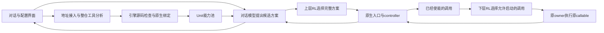

# 当前设计与执行链路

更新：2026-10-13，0.6.0。当前设计依据用户确认的“包装／原生接入＋有限局部重构”，并采用用户授权的简单两层 RL 原型。

## 四层怎样连接

分析与实际对话是两个不同的模型角色。分析发生在接入仓库时；对话处理每次用户任务，使用分析产出的真实接口。整仓分析结果不是每条用户消息的提示词模板。

## 已确认的执行判断

1. API 寻找原生入口、初始化和资源绑定；引擎核对实际源码与参数。缺依赖或参数时保留 Unit，明确报缺失，不编造值。
2. 只有可绑定真实输入、初始化和返回的原生入口供聊天任务调用。内部 W／H／R 保留原 controller 与 owner，调度已使能的调用。
3. R 使用当前有限循环提取规则，不改算法、数据、迭代顺序或读取时机。
4. 粗细版本互斥。模型声称独立、安全或可并行，不开放并行或远程。
5. 模型的自述不能替代引擎的源码、绑定和运行条件检查。

这些规则限制的是当前可执行范围。没有规则覆盖的动态接线不会靠模型自信补全为许可。

## 输入、引擎工作和产物

| 环节 | 实际内容 |
|---|---|
| 接入输入 | 仓库 URL／本地目录、可选修订、已知入口、用户已有资源引用 |
| 分析依据 | 通用理论准则和已确认 RuleSet，实际冻结源码与配置，原生入口／导入事实 |
| API 工作 | 用工具读源、查结构与依赖、提出多能力入口和 W／H／R 边界、根据检查反馈修正 |
| 引擎工作 | 对源码锚点、签名、初始化参数、资源和变换规则做机械核对，形成原生接线 |
| 交付产物 | 冻结工件、结构化候选、检查结果、入口参数接口、能力池 Unit、所需原生接线／有限提取代码 |
| 真实执行 | 真正调用时加载原对象、执行声明初始化、等待运行许可、运行原算法、回传结果 |

现在产物是平台私有工作目录中的可绑定工件与 Unit，不为每一个边界自动发布独立镜像。`READY` 说明当前结构可绑定；依赖加载和原生初始化发生在调用时，报错会反映到实际任务与 Unit 状态。

## 两层 RL 的具体首版

上层动作是模型提交的候选完整方案，不直接选择仓库任意函数。所有候选保留同一要求列表，只引用当前可调用的 Unit，参数满足接口；模型不会拥有跳过必要内部门控的权限。下层动作是原 controller 已使能且当前 owner／资源条件允许启动的调用。

两层使用表格 Q-learning，学习率 `α=0.2`，折扣 `γ=0.9`，探索率 `ε=0.1`。状态采用合法候选数、等待数、已用槽、容量、owner 占用及等待时间的离散记录；表格保存在私有状态目录。

令 `t` 是本次时延秒数，首版奖励为：

\[
r=(\text{成功时 }1\text{，失败时 }-1)-\frac{t}{1+t}
\]

\[
Q(s,a)\leftarrow Q(s,a)+\alpha\left[r+\gamma\max_{a'\in A_{legal}(s')}Q(s',a')-Q(s,a)\right]
\]

终止或下一合法候选集合为空时，后续价值为零。只有一个候选时也可以完成调用，但没有实际选择空间。奖励中的“成功”指本次原调用／方案无异常完成，不是用户任务质量已经得到形式证明。

RL 的权限始终是从合法集合中选择。当前条件判断、原控制流和 owner 生命周期决定这个集合；策略学习不能创造原控制流尚未使能的调用。

## 需要保持清楚的边界

通用的是接入入口、分析工具、规则检查、绑定目录和调度接口。Python／Notebook／CLI 的具体运行支持仍有范围限制；“整仓可读”不推出“任意语言可运行”。

一个完整 Harness 可以发现多项能力，但同一 owner 的状态和初始化不能被简单复制到各能力。Unit 数量不等于并行度，也不等于容器数量。当前部署是一个平台容器，原生执行在其 Python 环境内；K8S、多 owner 远程运行与合法并行没有作为已实现能力宣传。
