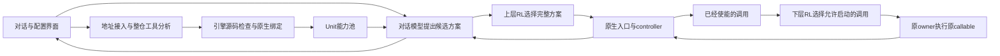

# 当前设计与执行链路

更新：2026-10-14，0.8.0。当前实现依据用户确认的“包装／原生接入＋有限局部重构”、构造与组合规则，以及简单两层 RL 原型。本版有限原生宿主采用 Python 3.11、显式生命周期及无 frame 观察范围，另有已确认范围内的有限独立运行进程接线。

## 四层怎样连接

分析与实际对话是两个不同的模型角色。分析发生在接入仓库时；对话处理每次用户任务，使用分析产出的真实接口。整仓分析结果不是每条用户消息的提示词模板。

## 已确认的执行判断

1. API 寻找原生入口、初始化和资源绑定；引擎核对实际源码与参数。缺依赖或参数时保留 Unit，明确报缺失，不编造值。
2. 只有可绑定真实输入、初始化和返回的原生入口供聊天任务调用。内部 W／H／R 保留原 controller 与 owner，调度已使能的调用。
3. R 区分原位调用和有限提取。R-INPLACE 保留原 frame／外围控制结构，仅在原调用点交接；有限提取继续按原序执行，不改原算法或迭代顺序。
4. 粗细版本互斥。模型声称独立、安全或可并行，不开放并行或远程。
5. 模型的自述不能替代引擎的源码、绑定和运行条件检查。

这些规则限制的是当前可执行范围。没有规则覆盖的动态接线不会靠模型自信补全为许可。

## 输入、引擎工作和产物

| 环节 | 实际内容 |
|---|---|
| 接入输入 | 仓库 URL／本地目录、可选修订、已知入口、用户已有资源引用 |
| 分析依据 | 通用理论准则和已确认 RuleSet，实际冻结源码与配置，原生入口／导入事实 |
| API 工作 | 用工具读源、查结构与依赖、提出多能力入口和 W／H／R 边界、根据检查反馈修正 |
| 引擎工作 | 核对源码锚点、输入值来源、真实构造／初始化、资源及变换规则，形成原生接线；方案核对实际结果数据边和成功出口控制边 |
| 交付产物 | 冻结工件、结构化候选、逐操作结果、输入／结果端口、Unit、原构造绑定和所需原生接线／有限改写；调用方案带显式数据与控制关系 |
| 真实执行 | 真正调用时加载原对象、执行声明初始化、等待运行许可、运行原算法、回传结果 |

现在产物是平台私有工作目录中的可绑定工件与 Unit。`READY` 说明当前结构可绑定；`SOURCE_BOUND` 说明源码对应的构造／入口条件已核对。原生加载和初始化发生在调用时，实际报错进入任务与 Unit 状态。部署仍为一个平台进程／容器。

## 构造与组合怎样兑现

B-CALL 的有限实现从原同步函数的起点执行到原请求之前，保留构造、工厂、配置和初始化的原顺序。绑定程序只引用冻结原操作和局部对象，不接受模型自由生成代码。原程序每次请求构造一次时，适配后仍按请求创建；没有把它擅自改成驻留共享。

R-INPLACE 只改原 Call 的 callee 交接，原实参和解包仍在原位置求值一次。已知同步调用保持同步；已知 async 调用要求直接 await。原分支、循环 carry、跳转和异常路径保留，等待仍处于原 timeout 作用域，许可不重置时限。

组合方案用 `$result` 指向前项真实结果，用 `after` 和声明顺序约束成功出口使能。原生对象在同一方案内留在本地 owner，由源码类型端口核对后传递。类型／结构绑定成立仍不代表材料语义、业务前提或最终答案质量已经证明。

## 两层 RL 的具体首版

上层动作是模型提交的候选完整方案，不直接选择仓库任意函数。所有候选保留同一要求列表，只引用当前可调用的 Unit，参数满足接口；模型不会拥有跳过必要内部门控的权限。下层动作是原 controller 已使能且当前 owner／资源条件允许启动的调用。

两层使用表格 Q-learning，学习率 `α=0.2`，折扣 `γ=0.9`，探索率 `ε=0.1`。状态采用合法候选数、等待数、已用槽、容量、owner 占用及等待时间的离散记录；表格保存在私有状态目录。

令 `t` 是本次时延秒数，首版奖励为：

\[
r=(\text{成功时 }1\text{，失败时 }-1)-\frac{t}{1+t}
\]

\[
Q(s,a)\leftarrow Q(s,a)+\alpha\left[r+\gamma\max_{a'\in A_{legal}(s')}Q(s',a')-Q(s,a)\right]
\]

终止或下一合法候选集合为空时，后续价值为零。只有一个候选时也可以完成调用，但没有实际选择空间。奖励中的“成功”指本次原调用／方案无异常完成，不是用户任务质量已经得到形式证明。

RL 的权限始终是从合法集合中选择。当前条件判断、原控制流和 owner 生命周期决定这个集合；策略学习不能创造原控制流尚未使能的调用。

## 需要保持清楚的边界

通用的是接入入口、分析工具、规则检查、绑定目录和调度接口。Python／Notebook／CLI 的具体运行支持仍有范围限制；“整仓可读”不推出“任意语言可运行”。

一个完整 Harness 可以发现多项能力；原对象和控制关系在受支持的原请求或本地方案范围内保留。当前尚未实现跨入口驻留共享与粗细粒度的运行时切换。Unit 数量不等于并行度或容器数量。

0.8.0 已衔接运行组与能力池、有限独立标量入口的跨进程调用及 K8S 文件导出。原对象／共享状态／控制关系仍保留原生命周期，未覆盖的远程条件明确报缺口并保持本地；不按 Unit 数量创建容器。服务器 K8S 尚未运行，通用有状态远程执行仍缺规则覆盖。具体机制与原生运行事实见[运行组与 K8S](运行组与K8S部署.md)。合法并行、完整 EXPORT／COMPOSE 证明及跨入口共享仍未实现。四源真实 API 分析见[0.7 记录](0.7_规则兑现与实际运行.md)。
