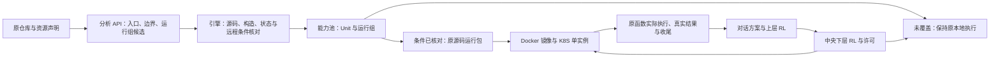

# 从能力池到原生运行组

更新：2026-10-14，0.8.0。

Unit 是分析后的能力和调度入口；运行组是这些入口必须共同保留的原生执行环境。两者不是一一对应关系。一个组中可以有多个 Unit，K8S 部署的是承载该组的进程。仅把多个容器放在同一个 Pod，不会让它们共享 Python 对象。



## 用户确认的边界

运行组按原对象、共享状态和控制依赖划分。同组保持同一进程及原构造／请求生命周期；不能把两个同配置的独立对象合并，也不能把每请求构造改为常驻对象。API 提出方案，引擎按明确规则核对。跨组只开放远程条件已核对的独立入口；JSON／制品端口不构成合法拆分的依据。未覆盖的能力继续本地执行并显示缺口。实例重启不默认恢复原会话。

这是当前宿主范围的上限。0.8.0 只兑现了其中一个有限子集；有完整 JSON 参数接口的模型、SDK 或文件处理入口，并不会因此自动成为远程能力。

## 引擎当前怎样核对

分析器可提交 `runtime_groups`，成员引用同次分析的入口 ID。`check_candidate` 返回同一引擎的分组和远程条件，模型可继续读源码、修正候选，使用原有完整上下文和模型配置，不另设轮次或费用上限。

原对象／共享状态／控制关系尚未解除的入口，保留在原来源上下文中。这个保守组表示继续使用现有原生绑定，并不声称已经求出了最小依赖闭包，也不会让不同入口共享同一个新造的对象。原 CLI 自带的子进程树继续保留，不压成一个新进程。API 若把未决的原生状态入口划到多个新宿主，引擎返回具体缺口并保留原上下文。

远程规则 `scalar-independent-entry/1` 核对原同步顶层函数、原源码和包初始化、有限值运算以及原输入／返回类型。当前支持不可变字符串、整数、布尔等标量；不支持开放参数、变长参数、对象构造、资源驻留、可变容器传输、异步入口、内部局部重构或未知外部效果。类型分析只检查原代码，不生成替代算法。支持的操作包括有限赋值／分支／返回、字符串运算，以及字面模式的标准 `re` 查询；正则局部结果留在进程内，可能异常保留为非成功出口。

入口仍须先通过已有原生绑定检查。远程输出按实际内建标量核对，不把对象、子类、tuple 或模型结果任意转换为 JSON。源码闭包、完整效果分析及远程语义的通用证明仍未完成，状态中保留 `formal_proof=false`。

## 运行包及执行

“运行组与部署”页面按来源查看成员、分组依据、执行位置及远程缺口。远程条件已核对的组可以导出：

| 产物 | 用途 |
|---|---|
| `worker.json` | 原候选、来源版本、安装身份和组成员 |
| `source/`、`snapshots/` | 冻结原源码和内容哈希；不重写原算法 |
| `core/` | 同版本平台原生绑定与运行协议 |
| `Dockerfile` | Python 3.11 原生运行进程，无模型或数据下载 |
| `k8s.json` | 该组单实例 Deployment 和 Service，使用 `Recreate` |
| 同目录名 `.zip` | 私有 SFTP 交付包，不进入 Git |

运行进程再次核对来源、入口与远程规则。启动生成新的实例身份，取得当前平台会话，然后登记实际地址。平台核对来源版本、安装身份、成员及宿主；登记后已有聊天工具自动路由到该组，无须另写示例工作流。

中央 RL 决定已使能边界的启动。原包装在运行进程中依次取得许可、消费许可、调用原函数、发送实际收尾。返回标量供方案的真实结果边使用，后继仍等前项正常返回。原生对象边不能跨进程。

每组一个实例，不自动扩容或恢复对象。平台重启会更换会话；旧运行进程不能继续使用旧许可。运行进程重启会更换实例，旧调用未收尾时不允许用新实例冒充恢复。网络响应缺失时不重放调用、不自动改为本地执行；未知物理执行保留占用，实际迟到收尾仍走原身份。这属于原生调用协议，不是自动故障恢复。

按来源摘除继续适用：阻止后续调用，已开始的原调用允许收尾；不强杀运行进程、不宣称自动卸载原模型。当前没有按 Unit 剔除功能。页面的“改为本地执行”只改变执行位置，要求远程调用已收尾。

## 服务器操作

代码与这些部署模板走 Git。生成的运行包、模型密钥和状态仍走 SFTP。命令由用户在 Terminus 审查执行；没有直接连接服务器，也没有操作已有共享工作负载。

首先返回以下当前状态即可，不需要重复完整服务器环境探测：

```bash
docker version --format '{{.Server.Version}}'
command -v kubectl kind
kubectl config current-context
kubectl get nodes -o wide
kind get clusters
```

命令不存在或当前没有集群时，保留实际报错。Docker 仍未启动时，管理员已经授权，可执行 `sudo systemctl start docker`。不要为了本项目升级系统、修改共享 GPU 环境或删除未知集群。

### 只运行独立进程的 Docker 路径

运行包必须由将要调度它的同一平台实例导出；来源与安装身份不能混用。平台在服务器时，先通过转发网页接入／分析，导出文件直接位于服务器数据目录。Windows 本机能力池生成的包不能直接登记到一个空的服务器平台。

“运行进程访问平台的地址”填写实际可访问地址，例如平台已在服务器启动时的 `http://127.0.0.1:8880`。如需跨主机传输且保留了同一来源／安装状态，上传本次 zip 到 `~/seampact-workspace/uploads/`；否则使用服务器上导出的实际 zip 路径。下面的 `WORKER_ZIP` 和 `WORKER_DIR` 需要替换为本次路径。**每段有报错即停止，不继续执行后续段落。**

```bash
WORKER_ZIP="$HOME/seampact-workspace/uploads/本次运行包.zip"
WORKER_DIR="$HOME/seampact-workspace/workers/本次新目录"
test ! -e "$WORKER_DIR"
mkdir -p "$WORKER_DIR"
python3 -I -B -m zipfile -e "$WORKER_ZIP" "$WORKER_DIR"
```

确认解压进入本次新目录后再构建与启动：

```bash
cd "$WORKER_DIR"
docker build -t seampact-worker:本次组标识 .
```

构建成功后执行：

```bash
docker run --name seampact-owner-本次组标识 --network host --init \
  seampact-worker:本次组标识 \
  --coordinator http://127.0.0.1:8880 \
  --host 127.0.0.1 \
  --advertise-url http://127.0.0.1:8890
```

此命令以前台方式运行，正常会输出 `worker_ready`，登记后能力池显示独立运行进程。需要上传的平台版本为 0.8.0，旧 0.4／0.7 平台没有运行进程协议。端口按本次可用值调整；Docker 镜像中的 Python 3.11 不影响服务器系统 Python。再次部署时先明确旧进程和调用状态，不直接删除旧容器或覆盖私有目录。

### K8S 路径

先确认现有集群、节点和镜像加载方式。`deploy/k8s/platform.json` 针对已知 `/home/jym` 单节点宿主，挂载本项目独立数据目录和来源目录，运行 UID／GID 为已知的 `1004`。多节点集群必须把持久目录绑定到正确节点或改用实际存储，不能直接假设任意节点都有目录。KIND 的节点是容器，需要主机目录额外挂载；`deploy/k8s/kind.yaml` 提供新建本项目专用集群的目录映射，不能据此销毁现有集群。

若已确认使用这个**新建的专用 KIND 集群**，下面是完整操作顺序。源目录和私有状态目录均为空间独立的项目路径；已有同名集群时跳过创建并先核对挂载。导出运行包时平台地址使用 `http://seampact-platform:8880`。

```bash
mkdir -p "$HOME/seampact-workspace/seampact-data" "$HOME/seampact-workspace/harnesses"
cd "$HOME/seampact-workspace/Seampact"
docker build -f deploy/Dockerfile -t seampact-core:0.8.0 .
kind create cluster --name seampact-prototype --config deploy/k8s/kind.yaml
kind load docker-image seampact-core:0.8.0 --name seampact-prototype
kubectl --context kind-seampact-prototype apply -f deploy/k8s/platform.json
kubectl --context kind-seampact-prototype -n seampact port-forward service/seampact-platform 8880:8880
```

最后一条以前台方式保持，用 Terminus 的 SSH 转发连接服务器 `127.0.0.1:8880`；在网页填写服务器自己的模型配置／接入地址。服务器本地私有数据不能直接复用 Windows DPAPI 密钥。另一个终端上传、解压本次运行包后：

```bash
cd "$WORKER_DIR"
docker build -t seampact-worker:本次组标识 .
kind load docker-image seampact-worker:本次组标识 --name seampact-prototype
kubectl --context kind-seampact-prototype apply -f k8s.json
kubectl --context kind-seampact-prototype -n seampact get pods
kubectl --context kind-seampact-prototype -n seampact logs deployment/本次rg标识
```

镜像名和 `rg` 标识均取本次导出记录，不随意改变 manifest 里的名称。服务器的 K8S 执行尚未发生；需要收到当前集群状态后才能确定应该使用上面的哪条路径。本版没有 GPU 请求、模型训练或资源调度器扩展。

K8S 承担进程放置和启动，应用内两层 RL 仍决定方案与已使能调用；两种调度不等同。参考 [Pod 语义](https://kubernetes.io/docs/concepts/workloads/pods/)、[Deployment](https://kubernetes.io/docs/concepts/workloads/controllers/deployment/)、[Kube scheduler](https://kubernetes.io/docs/concepts/scheduling-eviction/kube-scheduler/) 与 [KIND 操作说明](https://kind.sigs.k8s.io/docs/user/quick-start/)。

## 已有实际运行事实

本机 0.8.0 已把此前真实 API 分析得到的 DiSP 原函数 `insert_token_at_start` 导出为独立运行组，在另外的 Python 3.11 进程执行。实际聊天任务 `06c5145bb3a34d0f8a589c9ef3b39174` 请求两步前缀调用，第二步通过 `$result` 消费前项真实返回；得到 `[B] [A] Observe the red bicycle.`。三次对话模型响应，两个中央许可均 `starts=1`、`receipt=RETURN`、`physical=RETIRED`，实际执行记录标注 `REMOTE`。

这证明当前有限入口的跨进程调用与中央调度链路已运行；没有在服务器构建镜像或启动 K8S Pod，没有证明有状态 Harness 的远程合法性、并行收益或 RL 优势。模型只提出了一个方案，业务语义状态仍为 `UNRESOLVED`。原仓库未修改，私有实际记录保留在 `var/prototype/remote_runtime_2026-10-14.json`。

同源分组修正也已实际调用分析 API：`6b63a68475e4404ea8cf993a39d71532` 与 `766b0495f3284d008cf0c842f597607a` 各两次模型响应，沿用原完整历史。最终模型根据引擎“未决对象／共享状态／控制依赖不能切到多个进程”的反馈，提交一个标量远程组和一个保守本地组；报告 `proposal_status=CHECKED`、无分组缺口。原生接入和远程规则逐入口仍单独判断，模型的分组理由只作为候选说明，不作为证明。
