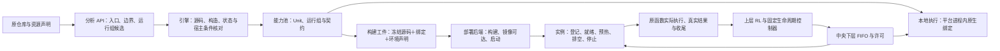

# 从能力池到原生运行组

更新：2026-10-29，SeamPact 0.14.0。首次远端部署从[服务器部署](服务器部署.md)开始；本页说明运行组宿主、运行组契约、部署后端、实例生命周期和功能调度模式下的运行组执行。建设范围来自[部署前建设与调度动作方案](部署前建设与调度动作方案.md)的 P1–P8；新增独立 Python、环境证据及零模型重新核对见 [0.10 异构运行环境](0.10_异构运行环境.md)。旧 worker 工件需重新生成与构建，历史分析和实验材料保留。

当前第三方依赖镜像、BuildKit 包缓存和已有工件更新规则见[统一构建说明](镜像构建与依赖复用.md)。平台与 worker 的核心身份仍须一致；同名镜像、镜像构建成功和真实 GPU／K8S 原目标调用分别记录。

**联合模式目标更新：** [部署前方案第 5.2—5.3 节](部署前建设与调度动作方案.md#52-功能派发与生命周期联合模式本轮建设目标)已将合法就绪学习派发、prepare、scale_out、scale_in 和保留等待列为本轮建设目标，工作区已有代码实现，尚无真实联合运行；Linux／GPU／K8S 仍为 NOT_RUN。scale_out／scale_in 是运行组级水平扩缩，现有每实例一个 Deployment 可继续承载；不要求改为共享 Deployment，也不同时启用 HPA 控制同一组。FIFO 保留为基线，节点放置、垂直伸缩和现场恢复仍不在本轮动作内。

## 2026-10-21 收尾与能力边界

当前能自动生成的是**规则允许的进程运行组及其 K8S 构建／部署工件**，尚不能声称自动求出性能最优的 K8S 粒度。仍由平台分析 API 读取原库、提出入口和分组，引擎核对后进入能力池；本轮没有逐库手写包装或切点。原对象、共享状态、控制依赖没有解除的成员保守同组；缺包、资源或端口编码时保留缺口，不靠拆分绕过原必需流程。

| 能力 | 当前代码范围 |
|---|---|
| Unit 自动形成运行组 | 已有分析候选与机械规则核对；无状态标量入口可独立，有状态成员保留原进程上下文 |
| 生成 K8S 工件 | 导出冻结源码、绑定、worker、环境声明、Dockerfile；后端按实例生成单副本 Deployment 清单；环境、资源挂载和镜像可达性须配置 |
| 超出启停／调用的管理 | 契约允许时可预热、停止接单、排空、观测、选择实例及保持任务亲和；核对可复制性的标量组可增减副本 |
| 功能 RL | 选择 Unit／合规方案／继续或结束；观察冷暖、可派发、忙碌、队列等状态；资源准备使用冻结的固定控制器 |
| 联合资源 RL | 工作区已有 `joint/1` 代码实现，尚无真实联合运行；Linux／GPU／K8S 仍为 NOT_RUN：准备、驻留、水平扩缩及合法就绪派发已接线为三学习器的联合动作；节点放置不列入本轮目标 |
| 不具备的承诺 | 最优粒度、任意有状态组复制、现场休眠／恢复、活对象迁移、自动推导 CPU／GPU 配额或多节点放置 |

本轮六项修复：

1. 手动命令也保留待确认的 Docker／K8S 对象句柄。K8S 句柄冻结 namespace/context；停止后须同时查证 Deployment 与其标签 Pod 均不存在，才标记 `released=true`。后端不可用、位置不明或仅收到 worker 的退出确认时保持待释放，前端展示原因和可得的手动命令。历史缺位置的句柄不套用当前可变配置。
2. 原生有状态组只允许 `fixed_resident`；配置和控制器均阻止 `idle_retire/1`。空闲回收仅开放给现有标量规则已核对可独立重建的组。原生实例停止后仍保留任务亲和，旧任务后续调用报缺口，不换 owner。未来开放原生回收须另有任务／owner 结束及重建契约。
3. 调用、响应、健康、预热、排空／停止及中央许可均核对 `session + instance_id + generation + process_nonce`，中央许可记录也绑定四元组。错误进程的调用响应不被采纳，不重放调用；远程异步入口复用原许可与取消语义，中央仍为 FIFO。
4. 命令执行器分别保留完整 stdout/stderr 供机器解析，展示／持久回执仅留截断日志。K8S 状态解析不再读取最后 4,000 字符；Deployment 存在但无 Pod 记为 PENDING，删除后尚有 Pod 记为 TERMINATING。
5. 暖态准备检查本次运行全部所需成员；只有允许提前准备的初始化实际达到 BOUND 才进入任务阶段。失败、缺成员或不允许提前准备时保存准备记录并中断。`process_ready` 与 `initialization_ready` 分开，保留 MODULE_IMPORT／OWNER_CONSTRUCTION 范围；REQUEST_SCOPED 不改为常驻对象。平台与 worker 均将预热计入在途数，排空后不接受新预热。
6. 分析工件迁移按文件／构造参数／资源／CLI 字段检测 Windows 与任意 POSIX 绝对路径（含 `/opt`、`/mnt`、`/srv`），排除 URL、明确接口路由与说明正文，导入时仍在目标平台重新核对与绑定。

**本轮核对：** 修改的 Python 模块语法、前端 JavaScript 语法及差异格式通过；无外部依赖的内联诊断通过长 JSON／stderr 分离、删除待确认、旧四元组拒绝、原生亲和保持、失败预热阻断、预热排空与 Linux 路径识别。异步许可使用实际 Coordinator／OwnerRuntime 核对 RETURN、等待中取消、开始后取消及占用归零，HTTP 传输由内存调用替代。这些是实现分支核对，不是原 Harness 实验或 K8S 性能结果。真实集群删除／Pod 重建、Linux 实机、GPU、镜像构建、跨机器通信和原来源暖态运行均为 **NOT_RUN**；历史结果不改写。

**操作要求：** 更新后须重建同版 worker 镜像；登记须声明 `process-identity/1`，旧 worker 在接单前即被拒绝。K8S 后端尽量显式填写 context 和 namespace 后再启动。已生成但位置未确认的对象继续待人工释放，不能通过修改当前后端配置“确认”历史对象。手动释放后，如平台可查询冻结位置，可再次提交排空停止核对；使用新的 operation_id，旧 operation_id 按幂等规则返回第一次结果。没有后端查询能力时，保持待释放记录，不凭退出或断联宣称已释放。

本轮收束另增加 `lifecycle-conditions/1`：请求隔离、可重复初始化、owner 结束、清理四项由检查器给出；复制与回收分开授权。现有原生组各项为 UNKNOWN，保持原保守动作范围。新字段进入契约摘要，已有分析须重新核对、安装和导出，不能只替换旧工件的 worker 文件。分析器和运行组页面均展示资格缺口；没有按仓库名或手工布尔值开放扩缩。联合通路的内存行为核对与真实来源边界见[当前实现](当前实现.md)。

**实现与运行状态分开：** 下文机制已在代码中实现。开发机（Windows，Docker 守护进程未运行）在本地状态的临时副本上走过一次手动路线：对 REX 检索组（2 个成员通过宿主核对）生成构建工件，docker 后端返回 `BACKEND_UNAVAILABLE` 与手动命令，实例记为 `UNDEPLOYED`；以工件内的 worker 命令在本机进程（非容器）启动后，宿主重新核对得到相同契约摘要并登记为 `READY`，预热执行了原模块导入（该环境缺 `pkg_resources`，原错误按 FAILED 返回，实例保持 READY），排空停止后实例 `STOPPED`、进程退出；平台重启后代次递增。成员调用未运行。该次发现并修正：带 `WITHHELD` 源码的仓库在宿主内重算来源版本时漏计 `withheld_sources`，导致宿主拒绝启动。Linux 实机、GPU、Docker 镜像构建、容器／Pod 启动、跨机器调用均为 **NOT_RUN**，首次服务器部署时才产生真实运行事实。联合生命周期研究模式（方案 5.2）工作区已有代码实现，尚无真实联合运行；Linux／GPU／K8S 仍为 NOT_RUN；现场休眠、任意活对象迁移、任意 Unit 复制和多节点放置学习不在本次范围。

上一段为六项修复前的历史过程：FAILED 预热不构成暖态实验，worker 进程退出也不构成后端对象已释放的证据。

bridge 平台的同机 worker 采用[共享网络方案](Docker部署.md#3-bridge-平台怎样接-worker)。host 网络与 SSH 跨机方式要求双方 daemon 支持对应网络语义；rootless 挂载私有目录的容器用户按服务器指南配置。实际机器环境、服务状态和集群探查记录保留本地。

Unit 是分析后的能力和调度入口；运行组是这些入口必须共同保留的原生执行环境；实例是某个运行组的一次具体进程。三者不是一一对应关系。一个组中可以有多个 Unit，K8S 部署的是承载该组的进程。仅把多个容器放在同一个 Pod，不会让它们共享 Python 对象。



## 用户确认的边界

运行组按原对象、共享状态和控制依赖划分。同组保持同一进程及原构造／请求生命周期；不能把两个同配置的独立对象合并，也不能把每请求构造改为常驻对象。API 提出方案，引擎按明确规则核对。JSON／制品端口不构成合法拆分的依据。未覆盖的能力继续本地执行并显示缺口。实例重启不默认恢复原会话。

## 引擎怎样核对

分析器可提交 `runtime_groups`，成员引用同次分析的入口 ID。`check_candidate` 返回同一引擎的分组、远程条件和宿主核对，模型可继续读源码、修正候选。原对象／共享状态／控制关系尚未解除的入口保留在同一个组，表示继续使用现有原生绑定，不声称已求出最小依赖闭包。API 若把未决的原生状态入口划到多个进程，引擎返回具体缺口并保留原上下文。

### 两种宿主

| 宿主规格 | 适用 | 组外端口 |
|---|---|---|
| `python311-scalar-worker/1` | 规则 `scalar-independent-entry/1` 核对的原同步顶层函数：原源码和包初始化、有限值运算、不可变字符串／整数／布尔输入与返回 | 原内建标量 |
| `python311-native-group-worker/1` | 其余组（包括保守原上下文组）：整组成员在一个进程，保留原构造次数、owner、原 controller、初始化与关闭 | `group-port/1` |

`group-port/1` 只编码精确的 JSON 标量、list、dict（字符串键）、bytes、tuple，以及非 object dtype 的 numpy 数组（npy 格式、`allow_pickle=False`，带 sha256）。不做 `str()`、JSON 转换或 pickle。成员若有必需的原对象输入，或结果端口是原对象类型，该成员在宿主中记为 MISSING，继续本地组合执行；例如 MADL 返回的原结果对象不跨进程。

### 环境条件由宿主核对

平台镜像通常不安装模型包、不挂载权重。结构规则（源码、入口、构造、参数映射、端口）仍在平台判断；包是否安装、权重文件、凭据是否可得属于实际执行进程的事实。平台上仅缺这类条件的入口记为 `host_condition.status=ENVIRONMENT_DEFERRED`，状态仍为 MISSING，不在平台进程执行。宿主启动时在自身环境重新执行全部规则：权重按登记路径做文件核对，凭据从本进程环境变量取得；未满足的成员列在实例 `missing` 中。

### 运行组契约 `runtime-group-contract/1`

契约记录来源与版本、成员和允许的根入口、构造／请求／owner／会话作用域、宿主规格、组外端口编码、逐成员预热规则、生命周期操作及依据、副本设置和摘要。实例登记时宿主报告的契约摘要必须与平台一致。

| 操作 | 状态依据 |
|---|---|
| `start` | 有通过宿主核对的成员即 SUPPORTED；新实例按原生命周期初始化，不恢复旧活跃任务 |
| `prewarm` | 只准备原生命周期允许提前的部分：原构造参数已冻结的 owner 方法入口可提前构造一次；模块函数仅导入模块；每请求构造（REQUEST_SCOPED）与 CLI 入口 UNSUPPORTED；从不执行入口 |
| `pause_intake` | 平台与实例停止接受新根请求，已开始的 owner 调用和内部许可继续收尾 |
| `drain_stop` | 等待根请求、组内许可与会话收尾后结束进程；原关闭流程未识别，不调用 |
| `cold_restart` | 停止释放后新建实例，计入重载成本，不保留现场 |
| `add_replica`／`remove_replica` | 只有各成员经标量规则核对（无捕获原生状态、每调用局部生命周期）的组 SUPPORTED；其他组 UNKNOWN，不授予 |
| `live_restore` | UNSUPPORTED |

## 构建与部署后端

“运行组与部署”页面按组列出宿主核对、契约操作、构建工件、实例和最近事件。按钮依据契约和当前状态启用；禁用时悬停显示原因。所有操作也有接口：

| 步骤 | 接口 | 平台记录 |
|---|---|---|
| 配置后端 | `POST /api/deployments/backend` | `kind`：`none`／`docker`／`kubernetes` |
| 生成构建工件 | `POST /api/deployments/export`，`environment` 为基础镜像、冻结源码内的依赖清单、额外 pip 需求、无凭据的额外索引 | `ARTIFACT_READY`；构建、发布均 `NOT_RUN` |
| 构建镜像 | `POST /api/deployments/build`；或 `operator_reported_image` 记录平台外构建 | `BUILT`（含镜像 ID）／`OPERATOR_REPORTED` |
| 使镜像对后端可达 | `POST /api/deployments/publish` | `NOT_REQUIRED`（本机 docker）、`PUBLISHED`（kind load／registry push，含 RepoDigests）、`OPERATOR_REPORTED`（预置） |
| 启动实例 | `POST /api/deployments/start` | 新实例 `UNDEPLOYED → STARTING`；进程登记并核对后 `READY` |
| 预热 | `POST /api/deployments/prewarm` | 逐成员 `PREPARED`／`NOT_PREPARED`，初始化前后状态与耗时 |
| 停止接单／排空后停止 | `POST /api/deployments/pause`、`/drain-stop` | `DRAINING → STOPPED`；UNKNOWN 实例须 `release_unknown` |
| 副本 | `POST /api/deployments/add-replica`、`/remove-replica` | 仅契约允许时 |
| 读取后端观测 | `POST /api/deployments/status` | 期望状态与后端实际状态分开记录 |

每个操作可带 `operation_id`；同一身份重复提交返回第一次结果。构建工件包含冻结原源码、内容快照、同版平台核心、`worker.json`（候选、来源、安装身份、组成员、宿主规格、契约摘要）、`environment.json` 与 Dockerfile。镜像内执行 `pip freeze` 写入环境锁，实例在健康报告中返回锁摘要；镜像不含权重、配置值或凭据。

后端配置示例（值均为示例，按目标环境填写）：

```json
{
  "kind": "kubernetes",
  "coordinator_url": "http://seampact-platform:8880",
  "namespace": "seampact",
  "context": "kind-seampact-prototype",
  "image_access": "kind",
  "kind_cluster": "seampact-prototype",
  "pass_env": ["EXAMPLE_PROVIDER_API_KEY"],
  "env_secret": "seampact-worker-env",
  "volumes": [{"name": "harnesses", "hostPath": {"path": "/srv/seampact/harnesses", "type": "Directory"}}],
  "volume_mounts": [{"name": "harnesses", "mountPath": "/harnesses", "readOnly": true}],
  "resources": {"limits": {"nvidia.com/gpu": 1}}
}
```

docker 后端使用 `docker_network`（同一用户自建网络中按容器名访问），或 `publish_host`／`advertise_host` 发布到一个空闲端口；`mounts` 为 `{source, target, read_only}`，`gpus` 原样传给 `--gpus`，`pass_env` 只列变量名，值来自平台进程环境。K8S 后端为每个实例生成一个副本数 1、`Recreate` 的 Deployment（名称 `<组>-g<代次>`），保存在工件目录 `instances/`；Pod 以 downward API 取得自身 IP 并登记 `http://$(POD_IP):8890`，按实例标签观测，停止时删除该 Deployment。凭据以 `env_secret` 中同名键注入；权重须挂载到与平台登记相同的路径。

平台通过 docker／kubectl／kind 命令行执行，不经 shell。客户端或守护进程不可用时报告 `BACKEND_UNAVAILABLE` 并给出 `manual_commands`；操作者在宿主执行后，带 `--instance-id` 的进程登记时绑定到平台预先创建的同一实例。平台基础镜像不含 docker／kubectl；0.11.1 部署脚本新安装默认选用 [Docker 工具镜像与 socket 配置](Docker部署.md#6-可选容器内使用-docker-自动准备与部署)，工具镜像不增加 kubectl／kind。平台直接运行在已有 docker／kubectl 的宿主时，由平台执行。容器中的 `/data/...` 与宿主数据挂载目录是两个路径视角，手动命令须按实际映射执行。

registry 发布成功后优先保存并使用实际 `RepoDigest`；本机 Docker 构建则使用返回的镜像 ID，减少可变标签和节点缓存造成的混淆。K8S 继续以 `IfNotPresent` 拉取目标镜像。私有镜像仓库可在后端 JSON 加 `"image_pull_secrets": ["registry-secret"]`，引用同一命名空间内已有的仓库 Secret；对应语义见 [Kubernetes 镜像文档](https://kubernetes.io/docs/concepts/containers/images/)。平台不创建仓库账号或凭据；节点仍需实际可访问仓库。

## 实例生命周期与路由

实例状态为 `UNDEPLOYED → STARTING → READY → DRAINING → STOPPED`，另有 `FAILED` 与 `UNKNOWN`；接单、在途数、逐成员初始化状态分开记录。每个实例有 `instance_id`、组内递增的 `generation`、平台 `session`、进程 `process_nonce`、镜像引用与 ID、绑定指纹、契约摘要、后端句柄、实际地址和最近事件。

- 登记：平台核对会话、宿主规格、来源版本、安装身份、绑定指纹和契约摘要；同一实例身份换了进程（容器／Pod 重建）记为 FAILED，不恢复原会话。
- 健康：控制器每 10 秒读取一次；连续 3 次无响应记为 UNKNOWN，并通知中央许可层 `remote_unknown`。
- 路由：同一任务上下文与同一运行组固定到首次分配的实例，原 owner 状态不迁移；该实例排空、失效或未登记所需成员时报告缺口，不改派、不重放。响应缺失记为 UNKNOWN，未收尾执行保留占用。
- 平台重启：上一会话的存活实例标为 UNKNOWN（stale），须排空停止释放；失败但仍有后端对象的实例同样可以“排空后停止”释放。
- 来源摘除：实例停止接单，已开始的原调用可收尾；不强杀进程。

逐实例事件（启动请求、应用、登记、预热、调用、停止接单、排空、停止、未决、进程替换）写入状态库和 `deployments/instance-events.jsonl`。

## 功能调度模式中的运行组

训练运行冻结每个 Unit 的执行位置：可在本进程执行时默认 `LOCAL`，只能在宿主执行时默认 `REMOTE`；也可用配置 `placement` 显式指定。`REMOTE` 冻结运行组、宿主规格、契约摘要、镜像引用、镜像 ID 和绑定指纹，运行中不静默改变。

`resource_control` 是所有被比较策略共享的固定执行条件，不是 RL 动作：

| 字段 | 取值 |
|---|---|
| `mode` | `fixed_resident`（启动后驻留到运行结束）；`idle_retire/1` 仅用于经标量规则核对可独立重建的组，原生有状态组配置会被拒绝 |
| `initial_state` | `cold`：首个需要它的任务承担启动等待；`warm`：全部所需成员允许且实际完成预热后才进入任务，准备成本单列，不计入任何任务 |
| `start_timeout_s` | 等待实例就绪的上限 |

运行开始时，所用运行组须没有存活实例，以保证被比较策略的初始状态相同；运行结束时排空停止本运行启动的实例。运行期间平台锁定这些组，手动启停被拒绝。部署后端不可用时，运行中需要的启动同样给出手动命令，并在 `start_timeout_s` 内等待操作者执行后登记；需要反复冷启动的 `idle_retire/1` 运行应让平台位于能执行 docker／kubectl 的位置。实例失联、进程替换或响应未取得会记为执行条件变化：当前任务的经历被排除，运行中断，已有材料保留。

候选分开记录 `semantic_legal`（任务义务、互斥规则）与 `dispatch`（逐 Unit：`READY_LOCAL`、`READY_INSTANCE`、`COLD_STARTABLE` 或 `UNAVAILABLE`）；`legal` 为二者同时成立。`capability-features/2` 增加动作类型（invoke／continue／finish）、无序多 Unit 方案、已得输出，以及本地、就绪实例、已初始化、可冷启动、接单、忙碌、队列和状态时龄等当时可见的运行状态；未知项有缺失标记。旧 `capability-features/1` 与 `sparse_terminal` 运行的身份不变。

成本：每个任务账本记录自己实际发生的远程调用往返、宿主内耗时、传输、启动等待和冷实例次数（嵌套在 Unit 墙钟内，不重复相加）。跨任务的驻留、就绪空闲和启动在运行窗口中以 `UNALLOCATED_WINDOW_TOTAL` 报告，不分摊；驻留内存积分与 GPU 时间为 UNKNOWN。

反馈：每次调用记录完成、激活、前后场景状态和证据引用。`event_module/1` 把权重非零的模块指标在该 Unit 最后一次完成调用所在的转移上结算一次；这些指标的终局权重须为 0，被调用 Unit 的加权模块指标 UNKNOWN 时整条经历排除。局部权重默认 0。运行另记动作使用、探索（训练选择与同一评分下贪婪选择不同）、逐动作学习样本、按难度的反馈覆盖和被排除经历的动作分布。

## 服务器操作

代码和通用模板由 Git 管理。模型密钥、数据、平台状态和生成的构建工件不提交 Git。运行组工件必须由负责调度它的同一平台生成：来源身份、分析结果、安装身份、成员、构造接线和契约都须一致。推荐在服务器重新填写模型配置、接入目标来源；已在开发机得到的分析可经 `/api/analysis/export` 与 `/api/analysis/import` 迁移：目标平台冻结的源码内容（包括换行符）须与工件的 `source_version` 一致，候选含原机器绝对路径时拒绝导入，导入后在本平台重新核对与安装，不调用模型。配置值与资源选择不随工件迁移，在服务器重新绑定。不要复制 Windows DPAPI 密钥或状态库。

统一目录如下：

| 宿主目录 | 平台容器中 | 内容 |
|---|---|---|
| `~/seampact-workspace/Seampact` | `/app` 内平台代码来自镜像 | Git 代码和文档 |
| `~/seampact-workspace/seampact-data` | `/data` | 模型配置、能力池、分析记录、冻结源码和构建工件 |
| `~/seampact-workspace/harnesses` | `/harnesses` | SFTP 上传的来源和实际资源 |

同机 Docker、跨机器 SSH 与 worker 更新命令见[运行组远端操作](运行组远端操作.md)。平台首次安装与更新统一见[服务器部署](服务器部署.md)。

### K8S：专用 KIND 中启动平台

单节点 KIND 在一台服务器上提供 K8S 部署形式；多个 KIND 节点仍是同机容器，不代表不同物理机器，也不增加实际算力。

下文仅用于**本项目专用** `seampact-prototype` KIND，假定 Docker、`kind`、`kubectl` 和系统 `python3` 已可用。安装方法以 [KIND 官方说明](https://kind.sigs.k8s.io/docs/user/quick-start/)和 [kubectl 官方说明](https://kubernetes.io/docs/tasks/tools/install-kubectl-linux/)为准，工具缺失时先返回实际情况，不改共享系统或共享集群。先读取现状：

```bash
command -v docker kind kubectl python3
kind get clusters
kubectl config get-contexts
```

已有 `seampact-prototype` 时不要直接销毁／重建。读取它的目录挂载并确认是本项目所需数据：

```bash
docker inspect seampact-prototype-control-plane --format '{{json .Mounts}}'
kubectl --context kind-seampact-prototype get nodes -o wide
```

只有没有同名集群、且决定使用新建项目专用 KIND 时，才执行后面的 `kind create cluster`。已有其他名字的集群不受本页命令影响。

平台不能和另一个平台实例同时写同一 `seampact-data`。如果此前按 Docker 主入口启动过平台，先结束任务、排空停止运行组实例，再按[服务器部署](服务器部署.md)的停止命令停止那个平台。K8S 的平台和 Docker 平台属于二选一的运行位置。

以下从当前环境生成本用户的私有配置。仓库中的 `deploy/k8s/platform.json` 使用 `/srv/seampact/` 和 UID/GID `1000` 作为示例；实际目录、UID/GID 与镜像标签由下面脚本填入。生成物保存在已忽略的 `.local-private/deployment/k8s/`。需要学习器依赖时，构建时设置 `SEAMPACT_EXTRAS=rl`；GPU 版本的基础镜像与包索引由 `BASE_IMAGE`、`SEAMPACT_PIP_EXTRA_INDEX_URL` 选择，本页不固定 CUDA 组合。

```bash
cd "$HOME/seampact-workspace/Seampact"
export SEAMPACT_DATA_DIR="$HOME/seampact-workspace/seampact-data"
export SEAMPACT_HARNESS_DIR="$HOME/seampact-workspace/harnesses"
export SEAMPACT_K8S_DIR="$PWD/.local-private/deployment/k8s"
mkdir -p "$SEAMPACT_DATA_DIR" "$SEAMPACT_HARNESS_DIR" "$SEAMPACT_K8S_DIR"
export SEAMPACT_REVISION="$(git rev-parse --short HEAD)"
export SEAMPACT_VERSION="$(PYTHONPATH=src python3 -B -c 'from seampact import __version__; print(__version__)')"
export SEAMPACT_CORE_IMAGE="seampact-core:$SEAMPACT_REVISION"
python3 -I -B - <<'PY'
import json
import os
from pathlib import Path

out = Path(os.environ['SEAMPACT_K8S_DIR'])
paths = [os.environ['SEAMPACT_DATA_DIR'], os.environ['SEAMPACT_HARNESS_DIR']]
kind = {
    'kind': 'Cluster', 'apiVersion': 'kind.x-k8s.io/v1alpha4',
    'name': 'seampact-prototype',
    'nodes': [{'role': 'control-plane', 'extraMounts': [
        {'hostPath': path, 'containerPath': path} for path in paths]}],
}
(out / 'kind.json').write_text(json.dumps(kind, indent=2) + '\n')
manifest = json.loads(Path('deploy/k8s/platform.json').read_text())
deployment = next(item for item in manifest['items'] if item['kind'] == 'Deployment')
spec = deployment['spec']['template']['spec']
spec['securityContext'] = {'runAsUser': os.getuid(), 'runAsGroup': os.getgid()}
spec['containers'][0]['image'] = os.environ['SEAMPACT_CORE_IMAGE']
for volume in spec['volumes']:
    volume['hostPath']['path'] = paths[0 if volume['name'] == 'state' else 1]
(out / 'platform.json').write_text(json.dumps(manifest, indent=2) + '\n')
PY
cat "$SEAMPACT_K8S_DIR/kind.json"
cat "$SEAMPACT_K8S_DIR/platform.json"
```

KIND 节点容器的 `extraMounts` 先接入宿主目录，Pod 的 `hostPath` 再接入节点内同名目录；少一层挂载就不能得到实际平台数据。[KIND extra mounts](https://kind.sigs.k8s.io/docs/user/configuration/#extra-mounts)

构建镜像；不存在同名集群时创建；再向明确的项目集群加载镜像、应用平台清单：

```bash
python3 deploy/build_platform.py \
  --state-dir "$HOME/seampact-workspace/platform-environments" \
  --revision "$SEAMPACT_REVISION" --extras "${SEAMPACT_EXTRAS:-}" \
  --image "$SEAMPACT_CORE_IMAGE"
```

仅新建集群执行：

```bash
kind create cluster --name seampact-prototype --config "$SEAMPACT_K8S_DIR/kind.json"
```

新集群或已确认挂载正确的项目集群均执行：

```bash
kind load docker-image "$SEAMPACT_CORE_IMAGE" --name seampact-prototype
kubectl --context kind-seampact-prototype apply -f "$SEAMPACT_K8S_DIR/platform.json"
kubectl --context kind-seampact-prototype -n seampact get pods -o wide
kubectl --context kind-seampact-prototype -n seampact logs deployment/seampact-platform --tail=80
```

镜像先加载再创建工作负载，清单使用 `IfNotPresent`，避免让集群到 Docker Hub 查找本地的项目镜像。[KIND 镜像加载](https://kind.sigs.k8s.io/docs/user/quick-start/#loading-an-image-into-your-cluster)

另一个终端会话保持以下前台进程：

```bash
kubectl --context kind-seampact-prototype -n seampact port-forward \
  --address 127.0.0.1 service/seampact-platform 8880:8880
```

再配置 SSH 本地转发：远端 `127.0.0.1:8880`，本机端口可选 `8880` 或空闲的 `18880`。`kubectl port-forward` 只用于访问网页，不承担集群内平台与运行组之间的通信。[官方端口转发说明](https://kubernetes.io/docs/tasks/access-application-cluster/port-forward-access-application-cluster/)

### K8S：启动运行组实例

在网页配置模型、接入并分析来源，再在“运行组与部署”保存上文示例形式的 kubernetes 后端（`coordinator_url` 为 `http://seampact-platform:8880`，`image_access` 为 `kind`）。模型组需要的凭据先建成本命名空间的 Secret，键名与 `pass_env` 一致；值在终端交互输入，经标准输入传给 kubectl，不进入命令参数、命令历史或文件：

```bash
read -r -s -p '凭据值：' SEAMPACT_SECRET_VALUE; echo
printf '%s' "$SEAMPACT_SECRET_VALUE" | kubectl --context kind-seampact-prototype -n seampact \
  create secret generic seampact-worker-env --from-file=EXAMPLE_PROVIDER_API_KEY=/dev/stdin
unset SEAMPACT_SECRET_VALUE
```

权重放在 `$SEAMPACT_HARNESS_DIR` 下，并按平台登记的路径挂载（平台 Pod 中为 `/harnesses/...`，后端 `volumes` 的 hostPath 填该宿主目录的实际路径）。KIND 节点已挂载同名目录。

平台 Pod 没有 docker／kubectl，构建、加载和启动返回手动命令。在宿主按页面显示的顺序执行，把命令中的 `/data/` 换成 `$SEAMPACT_DATA_DIR/`，并为 kubectl 补 `--context kind-seampact-prototype`（后端已配置 `context` 时命令已含）：

1. “构建镜像”：`docker build ...` 与 `docker image inspect ...`；构建成功后在页面填写“平台外已构建的镜像引用”，记录为 `OPERATOR_REPORTED`。
2. “使镜像对后端可达”：`image_access=kind` 时执行 `kind load docker-image ...`。
3. “启动实例”：平台生成该实例的 Deployment 文件并给出 `kubectl apply -f .../instances/<组>-g<代次>.json`；Pod 启动后进程登记，实例转为就绪。

```bash
kubectl --context kind-seampact-prototype -n seampact get deployments,pods -l app=seampact-worker -o wide
kubectl --context kind-seampact-prototype -n seampact logs -l app=seampact-worker --tail=80
```

`Running` 只表示 Pod 进程状态；页面实例为“就绪”才表明已登记并通过核对。停止时在页面点“排空后停止”：运行进程收尾后自行退出；平台没有 kubectl 时给出 `kubectl delete deployment <组>-g<代次>` 手动命令。不使用 `scale` 复用同一个 Deployment：新进程沿用原实例身份会被判为进程替换。

更新平台代码时，在没有分析／任务运行、各运行组实例已排空停止后，`git pull --ff-only`，重新执行平台配置生成、镜像构建、`kind load docker-image` 和平台 `apply`。镜像标签含 Git 提交；若同一标签被重建，还需执行：

```bash
kubectl --context kind-seampact-prototype -n seampact \
  rollout restart deployment/seampact-platform
```

平台重启会更换会话，旧实例标为 UNKNOWN；勾选“释放结果未决的实例”后排空停止，再启动新实例。协议核心变化时重新生成构建工件并构建新镜像。

停止平台只在任务／原调用收尾且运行组实例已停止之后执行：

```bash
kubectl --context kind-seampact-prototype -n seampact \
  scale deployment/seampact-platform --replicas=0
```

本页不提供删除集群、删除命名空间或清理其他用户工作负载的命令。

### 已有多节点 K8S 的区别

现有模板的 `hostPath` 只适用于目录确实存在的节点。真正的多节点集群必须先确定平台应落到哪一台有私有目录的节点，或改用实际持久存储；不能把单机 KIND 清单原样投到任意节点。运行组镜像需要每个目标节点可得，例如 `image_access=registry` 推送到课题组镜像仓库，而不是只在平台机器执行 `docker build`。

K8S 决定 Pod 放在哪个节点，应用内 RL 决定方案和已使能调用，二者不同。GPU 请求可写在后端 `resources` 中，平台不推断设备与显存；没有多节点放置策略、原生状态迁移或自动扩容。[Kube scheduler](https://kubernetes.io/docs/concepts/scheduling-eviction/kube-scheduler/)

## 已有实际运行事实

本机 0.8.0 已把此前真实 API 分析得到的 DiSP 原函数 `insert_token_at_start` 导出为独立运行组，在另外的 Python 3.11 进程执行。实际聊天任务 `06c5145bb3a34d0f8a589c9ef3b39174` 请求两步前缀调用，第二步通过 `$result` 消费前项真实返回；得到 `[B] [A] Observe the red bicycle.`。三次对话模型响应，两个中央许可均 `starts=1`、`receipt=RETURN`、`physical=RETIRED`，实际执行记录标注 `REMOTE`。

这证明当前有限入口的跨进程调用与中央调度链路已运行；没有在服务器构建镜像或启动 K8S Pod，没有证明有状态 Harness 的远程合法性、并行收益或 RL 优势。模型只提出了一个方案，业务语义状态仍为 `UNRESOLVED`。原仓库未修改，私有实际记录保留在 `var/prototype/remote_runtime_2026-10-14.json`。

同源分组修正也已实际调用分析 API：`6b63a68475e4404ea8cf993a39d71532` 与 `766b0495f3284d008cf0c842f597607a` 各两次模型响应，沿用原完整历史。最终模型根据引擎“未决对象／共享状态／控制依赖不能切到多个进程”的反馈，提交一个标量远程组和一个保守本地组；报告 `proposal_status=CHECKED`、无分组缺口。原生接入和远程规则逐入口仍单独判断，模型的分组理由只作为候选说明，不作为证明。

0.9.0 的原生组宿主、部署后端和功能调度模式尚无真实运行记录。
