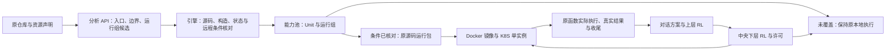

# 从能力池到原生运行组

更新：2026-10-21。首次远端部署从[服务器部署](服务器部署.md)开始；本页说明能力池运行包、独立运行进程和可选 K8S 操作。命令需按目标机器实际配置执行。

bridge 平台的同机 worker 采用[Compose 同网络方案](Docker部署.md#3-bridge-平台怎样接-worker)。host 网络与 SSH 跨机方式要求双方 daemon 支持对应网络语义；rootless 挂载私有目录的容器用户按服务器指南配置。实际机器环境、服务状态和集群探查记录保留本地。

Unit 是分析后的能力和调度入口；运行组是这些入口必须共同保留的原生执行环境。两者不是一一对应关系。一个组中可以有多个 Unit，K8S 部署的是承载该组的进程。仅把多个容器放在同一个 Pod，不会让它们共享 Python 对象。



## 用户确认的边界

运行组按原对象、共享状态和控制依赖划分。同组保持同一进程及原构造／请求生命周期；不能把两个同配置的独立对象合并，也不能把每请求构造改为常驻对象。API 提出方案，引擎按明确规则核对。跨组只开放远程条件已核对的独立入口；JSON／制品端口不构成合法拆分的依据。未覆盖的能力继续本地执行并显示缺口。实例重启不默认恢复原会话。

这是当前宿主范围的上限。0.8.0 只兑现了其中一个有限子集；有完整 JSON 参数接口的模型、SDK 或文件处理入口，并不会因此自动成为远程能力。

## 引擎当前怎样核对

分析器可提交 `runtime_groups`，成员引用同次分析的入口 ID。`check_candidate` 返回同一引擎的分组和远程条件，模型可继续读源码、修正候选，使用原有完整上下文和模型配置，不另设轮次或费用上限。

原对象／共享状态／控制关系尚未解除的入口，保留在原来源上下文中。这个保守组表示继续使用现有原生绑定，并不声称已经求出了最小依赖闭包，也不会让不同入口共享同一个新造的对象。原 CLI 自带的子进程树继续保留，不压成一个新进程。API 若把未决的原生状态入口划到多个新宿主，引擎返回具体缺口并保留原上下文。

远程规则 `scalar-independent-entry/1` 核对原同步顶层函数、原源码和包初始化、有限值运算以及原输入／返回类型。当前支持不可变字符串、整数、布尔等标量；不支持开放参数、变长参数、对象构造、资源驻留、可变容器传输、异步入口、内部局部重构或未知外部效果。类型分析只检查原代码，不生成替代算法。支持的操作包括有限赋值／分支／返回、字符串运算，以及字面模式的标准 `re` 查询；正则局部结果留在进程内，可能异常保留为非成功出口。

入口仍须先通过已有原生绑定检查。远程输出按实际内建标量核对，不把对象、子类、tuple 或模型结果任意转换为 JSON。源码闭包、完整效果分析及远程语义的通用证明仍未完成，状态中保留 `formal_proof=false`。

## 运行包及执行

“运行组与部署”页面按来源查看成员、分组依据、执行位置及远程缺口。远程条件已核对的组可以导出：

| 产物 | 用途 |
|---|---|
| `worker.json` | 原候选、来源版本、安装身份和组成员 |
| `source/`、`snapshots/` | 冻结原源码和内容哈希；不重写原算法 |
| `core/` | 同版本平台原生绑定与运行协议 |
| `Dockerfile` | Python 3.11 原生运行进程，无模型或数据下载 |
| `k8s.json` | 该组单实例 Deployment 和 Service，使用 `Recreate` |
| 同目录名 `.zip` | 私有 SFTP 交付包，不进入 Git |

运行进程再次核对来源、入口与远程规则。启动生成新的实例身份，取得当前平台会话，然后登记实际地址。平台核对来源版本、安装身份、成员及宿主；登记后已有聊天工具自动路由到该组，无须另写示例工作流。

中央 RL 决定已使能边界的启动。原包装在运行进程中依次取得许可、消费许可、调用原函数、发送实际收尾。返回标量供方案的真实结果边使用，后继仍等前项正常返回。原生对象边不能跨进程。

每组一个实例，不自动扩容或恢复对象。平台重启会更换会话；旧运行进程不能继续使用旧许可。运行进程重启会更换实例，旧调用未收尾时不允许用新实例冒充恢复。网络响应缺失时不重放调用、不自动改为本地执行；未知物理执行保留占用，实际迟到收尾仍走原身份。这属于原生调用协议，不是自动故障恢复。

按来源摘除继续适用：阻止后续调用，已开始的原调用允许收尾；不强杀运行进程、不宣称自动卸载原模型。当前没有按 Unit 剔除功能。页面的“改为本地执行”只改变执行位置，要求远程调用已收尾。

## 服务器操作

代码和通用模板由 GitHub 管理。模型密钥、数据、平台状态和生成的运行包不提交 Git；需要搬到另一台机器的运行包才使用 SFTP。同一服务器上导出的包已经在数据目录，无须再上传一遍。

默认采用[服务器部署](服务器部署.md)中的独立项目 Docker 平台。下面 Docker 运行进程命令对应 **Linux 平台与运行进程均使用 `--network host`，平台监听宿主 `127.0.0.1:8880`** 的路径；它们不能直接套用到桥接网络的单服务 Compose。跨物理机器的双向连接见[服务器部署](服务器部署.md)中的跨机器部分。K8S 可在已有合适集群、或确实需要演示 Pod 部署时采用。

### 先在目标平台接入和导出

运行包必须由负责调度它的同一平台导出。源码版本相同还不够：来源身份、分析结果、安装身份、成员和构造接线也须一致。Windows 能力池导出的包不能直接登记到新建的空服务器平台。推荐在服务器重新填写模型配置、接入目标来源并分析；不要复制 Windows DPAPI 密钥。

统一目录如下：

| 宿主目录 | 平台容器中 | 内容 |
|---|---|---|
| `~/seampact-workspace/Seampact` | `/app` 内平台代码来自镜像 | Git 代码和文档 |
| `~/seampact-workspace/seampact-data` | `/data` | 模型配置、能力池、分析记录、冻结源码和导出包 |
| `~/seampact-workspace/harnesses` | `/harnesses` | SFTP 上传的来源和实际资源 |

在目标平台网页完成来源分析后，打开“运行组与部署”，选择 `REMOTE_CHECKED` 的组。在“运行进程访问平台的地址”填写：

- 同机 host-network Docker：`http://127.0.0.1:8880`。
- 下文 K8S 中的组：`http://seampact-platform:8880`，平台与运行进程都在 `seampact` 命名空间。
- 跨机器：填写运行进程实际能够访问的平台地址；还须满足平台能够反向访问运行进程，具体连接命令见[服务器部署](服务器部署.md)。

点击“导出运行包”，展开“导出的运行包与部署文件”。例如显示 `/data/deployments/rg-……-xxxxxxxx`，则服务器位置是 `~/seampact-workspace/seampact-data/deployments/rg-……-xxxxxxxx`。**下面交互输入实际目录名，命令不含可以误执行的示例组名；每段出现报错时停止，不继续执行后文。**

```bash
export SEAMPACT_DATA_DIR="$HOME/seampact-workspace/seampact-data"
find "$SEAMPACT_DATA_DIR/deployments" -mindepth 1 -maxdepth 1 -type d -name 'rg-*'
read -r -p '粘贴本次导出目录名（仅 rg-...，不要整个路径）：' SEAMPACT_EXPORT_NAME
export SEAMPACT_WORKER_DIR="$SEAMPACT_DATA_DIR/deployments/$SEAMPACT_EXPORT_NAME"
python3 -I -B - <<'PY'
import json
import os
import re
from pathlib import Path

name = os.environ['SEAMPACT_WORKER_DIR']
root = Path(os.environ['SEAMPACT_DATA_DIR']).resolve() / 'deployments'
folder = Path(name).resolve()
if folder.parent != root or not re.fullmatch(r'rg-[0-9a-f]{24}-[0-9a-f]{8}', folder.name):
    raise SystemExit('不是本次平台导出的直接子目录')
spec = json.loads((folder / 'worker.json').read_text())
manifest = json.loads((folder / 'k8s.json').read_text())
deployment = next(item for item in manifest['items'] if item['kind'] == 'Deployment')
print('group:', spec['group']['id'])
print('source_version:', spec['group']['source_version'])
print('installation_id:', spec['installation_id'])
print('namespace:', deployment['metadata']['namespace'])
print('folder:', folder)
PY
```

然后生成仅供本次部署使用的清单副本，并从清单提取实际组名、命名空间和镜像名。原导出文件不覆盖；镜像标签追加本次导出后缀，避免新包复用旧镜像缓存。

```bash
python3 -I -B - <<'PY'
import json
import os
from pathlib import Path

folder = Path(os.environ['SEAMPACT_WORKER_DIR'])
manifest = json.loads((folder / 'k8s.json').read_text())
deployment = next(item for item in manifest['items'] if item['kind'] == 'Deployment')
container = deployment['spec']['template']['spec']['containers'][0]
container['image'] += '-' + folder.name.rsplit('-', 1)[1]
(folder / 'k8s-server.json').write_text(json.dumps(manifest, indent=2) + '\n')
PY
export SEAMPACT_GROUP_ID="$(python3 -I -B -c 'import json,sys; print(json.load(open(sys.argv[1]))["group"]["id"])' "$SEAMPACT_WORKER_DIR/worker.json")"
export SEAMPACT_WORKER_IMAGE="$(python3 -I -B -c 'import json,sys; d=next(x for x in json.load(open(sys.argv[1]))["items"] if x["kind"]=="Deployment"); print(d["spec"]["template"]["spec"]["containers"][0]["image"])' "$SEAMPACT_WORKER_DIR/k8s-server.json")"
export SEAMPACT_WORKER_NAMESPACE="$(python3 -I -B -c 'import json,sys; d=next(x for x in json.load(open(sys.argv[1]))["items"] if x["kind"]=="Deployment"); print(d["metadata"]["namespace"])' "$SEAMPACT_WORKER_DIR/k8s-server.json")"
docker build -t "$SEAMPACT_WORKER_IMAGE" "$SEAMPACT_WORKER_DIR"
```

这个镜像复制冻结原源码和同版协议核心，不下载模型、数据或特定 Harness 依赖。当前已核对的标量入口才适用；显示 `LOCAL_ONLY` 的组先继续在平台原生进程中执行。

### 同机 Docker 运行进程

先按[服务器部署](服务器部署.md)启动 host-network 平台，再执行上文导出和构建。选择本组独占的端口；多个运行组不能共用同一个宿主监听端口。

```bash
read -r -p '本组运行进程端口，回车使用 8890：' SEAMPACT_WORKER_PORT
export SEAMPACT_WORKER_PORT="${SEAMPACT_WORKER_PORT:-8890}"
docker run -d --name "$SEAMPACT_GROUP_ID" --network host --init \
  "$SEAMPACT_WORKER_IMAGE" \
  --coordinator http://127.0.0.1:8880 \
  --host 127.0.0.1 --port "$SEAMPACT_WORKER_PORT" \
  --advertise-url "http://127.0.0.1:$SEAMPACT_WORKER_PORT"
docker logs --tail 80 "$SEAMPACT_GROUP_ID"
```

正常输出 `worker_ready`，平台日志出现 `worker_attached`；“运行组与部署”显示 `REMOTE` 和当前实例身份。聊天仍调用已有能力池 Unit，接口不会换成手工示例流程。若登记失败，保留实际报错；不要通过修改 `worker.json` 来绕过来源或安装身份。

停止本组前先结束任务，在网页点“改为本地执行”。只有调用已收尾才允许切换。然后只停止本次组对应的容器：

```bash
docker stop "$SEAMPACT_GROUP_ID"
```

再次启动同一个包可用 `docker start "$SEAMPACT_GROUP_ID"`，它会取得新平台会话、生成新实例并重新登记。平台重新分析／恢复来源后安装身份可能变化，此时旧包不能继续登记；应重新导出。替换包时，在明确旧调用已收尾且旧容器已停止后，可删除这一个旧容器，再按新导出记录构建、启动：

```bash
docker rm "$SEAMPACT_GROUP_ID"
```

不要使用全局 Docker 清理命令。停止容器没有删除服务器上的原包、密钥或数据。

### K8S：专用 KIND 中启动平台

单节点 KIND 在一台服务器上提供 K8S 部署形式；多个 KIND 节点仍是同机容器，不代表不同物理机器，也不增加实际算力。不同机器的能力分布需要可达网络和真正位于不同机器的运行进程。

下文仅用于**本项目专用** `seampact-prototype` KIND，假定 Docker、`kind`、`kubectl` 和系统 `python3` 已可用。安装方法以 [KIND 官方说明](https://kind.sigs.k8s.io/docs/user/quick-start/)和 [kubectl 官方说明](https://kubernetes.io/docs/tasks/tools/install-kubectl-linux/)为准，工具缺失时先返回实际情况，不改共享系统或共享集群。先读取现状：

```bash
command -v docker kind kubectl python3
kind get clusters
kubectl config get-contexts
```

已有 `seampact-prototype` 时不要直接销毁／重建。读取它的目录挂载并确认是本项目所需数据：

```bash
docker inspect seampact-prototype-control-plane --format '{{json .Mounts}}'
kubectl --context kind-seampact-prototype get nodes -o wide
```

只有没有同名集群、且决定使用新建项目专用 KIND 时，才执行后面的 `kind create cluster`。已有其他名字的集群不受本页命令影响。

平台不能和另一个平台实例同时写同一 `seampact-data`。如果此前按 Docker 主入口启动过平台，先结束任务、让运行进程收尾并停止它们，再按[服务器部署](服务器部署.md)的停止命令停止那个平台。K8S 的平台和 Docker 平台属于二选一的运行位置。

以下从当前环境生成本用户的私有配置。仓库中的 `deploy/k8s/kind.yaml` 与 `platform.json` 使用 `/srv/seampact/` 和 UID/GID `1000` 作为示例；实际目录、UID/GID 与镜像标签由下面脚本填入。生成物保存在已忽略的 `.local-private/deployment/k8s/`。

```bash
cd "$HOME/seampact-workspace/Seampact"
export SEAMPACT_DATA_DIR="$HOME/seampact-workspace/seampact-data"
export SEAMPACT_HARNESS_DIR="$HOME/seampact-workspace/harnesses"
export SEAMPACT_K8S_DIR="$PWD/.local-private/deployment/k8s"
mkdir -p "$SEAMPACT_DATA_DIR" "$SEAMPACT_HARNESS_DIR" "$SEAMPACT_K8S_DIR"
export SEAMPACT_CORE_IMAGE="seampact-core:0.8.0-$(git rev-parse --short HEAD)"
python3 -I -B - <<'PY'
import json
import os
from pathlib import Path

out = Path(os.environ['SEAMPACT_K8S_DIR'])
paths = [os.environ['SEAMPACT_DATA_DIR'], os.environ['SEAMPACT_HARNESS_DIR']]
kind = {
    'kind': 'Cluster', 'apiVersion': 'kind.x-k8s.io/v1alpha4',
    'name': 'seampact-prototype',
    'nodes': [{'role': 'control-plane', 'extraMounts': [
        {'hostPath': path, 'containerPath': path} for path in paths]}],
}
(out / 'kind.json').write_text(json.dumps(kind, indent=2) + '\n')
manifest = json.loads(Path('deploy/k8s/platform.json').read_text())
deployment = next(item for item in manifest['items'] if item['kind'] == 'Deployment')
spec = deployment['spec']['template']['spec']
spec['securityContext'] = {'runAsUser': os.getuid(), 'runAsGroup': os.getgid()}
spec['containers'][0]['image'] = os.environ['SEAMPACT_CORE_IMAGE']
for volume in spec['volumes']:
    volume['hostPath']['path'] = paths[0 if volume['name'] == 'state' else 1]
(out / 'platform.json').write_text(json.dumps(manifest, indent=2) + '\n')
PY
cat "$SEAMPACT_K8S_DIR/kind.json"
cat "$SEAMPACT_K8S_DIR/platform.json"
```

KIND 节点容器的 `extraMounts` 先接入宿主目录，Pod 的 `hostPath` 再接入节点内同名目录；少一层挂载就不能得到实际平台数据。[KIND extra mounts](https://kind.sigs.k8s.io/docs/user/configuration/#extra-mounts)

构建镜像；不存在同名集群时创建；再向明确的项目集群加载镜像、应用平台清单：

```bash
docker build -f deploy/Dockerfile -t "$SEAMPACT_CORE_IMAGE" .
```

仅新建集群执行：

```bash
kind create cluster --name seampact-prototype --config "$SEAMPACT_K8S_DIR/kind.json"
```

新集群或已确认挂载正确的项目集群均执行：

```bash
kind load docker-image "$SEAMPACT_CORE_IMAGE" --name seampact-prototype
kubectl --context kind-seampact-prototype apply -f "$SEAMPACT_K8S_DIR/platform.json"
kubectl --context kind-seampact-prototype -n seampact get pods -o wide
kubectl --context kind-seampact-prototype -n seampact logs deployment/seampact-platform --tail=80
```

镜像先加载再创建工作负载，清单使用 `IfNotPresent`，避免让集群到 Docker Hub 查找本地的项目镜像。[KIND 镜像加载](https://kind.sigs.k8s.io/docs/user/quick-start/#loading-an-image-into-your-cluster)

另一个 Terminus 会话保持以下前台进程：

```bash
kubectl --context kind-seampact-prototype -n seampact port-forward \
  --address 127.0.0.1 service/seampact-platform 8880:8880
```

再配置 Terminus SSH 本地转发：远端 `127.0.0.1:8880`，本机端口可选 `8880` 或空闲的 `18880`。浏览器按本机端口打开地址。`kubectl port-forward` 关闭或所选 Pod 重启后需重新运行；它只用于访问网页，不承担集群内平台与运行组之间的通信。[官方端口转发说明](https://kubernetes.io/docs/tasks/access-application-cluster/port-forward-access-application-cluster/)

### K8S：从同一能力池启动运行组

通过上述网页配置模型、接入并分析来源。导出运行组时填写 `http://seampact-platform:8880`；若复用先前 Docker 的能力池，仍须由当前平台导出本次包。宿主 `/data` 对应上文 `SEAMPACT_DATA_DIR`，无需从本机 SFTP 绕一遍。

执行“先在目标平台接入和导出”中的目录选择、生成清单副本和镜像构建命令。确认显示的命名空间是 `seampact`，然后执行：

```bash
kind load docker-image "$SEAMPACT_WORKER_IMAGE" --name seampact-prototype
kubectl --context kind-seampact-prototype apply -f "$SEAMPACT_WORKER_DIR/k8s-server.json"
kubectl --context kind-seampact-prototype -n "$SEAMPACT_WORKER_NAMESPACE" get pods -o wide
kubectl --context kind-seampact-prototype -n "$SEAMPACT_WORKER_NAMESPACE" \
  logs "deployment/$SEAMPACT_GROUP_ID" --tail=80
kubectl --context kind-seampact-prototype -n seampact \
  logs deployment/seampact-platform --tail=80
```

运行组 Service 名称取实际 `rg-...`，每组内部监听 `8890`；不同 Pod 可用同一容器端口。工作进程自动登记的地址是 `http://该组名:8890`，平台通过集群 Service 访问。网页显示 `REMOTE` 才表明登记到当前平台；`Running` 只表示 Pod 进程状态，不能代替绑定条件核对。

该组 Deployment 的副本数为 `1`、更新策略为 `Recreate`。这些设置避免期望多个常驻实例，却不构成任意故障下的严格一次执行证明；实例变化仍依赖平台会话和实际许可核对。[Deployment 更新策略](https://kubernetes.io/docs/concepts/workloads/controllers/deployment/#recreate-deployment)

### 查看、停止和更新 K8S 工作负载

查看本项目命名空间即可：

```bash
kubectl --context kind-seampact-prototype -n seampact get deployments,services,pods -o wide
kubectl --context kind-seampact-prototype -n "$SEAMPACT_WORKER_NAMESPACE" \
  describe "deployment/$SEAMPACT_GROUP_ID"
```

停止某组：先在网页确认调用已收尾并点“改为本地执行”，再执行以下命令。清单和导出包保留：

```bash
kubectl --context kind-seampact-prototype -n "$SEAMPACT_WORKER_NAMESPACE" \
  scale "deployment/$SEAMPACT_GROUP_ID" --replicas=0
```

恢复该组用 `--replicas=1`；新进程会产生新实例身份，不恢复旧原生会话。来源被重新分析／恢复而安装身份变化时，必须从当前能力池重新导出，不能只把旧 Deployment 调回 `1`。

更新平台代码时，在没有分析／任务运行、且各运行组原调用已收尾后，先暂停本次运行组。然后在 Git 克隆中 `git pull --ff-only`，重新执行本页平台配置生成、镜像构建、`kind load docker-image` 和平台 `apply`。镜像标签含 Git 提交，更新清单会触发进程替换；若同一标签被重建，还需明确执行：

```bash
kubectl --context kind-seampact-prototype -n seampact \
  rollout restart deployment/seampact-platform
```

平台重启会更换会话。仍在线的旧运行进程不会自动取得新会话；待新平台已经输出启动日志后，按实际组执行下面的重启命令，或将之前暂停的组调回 `1`。未收尾调用不能借这一步当成已经恢复：

```bash
kubectl --context kind-seampact-prototype -n "$SEAMPACT_WORKER_NAMESPACE" \
  rollout restart "deployment/$SEAMPACT_GROUP_ID"
```

协议核心发生变化时，重新导出运行包、构建新镜像、加载并应用新清单，而不只重启包含旧代码的 Pod。导出副本使用独立镜像标签，因此不会误用同名旧缓存。

停止平台只在任务／原调用收尾且运行组已暂停之后执行：

```bash
kubectl --context kind-seampact-prototype -n seampact \
  scale deployment/seampact-platform --replicas=0
```

本页不提供删除集群、删除命名空间或清理其他用户工作负载的命令。

### 已有多节点 K8S 的区别

现有模板的 `hostPath` 只适用于目录确实存在的节点。真正的多节点集群必须先确定平台应落到哪一台有私有目录的节点，或改用实际持久存储；不能把单机 KIND 清单原样投到任意节点。生成的运行组源码在镜像内，跨节点部署还要让每个目标节点能获得该镜像，例如通过课题组镜像仓库，而不是只在平台机器执行 `docker build`。

0.8.0 没有多节点放置策略、设备资源准入、GPU 请求、原生状态迁移或自动扩容。K8S 决定进程放在哪个节点，应用内两层 RL 决定方案和已使能调用，二者不同；也尚未把网络时延纳入当前 Q 状态。这些限制不妨碍已核对的独立标量组在实际可达的不同机器运行，但不能据此宣称完整有状态 Harness 已可分布式拆开。[Kube scheduler](https://kubernetes.io/docs/concepts/scheduling-eviction/kube-scheduler/)

## 已有实际运行事实

本机 0.8.0 已把此前真实 API 分析得到的 DiSP 原函数 `insert_token_at_start` 导出为独立运行组，在另外的 Python 3.11 进程执行。实际聊天任务 `06c5145bb3a34d0f8a589c9ef3b39174` 请求两步前缀调用，第二步通过 `$result` 消费前项真实返回；得到 `[B] [A] Observe the red bicycle.`。三次对话模型响应，两个中央许可均 `starts=1`、`receipt=RETURN`、`physical=RETIRED`，实际执行记录标注 `REMOTE`。

这证明当前有限入口的跨进程调用与中央调度链路已运行；没有在服务器构建镜像或启动 K8S Pod，没有证明有状态 Harness 的远程合法性、并行收益或 RL 优势。模型只提出了一个方案，业务语义状态仍为 `UNRESOLVED`。原仓库未修改，私有实际记录保留在 `var/prototype/remote_runtime_2026-10-14.json`。

同源分组修正也已实际调用分析 API：`6b63a68475e4404ea8cf993a39d71532` 与 `766b0495f3284d008cf0c842f597607a` 各两次模型响应，沿用原完整历史。最终模型根据引擎“未决对象／共享状态／控制依赖不能切到多个进程”的反馈，提交一个标量远程组和一个保守本地组；报告 `proposal_status=CHECKED`、无分组缺口。原生接入和远程规则逐入口仍单独判断，模型的分组理由只作为候选说明，不作为证明。
