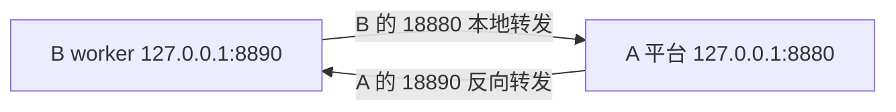

# 运行组远端操作

更新：2026-10-31，SeamPact 0.14.8。平台安装与更新统一见[服务器部署](服务器部署.md)，网络和容器路径见[Docker 说明](Docker部署.md)，运行组契约、后端与生命周期见[运行组与 K8S 部署](运行组与K8S部署.md)。平台核心更新后核对 worker 身份，必要时重新生成运行包和构建镜像。本页保留手动构建、同机 worker、跨机 SSH 和 worker 清理命令；未执行本页的 Linux 容器、GPU 或跨机操作，不能以文档存在代替真实运行结果。

依赖镜像复用、已有来源重新核对及过期工件处理见[镜像构建与依赖复用](镜像构建与依赖复用.md)。构建成功、实例就绪和原目标调用成功分别记录。

## 1. 先取得当前平台的运行包

在实际调度该组的中央平台 A 中，先完成来源接入、分析／重新核对以及运行环境选择，再在“运行组与部署”生成构建工件。包必须来自同一平台、来源版本、安装身份和运行组契约。电脑旧包不能直接登记到空的服务器平台；重新分析／恢复来源或更新协议核心后，应重新导出并构建。

默认工具镜像且 Docker 后端可用时，可直接在网页构建、使镜像可达、启动实例。以下用于操作者手动构建；若网页已产生带 `--instance-id`、`--generation` 的手动命令，沿用该完整命令，登记后会绑定到预先创建的实例，不另起同组实例代替它。

对于脚本管理的平台，在 A 的宿主终端读取数据目录。修改过部署根目录时替换第一行；只读取必要字段，不输出整份私有配置：

```bash
SEAMPACT_ROOT="$HOME/seampact-workspace"
SEAMPACT_DATA_DIR="$(python3 -I -B -c 'import json,sys; d=json.load(open(sys.argv[1],encoding="utf-8")).get("data_dir"); assert d, "命名卷须按实际挂载导出工件"; print(d)' "$SEAMPACT_ROOT/deployment.json")"
read -r -p '本次导出目录名（仅最后一段）：' SEAMPACT_BUNDLE_NAME
SEAMPACT_BUNDLE_DIR="$SEAMPACT_DATA_DIR/deployments/$SEAMPACT_BUNDLE_NAME"
test -f "$SEAMPACT_BUNDLE_DIR/worker.json"
test -f "$SEAMPACT_BUNDLE_DIR/environment.json"
test -f "$SEAMPACT_BUNDLE_DIR/build-reuse.json"
```

`test` 成功后再执行后续命令。平台显示的 `/data/deployments/<目录>` 对应宿主数据目录的 `deployments/<目录>`。旧数据若用命名卷，或 `/data` 使用其他映射，按实际挂载取得工件，不把容器路径直接当成宿主路径。

```bash
SEAMPACT_GROUP_ID="$(python3 -I -B -c 'import json,sys; print(json.load(open(sys.argv[1],encoding="utf-8"))["group"]["id"])' "$SEAMPACT_BUNDLE_DIR/worker.json")"
SEAMPACT_WORKER_IMAGE="seampact-worker:${SEAMPACT_GROUP_ID#rg-}-${SEAMPACT_BUNDLE_NAME##*-}"
SEAMPACT_WORKER_NAME="seampact-owner-${SEAMPACT_GROUP_ID#rg-}-$(id -u)"

```

每条命令成功后继续。这里的系统 Python 只读取 JSON；原代码使用工件选定的解释器和依赖，默认平台的 Python 3.11 不决定 worker 的版本。镜像标签只是本机名称，真实来源与安装身份来自 `worker.json`。同时保留多个手动实例时，为容器使用不同名称。

### 读取构建输入并构建

手动入口直接调用当前工件中与前端相同的构建器。宿主需要 Python 3.11+、Docker CLI／buildx 和可用 daemon；该 Python 只运行构建器，原库仍使用工件选定的容器解释器。构建器解析实际基础镜像、核验／构建依赖环境后再构建 worker，自动保存 `build-result.json`：

```bash
PYTHONPATH="$SEAMPACT_BUNDLE_DIR/core" python3 -B -m seampact.backends \
  "$SEAMPACT_BUNDLE_DIR" --image "$SEAMPACT_WORKER_IMAGE"
```

只有终端返回 `BUILT` 且退出成功后继续启动；`dependency environment: REUSED` 表示本次跳过了依赖环境安装阶段，不代表其他安装步骤或 pip 下载缓存命中。需要源码的清单／项目仍在后续阶段按原顺序安装。手动收据留在工件目录，不会自动回写中央平台构建状态。下载缓存属于当前 builder；跨机器复用仍需传输实际镜像或使用可达镜像仓库。构建成功不代表 GPU、权重挂载或原调用已成功。


## 2. 同机 bridge worker

本节适用于自建 bridge 网络的平台，包括脚本新部署的默认方式。读取已保存的实际网络与平台容器名：

```bash
SEAMPACT_RUNTIME_NETWORK="$(python3 -I -B -c 'import json,sys; c=json.load(open(sys.argv[1],encoding="utf-8")); n=c.get("runtime_network"); assert n, "旧部署网络未唯一确定，先核对容器网络"; print(n)' "$SEAMPACT_ROOT/deployment.json")"
SEAMPACT_PLATFORM_NAME="$(python3 -I -B -c 'import json,sys; print(json.load(open(sys.argv[1],encoding="utf-8"))["container"])' "$SEAMPACT_ROOT/deployment.json")"
docker network inspect "$SEAMPACT_RUNTIME_NETWORK" --format '{{.Name}}'
```

平台须在该网络上具有上述容器名／别名，且容器监听 8880；旧部署的别名、容器端口以实际配置为准。默认新部署满足此条件。确认镜像构建成功后：

```bash
docker run -d --name "$SEAMPACT_WORKER_NAME" --init \
  --network "$SEAMPACT_RUNTIME_NETWORK" \
  "$SEAMPACT_WORKER_IMAGE" \
  --coordinator "http://$SEAMPACT_PLATFORM_NAME:8880" \
  --host 0.0.0.0 --port 8890 \
  --advertise-url "http://$SEAMPACT_WORKER_NAME:8890"
docker logs --tail 80 "$SEAMPACT_WORKER_NAME"
```

平台与 worker 通过 Docker DNS 双向访问，不发布 worker 的宿主端口。这里的网络只覆盖当前 daemon 上的同机容器。bridge 平台不能通过 `127.0.0.1:8890` 访问宿主 worker，也不能直接用后文的宿主 SSH 反向端口。

## 3. 同机 host worker

仅适用于平台已经采用 host 网络，且平台和 worker 都实际共享宿主回环视角的部署。Linux 系统 daemon 可按 host 语义使用；rootless 历史限制与版本依据见[Docker 网络说明](Docker部署.md#2-host-网络与回环地址)。不要为执行本节改变已有平台网络。

先填写平台实际监听端口，检查 worker 端口：

```bash
read -r -p '平台实际监听端口（默认8880）：' SEAMPACT_PLATFORM_PORT
SEAMPACT_PLATFORM_PORT="${SEAMPACT_PLATFORM_PORT:-8880}"
ss -ltn '( sport = :8890 )'
```

端口空闲且第 1 节镜像构建成功后：

```bash
docker run -d --name "$SEAMPACT_WORKER_NAME" --network host --init \
  "$SEAMPACT_WORKER_IMAGE" \
  --coordinator "http://127.0.0.1:$SEAMPACT_PLATFORM_PORT" \
  --host 127.0.0.1 --port 8890 \
  --advertise-url http://127.0.0.1:8890
docker logs --tail 80 "$SEAMPACT_WORKER_NAME"
```

正常启动后，A 页面出现操作者启动并登记的实例。改 worker 端口时，同时修改 `--port` 和 `--advertise-url`。宿主重新核对源码、绑定、文件／包／凭据条件和契约摘要；未满足成员列在实例 `missing` 中，不因容器启动而变成可调用。

## 4. 跨机器：host 网络与双向 SSH

本节使用 A 中央平台＋B worker，并要求 A 已采用 host 网络；Docker 形式的 B 也须真正共享 B 宿主回环。SSH 在 B 宿主启动时，B worker 必须能访问该宿主的本地转发端口。脚本默认 bridge 平台不能套用本节地址。跨机 bridge 须另行配置双方实际可路由的专用地址；K8S 使用其集群网络，见[运行组与 K8S 部署](运行组与K8S部署.md)。



### B：上传、解压与构建

在 B 第一个终端建立接收目录：

```bash
umask 077
SEAMPACT_ROOT="$HOME/seampact-workspace"
mkdir -p "$SEAMPACT_ROOT/uploads" "$SEAMPACT_ROOT/workers"
```

在 A 平台生成本次工件 zip，通过 SFTP 下载再上传到 B 的 `uploads/`。B 不需要重新分析来源，否则得到另一份安装身份。B 须具备自己的 Docker 权限；现成租用容器不一定提供 Docker daemon。

```bash
read -r -p '已上传的本次zip文件名：' SEAMPACT_ZIP_NAME
SEAMPACT_ZIP="$SEAMPACT_ROOT/uploads/$SEAMPACT_ZIP_NAME"
python3 -I -B - "$SEAMPACT_ZIP" "$SEAMPACT_ROOT/workers" <<'PY'
import pathlib, stat, sys, zipfile
archive = pathlib.Path(sys.argv[1]).resolve()
destination = pathlib.Path(sys.argv[2]).resolve() / archive.stem
if destination.exists():
    raise SystemExit("目标目录已存在，未覆盖：" + str(destination))
with zipfile.ZipFile(archive) as package:
    for member in package.infolist():
        target = (destination / member.filename).resolve()
        try:
            target.relative_to(destination)
        except ValueError:
            raise SystemExit("运行包路径不合法，未解压")
        if stat.S_ISLNK(member.external_attr >> 16):
            raise SystemExit("运行包包含符号链接，未解压")
    destination.mkdir()
    package.extractall(destination)
print(destination)
PY
```

解压成功后，读取真实组身份并构建：

```bash
SEAMPACT_BUNDLE_NAME="${SEAMPACT_ZIP_NAME%.zip}"
SEAMPACT_BUNDLE_DIR="$SEAMPACT_ROOT/workers/$SEAMPACT_BUNDLE_NAME"
SEAMPACT_GROUP_ID="$(python3 -I -B -c 'import json,sys; print(json.load(open(sys.argv[1],encoding="utf-8"))["group"]["id"])' "$SEAMPACT_BUNDLE_DIR/worker.json")"
SEAMPACT_WORKER_IMAGE="seampact-worker:${SEAMPACT_GROUP_ID#rg-}-${SEAMPACT_BUNDLE_NAME##*-}"
SEAMPACT_WORKER_NAME="seampact-owner-${SEAMPACT_GROUP_ID#rg-}-$(id -u)"
# 接着执行第 1 节“读取构建输入并构建”的代码块。
```

在 B 当前终端按第 1 节读取本次工件环境并完成两阶段构建，使用这里的 `SEAMPACT_BUNDLE_DIR` 与镜像变量。后续启动前确认最终 worker 镜像已构建成功。

### B：保持双向 SSH 连接

在 B 第二个终端填写 A 的 SSH 参数；A 的 SSH 服务必须允许对应端口转发：

```bash
read -r -p '平台A的SSH地址：' SEAMPACT_A_HOST
read -r -p '平台A的SSH用户名：' SEAMPACT_A_USER
read -r -p '平台A的SSH端口（默认22）：' SEAMPACT_A_SSH_PORT
SEAMPACT_A_SSH_PORT="${SEAMPACT_A_SSH_PORT:-22}"
ssh -N -T -o ExitOnForwardFailure=yes \
  -o ServerAliveInterval=30 -o ServerAliveCountMax=3 \
  -p "$SEAMPACT_A_SSH_PORT" \
  -L 127.0.0.1:18880:127.0.0.1:8880 \
  -R 127.0.0.1:18890:127.0.0.1:8890 \
  "$SEAMPACT_A_USER@$SEAMPACT_A_HOST"
```

保持该终端运行。B 的 18880 到达 A 平台，A 的 18890 到达 B worker。A 平台改过端口时修改 `-L` 最后的端口；多个 B 各用不同的 A 反向端口。组织禁止 SSH 转发时使用其允许的专用网络连接，不修改共享 SSH 全局设置。

### B：启动并登记到 A

回到 B 第一个终端，镜像构建成功、SSH 通道存在且 8890 可用时：

```bash
docker run -d --name "$SEAMPACT_WORKER_NAME" --network host --init \
  "$SEAMPACT_WORKER_IMAGE" \
  --coordinator http://127.0.0.1:18880 \
  --host 127.0.0.1 --port 8890 \
  --advertise-url http://127.0.0.1:18890
docker logs --tail 80 "$SEAMPACT_WORKER_NAME"
```

coordinator 是 B 能访问 A 的地址，advertise 是 A 能访问 B 的地址，二者对应不同主机的回环。该接口没有面向公网的鉴权，业务端口按上面方式保留在回环或已授权专用网络。

### B 没有 Docker daemon 时

可以在 B 的独立 Python 环境中使用运行包自带的 `core`，不必在现成容器里再安装 daemon。先按 `environment.json` 准备匹配的 Python 3.10–3.13、原依赖与项目安装，Python 3.10 还需要 `tomli>=2,<3`。实际解释器须匹配工件选定的 major.minor，并满足原库 Python 约束；不是任意受支持版本都能运行同一个包。

在同一网络命名空间先建立上述 SSH 通道，再选择已准备好的解释器：

```bash
read -r -p '已准备好的worker Python可执行文件路径：' SEAMPACT_WORKER_PYTHON
"$SEAMPACT_WORKER_PYTHON" --version
PYTHONPATH="$SEAMPACT_BUNDLE_DIR/core" "$SEAMPACT_WORKER_PYTHON" -B -m seampact worker \
  --spec "$SEAMPACT_BUNDLE_DIR/worker.json" \
  --coordinator http://127.0.0.1:18880 \
  --host 127.0.0.1 --port 8890 \
  --advertise-url http://127.0.0.1:18890
```

不替换系统解释器。core 可直接通过 `PYTHONPATH` 使用，不要求在目标 3.10 环境安装平台发行包；平台发行包本身仍要求 Python 3.11 及以上。模型权重、CUDA、本地扩展和环境变量须在实际执行环境存在，未满足条件保留具体缺口。

## 5. 权重、凭据和实际就绪

手动 `docker run` 需要资源时，在镜像名之前增加原来源所需参数：权重使用 `--mount type=bind,src=<daemon宿主绝对路径>,dst=<登记的worker路径>,readonly`，凭据使用 `-e 变量名`，值来自启动终端环境。凭据变量名为连接配置的 `env`，或 `SEAMPACT_CREDENTIAL_<连接ID大写，非字母数字改为下划线>`。不在命令行中写真实密钥。

GPU 由实际机器和原模型要求配置 `--gpus` 等参数。前端权重路径必须是 worker 能看到的挂载目标路径，平台中可见不等于 B 上也存在。原对象加载与 API 客户端仍执行原语义；静态 READY、worker 登记和真实目标调用分别记录。

## 6. 停止、平台更新后的重建与定向清理

前端可使用“一键准备并启动”按已保存配置完成必要步骤，普通重启不重复构建仍有效的镜像；需保持页面打开。已释放的旧代次可通过单条“清理记录”或组级“清理已释放记录”移出面板，实例及研究成本证据仍保留。它不执行下文的容器／镜像删除命令，具体条件见[统一操作说明](镜像构建与依赖复用.md#一键准备与普通重启)。

平台更新前，先在“运行组与部署”对旧实例执行“排空后停止”：停止派发新根请求，等待在途调用与内部许可收尾，再由运行进程退出。只停止派发而保留进程可用“停止接单”。平台启动的容器／Deployment 交给原后端释放，并确认对象已删除；操作者启动的容器退出后才按名称移除：

```bash
docker rm "$SEAMPACT_WORKER_NAME"
```

SSH 中断不等于原调用取消；响应缺失不自动在本地重放。未知或未决执行不得用新实例冒充已结束。平台启动时把上一 session 的存活实例标为 UNKNOWN（stale）；需要释放时在页面明确选择“释放结果未决的实例”，原未决调用仍保留 UNKNOWN。只填旧 worker URL 不会改变其缓存的 session。

**每次平台重启都会更换 session，全部 worker 须重新启动、取得新 session 再登记。** 平台管理的实例从页面启动新实例，不 `docker start` 复用旧实例身份。操作者启动的容器在未指定 `--instance-id`、且运行包／协议／安装身份仍兼容时，才可在停止后用 `docker start` 产生新实例身份重新登记。协议核心更新、来源重新分析／恢复或环境改变时，重新导出、构建并启动，不只重启旧镜像。

替换 worker 包前，先排空并确认旧容器退出，保存需要的日志，然后删除该容器。确实不再需要该旧包时，先查看旧镜像关联的全部容器，再按明确标签删除镜像：

```bash
read -r -p '已确认不用的旧worker镜像完整标签：' SEAMPACT_OLD_WORKER_IMAGE
docker ps -a --filter "ancestor=$SEAMPACT_OLD_WORKER_IMAGE"
docker image rm "$SEAMPACT_OLD_WORKER_IMAGE"
```

不加 `-f`；仍被其他容器使用时保留。部署脚本只清理它自己管理的平台旧容器／镜像，不按 `seampact-*` 批量删除 worker。不要运行全局 prune、`volume prune`、`down -v` 或 `rm -v`；共享网络、命名卷、基础镜像、其他项目和运行包由各自拥有者管理。

平台状态保留和备份按[服务器部署](服务器部署.md)操作：停止平台后备份完整数据目录或实际挂载卷，保留配置凭据、状态库、WAL、源码快照、学习状态与运行组工件。不能用运行中单独复制一个 `.sqlite3` 文件代替完整备份；保留历史数据也不等于恢复旧进程对象和未收尾会话。

## 7. 实验资源观测

0.14.0 的 `joint.observation` 已自动跟随窗口从准备前启动到收尾结束，并记录阶段时间、CPU／RSS、显式 cgroup 和 GPU 读数。配置及覆盖范围见[自动观测说明](0.14_按需驻留与混合调度.md#4-自动观测及成本口径)。当前平台进程和远端 worker 不是同一采样对象；以下命令仍用于实际 GPU 执行机上的独立采样及原生 B0 对照。

`python -m seampact.resource_observation` 是现有实验运行的只读设备采样入口，不启动来源、模型或训练，不改变设备。它在实际 GPU 执行机运行，需要该环境可导入当前平台包且能执行 `nvidia-smi`。按本次确实获准使用的 GPU UUID 选择设备，不能把编号相同的另一张卡或整台共享服务器当作实验对象。

先准备私有输出目录，使用实际运行身份、对照臂和设备 UUID 替换以下示例值。时长与间隔根据已冻结的测量协议填写；`1200` 秒只是命令示例，不是正式窗口长度要求。

```bash
mkdir -p var/research/resource-observation
python -m seampact.resource_observation \
  --run-id RUN_ID --arm B2 \
  --gpu-uuid GPU-UUID-FROM-EXECUTION-HOST \
  --duration-s 1200 --interval-s 1 \
  --output var/research/resource-observation/RUN_ID-B2.jsonl
```

多卡重复传 `--gpu-uuid`；已知本实验进程可重复传 `--expected-pid`。只有在手动配置后才会比较所见 PID 与预期 PID；没有额外 PID 不证明独占。工具限制查询与输出为所选设备，记录进程 ID 和显存读数，不收集其他进程的命令行或用户名。文件使用独占创建，已有同名结果不会覆盖；中断时保留已有样本及中断摘要。

输出依次为 `seampact.device-observation/1` 头、样本和摘要。包含单调时间／UTC、设备显存用量、GPU 利用率、功率、所见计算进程及查询状态。摘要给出采样峰值、显存 MiB·s、设备功率积分 J 估计，并按每个指标报告有效时间覆盖率；缺失、N/A 和失败保持未知，间隔超过 2.5 倍设定采样间隔不跨空洞积分。积分仅覆盖有效观测区间，不能把部分覆盖写成完整窗口总量，也不把采样峰值写成精确峰值。

归因固定为 `UNVERIFIED_SHARED_DEVICE`：显存与功率是整张所选设备读数，不等于本进程独享资源；GPU 利用率不是活跃 GPU 秒。CPU、账单、其他服务器上的模型服务／API成本不由本工具采集。租赁卡的身份、隔离条件及成本仍需结合实际执行与账单记录。读数含义见 [NVIDIA 官方说明](https://docs.nvidia.com/deploy/nvidia-smi/index.html)。

采用上述独立 CLI 时，由操作者在运行准备前启动、相同收尾范围结束，手动关联 `run_id` 和 `arm`；同机 joint 窗口可使用新的自动入口。用运行和阶段时间核对覆盖，采样不足时保留缺口。正式对照各臂统一采样方式、冷暖状态、准备与释放范围。原始观测含本地设备信息，保存在忽略的 `var/`；共享报告只保留需要的配置摘要、指标、覆盖率和证据索引。
