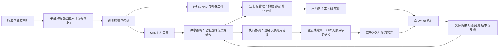

# 部署前建设与调度动作方案

更新：2026-10-21。本文维护部署前建设及联合调度的现行规格。P1—P8 的功能模式基础设施已有工作区实现，Linux／GPU／K8S 实机结果仍为 NOT_RUN；第 5.2—5.3 节的 `joint/1` 工作区已有代码实现，尚无真实联合运行。保留四层、原 W／H／R 与构造规则、三学习器；FIFO 保留为功能模式与排期对照，联合模式允许对合法就绪调用学习派发顺序。代码事实按当前工作区及[当前实现](当前实现.md)核对，文档更新不产生新实验结果。

本轮范围是服务器部署之前可完成的代码、接口、配置模板、实验接续和文档。服务器资源选择、权重／数据下载、模型服务部署、API 地址及密钥填写、GPU 实机配置与真实大模型实验由用户在服务器进行，不作为本地前置工作。代码仍须支持这些配置的引用、挂载和状态核对，但本轮不代填实际值。

## 1. 判断：当前任务窄，容器管理是另一项缺口

目前 REX 场景每个问题只生成 `continue` 和 `retrieve` 两个候选，见 `src/seampact/retrieval_scene.py`。这是一个来源、一个整体检索入口的场景限制。`learners.py` 按当前候选列表评分并使用合法性 mask，没有将动作数固定为二；增加多个合规 Unit、选择不同粒度、依据检查结果决定后续调用，不以 K8S 为前提。

两个动作也可以构成有价值的多步问题。现有 REX 会把检索证据累积到后续问题，不能简单当成互不相关的二分类。当前缺少的是足够多、真实且可观测的决策差异及其收益证据，不能用动作数或模型重量代替。

最新命名资源 REX 组的 294 次更新是 DDQN 87、PPO 120、SAC 87 的合计；各训练 90 个论文 episode。heldout 全跳过回报为 0，全开约 0.188624，简单策略约 0.195290。因此全跳过并非该组已知最优结果。DDQN／SAC 冻结后全跳过只能说明本配置没有学出有效的冻结策略；表示、探索、终局信用分配、优化和训练采样／冻结 argmax 差异都需要诊断，不能单凭输出归因为“学会少挨罚”。原始结果保持在原报告中，不为本方案改写。

更强服务器让完整模型及其真实代价能够进入实验；教师补充难以用程序评价的质量信号。这是重要实验条件，但不会自动产生好动作、可靠观测或贡献。没有教师也可以用客观判据训练；教师看训练参考答案本身不是泄漏，参考答案进入运行时策略／业务输入或测试反馈回流训练才违反相应协议。训练教师和独立评委采用同一模型可能造成相关偏差，不能据此断言必然失效；应分别记录并用独立判据复核。

结论：应建设运行组部署与基本生命周期管理，以承载异构执行环境及研究真实启动／驻留代价；同时补齐功能动作和真实事件接续。不能把“加上 K8S”作为解决当前学习失败或证明拆分价值的充分条件。

## 2. 当前代码事实

| 内容 | 已有实现 | 明确缺口 |
| --- | --- | --- |
| 功能选择 | 三学习器共享可变候选；`capability-features/2` 表达能力、方案和运行状态 | `ACTION_TYPES` 仍仅 invoke／continue／finish；训练清单固定 functional/1 |
| 原生调用与远程宿主 | 标量宿主与 `python311-native-group-worker/1`；原生组在同一进程保留原对象，组外使用 group-port/1 | 环境缺口须在目标宿主核对；不支持任意活对象跨组迁移；原生服务器调用待验证 |
| 部署 | 已有构建、发布、应用、登记、排空与停止后端；不可用时返回 BACKEND_UNAVAILABLE | 工件生成与实际部署成功分别记录；本地无真实 K8S 执行结果 |
| 实例与生命周期 | 多实例记录、代次与进程身份、健康、任务亲和；标量组有限增减副本 | 原生组目前 fixed_resident；尚缺任务／owner 结束及独立重建、复制的细分契约 |
| 派发与并发 | 已使能调用经中央 FIFO 和 owner／配额许可 | 默认全局 quota=1；训练逐任务运行，run_id 被用作任务上下文；副本尚不带来训练中的并行收益 |
| 奖励 | 程序／教师终局反馈；可选 event_module/1，局部权重默认 0 | 尚无跨任务工作负载轨迹与联合动作反馈；执行异常统一排除并中断运行 |
| 成本 | 实例事件与调用成本、运行窗口驻留汇总 | 窗口驻留仍记 UNALLOCATED_WINDOW_TOTAL，未进入联合动作回报；未知资源量不能填 0 |
| 实验镜像 | SEAMPACT_EXTRAS 选择学习器依赖，环境锁及依赖摘要进入清单 | 目标 Linux／GPU 环境及实际镜像须在服务器核验 |

这些事实分别可在 `retrieval_scene.py`、`capabilities.py`、`learners.py`、`deployment.py`、`worker.py`、`training.py`、`costs.py` 与 `deploy/Dockerfile` 核对。已有有限跨进程调用不等于已完成真实 K8S 部署。

## 3. 保留的结构与新控制对象

保持原四层。运行组执行、镜像构建和 K8S 后端放入现有适配／运行时实现，界面扩展现有“运行组与部署”；不另建 Agent 框架或独立实验平台。

Unit 是功能边界；运行组是必须保留共同执行上下文的成员集合；实例是该运行组的一次实际运行。共享模型／对象的多个 Unit 可以在一个进程内分别调度。不能预设一个 Unit 一个 Pod，不能把放在同一 Pod 的多个进程当作共享 Python 对象。

运行组契约至少记录：来源与分析版本、成员和允许的根入口、构造／owner／会话作用域、绑定工件、运行环境身份、组外端口与编码、允许的生命周期操作及依据。实例另记：group_id、instance_id、generation、平台 session、镜像摘要、配置版本、实际位置、初始化状态、在途 owner／调用和最近状态证据。

每个操作分别标记 `SUPPORTED`、`UNSUPPORTED` 或 `UNKNOWN`；未知不授予操作。建议区分进程启动、模型预热、停止接单、排空后停止、新实例启动、创建独立副本和现场恢复。运行组边界及条件仍由分析器提出、规则检查；开发者补通用宿主，不逐库预写包装和切点。

## 4. 必做的部署前代码包

P1—P8 保留基础设施建设要求，当前完成状态见第 2 节；本轮在其上补齐第 5.2—5.3 节，不能因为这些基础接口已有代码就将联合 RL 标记完成。

### P1. 可复现的实验启动环境

- 更新平台镜像、Compose、K8S 模板及文档，统一实际代码版本与镜像摘要；构建上下文允许读取 `pyproject.toml` 等所需项目元数据，安装步骤与 `.dockerignore` 同步维护。
- 提供包含三学习器依赖的明确实验安装入口，保留轻量平台入口。记录实际依赖解析结果，不把 `torch>=2.2` 这种宽范围当成完整复现锁定。
- 原服务独立环境与原生 owner 环境分别声明。已记录的依赖冲突需要有可用环境方案；不能把 Windows 虚拟环境直接拷贝给 Linux，也不能假定一个额外虚拟环境中的包会被平台进程自动导入。
- 本轮输出的是配置能力与构建入口，不提前指定未验证的目标 GPU／CUDA 版本组合，不下载权重。

### P2. 保留原 owner 的运行组宿主

- 保留现有标量宿主，并新增独立、版本化的有限原生运行组宿主规格。不能通过删除 `check_remote` 的资源／构造限制，宣称旧 worker 已支持模型。
- 新宿主装入冻结原源码和分析器生成、引擎核对的绑定，在同一个工作进程保留原构造次数、owner、原 controller、初始化与关闭。原每请求构造仍按请求执行，不因节省时延而改成常驻单例。
- 内部 W／H／R 边界继续在原上下文中向中央许可交接。把整个已核对运行组放进容器，不表示内部步骤获得任意独立启动、乱序或跳过权。
- 组外只开放已定义端口。不可变结构、图像和数组等可增加有版本的编解码／制品引用，须声明类型、形状／dtype、身份、可见范围及有效期；组内原对象边留在进程内。不能用任意 `str()`／JSON 转换替代原返回值，也不通过通用 pickle 传递活对象。
- 不能独立导出的原状态继续同组；没有合法组外编码或生命周期依据时给出具体 MISSING，保留原本地执行路径。
- 先覆盖原同步根入口及其受支持的组内绑定。生成器、流式回调和活跃栈迁移只有已有明确宿主规则时才开放，不承诺自动覆盖所有 Python 程序。

### P3. 从导出工件到实际部署控制

- 补齐显式操作：构建工件、生成镜像、使镜像对目标后端可用、应用运行组清单、读取状态、登记实例、排空与停止。首版使用用户配置的一个集群／namespace 和镜像可达方式，不建设通用集群调度平台。
- 镜像由冻结源码、系统生成的绑定与确定的运行环境组成。配置、凭据、权重通过已有引用机制在启动时注入／挂载，不能把秘密或模型副本自动打进镜像。源码依赖清单的执行与构建错误需有实际状态，不能把文件生成成功当镜像成功。
- K8S 后端采用显式客户端操作，记录 build／apply／instance 身份；K8S 自身负责 Pod 放置。平台 RL 不默认接管节点放置或替代 kube-scheduler。
- 构建、镜像可达、Deployment 已应用、Pod 运行、worker 已登记、原生初始化完成分别报告。原生命周期不允许提前构造时，worker 可接单不等于模型已预热。
- 已应用的 desired state 与实际 observed state 分开。重复提交部署操作可按操作身份核对，但原 Harness 调用不能因响应丢失自动重放。进程重启后重新确认平台会话、实例和未收尾调用，不伪造原任务恢复。
- 本地未具备 Docker／K8S 后端时，给出后端不可用及剩余操作，仍可保存构建工件；不返回虚假 DEPLOYED。

### P4. 生命周期与有限副本管理

生命周期建议采用 `UNDEPLOYED → STARTING → READY → DRAINING → STOPPED`，失败及执行不确定另记 `FAILED/UNKNOWN`；忙碌度、原模型初始化和请求状态独立表示。

| 操作 | 首版语义与允许条件 |
| --- | --- |
| 启动 | 创建新实例，核对身份，允许按原生命周期初始化；不能恢复旧活跃任务 |
| 预热 | 可以准备进程／允许提前准备的资源；只有原构造允许时才加载模型，不能提前执行有任务副作用的入口 |
| 暂停接单 | 阻止新根请求，已有 owner 可继续及完成内部接续；不会自动释放模型显存 |
| 排空后停止 | 等待所有根请求、原 controller、会话和许可收尾，再调用原关闭流程／结束进程；只看当前没有 GPU kernel 或一个 Unit 返回不够 |
| 冷停与再启动 | 可缩到 0 并创建新实例，计入重载成本；页面用“停止并释放实例”，不称保留现场休眠 |
| 增加副本 | 只对经规则核对具备请求隔离、状态／外部效果允许、原初始化可独立重复条件的运行组开放；新副本是新 owner，不能复制正在执行的现场 |
| 缩减副本 | 先选择可排空实例，停止向其分配新请求；已绑定会话留在原实例，存在 UNKNOWN 的实例不视为可安全结束 |
| 保留现场休眠／恢复 | 本轮不实现；包含 GPU 内存、调用栈和任意会话恢复，不是 K8S scale 或 rollout pause 的语义 |

实例登记及亲和路由已有实现；联合模式须进一步区分 workload、task、session／owner 和 instance 身份。根请求选择实例后，所有组内调用固定在该实例；不依赖普通 Service 随机转发来维持 owner。携带 group／instance／generation／session／call 身份校验。多副本不自动授予同一个原请求内部的并行权；FIFO 可被合法就绪集中的学习排序替换，原控制关系与原子准入继续有效。

初始默认副本数仍为 1。平台可具备副本管理接口，但具体组未通过可复制性检查时禁用。无并发请求或资源竞争的工作负载不以“扩副本”为研究动作；否则只是在增加没有用途的选项。

### P5. 功能动作、接续与共同表示

- 在 `scenarios.py` 与现有 scene 桥中明确决策事件、可见状态、可选 Unit／已核对方案、输入数据来源和实际结果接续。桥只能调用能力目录，不访问原库内部对象来制造新切点。
- 支持同一事件上的多个合规能力及合法粒度选择；调用结果更新后再出现下一决策，例如新证据到达后选择核验、修正或继续。是否存在这种接续必须来自真实任务／Unit 契约，不能强制四来源互相配对。
- 保留 `continue`／结束等具有业务含义的候选；原必需步骤仍由规则与任务义务保留。内部等待、网络轮询及监控 tick 不伪装成 RL 决策步。
- 版本化扩展共同表示：能力目标、输入输出、作用、粒度与前提；任务当前已知信息和已付费取得的结果；允许的动作类型；运行组冷／暖、队列、忙碌／可接单、观测时间及缺失标记。当前 `goal` 文本不直接进入数值网络，不能仅填写文字就声称已解决共同语义。
- 新的类型要能表达鉴伪／定位等已选能力；数据集真值、最终教师评分和未来状态不得成为在线特征。特征提取如增加模型调用，也必须计入在线成本。
- 区分语义合法性与立即可派发性。冷但可启动的能力不能永远被从候选池删除；功能动作可经执行协调器完成启动、等待就绪再派发。不可执行、资源未配置的候选则报告具体原因。
- 任何新增 schema 或动作语义都进入 checkpoint／manifest 兼容判断；不能直接把旧二动作经验或旧特征维度当作兼容的新联合策略。

### P6. 教师与模块反馈的实际接线

- 复用已有教师配置、证据白名单、图像发送与结构校验，增加按真实调用／状态变更保存的模块反馈记录：调用是否完成、功能是否完成、激活依据、可观测的状态变化，以及支持判断的证据引用。
- 模块反馈与系统终局评价分开。核验器正确给出“证据不足”可以完成模块职责，不能因此给出系统成功；没有调用也必须取得系统终局评价。
- 允许把训练参考答案送给明示允许的教师／程序评估器，隔离于策略及业务输入。训练教师、最终评委的角色和版本独立记录；共享底模不等于独立，也不自动构成泄漏。冻结评测不把评委结果回写策略或经验库。
- “必要性”可作为诊断／可选监督，不能冒充未执行路径的实际增益。真实增益依靠相同初始条件的配对调用／跳过或策略对照，涉及有副作用任务时仅在可重置环境重放。
- 教师缺结果保留 UNKNOWN、实际费用和所有尝试分母，并按动作／任务难度统计覆盖率；不能把缺反馈直接标为失败或零成本。保留当前不完整轨迹不进入完整回报更新的规则，另报告由此产生的样本选择偏差。
- `sparse_terminal` 仍可作为完整基线。新增逐事件反馈模式必须显式记录奖励时点；如果采用增量质量或局部 shaping，终局只结算尚未计入的部分，不能按每次调用重复奖励同一最终正确答案。初始局部权重可为 0，是否启用通过开发对照决定，不把设计模式记成当前已实现。

### P7. 成本、状态与训练诊断

- 补实例级事件：构建／启动、初始化、排队、实际调用、空闲驻留、排空和停止；记录实际持续时间、采样来源、实例身份及阶段。墙钟时间不能冒充 GPU kernel 时间，无法测量的项保留 UNKNOWN。
- 原调用内部重试／Token 用量只能据实际证据统计，不由外层成功返回猜测。不同机器时钟用于对齐时需要明确偏差；单次耗时使用本机单调时钟。
- 质量、时延、调用 Token／费用、驻留内存积分和失败分项保存。实验目标选择互不重复的成本项并冻结尺度／权重；端到端时间已经包含初始化或排队时，不再把这些子项重复相加罚一次。
- 部署启动和空闲成本可能跨多个任务，须指定整段工作负载的计费窗口和分摊方式，另报告不分摊的窗口总量。实例一直空闲也在资源实验分母内，不能因没有 Unit 调用而消失。
- 输出候选／mask、动作概率或 Q 值、探索状态、训练与冻结选择差异、每动作样本数、奖励分项和有效反馈覆盖率。先诊断现有全跳过结果，不能仅通过增加动作掩盖学习问题。
- 当前 `risk_limits` 只是违规报告，不是已实现的约束 RL。必须执行的防护由规则／任务义务保证；可选防护报告漏防、误干预与成本，不声称经验奖励保证零漏防。

### P8. 实验身份、迁移与前端

- manifest 增加运行组／实例契约版本、镜像与绑定摘要、动作与观测 schema、反馈协议、成本窗口、资源控制模式及策略版本。原历史工件不回填，不把新代码记到旧运行。
- 服务器使用新的执行状态与实际路径。可共享实验定义、任务划分和可复用分析工件有明确导入／重新检查路径；禁止把 Windows 状态库中的原绝对路径及凭据直接当作 Linux 当前运行状态。实际目录与凭据填写留到服务器。
- 界面分别显示 Unit、运行组和实例；按组提供构建／部署／停止接单／排空停止／启动／允许时增减副本，并展示禁用原因。任务仍按 Unit 显示实际选择和结果，避免把“不调用”显示为“模型已卸载”。
- 训练运行冻结配置；编辑页面只影响后续运行。正在运行的实验不能被另一次手动启停悄然改变环境；外部人为变更记录为环境变化／中断，不能混入同一冻结对照。
- 同步 README、当前实现、服务器与 K8S 文档、实验方案。标明代码实现、工件导出和服务器实际执行三种状态；Linux／GPU／K8S 未运行就保持 NOT_RUN。

## 5. 调度动作的接入方式

建议支持两个明确分开的实验模式，避免把基础设施动作混进旧任务而改写原结论。

### 5.1 功能调度模式：保留已有基线

RL 选择 Unit／合法方案／继续；运行时按固定、公开的规则准备实例并等待就绪，下层 FIFO 派发。启动与等待成本进入该次任务／工作负载记录。这样已经可以比较完整模型的质量—代价取舍，也能验证拆分后新增的选择是否有用。

该模式下生命周期控制器可使用固定驻留或开发集选定的空闲回收规则。它是所有被比较功能策略共享的执行条件，不把控制器收益计给 RL。副本固定，保留最简单的解释路径。

2026-10-21 实现收尾后的限制：空闲回收当前只开放给经标量规则核对可独立重建的组；原生有状态组使用 `fixed_resident`，不能凭两次调用之间无在途请求重建 owner。暖态须核对本次运行全部所需成员已完成契约允许提前的初始化，失败即停止在任务阶段之前；进程 READY 单独记录。具体实现与未运行项目见[收尾与能力边界](运行组与K8S部署.md#2026-10-21-收尾与能力边界)。

### 5.2 功能、派发与生命周期联合模式：本轮建设目标

`joint/1` 复用现有三学习器的共享候选评分，在同一工作负载中处理功能、就绪派发及资源决策。上下层仍是职责划分，不要求新增两套网络或新的 RL 更新算法。动作候选由实际事件和运行状态产生，不枚举任务×Unit×实例×副本数的全部组合。以下七类、八个标签是首版范围，不是理论上的充分动作集或固定上限。

| 类别 | 标签与参数 | 状态变化与准入 |
|---|---|---|
| 功能选择 | `invoke(task, unit_or_checked_plan)` | 非阻塞提交获准业务请求；实际调用仍由原 controller／绑定生成并等候许可。提交不等于执行成功，必需依赖及粗细互斥继续检查 |
| 业务推进 | `continue(task)`／`finish(task)` | 跳过允许取舍的工作或完成任务；未履行义务、待返回的必需调用不得被关闭 |
| 学习派发 | `dispatch(enabled_call)` | 从已使能且依赖、owner、效果及资源条件允许的调用中选择下一次许可；不能提前创造内部调用、改变原分支或抢占已启动调用 |
| 提前准备 | `prepare(group)` | 无实例时 0→1，或补足现有实例契约允许提前的初始化；原每请求构造不改为常驻单例，进程就绪与模型就绪分开 |
| 水平扩容 | `scale_out(group)` | n→n+1，n≥1；独立创建实例，只接新任务。须有复制资格与资源预留，不复制运行现场 |
| 水平缩容 | `scale_in(instance)` | n→n−1，包含 1→0；首版选择已无任务／owner lease、在途／排队接续及未确认请求、且原生命周期允许结束和重建的实例；原子停止接新单，再排空确认释放 |
| 保留与等待 | `yield_until_next_event` | 保留当前部署，推进到下一真实事件或预先配置的正时长复查点；等待期间照常累计任务与驻留成本 |

旧讨论中的 `replicate` 对应 `scale_out`，`release`／`retire_idle` 对应 `scale_in`，不同时生成同义候选。初始副本配置与上限分别冻结；首版默认上限 2 足以研究一个并发增量，并非理论上限。STARTING／DRAINING 等占用尚未释放时仍计入容量，不能依靠异步提交绕过副本和资源预算。

功能请求的提交与已使能调用的派发是两个不同决策对象。同一调用只启动一次，不能把它们计成两次模块完成或奖励。实例选择先沿用确定性的亲和／可接单路由；`dispatch` 不同时学习节点放置或活跃会话迁移。单候选只作执行记录，不把无选择的内部交接数量当作研究贡献。

候选合法性按动作类型判断，不能继续对所有动作统一应用 `required_units <= candidate.units`：资源操作不完成也不消除任务义务，`dispatch` 核对已批准请求与真实发生，`continue/finish` 才检查是否允许接续／结束。原内部强制检查不能因派发另一个合法请求而被遗漏。

冷组的获准业务请求保留确定性的按需启动路径，等待实际就绪后才能派发，启动／等待费用归入该请求所在窗口；`prepare` 的额外选择是提前准备及与其他工作的时间重叠。按需启动与主动准备合并同一目标，不能重复创建实例。调用结果返回对应任务继续者后，才产生下一业务决策或质量反馈。

#### 5.2.1 FIFO、学习排序和硬约束

FIFO 的作用是无需耗时预测、保持确定的对照和方便归因；它不是 W／H／R 保真或 T3 许可不变量的必要前提。全局到达顺序不同于原依赖／owner 顺序。跨任务或已获准独立发生之间，可以改变先后；同一会话的原因果顺序、保护前缀、效果限制和非抢占继续保留。FIFO 在合法就绪集合中工作，不因队首不可派发而阻止其他合法工作。

运行配置冻结 `dispatch_policy`：`fifo/1` 为基线，`shortest_estimated/1` 为有可用历史耗时预测时的对照，`learned_ready/1` 为联合学习目标。短作业预测只能使用训练／历史已知材料，保留估计误差与缺失标记；缺失时的 FIFO 回退规则随配置保存。有真实 deadline 的场景才加入 EDF，不虚构截止时间。学习策略在不同等待、暖态、资源需求和任务上下文下给候选评分，是否优于规则由相同工作负载对照回答。

本轮固定采用总等待年龄：`age = now - enabled_at`，从根请求被使能时开始计时，因宿主、owner 或槽位阻塞时不清零；每次仅在当前合法可派发集合中，对达到 `age_guard_ms` 的请求优先选择最早使能者，同龄以 FIFO 打破并列。不采用“持续合法时间”计时，避免合法性反复变化重置保护。它不解除依赖或预留条件，不抢占运行任务，也不在容量不足时承诺 SLO。资源操作不能无限推迟就绪业务：同一时刻合并重复目标、禁止无状态变化操作，并限制连续资源决策；有可派发业务时，达到冻结的决策上限或年龄条件必须进入派发机会。相同保护用于全部排期对照。

当前 `Coordinator` 默认全局 quota=1，训练逐任务运行；远程 worker 也回中央取得许可。实施须按实际托管容量开放独立实例间并行，保留 owner 不可重入、同进程原生锁及外部效果限制。先按任务和真实实例区分 owner 身份，不能仅把配额调大或删除锁就声明合法并行；父子调用的预留释放和接续不得死锁。

#### 5.2.2 水平扩缩容与 K8S 的分工

水平扩缩容属于本轮 RL 动作。当前后端一个实例对应一个单副本 Deployment，平台按运行组管理这些实例；因此 group 的 1→2 可实现为创建第二个 Deployment，2→1 删除指定已排空实例。学习动作使用运行组／实例身份，不依赖某一种 Deployment 布局，也不直接用 `kubectl scale` 任意删除有状态 owner。

同一实验由一个控制器拥有组副本决策权，不能同时让 HPA 与 RL 独立修改同一容量；HPA 或队列阈值扩缩可另作对照。RL 提出意图，执行器检查契约、原子预留和后端结果，K8S 负责 Pod 放置。资源观测包括 desired、STARTING、READY、DRAINING 和实际释放状态；提交扩容不等于获得即时容量。

暂不纳入垂直伸缩（改变单实例 CPU／内存／GPU 规格）、集群节点扩缩、多节点放置学习、批处理接口改造和保存现场休眠。这些会改变实例服务能力、模型／运行配置、重建方式或底层硬件分配，需另有动作契约和成本依据。保留这些边界不影响当前水平扩缩实验。

#### 5.2.3 事件、工作负载与成本

一次 episode 覆盖一段有限的真实或可重放到达序列及其任务收尾。任务到达、阶段结果、调用许可释放、准备／缩容完成和规定的空闲复查点产生事件。异步准备、已提交调用与其他任务可交叠；无候选但仍有在途工作时等待，不能当作任务完成。工作负载初态、到达窗口、收尾时限和终止规则对所有策略一致，策略不读取未来到达信息。

`task_done` 结算该任务的质量，只有窗口真正结束才 `terminated`。截止仍未完成的任务按预先声明的超时／未完成规则保留在分母；清理和未释放占用记录到共同终止点。运行中按真实 task／session／owner lease 保持亲和，窗口 run_id 不能替代全部任务身份。单次 Unit 返回不等于原会话结束。

联合观测至少含当前任务与义务、候选能力及粒度、就绪调用年龄、历史服务时间估计与缺失标记、组冷暖／初始化、期望与实际副本、在途／队列、占用／预留与剩余预算；特征获取和策略推断计入成本。实际下一状态和时间跨度进入 transition，不能用预期部署成功替代。

有限窗口首版推荐 `gamma=1`，以窗口累计回报学习；三学习器显式核对终止／截断和相同折扣配置。任务质量仅在其完成时结算，时延与驻留成本按相邻事件区间累计，不给启动／扩容成功独立正奖励。若使用任务数×时间积分作为响应时间代价，不再重复相加每任务完整响应时间；启动／排队分解保留作诊断。资源预留时长可以作为明示代理，不能冒充实测显存积分。模块局部奖励默认仍为 0，开启时沿用不重复计分规则。

合法动作的可观测失败作为 action outcome 留在轨迹，并结算实际耗时／费用；发生语义未知、身份更换或结果无法确认时记 environment-invalid／UNKNOWN，按完整反馈要求排除并保留总尝试分母。不能把所有资源失败都转成 execution_error 筛出学习。教师评价业务质量与模块结果，不负责给每次扩缩动作编造增益。

按时间折扣的 SMDP 可另行研究，不以增加时间字段代替三个学习器 target 的定义。本轮不引入 JitRL。冻结 mode、dispatch_policy、动作／观测／工作负载／成本 schema、年龄与操作上限、运行组契约及配置；旧 functional checkpoint 和转移不默认兼容 joint。前端按上述动作名称展示选择、禁用理由、实际结果与成本，禁止将计划功能标为已实现。

### 5.3 自动形成受约束的部署粒度

先形成可执行划分，再研究其性能；首版运行期间固定分组，不要求最优。分析器从原入口及 W／H／R／导出候选中提出 owner、对象别名、数据／控制／效果和生命周期依赖，检查器核对源码依据。活对象边、原控制上下文或未获准外传状态构成必须同进程的关系，按这些关系的传递闭包合组；只看调用图强连通分量不足以发现无环的共享对象依赖。

跨组端口必须已有类型／编码、输入来源、继续者和生命周期条件。未决成员保守留在原上下文；如必须合组却有无法满足的环境冲突，报告 MISSING，不以性能收益强行切开。当前保守分组可作为起点，后续比较原整体组、规则形成的基本组及有限合法合并；同组不授权把原本不同的构造合成一个共享单例。

每组分别检查 call、prepare、reclaim 和 replicate 的许可及依据。只读模型驻留／请求临时状态隔离、可重复初始化、外部副作用及独立资源配置支持独立实例；会话状态须绑定原 owner，结束及清理条件成立后才回收；未判清的进程全局状态继续 UNKNOWN。重模型不因使用 Python 对象就永久禁止操作，也不因无在途调用就自动获得重建资格。所有许可由通用分析／检查产生，不为指定仓库手写例外。

**部署前收束口径（2026-10-21）：** 契约使用 `lifecycle-conditions/1` 分别报告下列条件；检查器产出状态，分析器与前端消费缺口，不接收手工“可复制”开关或教师口头保证。

| 条件 | 必需依据 |
|---|---|
| 请求隔离 | 请求临时状态不串扰，保留原 owner／会话亲和，无未核对的进程全局或外部共享写入 |
| 可重复初始化 | 冻结构造及资源配置可在新进程独立执行，不重复不可幂等的外部注册／写入 |
| owner 结束 | 原任务／会话确已结束，无后台续接、回调和待兑现义务，单个 Unit 返回不够 |
| 清理 | 原清理与外部工作已结束；进程退出及后端删除能确认资源释放，失联不算释放 |

`replicate` 取前两项；`reclaim` 取全部四项。执行时仍核对资源预留、任务 lease、在途调用、UNKNOWN 和实际释放，静态资格不替代这些动态条件。现有独立标量规则能确认这四项；原生模型尚无覆盖这些条件的通用源码规则，逐项保留 UNKNOWN。此时允许已有契约支持的调用、派发和准备，禁止窗口内扩缩；整窗退出后的后端清理不等于允许窗口内回收再建。

首轮服务器部署不以补齐任意 Python 模型的生命周期分析为前提。原生组可先用于功能／派发／准备实验；扩缩只在自动核对通过的组上运行。真实来源没有合格组时，重模型扩缩实验明确 NOT_RUN，不以标量或合成工作负载结论替代。新增原生规则仍必须在平台通用分析／检查链内实现，不能为赶实验按仓库名放行。

至少在有真实独立请求、竞争和可复制组的工作负载上研究扩缩容。若本轮来源均未满足资格，保留缺口和受支持动作，不能用简单标量副本结果替代重模型扩缩收益。部署粒度是否创造了有用选择与其是否合法分别建立证据。

## 6. 如何判断建设有效

部署前完成代码与工件接线，并用现有可运行入口／场景核对实际路径；不创建第二套测试平台，不在本机强行运行无法容纳的模型。服务器上的真实执行、GPU／依赖兼容和性能结论单独记录。

| 要回答的问题 | 最小对照 | 保持一致的条件 |
| --- | --- | --- |
| 多能力选择是否有用 | 跳过／全开／简单规则／当前 RL | 同任务、合法候选、输入信息、反馈与数据预算 |
| 拆分是否增加有效选择 | 原整体入口／分析器产生的合法拆分入口 | 同来源和任务、原必需步骤与生命周期；不手工创造切点 |
| 部署隔离本身影响多少 | 原本地宿主／等价运行组宿主 | 原算法、配置和任务一致，计 IPC、启动与序列化成本 |
| 生命周期管理是否有用 | 固定驻留／固定空闲回收／联合策略 | 相同功能候选和允许操作、到达序列与资源预算 |
| 学习派发是否有用 | FIFO／有依据的短作业优先＋年龄保护／learned_ready | 相同已批准业务、实例控制、合法就绪集与公平规则；不以未来真实耗时排序 |
| 水平扩缩是否有用 | 固定副本／队列阈值扩缩／学习扩缩 | 相同容量上限、准备和原复制契约；有真实到达重叠，计冷启动与空闲副本成本 |
| 收益来自哪部分 | 固定资源控制＋功能 RL／固定功能策略＋资源控制／联合模式 | 不同时改变模型质量、任务集和动作粒度 |
| 教师是否提供有效信号 | 客观反馈／客观＋教师／有依据的局部反馈 | 教师预算、可见材料、独立最终评测和 UNKNOWN 分母 |

按论文／原图／任务来源划分训练与保留材料，防止同源近重复泄漏。只在开发集选择奖励尺度、阈值和驻留规则。冷启动与暖态分别比较，或固定相同初始状态与到达序列；不能让第一个策略承担全部加载成本。

报告系统任务质量／安全、原模块功能、实际配对增益、端到端时延、队列和启动开销、Token／费用、驻留资源、无效／失败调用、有效反馈比例与调度开销。副本实验需要真实并发或到达序列；纯顺序任务不能据此宣称扩容价值。

K8S 接通证明部署路径有效，不能单独证明拆分创造价值或 RL 优于规则。简单策略最好时保留结果，基于开发集诊断是任务结构、信息不足、反馈或学习问题，再决定扩池；不以“必须让 RL 赢”为目标选择保留集。

## 7. 交接顺序与边界

推荐实现依赖顺序为：P1 环境入口 → P2 运行组契约与原生宿主 → P3 部署后端与 P4 基本生命周期 → P5 功能事件／表示 → P6/P7 反馈成本 → P8 界面与复现同步。每项都保留旧路径，不在迁移时重写历史记录。

部署前的必做范围包括已有 P1—P8 基础及 `joint/1` 的七类动作、合法就绪学习派发、水平扩缩、异步连续工作负载、分项生命周期契约、真实成本和前端配置。副本不具备语义条件时禁用，不能为完成界面把支持状态强设为真。资源实际配置及 Linux／GPU／K8S 验证在服务器完成，代码接线与实际可用分别标记。

联合学习现为下一次服务器实验的实现目标，不能继续以“功能模式已跑通”代替完成。功能模式与 FIFO 保留作对照，学习派发、生命周期及完整联合的收益分别报告；论文主方法定位由实际结果决定。垂直资源伸缩、集群节点扩缩、多节点放置学习、保留现场休眠、任意活对象跨组迁移、任意 Unit 自动复制和新 JitRL 算法不列为此次前置。

对下一实现会话的要求：先读本文及当前实现，按实际差距补通用引擎、宿主、部署和场景接口；不预包装四个源库，不改原算法，不下载权重或代配 API，不将新动作混入旧实验身份。静态工件、已实现功能与服务器真实运行分别交付；具体新增语义若超出本文给定范围，再提出选择，不能自行放宽执行规则。

## 8. 依据

- 当前事实：[当前实现](当前实现.md)、[真实实验记录](四候选接入与真实实验.md)、[运行组与 K8S](运行组与K8S部署.md)、[资源配置操作](资源配置操作.md)。
- 原研究边界：[研究实验方案](研究实验方案.md)、[候选与两层评价](Harness候选与两层评价方案.md)、[构造语义与规则实例](../../想法/21_拆分接入的构造语义与规则实例.md)。
- Kubernetes [Deployment](https://kubernetes.io/docs/concepts/workloads/controllers/deployment/) 管理期望副本及发布；暂停 rollout 不代表暂停进程或释放显存。[Pod 生命周期](https://kubernetes.io/docs/concepts/workloads/pods/pod-lifecycle/)区分原 Pod 与替代实例，不能据重建推定旧会话／对象已恢复。这些部署机制不提供 Harness 语义合法性的证明。
- [Fusionize，IC2E 2022](https://arxiv.org/html/2204.11533v2)，第 III—IV 节区分逻辑任务和部署函数，以规则寻找较好但未必最优的分组；这里借鉴粒度分离，原 Python 状态与控制检查仍由本项目规则承担。
- [Decima，SIGCOMM 2019](https://web.mit.edu/decima/content/sigcomm-2019.pdf)，第 5.2—5.3 节提供合法候选、共享评分、事件驱动及按时间累计成本的依据；不据其 Spark 并行度动作推定任意 Harness 可复制。
- [FaasCache，ASPLOS 2021](https://homes.luddy.indiana.edu/prateeks/papers/faascache-asplos21.pdf)，第 4 节用调用频率、初始化成本和资源占用选择保温／回收，适合资源控制强基线；它不提供本项目的联合 RL 结果。
- Kubernetes [工作负载自动伸缩](https://kubernetes.io/docs/concepts/workloads/autoscaling/)区分水平副本、垂直资源调整等机制；[HPA](https://kubernetes.io/docs/concepts/workloads/autoscaling/horizontal-pod-autoscale/)是可独立比较的自动副本控制器，不与本轮 RL 同时争用同一控制目标。
